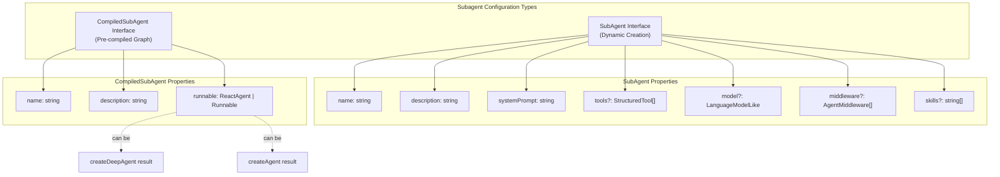
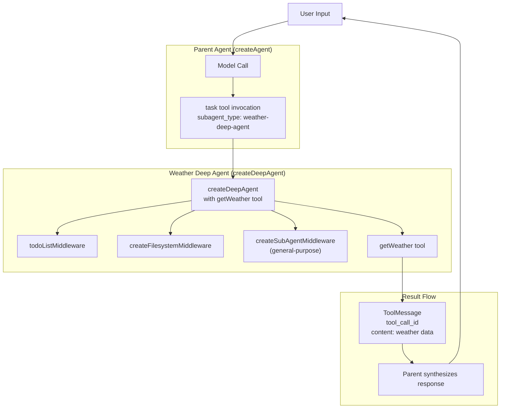
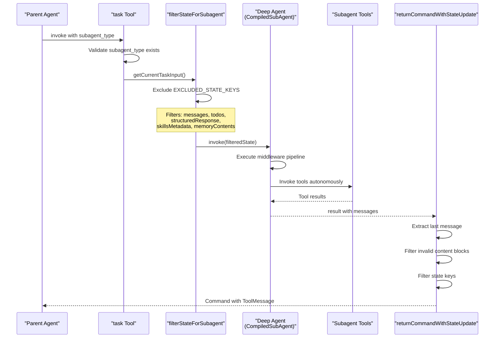
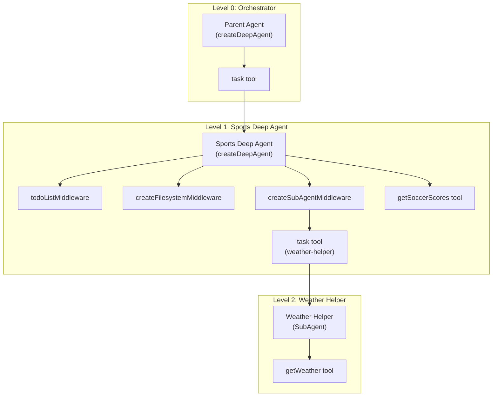
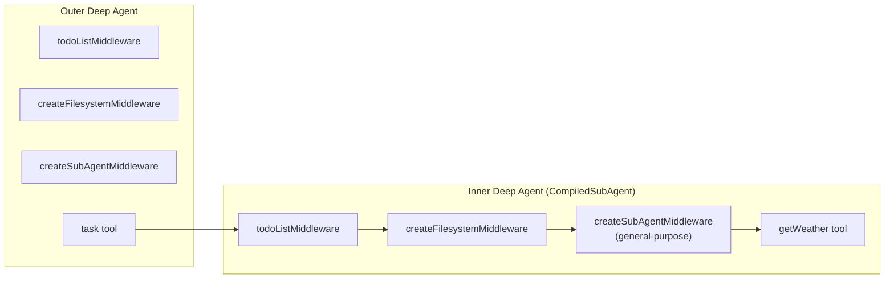
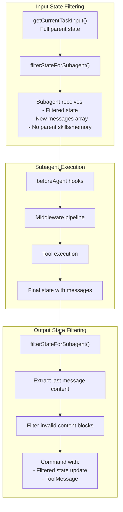
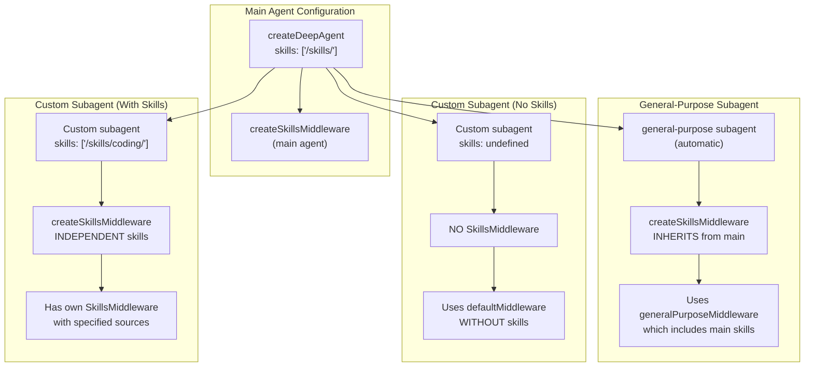

<!-- source: DeepWiki mcp.deepwiki.com · repo langchain-ai/deepagentsjs · page 9.1 Hierarchical Agent Architectures · fetched 2026-10-26 -->

# Hierarchical Agent Architectures

<details>
<summary>Relevant source files</summary>

The following files were used as context for generating this wiki page:

- [libs/deepagents/src/agent.ts](libs/deepagents/src/agent.ts)
- [libs/deepagents/src/index.ts](libs/deepagents/src/index.ts)
- [libs/deepagents/src/middleware/async_subagents.ts](libs/deepagents/src/middleware/async_subagents.ts)
- [libs/deepagents/src/middleware/index.ts](libs/deepagents/src/middleware/index.ts)
- [libs/deepagents/src/middleware/subagent.test.ts](libs/deepagents/src/middleware/subagent.test.ts)
- [libs/deepagents/src/middleware/subagents.int.test.ts](libs/deepagents/src/middleware/subagents.int.test.ts)
- [libs/deepagents/src/middleware/subagents.ts](libs/deepagents/src/middleware/subagents.ts)
- [libs/deepagents/src/types.ts](libs/deepagents/src/types.ts)

</details>


## Purpose and Scope

This document describes patterns for creating multi-level agent hierarchies in DeepAgents, where agents created with `createDeepAgent` serve as subagents within other agents. This enables complex delegation patterns where specialized agents can themselves delegate to further specialized subagents.

For basic subagent configuration using the `SubAgent` interface, see [Subagent Middleware](5.3). For general information about the `createDeepAgent` API, see [createDeepAgent API](4). For details on how skills are managed within subagents, see [Skills Middleware](5.2).

**Sources:** [libs/deepagents/src/middleware/subagents.ts:1-231](), [libs/deepagents/src/agent.ts:72-101]()

## Core Concepts

### CompiledSubAgent Interface

The `CompiledSubAgent` interface allows pre-compiled agent graphs (created with `createDeepAgent` or `createAgent`) to be used as subagents. Unlike the `SubAgent` interface which defines specifications for dynamically creating agents, `CompiledSubAgent` wraps an already-instantiated agent.

Title: Subagent Configuration Types


**Key Differences:**

| Property | SubAgent | CompiledSubAgent |
|----------|----------|------------------|
| Agent Creation | Dynamically created by `SubAgentMiddleware` | Pre-compiled, passed as `runnable` |
| Configuration | Full configuration (prompt, tools, model, middleware) | Only name, description, and runnable |
| Use Case | Simple, single-level delegation | Hierarchical architectures, reusable agent components |
| Type | `SubAgent` | `CompiledSubAgent<TRunnable>` |

**Sources:** [libs/deepagents/src/middleware/subagents.ts:214-231](), [libs/deepagents/src/types.ts:25-29]()

### Type Definition Mapping

```typescript
// From subagents.ts
interface SubAgent {
  name: string;
  description: string;
  systemPrompt: string;
  tools?: StructuredTool[];
  model?: LanguageModelLike | string;
  middleware?: readonly AgentMiddleware[];
  interruptOn?: Record<string, boolean | InterruptOnConfig>;
  skills?: string[];
}

interface CompiledSubAgent<TRunnable extends ReactAgent<any> | Runnable> {
  name: string;
  description: string;
  runnable: TRunnable;
}
```

**Sources:** [libs/deepagents/src/middleware/subagents.ts:262-305](), [libs/deepagents/src/middleware/subagents.ts:214-231]()

## Basic Hierarchical Pattern

### Single-Level Agent-as-Subagent

The simplest hierarchical pattern involves creating a `createDeepAgent` instance and using it as a `CompiledSubAgent` within a parent agent.

Title: Deep Agent Subagent Invocation


**Implementation Example:**

```typescript
// Step 1: Create the specialized deep agent
const weatherDeepAgent = createDeepAgent({
  model: "claude-sonnet-4-5-20250929",
  systemPrompt: "You are a weather specialist. Use get_weather for all queries.",
  tools: [getWeather],
});

// Step 2: Use it as a CompiledSubAgent in parent
const parentAgent = createDeepAgent({
  model: "claude-sonnet-4-5-20250929",
  systemPrompt: "Delegate weather queries to the weather-deep-agent.",
  subagents: [
    {
      name: "weather-deep-agent",
      description: "Specialized deep agent for weather information.",
      runnable: weatherDeepAgent,
    } as CompiledSubAgent,
  ],
});
```

**Sources:** [libs/deepagents/src/agent.ts:143-179](), [libs/deepagents/src/middleware/subagents.ts:214-231]()

### Invocation Flow Through Hierarchy

When a parent agent invokes a `CompiledSubAgent`, the following sequence occurs:

Title: Subagent Invocation Sequence


**Key Steps:**

1. **State Filtering (Input):** The `filterStateForSubagent` function removes keys from `EXCLUDED_STATE_KEYS` before passing state to the subagent [libs/deepagents/src/middleware/subagents.ts:45-51]().
2. **Autonomous Execution:** The subagent runs its complete middleware pipeline and tools independently [libs/deepagents/src/middleware/subagents.ts:566-571]().
3. **Content Block Filtering:** Invalid content blocks (`tool_use`, `thinking`, `redacted_thinking`) are removed from the final message [libs/deepagents/src/middleware/subagents.ts:385-395]().
4. **State Filtering (Output):** The same excluded keys are filtered from the return state update [libs/deepagents/src/middleware/subagents.ts:381-381]().
5. **ToolMessage Construction:** The final message content is wrapped in a `ToolMessage` with the original `tool_call_id` [libs/deepagents/src/middleware/subagents.ts:402-404]().

**Sources:** [libs/deepagents/src/middleware/subagents.ts:45-51](), [libs/deepagents/src/middleware/subagents.ts:539-591]()

## Multi-Level Hierarchies

### Three-Level Agent Architecture

DeepAgents supports arbitrarily deep hierarchies where agents at any level can have their own subagents.

Title: Multi-Level Agent Hierarchy


**Sources:** [libs/deepagents/src/middleware/subagents.int.test.ts:163-191]()

### Nested Deep Agents

A `createDeepAgent` can use another `createDeepAgent` as a `CompiledSubAgent`, creating fully composable agent hierarchies.

Title: Nested Deep Agents


**Sources:** [libs/deepagents/src/middleware/subagents.int.test.ts:194-228]()

## State Flow Through Hierarchies

### EXCLUDED_STATE_KEYS Mechanism

The `EXCLUDED_STATE_KEYS` constant defines which state fields are filtered when passing state to subagents and returning updates from subagents.

```typescript
// From subagents.ts:45-51
const EXCLUDED_STATE_KEYS = [
  "messages",
  "todos",
  "structuredResponse",
  "skillsMetadata",
  "memoryContents",
] as const;
```

**Filtering Logic:**

| State Key | Direction | Reason for Exclusion |
|-----------|-----------|---------------------|
| `messages` | Input/Output | Subagent gets new messages array with task description; returns single final message [libs/deepagents/src/middleware/subagents.ts:46-46](). |
| `todos` | Output | No defined reducer; no clear semantics for returning from subagent [libs/deepagents/src/middleware/subagents.ts:47-47](). |
| `structuredResponse` | Output | No defined reducer; no clear semantics for returning from subagent [libs/deepagents/src/middleware/subagents.ts:48-48](). |
| `skillsMetadata` | Input/Output | Prevents parent skills from leaking to child; each agent loads own skills independently [libs/deepagents/src/middleware/subagents.ts:49-49](). |
| `memoryContents` | Input/Output | Prevents parent memory from leaking to child; each agent loads own memory independently [libs/deepagents/src/middleware/subagents.ts:50-50](). |

**Sources:** [libs/deepagents/src/middleware/subagents.ts:34-51]()

### State Filtering Implementation

Title: State Filtering Logic


**Sources:** [libs/deepagents/src/middleware/subagents.ts:356-411](), [libs/deepagents/src/middleware/subagents.ts:539-591]()

### Invalid Content Block Filtering

When using Anthropic models, `AIMessage.content` can contain block types that are invalid as `ToolMessage` content. These are filtered before constructing the return message [libs/deepagents/src/middleware/subagents.ts:369-378]().

**Invalid Block Types:**

```typescript
// From subagents.ts:371-375
const INVALID_TOOL_MESSAGE_BLOCK_TYPES = [
  "tool_use",           // Tool invocation blocks (issue #239)
  "thinking",           // Extended thinking blocks (issue #245)
  "redacted_thinking",  // Redacted thinking blocks (issue #245)
];
```

**Sources:** [libs/deepagents/src/middleware/subagents.ts:369-378]()

## Skills Inheritance in Hierarchies

### Skills Configuration Rules

Skills inheritance in hierarchical architectures follows specific rules based on subagent type:

Title: Skills Inheritance Patterns


**Inheritance Table:**

| Subagent Type | Skills Configuration | Behavior |
|---------------|---------------------|----------|
| General-purpose | Automatic | Inherits all skills from main agent via `generalPurposeMiddleware` [libs/deepagents/src/agent.ts:212-215](). |
| Custom without `skills` | None | No `SkillsMiddleware`; receives `defaultMiddleware` without skills [libs/deepagents/src/agent.ts:225-227](). |
| Custom with `skills` | `skills: ["/path/"]` | Independent `createSkillsMiddleware` with specified sources [libs/deepagents/src/agent.ts:233-241](). |
| CompiledSubAgent | Defined at creation | Skills are part of the pre-compiled agent; not affected by parent [libs/deepagents/src/agent.ts:220-222](). |

**Sources:** [libs/deepagents/src/agent.ts:211-245](), [libs/deepagents/src/middleware/subagent.test.ts:54-210]()

## Implementation Reference

### Creating Hierarchical Agents

**Function:** `createSubAgentMiddleware`

```typescript
// From subagents.ts:623-662
export function createSubAgentMiddleware(options: SubAgentMiddlewareOptions) {
  const {
    defaultModel,
    defaultTools = [],
    defaultMiddleware = null,
    generalPurposeMiddleware = null,
    defaultInterruptOn = null,
    subagents = [],
    systemPrompt = TASK_SYSTEM_PROMPT,
    generalPurposeAgent = true,
    taskDescription = null,
  } = options;

  const taskTool = createTaskTool({
    defaultModel,
    defaultTools,
    defaultMiddleware,
    generalPurposeMiddleware,
    defaultInterruptOn,
    subagents,
    generalPurposeAgent,
    taskDescription,
  });

  return createMiddleware({
    name: "subAgentMiddleware",
    tools: [taskTool],
    // ...
  });
}
```

**Sources:** [libs/deepagents/src/middleware/subagents.ts:623-662]()

### Agent Name Metadata Propagation

When a subagent is created with a name, that name is propagated to tools via `config.metadata.lc_agent_name`. This enables tools to identify which agent invoked them, which is critical for logging and observability in hierarchical architectures.

**Verification Test Example:**

In integration tests, the `lc_agent_name` is verified to match the subagent's configured name when a tool is called from within the subagent's graph [libs/deepagents/src/middleware/subagents.int.test.ts:78-83]().

**Sources:** [libs/deepagents/src/middleware/subagents.int.test.ts:78-83]()

---

