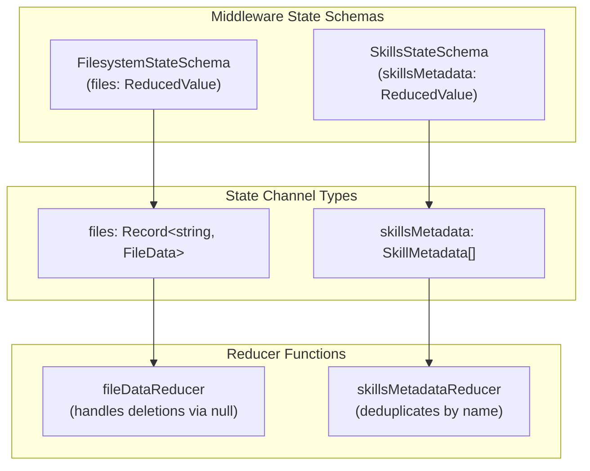
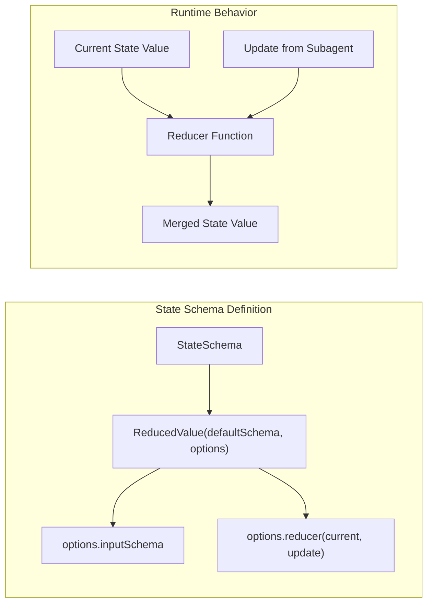
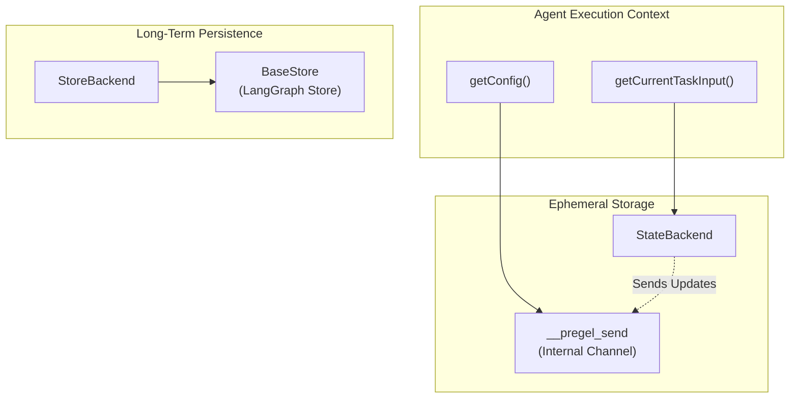

<!-- source: DeepWiki mcp.deepwiki.com · repo langchain-ai/deepagentsjs · page 9.2 State Management and Persistence · fetched 2026-10-26 -->

# State Management and Persistence

Relevant source files

The following files were used as context for generating this wiki page:

- [.changeset/chilled-beers-lay.md](.changeset/chilled-beers-lay.md)
- [libs/deepagents/src/backends/index.ts](libs/deepagents/src/backends/index.ts)
- [libs/deepagents/src/backends/protocol.ts](libs/deepagents/src/backends/protocol.ts)
- [libs/deepagents/src/backends/state.test.ts](libs/deepagents/src/backends/state.test.ts)
- [libs/deepagents/src/backends/state.ts](libs/deepagents/src/backends/state.ts)
- [libs/deepagents/src/backends/store.test.ts](libs/deepagents/src/backends/store.test.ts)
- [libs/deepagents/src/backends/store.ts](libs/deepagents/src/backends/store.ts)
- [libs/deepagents/src/values.ts](libs/deepagents/src/values.ts)

This page covers how DeepAgentsJS manages agent state, handles concurrent updates from parallel subagents, and persists state across invocations. For information about the backend abstraction layer that provides storage implementations, see [Backend System (3.2)](). For details on how specific middleware manage their state, see [Middleware Reference (5)]().

## Overview

DeepAgentsJS builds on LangGraph's state management system, using `StateSchema` and `ReducedValue` to enable:

- **Concurrent updates** from parallel subagents via custom reducers [libs/deepagents/src/values.ts:34-40]().
- **Type-safe state access** through middleware composition [libs/deepagents/src/values.ts:8-10]().
- **Checkpointing** for state restoration across invocations [libs/deepagents/src/backends/state.ts:41-43]().
- **Long-term persistence** via the LangGraph `BaseStore` [libs/deepagents/src/backends/store.ts:170-174]().
- **Ephemeral state** for within-invocation data [libs/deepagents/src/backends/state.ts:39-44]().

The framework distinguishes between ephemeral state (managed by `StateBackend`) and persistent state (managed by `StoreBackend` and checkpointers).

## State Schema Architecture

State in DeepAgentsJS is defined using LangGraph's `StateSchema` class, with middleware contributing their own state fields through composition.

### Core State Schema Pattern

**Sources:** [libs/deepagents/src/values.ts:34-40](), [libs/deepagents/src/backends/protocol.ts:121-121]()

### ReducedValue for Concurrent Updates

The `ReducedValue` class enables parallel subagents to make concurrent updates that are properly merged rather than overwriting each other.

**Sources:** [libs/deepagents/src/values.ts:34-40]()

The `filesValue` pre-configured `ReducedValue` [libs/deepagents/src/values.ts:34-40]() uses:
- **Default schema**: `z.record(z.string(), FileDataSchema).default(() => ({}))` [libs/deepagents/src/values.ts:35]()
- **Input schema**: `z.record(z.string(), FileDataSchema.nullable()).optional()` [libs/deepagents/src/values.ts:37]()
- **Reducer function**: `fileDataReducer` [libs/deepagents/src/values.ts:38]()

## State Reducers and Concurrent Updates

### File Data Reducer

The `fileDataReducer` handles concurrent file operations from parallel subagents, supporting both updates and deletions. It treats `null` values in an update as a request to delete the file from the state record.

| Current State | Update Value | Result |
|---------------|--------------|--------|
| `undefined` | `undefined` | `{}` (empty record) |
| `{...}` | `undefined` | Current state unchanged |
| `undefined` | `{'/file': FileData}` | `{'/file': FileData}` |
| `{'/a': FileData}` | `{'/b': FileData}` | `{'/a': FileData, '/b': FileData}` (merged) |
| `{'/a': FileData}` | `{'/a': null}` | `{}` (file deleted) |

**Sources:** [libs/deepagents/src/values.ts:34-40](), [libs/deepagents/src/backends/state.test.ts:44-86]()

## Persistence Mechanisms

DeepAgentsJS supports multiple persistence layers for different use cases.

### Persistence Architecture

**Sources:** [libs/deepagents/src/backends/state.ts:95-103](), [libs/deepagents/src/backends/store.ts:227-245]()

### State Backend (Ephemeral)

`StateBackend` provides in-memory storage that exists only for the duration of an agent invocation thread [libs/deepagents/src/backends/state.ts:39-44]().

- **Storage location**: Agent state, accessed via `getCurrentTaskInput` [libs/deepagents/src/backends/state.ts:101-102]().
- **Lifetime**: Persists within a conversation thread via LangGraph checkpointing [libs/deepagents/src/backends/state.ts:41-43]().
- **Updates**: In modern "zero-arg" mode, updates are sent via the internal `__pregel_send` channel found in the runnable config [libs/deepagents/src/backends/state.ts:115-126]().

**Implementation:** Operations like `write` and `edit` generate a `filesUpdate` object [libs/deepagents/src/backends/state.test.ts:48-51](). In legacy mode, this is returned to the caller; in zero-arg mode, the backend sends it directly to the state channel [libs/deepagents/src/backends/state.ts:115-126]().

### Store Backend (Long-Term Persistence)

`StoreBackend` provides persistent storage via LangGraph's `BaseStore` API, allowing data to persist across different conversation threads [libs/deepagents/src/backends/store.ts:170-174]().

- **Storage location**: External persistent store (e.g., SQLite, Postgres via LangGraph) [libs/deepagents/src/backends/store.ts:2-3]().
- **Lifetime**: Persistent across all threads and restarts [libs/deepagents/src/backends/store.ts:172-173]().
- **Namespaces**: Data is isolated using hierarchical namespaces [libs/deepagents/src/backends/store.ts:173]().

**Namespace Validation:** `StoreBackend` enforces strict character sets for namespace components (alphanumeric, `-`, `_`, `.`, `@`, `+`, `:`, `~`) to prevent injection or glob collisions [libs/deepagents/src/backends/store.ts:69-91](). It supports dynamic namespace resolution via a `StoreBackendNamespaceFactory` [libs/deepagents/src/backends/store.ts:121-123]().

## File Data Formats

The system supports two versions of file data for backward compatibility:

- **FileDataV1**: Legacy format where content is stored as an array of lines (`string[]`) [libs/deepagents/src/backends/protocol.ts:85-92]().
- **FileDataV2**: Current format supporting both text (`string`) and binary (`Uint8Array`) content, along with explicit `mimeType` [libs/deepagents/src/backends/protocol.ts:103-112]().

Backends automatically migrate V1 data to V2 during read operations [libs/deepagents/src/backends/state.ts:207]().

## Concurrent Updates and Checkpointing

When an agent executes tool calls in parallel (e.g., multiple subagents writing to different files), LangGraph checkpoints the state after each step.

1. **Tool Execution**: Each subagent calls a backend method (e.g., `write`).
2. **State Emission**: The `StateBackend` emits a partial state update for the `files` channel [libs/deepagents/src/backends/state.ts:121-125]().
3. **Reduction**: LangGraph's engine collects all emitted updates for the `files` channel and passes them to the `fileDataReducer` [libs/deepagents/src/values.ts:38]().
4. **Checkpointing**: The merged result is saved to the checkpointer, ensuring that if the process crashes, the agent can resume with the combined file state [libs/deepagents/src/backends/state.ts:41-43]().

**Sources:** [libs/deepagents/src/backends/state.ts:39-48](), [libs/deepagents/src/values.ts:34-40](), [libs/deepagents/src/backends/protocol.ts:173-180]()

---

