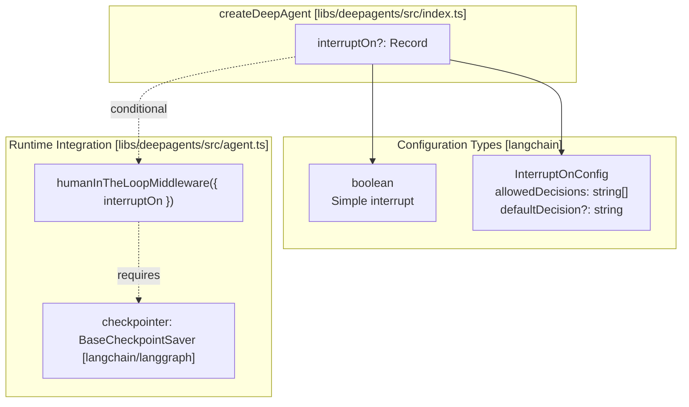
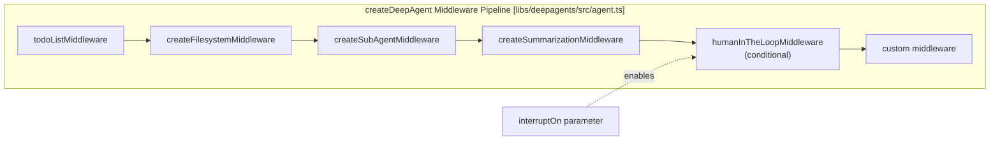
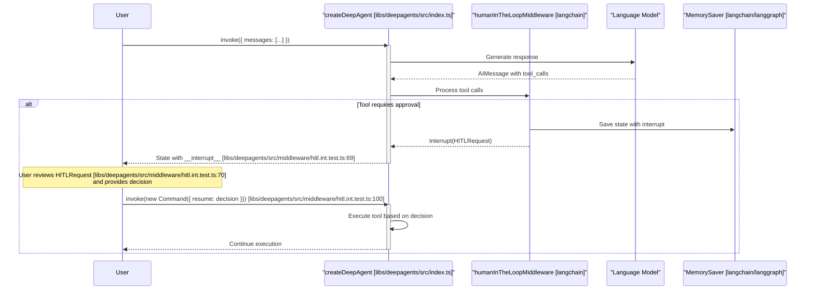
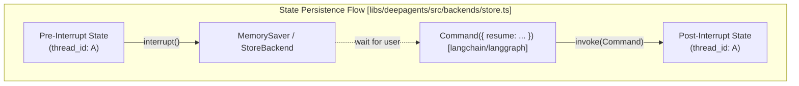

<!-- source: DeepWiki mcp.deepwiki.com · repo langchain-ai/deepagentsjs · page 9.3 Human-in-the-Loop Workflows · fetched 2026-10-26 -->

# Human-in-the-Loop Workflows

<details>
<summary>Relevant source files</summary>

The following files were used as context for generating this wiki page:

- [evals/hitl/eval.test.ts](evals/hitl/eval.test.ts)
- [evals/hitl/index.ts](evals/hitl/index.ts)
- [libs/deepagents/src/middleware/fs.int.test.ts](libs/deepagents/src/middleware/fs.int.test.ts)
- [libs/deepagents/src/middleware/hitl.int.test.ts](libs/deepagents/src/middleware/hitl.int.test.ts)
- [libs/deepagents/src/middleware/subagents-hitl.int.test.ts](libs/deepagents/src/middleware/subagents-hitl.int.test.ts)

</details>


This page explains how to configure human approval workflows in DeepAgentsJS, allowing agents to pause execution and request human intervention before executing sensitive tools. Human-in-the-loop (HITL) functionality is built on LangGraph's interrupt capabilities and integrated through the `humanInTheLoopMiddleware`.

For information about the overall middleware architecture, see [Middleware Architecture](3.1). For details on state persistence across interrupts, see [State Management and Persistence](9.2).

---

## Overview

Human-in-the-loop workflows enable agents to pause before executing specified tools and wait for human approval, modification, or rejection of tool calls. This is critical for agents that may perform sensitive operations such as writing files, executing shell commands, or making external API calls.

DeepAgents implements HITL through three key components:

| Component | Purpose | Configuration |
|-----------|---------|---------------|
| `interruptOn` parameter | Maps tool names to interrupt configurations | Passed to `createDeepAgent()` [libs/deepagents/src/agent.ts:101-101]() |
| `humanInTheLoopMiddleware` | Intercepts tool calls and triggers interrupts | Automatically added when `interruptOn` is provided [libs/deepagents/src/agent.ts:299-299]() |
| Checkpointer | Persists agent state during interrupts | Required for HITL functionality [libs/deepagents/src/middleware/hitl.int.test.ts:31-36]() |

**Sources:** [libs/deepagents/src/agent.ts:101-101](), [libs/deepagents/src/agent.ts:296-302](), [libs/deepagents/src/middleware/hitl.int.test.ts:26-36]()

---

## Configuration Interface

The `interruptOn` parameter accepts a mapping of tool names to interrupt configurations. Each tool can be configured with a boolean (simple interrupt) or an `InterruptOnConfig` object (advanced configuration).



**Configuration Options:**

- **Boolean value**: `{ tool_name: true }` - Enables interrupts with default decision options (`approve`, `edit`, `reject`) [libs/deepagents/src/middleware/hitl.int.test.ts:20-21]().
- **InterruptOnConfig object**: 
  - `allowedDecisions`: Array of allowed decision types (e.g., `["approve", "reject"]`) [libs/deepagents/src/middleware/hitl.int.test.ts:23-23]().
  - `defaultDecision`: Optional default decision when none is provided.

**Sources:** [libs/deepagents/src/agent.ts:101-101](), [libs/deepagents/src/middleware/hitl.int.test.ts:20-24]()

---

## Basic Configuration

The simplest way to enable HITL is through the `interruptOn` parameter in `createDeepAgent`:

```typescript
import { createDeepAgent } from "deepagents";
import { MemorySaver } from "@langchain/langgraph";

const agent = createDeepAgent({
  tools: [sampleTool],
  interruptOn: {
    sample_tool: true, // Simple boolean trigger
    get_soccer_scores: { allowedDecisions: ["approve", "reject"] }, // Granular config
  },
  checkpointer: new MemorySaver(), // Required for HITL
});
```

The configuration above specifies that `sample_tool` requires approval before execution, while `get_soccer_scores` limits the human to only approving or rejecting without editing.

**Sources:** [libs/deepagents/src/middleware/hitl.int.test.ts:20-36]()

---

## Middleware Integration

When `interruptOn` is configured, `createDeepAgent` automatically includes the `humanInTheLoopMiddleware` in the middleware pipeline. This middleware is positioned after core system middlewares but before custom ones.



The conditional middleware addition is handled within the `createDeepAgent` factory function [libs/deepagents/src/agent.ts:296-302]():

```typescript
const runtimeMiddleware: AgentMiddleware[] = [
  ...builtInMiddleware,
  ...skillsMiddlewareArray,
  ...memoryMiddlewareArray,
  ...(interruptOn ? [humanInTheLoopMiddleware({ interruptOn })] : []),
  ...(customMiddleware as unknown as AgentMiddleware[]),
];
```

**Sources:** [libs/deepagents/src/agent.ts:296-302]()

---

## Execution Flow

When an agent encounters a tool configured for HITL, execution follows the LangGraph interrupt pattern. The agent returns a state containing a `__interrupt__` field [libs/deepagents/src/middleware/hitl.int.test.ts:66-67]().



**Key Points:**

1. The agent pauses execution after the model generates tool calls but before tool execution [libs/deepagents/src/middleware/hitl.int.test.ts:55-67]().
2. State is persisted to the checkpointer with an interrupt marker.
3. Control returns to the user with the pending tool call and `reviewConfigs` [libs/deepagents/src/middleware/hitl.int.test.ts:79-88]().
4. User provides a decision via a `Command` object [libs/deepagents/src/middleware/hitl.int.test.ts:100-104]().
5. Agent resumes from the checkpoint with the human decision applied.

**Sources:** [libs/deepagents/src/middleware/hitl.int.test.ts:41-118](), [libs/deepagents/src/middleware/subagents-hitl.int.test.ts:194-199]()

---

## Decision Types

The `allowedDecisions` array in `InterruptOnConfig` specifies which actions a human can take:

| Decision | Behavior | Use Case |
|----------|----------|----------|
| `approve` | Execute the tool call exactly as proposed by the agent | Tool call is correct and safe [libs/deepagents/src/middleware/hitl.int.test.ts:102-102]() |
| `edit` | Modify the tool call arguments before execution | Tool call needs parameter adjustments [libs/deepagents/src/middleware/hitl.int.test.ts:85-85]() |
| `reject` | Skip execution of the tool call entirely | Tool call should not be executed [libs/deepagents/src/middleware/hitl.int.test.ts:86-86]() |

**Sources:** [libs/deepagents/src/middleware/hitl.int.test.ts:20-24](), [libs/deepagents/src/middleware/hitl.int.test.ts:78-96]()

---

## Subagent HITL and the `interrupt()` Primitive

HITL workflows in DeepAgents extend to subagents in two ways:

### 1. Declarative Configuration
Subagents can be configured with their own `interruptOn` settings, which may differ from the parent agent [libs/deepagents/src/middleware/hitl.int.test.ts:192-200]().

```typescript
const agent = createDeepAgent({
  subagents: [{
    name: "custom_weather_agent",
    tools: [getWeather],
    interruptOn: { get_weather: true }, // Subagent specific HITL
  }],
  checkpointer: new MemorySaver(),
});
```

### 2. Manual `interrupt()` in Tools
Tools used by subagents (or main agents) can call the `interrupt()` primitive directly to request specific data or custom approvals [libs/deepagents/src/middleware/subagents-hitl.int.test.ts:16-16]().

```typescript
import { interrupt } from "@langchain/langgraph";

const requestApproval = tool(async (input) => {
  // interrupt() pauses execution and returns the value passed to Command(resume=...)
  const approval = interrupt({
    type: "approval_request",
    action: input.action_description,
  }) as { approved?: boolean };

  return approval?.approved ? "Approved" : "Rejected";
}, { name: "request_approval" });
```

When a tool calls `interrupt()`, the entire agent graph (including the parent) pauses and bubbles the interrupt value up to the top-level `invoke` result [libs/deepagents/src/middleware/subagents-hitl.int.test.ts:182-192]().

**Sources:** [libs/deepagents/src/middleware/hitl.int.test.ts:184-202](), [libs/deepagents/src/middleware/subagents-hitl.int.test.ts:38-52](), [libs/deepagents/src/middleware/subagents-hitl.int.test.ts:182-192]()

---

## Thread Isolation and Resuming

HITL workflows require a `thread_id` to maintain state across the interrupt boundary. Execution is resumed using the `Command` object with a `resume` payload [libs/deepagents/src/middleware/subagents-hitl.int.test.ts:194-199]().



**Resuming Example:**
```typescript
const config = { configurable: { thread_id: "my-thread" } };

// 1. Initial call triggers interrupt
const result = await agent.invoke({ messages: [...] }, config);

// 2. Resume with decision
const finalResult = await agent.invoke(
  new Command({ resume: { approved: true } }), 
  config
);
```

**Sources:** [libs/deepagents/src/middleware/hitl.int.test.ts:38-53](), [libs/deepagents/src/middleware/hitl.int.test.ts:99-105](), [libs/deepagents/src/middleware/subagents-hitl.int.test.ts:194-199]()

---

## Built-in Tool HITL Targets

DeepAgents provides several built-in tools through middleware that are common targets for HITL:

| Middleware | Tools | Typical Configuration |
|------------|-------|-----------------------|
| `FilesystemMiddleware` | `ls`, `read_file`, `write_file`, `edit_file`, `execute` | High sensitivity; usually `true` or full `InterruptOnConfig` [libs/deepagents/src/middleware/fs.int.test.ts:96-100]() |
| `SubAgentMiddleware` | `task` | Medium sensitivity; triggers subagent lifecycle [libs/deepagents/src/middleware/subagents.ts:61-61]() |
| `SummarizationMiddleware` | (Internal) | Typically does not require HITL as it manages context automatically [libs/deepagents/src/middleware/summarization.ts:15-20]() |

**Sources:** [libs/deepagents/src/middleware/fs.int.test.ts:96-100](), [libs/deepagents/src/middleware/subagents.ts:61-61](), [libs/deepagents/src/middleware/summarization.ts:15-20]()

---

