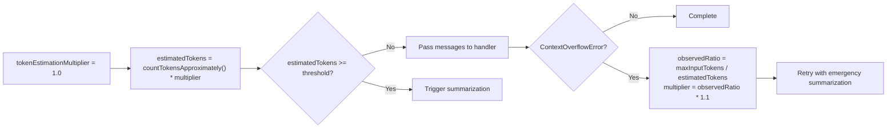

<!-- source: DeepWiki mcp.deepwiki.com · repo langchain-ai/deepagentsjs · page 9.4 Context Window Management · fetched 2026-10-26 -->

# Context Window Management

<details>
<summary>Relevant source files</summary>

The following files were used as context for generating this wiki page:

- [.changeset/mean-rats-shake.md](.changeset/mean-rats-shake.md)
- [libs/deepagents/src/middleware/fs.eviction.test.ts](libs/deepagents/src/middleware/fs.eviction.test.ts)
- [libs/deepagents/src/middleware/fs.test.ts](libs/deepagents/src/middleware/fs.test.ts)
- [libs/deepagents/src/middleware/fs.ts](libs/deepagents/src/middleware/fs.ts)
- [libs/deepagents/src/middleware/summarization.test.ts](libs/deepagents/src/middleware/summarization.test.ts)
- [libs/deepagents/src/middleware/summarization.ts](libs/deepagents/src/middleware/summarization.ts)

</details>


## Purpose and Scope

This document covers strategies and techniques for managing large conversations that exceed language model context windows in DeepAgentsJS. It explains how the framework automatically prevents context overflow through summarization, token estimation, and emergency compaction strategies.

For API reference and configuration options for the summarization middleware, see [Summarization Middleware](5.4). For state management concepts, see [State Management and Persistence](9.2).

## Overview

Language models have finite context windows that limit the total tokens they can process in a single request. As agent conversations grow, they will eventually exceed these limits, causing `ContextOverflowError` exceptions. DeepAgentsJS manages this automatically through the `SummarizationMiddleware` [libs/deepagents/src/middleware/summarization.ts:1-41]().

The middleware operates in three primary modes:

1.  **Proactive Summarization**: Triggered when conversation length exceeds configured thresholds (tokens, messages, or fraction of window) [libs/deepagents/src/middleware/summarization.ts:1210-1215]().
2.  **Reactive Summarization**: Triggered by catching a `ContextOverflowError` from the model, followed by a re-estimation calibration [libs/deepagents/src/middleware/summarization.ts:1233-1250]().
3.  **Emergency Compaction**: Truncates tool results when all messages would otherwise be summarized to fit the window, preserving recent tool call context [libs/deepagents/src/middleware/summarization.ts:690-744]().

### Key Components

| Component | Purpose | Location |
| :--- | :--- | :--- |
| `createSummarizationMiddleware` | Factory function for summarization middleware | [libs/deepagents/src/middleware/summarization.ts:286-361]() |
| `SummarizationEvent` | Tracks cutoff indices across multiple summarizations to reconstruct message history | [libs/deepagents/src/middleware/summarization.ts:236-251]() |
| `ContextSize` | Interface specifying trigger/keep policies (messages/tokens/fraction) | [libs/deepagents/src/middleware/summarization.ts:83-88]() |
| `findSafeCutoffPoint` | Ensures AI/Tool message pairs aren't split during eviction | [libs/deepagents/src/middleware/summarization.ts:481-545]() |
| `compactToolResults` | Truncates tool results to fit context window as a last resort | [libs/deepagents/src/middleware/summarization.ts:690-744]() |

Sources: [libs/deepagents/src/middleware/summarization.ts:1-1263]()

## Summarization Decision Flow

The `wrapModelCall` function manages the lifecycle of a model request, checking for triggers before execution and handling overflows after execution.

```mermaid
flowchart TD
    Start["wrapModelCall invoked"] --> GetEffective["getEffectiveMessages()<br/>Apply previous summarization event"]
    GetEffective --> TruncArgs["truncateArgs()<br/>Truncate old tool arguments"]
    TruncArgs --> CountTokens["countTotalTokens()<br/>Include system + tools"]
    CountTokens --> CheckTrigger{"shouldSummarize()?<br/>Compare against triggers"}
    
    CheckTrigger -->|"No"| TryHandler["Call handler with messages"]
    TryHandler --> CheckOverflow{"ContextOverflowError?"}
    CheckOverflow -->|"No"| Success["Return AIMessage"]
    CheckOverflow -->|"Yes"| Calibrate["Calibrate tokenEstimationMultiplier<br/>multiplier = maxTokens / estimatedTokens * 1.1"]
    
    CheckTrigger -->|"Yes"| PerformSumm["performSummarization()"]
    Calibrate --> PerformSumm
    
    PerformSumm --> DetCutoff["determineCutoffIndex()<br/>Based on keep policy"]
    DetCutoff --> SafeCutoff["findSafeCutoffPoint()<br/>Don't split AI/Tool pairs"]
    SafeCutoff --> CheckEmpty{"All messages<br/>would be summarized?"}
    
    CheckEmpty -->|"No"| DoSumm["summarizeMessages()<br/>Offload + generate summary"]
    CheckEmpty -->|"Yes"| TryCompact["compactToolResults()<br/>Truncate ToolMessage content"]
    
    TryCompact --> TryCompactHandler["Call handler with compacted messages"]
    TryCompactHandler --> CompactOverflow{"ContextOverflowError?"}
    CompactOverflow -->|"No"| Success
    CompactOverflow -->|"Yes"| DoSumm
    
    DoSumm --> RetryHandler["Call handler with summary + preserved"]
    RetryHandler --> RetryOverflow{"ContextOverflowError?"}
    RetryOverflow -->|"No"| UpdateState["Return Command with<br/>_summarizationEvent"]
    RetryOverflow -->|"Yes"| ReSummarize["Re-summarize ALL messages<br/>(summary only, no preserved)"]
    ReSummarize --> FinalRetry["Call handler with summary only"]
    FinalRetry --> UpdateState
    UpdateState --> End["Complete"]
```



### Decision Points

*   **Trigger Check**: Compares message count or token count against thresholds. If `trigger` is an array, any threshold exceeding its limit triggers summarization [libs/deepagents/src/middleware/summarization.ts:436-465]().
*   **Overflow Detection**: Catches `ContextOverflowError` from the underlying model provider and initiates immediate summarization [libs/deepagents/src/middleware/summarization.ts:1233-1235]().
*   **Empty Preservation**: When the `keep` policy would preserve zero messages, the system attempts `compactToolResults` first to avoid losing current tool call context before falling back to full summarization [libs/deepagents/src/middleware/summarization.ts:1082-1090]().
*   **Retry Logic**: If a summarized prompt still causes an overflow (e.g., due to massive tool definitions), the middleware re-summarizes everything including previously preserved messages [libs/deepagents/src/middleware/summarization.ts:1145-1155]().

Sources: [libs/deepagents/src/middleware/summarization.ts:1058-1260](), [libs/deepagents/src/middleware/summarization.test.ts:37-79]()

## Trigger Strategies

Triggers determine when summarization is activated. The middleware supports three trigger types specified via the `ContextSize` interface [libs/deepagents/src/middleware/summarization.ts:83-88]().

### Trigger Types

| Type | Description | Example | Use Case |
| :--- | :--- | :--- | :--- |
| `messages` | Fixed message count | `{type: "messages", value: 20}` | Predictable behavior for small contexts |
| `tokens` | Fixed token count | `{type: "tokens", value: 100000}` | Models without standardized metadata |
| `fraction` | Percentage of model's max input tokens | `{type: "fraction", value: 0.85}` | Dynamic scaling with model context |

### Default Trigger Behavior

Defaults are computed by `computeSummarizationDefaults` based on whether the model profile contains `maxInputTokens` [libs/deepagents/src/middleware/summarization.ts:203-227]():

*   **Model with profile**: `trigger: { type: "fraction", value: 0.85 }` (85% of window) [libs/deepagents/src/middleware/summarization.ts:187-192]().
*   **Model without profile**: `trigger: { type: "tokens", value: 170000 }` (Fixed fallback) [libs/deepagents/src/middleware/summarization.ts:179-180]().

Sources: [libs/deepagents/src/middleware/summarization.ts:175-227](), [libs/deepagents/src/middleware/summarization.ts:436-465](), [libs/deepagents/src/middleware/summarization.test.ts:143-205]()

## Token Estimation and Calibration

DeepAgentsJS uses `countTokensApproximately` from LangChain [libs/deepagents/src/middleware/summarization.ts:46](). Since this is an approximation (roughly 4 characters per token), the middleware maintains a `tokenEstimationMultiplier` to adjust for model-specific overhead (like tool schemas or JSON formatting) [libs/deepagents/src/middleware/summarization.ts:352-356]().

### Calibration Mechanism



### Calibration Formula

When a `ContextOverflowError` occurs, the multiplier is updated to include a 10% safety margin [libs/deepagents/src/middleware/summarization.ts:1237-1246]():

```typescript
const observedRatio = maxInputTokens / estimatedTokens;
if (observedRatio > tokenEstimationMultiplier) {
  tokenEstimationMultiplier = observedRatio * 1.1;
}
```

Sources: [libs/deepagents/src/middleware/summarization.ts:352-356](), [libs/deepagents/src/middleware/summarization.ts:1233-1250](), [libs/deepagents/src/middleware/summarization.test.ts:944-1005]()

## Safe Message Boundaries

AI tool calls and their corresponding `ToolMessage` results must stay together. Splitting them (e.g., summarizing the tool call but keeping the result) causes models to hallucinate or error. The `findSafeCutoffPoint` function ensures these pairs remain in the same set (summarized or preserved) [libs/deepagents/src/middleware/summarization.ts:481-545]().

### Boundary Adjustment Algorithm

1.  **Identify Cutoff**: Start at the index determined by the `keep` policy.
2.  **Scan for Tool Messages**: If the message at the cutoff is a `ToolMessage`, find the full sequence of consecutive tool messages [libs/deepagents/src/middleware/summarization.ts:494-497]().
3.  **Locate Parent AI Message**: Search backward for the `AIMessage` containing the `tool_calls` matching these tool messages [libs/deepagents/src/middleware/summarization.ts:511-519]().
4.  **Decision**:
    *   If the parent `AIMessage` is close to the cutoff, move the cutoff back to include the parent (preserving the whole transaction) [libs/deepagents/src/middleware/summarization.ts:536-538]().
    *   If the parent is far back (more than half the message list), move the cutoff forward (summarizing the whole transaction) [libs/deepagents/src/middleware/summarization.ts:532-534]().

Sources: [libs/deepagents/src/middleware/summarization.ts:481-545](), [libs/deepagents/src/middleware/summarization.test.ts:724-849]()

## Filesystem Result Eviction

Independent of summarization, the `FilesystemMiddleware` manages context by evicting large tool outputs directly to the filesystem [libs/deepagents/src/middleware/fs.ts:1-7]().

### Large Output Management

If a tool result (or a `HumanMessage`) exceeds the `toolTokenLimitBeforeEvict` (defaulting to 100,000 tokens), it is saved as a file [libs/deepagents/src/middleware/fs.ts:241-255]().

*   **Eviction Message**: The original large content is replaced with a template `TOO_LARGE_TOOL_MSG` containing a path to the file and a preview [libs/deepagents/src/middleware/fs.ts:127-138]().
*   **Excluded Tools**: Tools like `ls`, `glob`, and `grep` are excluded from eviction because they have built-in truncation logic [libs/deepagents/src/middleware/fs.ts:87-94]().
*   **Character Approximation**: Uses `NUM_CHARS_PER_TOKEN = 4` to estimate size [libs/deepagents/src/middleware/fs.ts:101]().

Sources: [libs/deepagents/src/middleware/fs.ts:71-150](), [libs/deepagents/src/middleware/fs.ts:241-320](), [libs/deepagents/src/middleware/fs.eviction.test.ts:186-210]()

## Emergency Compaction Strategy

When the `keep` policy would preserve 0 messages (e.g., when tool definitions and the system prompt consume nearly the entire window), the system uses `compactToolResults` [libs/deepagents/src/middleware/summarization.ts:690-744]().

### Token Budget Allocation

Each `ToolMessage` receives an equal share of the remaining token budget after accounting for non-removable overhead [libs/deepagents/src/middleware/summarization.ts:717-721]():

```typescript
const overheadTokens = countTotalTokens(nonToolMessages, systemMessage, tools);
const budgetForTools = (maxInputTokens / multiplier) * 0.7 - overheadTokens; // 30% headroom
const perToolBudgetTokens = budgetForTools / numToolMessages;
```

Sources: [libs/deepagents/src/middleware/summarization.ts:690-744](), [libs/deepagents/src/middleware/summarization.test.ts:1007-1173]()

## Argument Truncation

For old messages that are not yet summarized but are far back in history, the middleware can truncate large tool arguments (specifically for `write_file` and `edit_file`) to save tokens [libs/deepagents/src/middleware/summarization.ts:746-813]().

*   **Scope**: Only targets the `content` parameter of file-writing tools [libs/deepagents/src/middleware/summarization.ts:792-805]().
*   **Threshold**: Defaults to 2000 characters [libs/deepagents/src/middleware/summarization.ts:108-111]().

Sources: [libs/deepagents/src/middleware/summarization.ts:91-117](), [libs/deepagents/src/middleware/summarization.ts:746-813](), [libs/deepagents/src/middleware/summarization.test.ts:464-514]()

---

