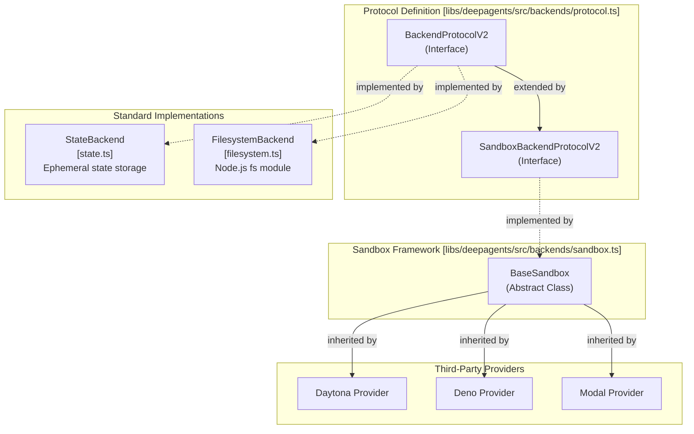
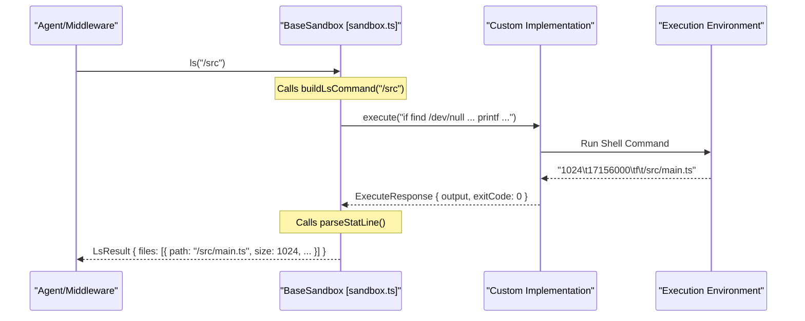

<!-- source: DeepWiki mcp.deepwiki.com · repo langchain-ai/deepagentsjs · page 9.5 Custom Backend Implementation · fetched 2026-10-26 -->

# Custom Backend Implementation

<details>
<summary>Relevant source files</summary>

The following files were used as context for generating this wiki page:

- [.changeset/fix-follow-symlinks.md](.changeset/fix-follow-symlinks.md)
- [libs/deepagents/src/backends/filesystem.ts](libs/deepagents/src/backends/filesystem.ts)
- [libs/deepagents/src/backends/protocol.ts](libs/deepagents/src/backends/protocol.ts)
- [libs/deepagents/src/backends/sandbox.test.ts](libs/deepagents/src/backends/sandbox.test.ts)
- [libs/deepagents/src/backends/sandbox.ts](libs/deepagents/src/backends/sandbox.ts)
- [libs/deepagents/src/backends/state.test.ts](libs/deepagents/src/backends/state.test.ts)
- [libs/deepagents/src/backends/state.ts](libs/deepagents/src/backends/state.ts)
- [libs/standard-tests/src/sandbox.ts](libs/standard-tests/src/sandbox.ts)
- [libs/standard-tests/src/tests/glob-info.ts](libs/standard-tests/src/tests/glob-info.ts)
- [libs/standard-tests/src/tests/grep-raw.ts](libs/standard-tests/src/tests/grep-raw.ts)
- [libs/standard-tests/src/tests/initial-files.ts](libs/standard-tests/src/tests/initial-files.ts)
- [libs/standard-tests/src/tests/integration.ts](libs/standard-tests/src/tests/integration.ts)
- [libs/standard-tests/src/tests/ls-info.ts](libs/standard-tests/src/tests/ls-info.ts)

</details>


This page provides a technical guide for implementing custom backend storage and execution environments in DeepAgentsJS. It covers the `BackendProtocolV2` interface, the `BaseSandbox` abstract class for sandbox providers, and patterns for integrating custom backends with the middleware system.

---

## Backend Architecture Overview

The DeepAgents backend system provides an abstraction layer for file storage and command execution. Backends enable middleware (Filesystem, Skills, Memory, Summarization) to operate independently of the underlying storage mechanism. The system has evolved to **Version 2 (V2)**, which adds support for binary data and structured results to reduce parsing overhead in the agent.

### Backend Hierarchy and Code Entities

This diagram maps the natural language concepts of storage and execution to the specific TypeScript interfaces and classes in the codebase.



**Sources:** [libs/deepagents/src/backends/protocol.ts:1-35](), [libs/deepagents/src/backends/sandbox.ts:1-14](), [libs/deepagents/src/backends/state.ts:49-52](), [libs/deepagents/src/backends/filesystem.ts:48-48]()

---

## Backend Protocol Interface

### BackendProtocolV2

All modern backends must implement the `BackendProtocolV2` interface. Unlike V1, which returned plain strings, V2 methods return structured objects (`ReadResult`, `WriteResult`, etc.) that allow for programmatic error handling and metadata passing.

| Method | Purpose | Return Type |
|--------|---------|-------------|
| `ls(path)` | List directory contents (non-recursive) | `MaybePromise<LsResult>` |
| `read(filePath, offset?, limit?)` | Read file (paginated text or full binary) | `MaybePromise<ReadResult>` |
| `readRaw(filePath)` | Read file as raw `FileData` (v1/v2 format) | `MaybePromise<ReadRawResult>` |
| `write(filePath, content)` | Create a new file (string or Uint8Array) | `MaybePromise<WriteResult>` |
| `edit(filePath, old, new, all?)` | String replacement in file | `MaybePromise<EditResult>` |
| `glob(pattern, path?)` | Find files matching glob pattern | `MaybePromise<GlobResult>` |
| `grep(pattern, path?, glob?)` | Search in file contents | `MaybePromise<GrepResult>` |

**Sources:** [libs/deepagents/src/backends/protocol.ts:129-216](), [libs/deepagents/src/backends/v2/protocol.ts:1-50]()

### SandboxBackendProtocolV2

Sandbox backends extend the standard protocol with execution and binary transfer capabilities. These are used for environments where code can be run (e.g., Docker, Modal, Deno).

| Property/Method | Purpose | Return Type |
|-----------------|---------|-------------|
| `id` | Unique identifier for the sandbox instance | `string` |
| `execute(command)` | Execute a shell command | `MaybePromise<ExecuteResponse>` |
| `uploadFiles(files)` | Upload binary data to paths | `MaybePromise<FileUploadResponse[]>` |
| `downloadFiles(paths)` | Download binary data from paths | `MaybePromise<FileDownloadResponse[]>` |

**Sources:** [libs/deepagents/src/backends/protocol.ts:222-260](), [libs/deepagents/src/backends/v2/protocol.ts:52-70]()

---

## Implementing a Sandbox Backend with BaseSandbox

The `BaseSandbox` abstract class provides a complete implementation of the file operations in `BackendProtocolV2` by translating them into POSIX shell commands. This allows a provider to support the full agent toolset by only implementing a few low-level transport methods.

### Internal Data Flow in BaseSandbox

This diagram illustrates how a high-level call like `ls` is decomposed into shell commands and parsed back into structured data.



**Sources:** [libs/deepagents/src/backends/sandbox.ts:122-149](), [libs/deepagents/src/backends/sandbox.ts:176-188](), [libs/deepagents/src/backends/sandbox.ts:305-342]()

### Shell Command Compatibility

`BaseSandbox` uses a three-way probing strategy to ensure compatibility across different Linux distributions and Unix-like systems without requiring Python or Node.js in the target environment:

1.  **GNU Linux**: Uses `find -printf` for high-performance metadata retrieval [libs/deepagents/src/backends/sandbox.ts:180-181]().
2.  **BusyBox / Alpine**: Uses `stat -c` within a shell loop fallback [libs/deepagents/src/backends/sandbox.ts:158-164]().
3.  **BSD / macOS**: Uses `stat -f` for metadata formatting [libs/deepagents/src/backends/sandbox.ts:185]().

### Core Implementation Example

A custom sandbox only needs to implement the abstract transport methods:

```typescript
import { BaseSandbox } from "./sandbox.js";
import { ExecuteResponse, FileUploadResponse, FileDownloadResponse } from "./protocol.js";

class MyCustomSandbox extends BaseSandbox {
  readonly id = "my-unique-id";

  async execute(command: string): Promise<ExecuteResponse> {
    // Logic to send command to your remote execution engine
    return { output: "...", exitCode: 0, truncated: false };
  }

  async uploadFiles(files: Array<[string, Uint8Array]>): Promise<FileUploadResponse[]> {
    // Logic to stream bytes to the environment
    return files.map(([path]) => ({ path, error: null }));
  }

  async downloadFiles(paths: string[]): Promise<FileDownloadResponse[]> {
    // Logic to retrieve bytes from the environment
    return paths.map(path => ({ path, content: new Uint8Array(), error: null }));
  }
}
```

**Sources:** [libs/deepagents/src/backends/sandbox.ts:2-13](), [libs/deepagents/src/backends/sandbox.test.ts:13-113]()

---

## Implementing a Non-Sandbox Backend

Non-sandbox backends (like `StateBackend`) implement `BackendProtocolV2` directly. They often use LangGraph primitives to interact with agent state.

### State Management Patterns

The `StateBackend` uses two modes for updating files:
- **Legacy Mode**: Injected with a `runtime` object; returns `filesUpdate` in the result for the caller to handle [libs/deepagents/src/backends/state.ts:62-69]().
- **Zero-Arg Mode**: Uses LangGraph's `getConfig()` and `getCurrentTaskInput()`. It sends updates internally via the `__pregel_send` channel [libs/deepagents/src/backends/state.ts:107-126]().

### Helper Utilities

The framework provides several utilities in `utils.ts` to simplify implementing the protocol:
- `getMimeType`: Determines MIME type from file extensions [libs/deepagents/src/backends/utils.ts:1-20]().
- `performStringReplacement`: Handles the logic for the `edit` method, including `replaceAll` logic [libs/deepagents/src/backends/state.ts:285-290]().
- `globSearchFiles`: Implements in-memory globbing for state-based backends [libs/deepagents/src/backends/state.ts:251]().

**Sources:** [libs/deepagents/src/backends/state.ts:36-48](), [libs/deepagents/src/backends/state.ts:95-103]()

---

## Testing and Validation

All backends should be validated using the `@langchain/sandbox-standard-tests` package to ensure consistent behavior.

### Validation Checklist

| Feature | Requirement |
|---------|-------------|
| **Symlink Handling** | Find commands should include the `-L` flag to follow symlinks [libs/deepagents/src/backends/sandbox.ts:178-198](), [.changeset/fix-follow-symlinks.md:5-5](). |
| **Path Traversal** | Backends must resolve paths relative to a root and prevent `..` escapes in virtual mode [libs/deepagents/src/backends/filesystem.ts:79-89](). |
| **Pagination** | `read()` must support `offset` and `limit` for text files [libs/deepagents/src/backends/state.ts:220-222](). |
| **Binary Support** | `write()` and `uploadFiles()` must accept `Uint8Array` for images and PDFs [libs/deepagents/src/backends/protocol.ts:103-112](). |

**Sources:** [libs/standard-tests/src/sandbox.ts:16-29](), [libs/standard-tests/src/tests/ls-info.ts:9-13]()

---

