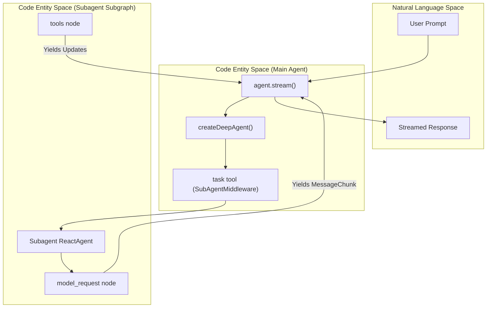
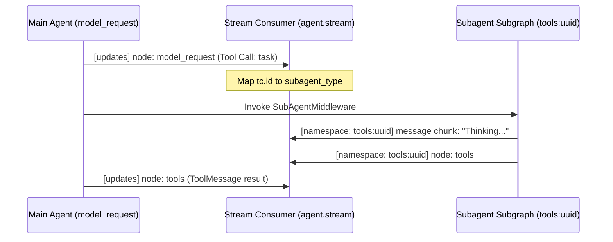

<!-- source: DeepWiki mcp.deepwiki.com · repo langchain-ai/deepagentsjs · page 9.6 Streaming · fetched 2026-10-26 -->

# Streaming

Relevant source files

The following files were used as context for generating this wiki page:

- [examples/streaming/basic.ts](examples/streaming/basic.ts)
- [examples/streaming/custom-updates.ts](examples/streaming/custom-updates.ts)
- [examples/streaming/filter-by-type.ts](examples/streaming/filter-by-type.ts)
- [examples/streaming/lifecycle.ts](examples/streaming/lifecycle.ts)
- [examples/streaming/multi-mode.ts](examples/streaming/multi-mode.ts)
- [examples/streaming/progress.ts](examples/streaming/progress.ts)
- [examples/streaming/tokens.ts](examples/streaming/tokens.ts)
- [examples/streaming/tool-calls.ts](examples/streaming/tool-calls.ts)

Streaming is a first-class feature in DeepAgentsJS, allowing real-time visibility into the execution of complex agentic workflows. Because DeepAgents use a hierarchical architecture, the framework supports **subgraph streaming**, which captures events not only from the main agent but also from any nested subagents spawned during a task.

## Overview of Streaming Modes

DeepAgentsJS leverages LangGraph's streaming capabilities, supporting multiple `streamMode` configurations to track different aspects of the agent's lifecycle.

| Mode | Description | Key Use Case |
| :--- | :--- | :--- |
| `updates` | Streams incremental state changes and node transitions. | Progress tracking and lifecycle monitoring [examples/streaming/progress.ts:35-58](). |
| `messages` | Streams message chunks (tokens) as they are generated by the LLM. | Real-time UI chat interfaces [examples/streaming/tokens.ts:30-40](). |
| `custom` | Streams data emitted manually via `config.writer`. | Custom progress bars or status updates from within tools [examples/streaming/custom-updates.ts:19-31](). |

### Subgraph Streaming Architecture
When an agent is created via `createDeepAgent`, it is compiled into a graph. When that agent calls a subagent (via the `task` tool), it enters a nested subgraph. To see events from these subagents, the `subgraphs: true` option must be enabled in the `.stream()` call [examples/streaming/basic.ts:24-34]().

**Sources:** [examples/streaming/basic.ts:24-34](), [examples/streaming/tokens.ts:30-40]()

## Data Flow and Implementation

The following diagram illustrates how a streaming request flows through the main agent into a subagent and back, showing the relationship between code entities and the logical streaming space.

### Agent Streaming Pipeline

**Sources:** [examples/streaming/basic.ts:24-44](), [examples/streaming/tokens.ts:30-66]()

## Filtering by Event Type and Source

When `subgraphs: true` is enabled, the stream yields a tuple containing the `namespace` and the `chunk`. The `namespace` is an array of strings that identifies the origin of the event [examples/streaming/basic.ts:35-42]().

*   **Main Agent:** `namespace` is empty `[]` [examples/streaming/basic.ts:38-41]().
*   **Subagent:** `namespace` contains identifiers like `["tools:uuid"]` [examples/streaming/basic.ts:35-37]().

### Identifying Subagent Types
To route events based on which subagent is speaking, you can inspect the `namespace` and match it against the tool call IDs generated by the main agent during the `model_request` phase [examples/streaming/lifecycle.ts:48-66]().

**Sources:** [examples/streaming/filter-by-type.ts:78-87](), [examples/streaming/lifecycle.ts:46-107]()

## Advanced Streaming Patterns

### 1. Streaming Tool Calls
To provide immediate feedback when an agent decides to use a tool, you can monitor `AIMessageChunk` instances in `messages` mode. This allows you to stream the tool arguments as they are being "typed" by the model [examples/streaming/tool-calls.ts:72-82]().

### 2. Custom Progress Updates
Tools can emit domain-specific progress data (e.g., "status: analyzing") using the `config.writer` function [examples/streaming/custom-updates.ts:19-28](). This data is received by the consumer when using `streamMode: "custom"` [examples/streaming/custom-updates.ts:70-79]().

### 3. Multi-Mode Streaming
You can combine multiple modes into a single stream by passing an array to `streamMode`. This returns a 3-tuple: `[namespace, mode, data]` [examples/streaming/multi-mode.ts:66-76]().

| Mode | Data Structure | Source File Reference |
| :--- | :--- | :--- |
| `updates` | Object keyed by node name (e.g., `{ model_request: {...} }`) | [examples/streaming/lifecycle.ts:47-51]() |
| `messages` | Array containing a `BaseMessage` or `MessageChunk` | [examples/streaming/tool-calls.ts:63-64]() |
| `custom` | Any JSON-serializable object passed to `config.writer` | [examples/streaming/custom-updates.ts:22-28]() |

**Sources:** [examples/streaming/tool-calls.ts:61-99](), [examples/streaming/custom-updates.ts:61-79](), [examples/streaming/multi-mode.ts:66-110]()

## Implementation Details

### Progress Tracking and Lifecycle
Tracking the lifecycle of a subagent involves monitoring three distinct phases in the stream [examples/streaming/lifecycle.ts:48-105]():
1.  **Pending:** Detected when the main agent emits a `task` tool call in `model_request` [examples/streaming/lifecycle.ts:51-66]().
2.  **Running:** Detected when the stream yields events with a `tools:UUID` namespace [examples/streaming/lifecycle.ts:71-85]().
3.  **Complete:** Detected when the main agent's `tools` node emits a `ToolMessage` corresponding to the original task ID [examples/streaming/lifecycle.ts:90-105]().

### Key Entities
*   `agent.stream`: The primary entry point for initiating a streaming execution [examples/streaming/basic.ts:24]().
*   `config.writer`: The utility provided to tool runtimes for emitting `custom` stream events [examples/streaming/custom-updates.ts:20-28]().
*   `namespace`: The array used to differentiate between the parent agent and nested subgraphs [examples/streaming/basic.ts:35-42]().

**Sources:** [examples/streaming/lifecycle.ts:46-107](), [examples/streaming/custom-updates.ts:18-31](), [examples/streaming/progress.ts:28-58]()

---

