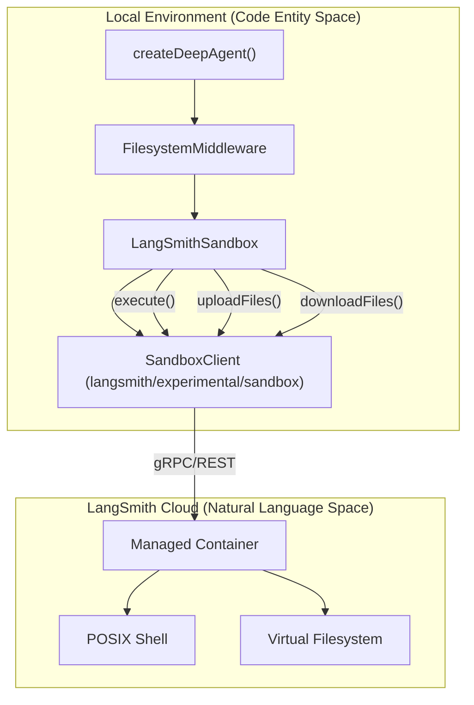
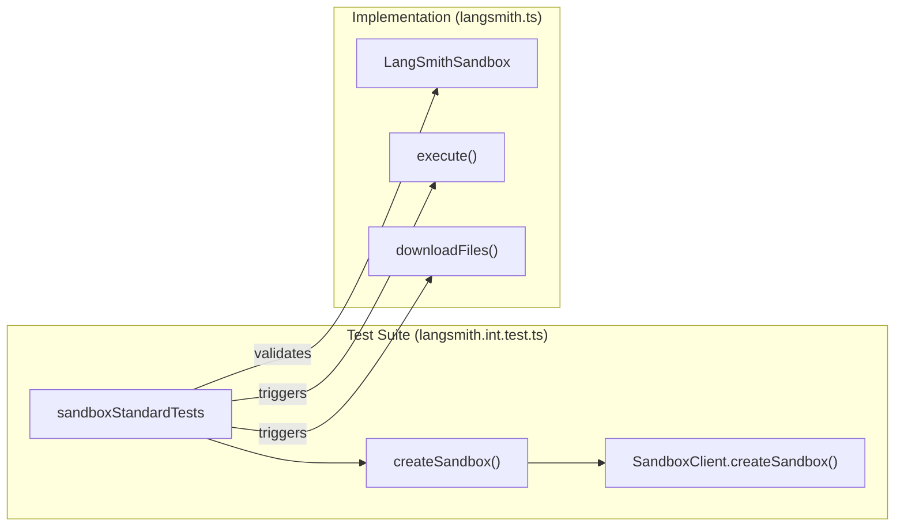

<!-- source: DeepWiki mcp.deepwiki.com · repo langchain-ai/deepagentsjs · page 9.7 LangSmith Integration · fetched 2026-10-26 -->

# LangSmith Integration

<details>
<summary>Relevant source files</summary>

The following files were used as context for generating this wiki page:

- [examples/sandbox/langsmith-sandbox.ts](examples/sandbox/langsmith-sandbox.ts)
- [libs/deepagents/src/backends/langsmith.int.test.ts](libs/deepagents/src/backends/langsmith.int.test.ts)
- [libs/deepagents/src/backends/langsmith.test.ts](libs/deepagents/src/backends/langsmith.test.ts)
- [libs/deepagents/src/backends/langsmith.ts](libs/deepagents/src/backends/langsmith.ts)

</details>


DeepAgentsJS provides native integration with LangSmith for both observability and remote execution. This integration allows developers to trace agent execution, debug complex tool-calling sequences, and run agent workloads in secure, cloud-hosted environments via the `LangSmithSandbox`.

## Overview

The integration serves two primary purposes:
1.  **Observability**: Automatic tracing of `createDeepAgent` runs when the `LANGSMITH_API_KEY` environment variable is set.
2.  **Remote Execution**: Providing a `SandboxBackendProtocol` implementation that offloads shell commands and file operations to LangSmith's managed sandbox infrastructure [libs/deepagents/src/backends/langsmith.ts:72-79]().

## LangSmithSandbox Backend

The `LangSmithSandbox` class is a specialized backend that implements the `BaseSandbox` abstract class [libs/deepagents/src/backends/langsmith.ts:80-80](). It allows a Deep Agent to execute shell commands, read files, and write files within a LangSmith-managed container rather than on the local machine.

### Data Flow and Architecture

The following diagram illustrates how the `LangSmithSandbox` bridges the local Deep Agent logic with the remote LangSmith infrastructure.

**LangSmith Sandbox Execution Flow**

Sources: [libs/deepagents/src/backends/langsmith.ts:107-130](), [libs/deepagents/src/backends/langsmith.ts:137-162](), [libs/deepagents/src/backends/langsmith.ts:169-184]()

### Key Functions and Implementation

| Function | Description | Implementation Detail |
| :--- | :--- | :--- |
| `create()` | Static factory to initialize a sandbox. | Instantiates `SandboxClient` and calls `createSandbox` with a template name [libs/deepagents/src/backends/langsmith.ts:214-230](). |
| `execute()` | Runs a shell command. | Wraps the LangSmith `sandbox.run()` method, combining `stdout` and `stderr` into a single output string [libs/deepagents/src/backends/langsmith.ts:107-130](). |
| `downloadFiles()` | Retrieves files from the cloud. | Uses `sandbox.read()` and maps LangSmith-specific errors (e.g., `LangSmithResourceNotFoundError`) to standard `FileOperationError` types [libs/deepagents/src/backends/langsmith.ts:137-162](). |
| `uploadFiles()` | Sends local data to the cloud. | Iterates through `[path, content]` tuples and calls `sandbox.write()` [libs/deepagents/src/backends/langsmith.ts:169-184](). |
| `close()` | Terminates the remote session. | Calls `sandbox.delete()` and sets `#isRunning` to `false` [libs/deepagents/src/backends/langsmith.ts:192-195](). |

Sources: [libs/deepagents/src/backends/langsmith.ts:80-231]()

## Usage Example

The `LangSmithSandbox` is included in the core `deepagents` package, requiring no additional provider installations [examples/sandbox/langsmith-sandbox.ts:5-8]().

```typescript
import { createDeepAgent, LangSmithSandbox } from "deepagents";

// 1. Create the remote backend
const backend = await LangSmithSandbox.create({
  templateName: "deepagents", // Matches your LangSmith sandbox template
});

try {
  // 2. Initialize the agent with the LangSmith backend
  const agent = createDeepAgent({
    model,
    backend,
    systemPrompt: "You are a coding assistant with a cloud shell.",
  });

  // 3. Invoke the agent
  await agent.invoke({
    messages: [{ role: "user", content: "Run 'ls -la' and tell me what you see." }]
  });
} finally {
  // 4. Always close to prevent resource leaks
  await backend.close();
}
```
Sources: [examples/sandbox/langsmith-sandbox.ts:68-108](), [libs/deepagents/src/backends/langsmith.ts:5-17]()

## Configuration Options

The `LangSmithSandbox` supports configuration via `LangSmithSandboxCreateOptions` [libs/deepagents/src/backends/langsmith.ts:49-67]():

*   **`templateName`**: The name of the sandbox template defined in your LangSmith dashboard. Defaults to `"deepagents"` [libs/deepagents/src/backends/langsmith.ts:53-57]().
*   **`apiKey`**: Your LangSmith API key. If omitted, it defaults to the `LANGSMITH_API_KEY` environment variable [libs/deepagents/src/backends/langsmith.ts:58-61]().
*   **`defaultTimeout`**: The maximum duration (in seconds) for shell command execution. Defaults to 1800 seconds (30 minutes) [libs/deepagents/src/backends/langsmith.ts:62-66]().

## Error Handling and Mapping

The backend translates LangSmith-specific exceptions into the standard `FileOperationError` codes used by DeepAgents middleware [libs/deepagents/src/backends/langsmith.ts:141-158]():

| LangSmith Error | DeepAgents Error |
| :--- | :--- |
| `LangSmithResourceNotFoundError` | `file_not_found` [libs/deepagents/src/backends/langsmith.ts:146-147]() |
| `LangSmithSandboxError` (message includes "is a directory") | `is_directory` [libs/deepagents/src/backends/langsmith.ts:149-153]() |
| Generic Catch | `invalid_path` [libs/deepagents/src/backends/langsmith.ts:156-156]() or `permission_denied` [libs/deepagents/src/backends/langsmith.ts:179-179]() |

Sources: [libs/deepagents/src/backends/langsmith.ts:141-184]()

## Integration Testing

The codebase includes a comprehensive integration suite in `langsmith.int.test.ts` that utilizes the `@langchain/sandbox-standard-tests` package [libs/deepagents/src/backends/langsmith.int.test.ts:18-18](). These tests verify:
*   Sequential command execution state persistence [libs/deepagents/src/backends/langsmith.int.test.ts:31-31]().
*   File upload/download integrity [libs/deepagents/src/backends/langsmith.int.test.ts:27-27]().
*   Lifecycle management (create/delete) [libs/deepagents/src/backends/langsmith.int.test.ts:33-45]().

**Entity Mapping: Test to Implementation**

Sources: [libs/deepagents/src/backends/langsmith.int.test.ts:27-48](), [libs/deepagents/src/backends/langsmith.ts:80-162]()

---

