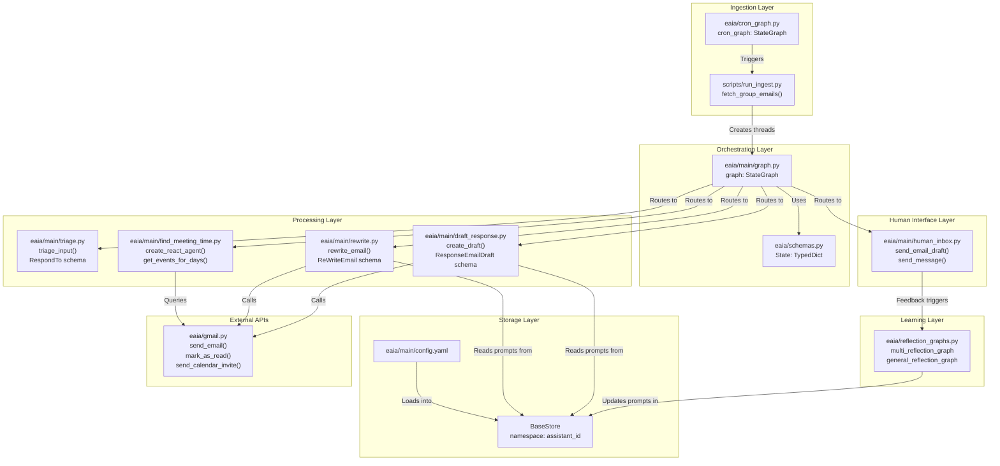
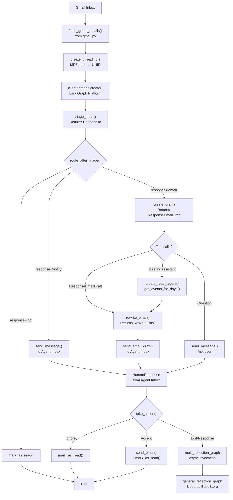
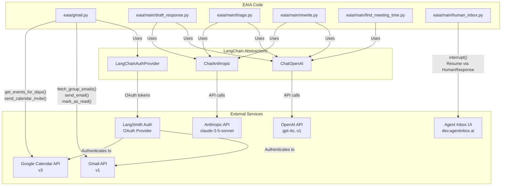

<!-- source: DeepWiki mcp.deepwiki.com · repo langchain-ai/executive-ai-assistant · page 1 Overview · fetched 2026-10-26 -->

# Overview

Relevant source files

The following files were used as context for generating this wiki page:

- [CONTRIBUTING.md](CONTRIBUTING.md)
- [README.md](README.md)

The Executive AI Assistant (EAIA) is an automated email management system that processes incoming Gmail messages, drafts responses, schedules calendar meetings, and routes work to humans for approval. It is built on LangGraph for orchestration, uses OpenAI and Anthropic LLMs for natural language processing, and integrates with Gmail/Calendar APIs via LangChain Auth for OAuth management.

For detailed setup instructions, see page 1.1 (Installation and Setup). For system architecture details, see page 1.2 (Architecture Overview).

## Purpose and Core Functionality

EAIA performs the following automated tasks:

- **Email Triage**: Classifies incoming emails into three categories (ignore, notify, draft response) using few-shot classification
- **Response Drafting**: Generates email replies using LLM-based agents with tool access (meeting scheduling, calendar invites)
- **Tone Adjustment**: Rewrites drafted responses to match user-specified tone and style preferences
- **Calendar Integration**: Queries Google Calendar availability and proposes meeting times
- **Learning System**: Updates prompt templates based on human feedback via reflection graphs

All actions requiring email sends are routed through Agent Inbox (dev.agentinbox.ai) for human approval, ensuring no autonomous email transmission.

Sources: [README.md:1-4](), [README.md:50-65]()

## System Architecture Layers

EAIA is organized into distinct functional layers, each implemented by specific Python modules:

**Diagram: System Architecture with Code Entities**

Sources: [README.md:1-4](), [README.md:166-180]()

### Component Reference Table

| Layer | Module | Key Functions/Classes | Purpose |
|-------|--------|----------------------|---------|
| Ingestion | `scripts/run_ingest.py` | `fetch_group_emails()`, `create_thread_id()` | Fetches emails from Gmail API, creates LangGraph threads |
| Ingestion | `eaia/cron_graph.py` | `cron_graph: StateGraph` | Scheduled email checking via cron |
| Orchestration | `eaia/main/graph.py` | `graph: StateGraph`, `route_after_triage()` | Main workflow coordinator |
| State | `eaia/schemas.py` | `State: TypedDict`, `EmailData`, `RespondTo` | State management and data schemas |
| Triage | `eaia/main/triage.py` | `triage_input()`, `RespondTo` | Email classification into 3 categories |
| Drafting | `eaia/main/draft_response.py` | `create_draft()`, `ResponseEmailDraft` | Response generation with tool binding |
| Rewriting | `eaia/main/rewrite.py` | `rewrite_email()`, `ReWriteEmail` | Tone adjustment based on preferences |
| Calendar | `eaia/main/find_meeting_time.py` | `create_react_agent()`, `get_events_for_days()` | Meeting time discovery using ReAct pattern |
| Human Interface | `eaia/main/human_inbox.py` | `send_email_draft()`, `send_message()` | Routes work to Agent Inbox |
| Learning | `eaia/reflection_graphs.py` | `multi_reflection_graph`, `general_reflection_graph` | Prompt improvement from feedback |
| Gmail API | `eaia/gmail.py` | `send_email()`, `mark_as_read()`, `send_calendar_invite()` | Gmail/Calendar API wrapper |

Sources: [README.md:166-180]()

## Email Processing Workflow

**Diagram: Email Processing Flow with Function Calls**

This workflow is implemented in `eaia/main/graph.py` as a `StateGraph` with conditional edges defined by `route_after_triage()`, `take_action()`, and `enter_after_human()` functions.

Sources: [README.md:76-84](), [README.md:166-180]()

## Deployment Models

EAIA supports two deployment environments:

### Local Development

Run EAIA on localhost for testing:

1. Start development server: `langgraph dev` (listens on port 2024)
2. Trigger ingestion manually: `python scripts/run_ingest.py --url http://127.0.0.1:2024`
3. Connect Agent Inbox to `http://127.0.0.1:2024` with `graph_id="main"`

The local server runs `eaia/main/graph.py` as the main graph and `eaia/cron_graph.py` as the cron graph.

Sources: [README.md:65-103]()

### Production Deployment (LangGraph Platform)

Deploy EAIA as a managed service:

1. Deploy via LangSmith UI, connecting to GitHub repository
2. Set environment variables: `OPENAI_API_KEY`, `ANTHROPIC_API_KEY`, `LANGSMITH_API_KEY`
3. Set up cron schedule: `python scripts/setup_cron.py --url ${DEPLOYMENT_URL}`
4. The `cron_graph.py` StateGraph runs on schedule, triggering `run_ingest.py` logic

The ingestion script uses `--minutes-since` to control how far back to check for emails, `--rerun` to control whether to reprocess seen emails, and `--early` to control whether to stop on first seen email.

Sources: [README.md:105-161]()

## External Service Integrations

**Diagram: External API Integration Points**

### Authentication

OAuth authentication to Gmail/Calendar is managed by LangChain Auth (LangSmith's OAuth provider service). The `scripts/setup_gmail.py` script creates the OAuth provider by calling LangSmith Auth APIs with client credentials from `eaia/.secrets/secrets.json`. 

The `eaia/gmail.py` module uses `LangChainAuthProvider` to fetch and refresh tokens automatically.

Sources: [README.md:25-46](), [README.md:36-47]()

### LLM Provider Selection

Both `ChatOpenAI` and `ChatAnthropic` interfaces are available. Model selection is done at the module level:
- `triage.py`: Uses both providers
- `draft_response.py`: Uses both providers
- `rewrite.py`: Uses both providers
- `find_meeting_time.py`: Uses OpenAI only
- `reflection_graphs.py`: Uses both providers (o1 for complex reflection)

Sources: [README.md:33-34]()

## Configuration System

EAIA uses a YAML configuration file at `eaia/main/config.yaml` that defines user-specific behavior. The configuration is loaded into `BaseStore` on startup and accessed by processing nodes.

### Configuration Schema

The `config.yaml` file contains these required fields:

| Field | Type | Used By | Purpose |
|-------|------|---------|---------|
| `email` | string | `gmail.py` | User's email address for sending/receiving |
| `full_name` | string | `draft_response.py` | User's full name for email signatures |
| `name` | string | `draft_response.py` | User's first name for responses |
| `timezone` | string | `find_meeting_time.py` | Default timezone for scheduling |
| `background` | string | `draft_response.py` | Context about user for responses |
| `triage_no` | string | `triage.py` | Rules for emails to ignore |
| `triage_notify` | string | `triage.py` | Rules for notification-only emails |
| `triage_email` | string | `triage.py` | Rules for emails requiring response |
| `response_preferences` | string | `draft_response.py` | Content preferences (stored as `response_preferences` in BaseStore) |
| `rewrite_preferences` | string | `rewrite.py` | Tone preferences (stored as `rewrite_instructions` in BaseStore) |
| `schedule_preferences` | string | `find_meeting_time.py` | Calendar preferences (stored as `schedule_preferences` in BaseStore) |
| `background_preferences` | string | `draft_response.py` | Additional context (stored as `random_preferences` in BaseStore) |

These configuration values are read by nodes during execution and can be updated via the reflection system.

For detailed configuration instructions, see page 5 (Configuration) and page 5.1 (Email Preferences Configuration).

Sources: [README.md:48-65]()

## System Requirements

To use EAIA, you need:

1. Python 3.11 or higher
2. API keys for OpenAI and Anthropic
3. Google API credentials for Gmail and Calendar access
4. LangSmith API key for deployment and monitoring

Sources: [README.md:25-47]()

---

