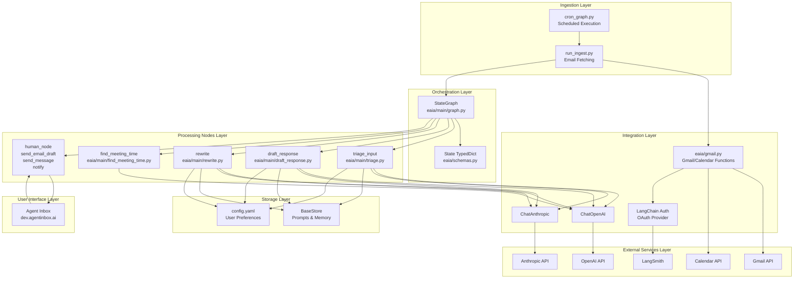
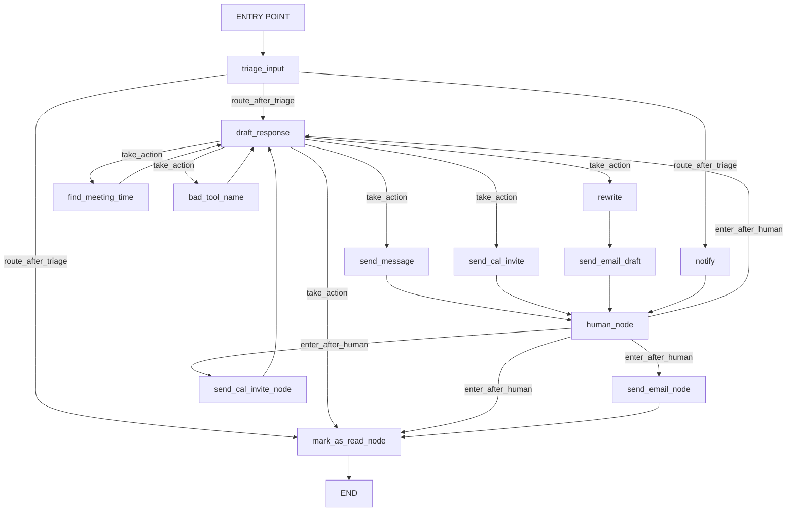
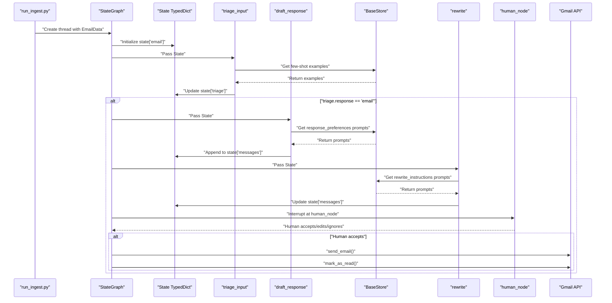
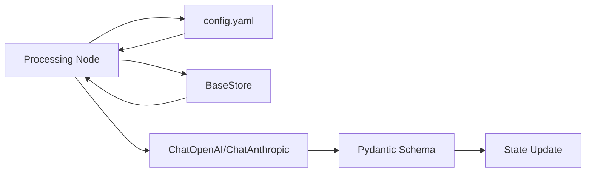
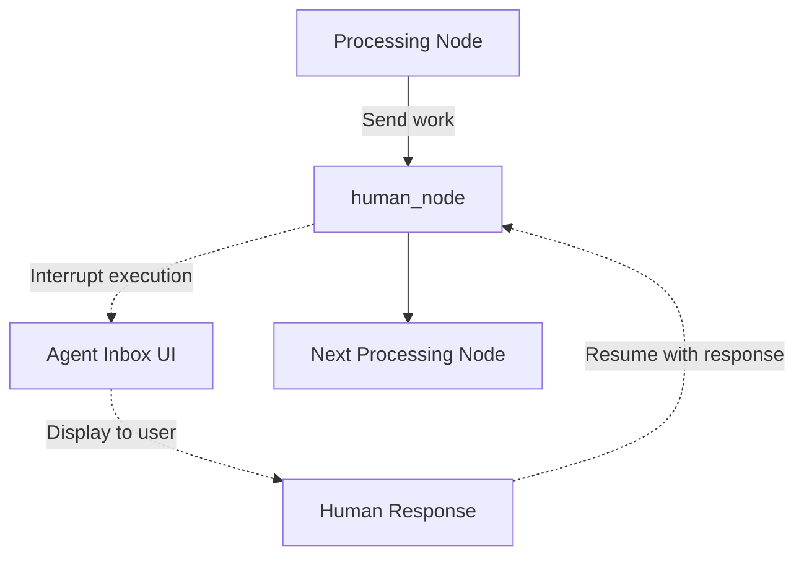
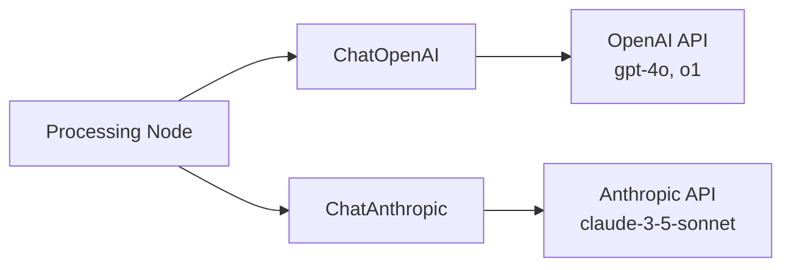
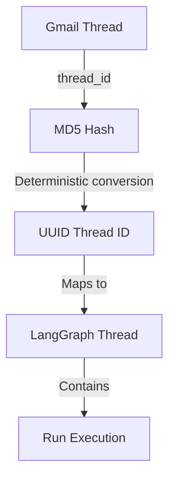
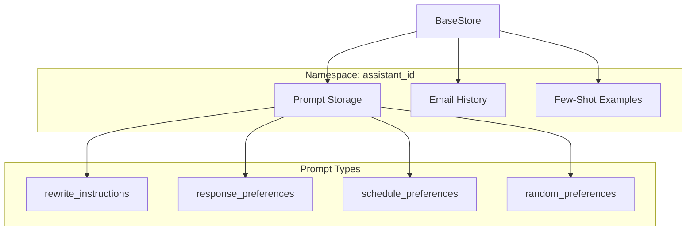

<!-- source: DeepWiki mcp.deepwiki.com · repo langchain-ai/executive-ai-assistant · page 1.2 Architecture Overview · fetched 2026-10-26 -->

# Architecture Overview

Relevant source files

The following files were used as context for generating this wiki page:

- [README.md](README.md)
- [eaia/main/graph.py](eaia/main/graph.py)
- [pyproject.toml](pyproject.toml)

This document describes the high-level architecture of the Executive AI Assistant (EAIA) system, focusing on its LangGraph-based orchestration, modular component design, and data flow patterns. For specific setup and configuration details, see [Installation and Setup](#1.1). For information about state management and data structures, see [Core Data Structures and State Management](#1.3).

## System Overview

EAIA is built as a **LangGraph StateGraph application** that orchestrates email processing through a series of specialized nodes. The architecture follows a pipeline pattern where emails flow through triage, drafting, rewriting, and human approval stages before final actions are taken.

### Core Architectural Principles

| Principle | Implementation |
|-----------|----------------|
| **Stateful Orchestration** | LangGraph StateGraph manages workflow state across all processing nodes |
| **Modular Components** | Each processing step (triage, draft, rewrite, scheduling) is an independent node |
| **Human-in-the-Loop** | All drafts require human approval before execution |
| **Asynchronous Learning** | Feedback triggers background prompt improvement without blocking execution |
| **External Integrations** | Gmail, Calendar, and LLM providers accessed through abstraction layers |

**Sources:** [README.md:1-179](), [eaia/main/graph.py:1-191]()

## System Layers

**Architecture Overview: System Layers and Component Relationships**

The architecture is organized into seven distinct layers:

1. **External Services Layer**: Third-party APIs for email, calendar, and LLM capabilities
2. **Integration Layer**: Abstraction modules that wrap external services
3. **Orchestration Layer**: LangGraph StateGraph that coordinates workflow execution
4. **Processing Nodes Layer**: Specialized processing components for triage, drafting, rewriting, and scheduling
5. **Storage Layer**: Persistent storage for prompts, memory, and configuration
6. **Ingestion Layer**: Email fetching and thread creation logic
7. **User Interface Layer**: Human interaction through Agent Inbox

**Sources:** [README.md:1-179](), [eaia/main/graph.py:1-191](), [pyproject.toml:1-46]()

## LangGraph StateGraph Orchestration

The core of EAIA is the `StateGraph` defined in [eaia/main/graph.py:162-191](). This graph orchestrates all email processing through a series of nodes connected by conditional edges.

**StateGraph Node Structure and Routing Logic**

### Node Definitions

The graph consists of the following node types ([eaia/main/graph.py:162-174]()):

| Node Name | Function | Purpose |
|-----------|----------|---------|
| `triage_input` | [eaia/main/triage.py]() | Classifies emails into response categories |
| `draft_response` | [eaia/main/draft_response.py]() | Generates initial email responses with tool binding |
| `rewrite` | [eaia/main/rewrite.py]() | Adjusts tone and style of drafts |
| `find_meeting_time` | [eaia/main/find_meeting_time.py]() | Queries calendar for availability |
| `send_message` | [eaia/main/human_inbox.py]() | Sends questions to human via Agent Inbox |
| `send_email_draft` | [eaia/main/human_inbox.py]() | Sends email drafts for human approval |
| `notify` | [eaia/main/human_inbox.py]() | Notifies human of important emails |
| `send_cal_invite` | [eaia/main/human_inbox.py]() | Sends calendar invites for human approval |
| `human_node` | [eaia/main/graph.py:153-154]() | Interrupt point for human interaction |
| `mark_as_read_node` | [eaia/main/graph.py:148-150]() | Marks emails as read in Gmail |
| `send_email_node` | [eaia/main/graph.py:133-145]() | Executes approved email sends |
| `send_cal_invite_node` | [eaia/main/graph.py:115-130]() | Executes approved calendar invites |

### Conditional Routing Logic

Three routing functions control graph traversal ([eaia/main/graph.py:30-113]()):

#### 1. `route_after_triage`

Routes based on triage classification:
- `"email"` or `"question"` → `draft_response` (needs AI response)
- `"no"` → `mark_as_read_node` (ignore email)
- `"notify"` → `notify` (notify human without draft)

#### 2. `take_action`

Routes based on tool call in draft response:
- `"Question"` → `send_message` (AI needs clarification)
- `"ResponseEmailDraft"` → `rewrite` (draft ready for tone adjustment)
- `"Ignore"` → `mark_as_read_node` (AI decides to ignore)
- `"MeetingAssistant"` → `find_meeting_time` (needs calendar lookup)
- `"SendCalendarInvite"` → `send_cal_invite` (ready to send invite)

#### 3. `enter_after_human`

Routes based on human response:
- If no messages or `ToolMessage`/`HumanMessage` → `draft_response` (re-process with feedback)
- If approved `ResponseEmailDraft` → `send_email_node` (execute send)
- If approved `SendCalendarInvite` → `send_cal_invite_node` (execute invite)
- If approved `Ignore` → `mark_as_read_node` (mark read)
- If `"notify"` triage and no messages → `mark_as_read_node` (acknowledge notification)

**Sources:** [eaia/main/graph.py:1-191]()

## Data Flow Through Processing Pipeline

**Email Processing Data Flow Sequence**

### State Propagation

The `State` TypedDict ([eaia/schemas.py]()) is passed through every node in the graph. Each node can:
- **Read** from state fields: `email`, `messages`, `triage`
- **Write** to state fields using return values
- **Append** to `messages` using the `add_messages` reducer

### Storage Interactions

Nodes interact with `BaseStore` at multiple points:

| Node | Storage Operation | Purpose |
|------|------------------|---------|
| `triage_input` | Read few-shot examples | Improve classification accuracy |
| `triage_input` | Write triage status | Track email processing history |
| `draft_response` | Read `response_preferences`, `schedule_preferences`, `random_preferences` | Guide content generation |
| `rewrite` | Read `rewrite_instructions` | Control tone and style |
| Reflection system | Write all prompt types | Update prompts based on feedback |

**Sources:** [eaia/main/graph.py:1-191](), [README.md:49-65]()

## Component Communication Patterns

### LLM Integration Pattern

All LLM-calling nodes follow a consistent pattern:

**LLM Integration Pattern Used by Processing Nodes**

1. **Load Configuration**: Read from `config.yaml` for user preferences
2. **Retrieve Prompts**: Fetch specialized prompts from `BaseStore`
3. **Call LLM**: Invoke `ChatOpenAI` or `ChatAnthropic` with structured output
4. **Enforce Schema**: Use `.with_structured_output()` to ensure type safety
5. **Update State**: Return structured data to update `State`

**Sources:** [README.md:49-65]()

### Human-in-the-Loop Pattern

The human interaction model uses LangGraph's interrupt mechanism:

**Human-in-the-Loop Interrupt Pattern**

The `human_node` ([eaia/main/graph.py:153-154]()) is a no-op function that serves as an interrupt point. When execution reaches this node, the graph pauses and waits for human input via Agent Inbox. The `enter_after_human` routing function ([eaia/main/graph.py:88-113]()) determines what happens after human interaction.

**Sources:** [eaia/main/graph.py:88-113](), [eaia/main/graph.py:153-154]()

## External Integration Architecture

### Gmail and Calendar Integration

The [eaia/gmail.py]() module provides abstraction over Google APIs:

| Function | Purpose | Authentication |
|----------|---------|----------------|
| `fetch_group_emails()` | Retrieve emails within time window | LangChain Auth OAuth |
| `send_email()` | Send email reply | LangChain Auth OAuth |
| `mark_as_read()` | Mark email as read | LangChain Auth OAuth |
| `get_events_for_days()` | Query calendar availability | LangChain Auth OAuth |
| `send_calendar_invite()` | Create calendar event | LangChain Auth OAuth |

**Authentication Flow**: OAuth credentials are managed by LangChain Auth ([langchain-auth]()), which stores tokens in LangSmith and handles automatic refresh. The initial setup is performed by [scripts/setup_gmail.py](), which creates a Google OAuth provider.

**Sources:** [README.md:31-47](), [pyproject.toml:16]()

### LLM Provider Integration

EAIA supports dual LLM providers through LangChain abstractions:

**LLM Provider Abstraction Layer**

Both providers are accessed through LangChain's unified interfaces ([langchain-openai](), [langchain-anthropic]()), enabling:
- **Model swapping** without code changes
- **Structured output** via `.with_structured_output()`
- **Tool binding** via `.bind_tools()`
- **Automatic tracing** to LangSmith

**Sources:** [pyproject.toml:13-14]()

## Deployment Architecture

### Thread and Run Management

EAIA uses LangGraph Platform's thread model for execution:

**Thread ID Generation and Mapping**

The [scripts/run_ingest.py]() script converts Gmail thread IDs to LangGraph thread IDs using MD5 hashing, ensuring the same email thread always maps to the same execution context. Each ingestion creates or updates a thread and initiates a new run.

### Execution Modes

| Mode | Entry Point | Trigger | Use Case |
|------|-------------|---------|----------|
| **Local Development** | `langgraph dev` | Manual `run_ingest.py` | Testing and debugging |
| **Production** | LangGraph Platform | `cron_graph.py` scheduled runs | Real-world operation |

In both modes, the same `StateGraph` ([eaia/main/graph.py]()) executes, but production adds automated triggering via [scripts/setup_cron.py]().

**Sources:** [README.md:66-159]()

## Storage Architecture

### BaseStore Organization

The `BaseStore` provides namespaced key-value storage:

**BaseStore Namespace and Key Structure**

- **Namespace**: Each assistant (user) has isolated storage
- **Prompt Keys**: Four prompt types stored by (assistant_id, prompt_type)
- **History Keys**: Email IDs map to triage decisions for deduplication
- **Example Keys**: Few-shot examples stored for triage improvement

**Sources:** [README.md:49-65]()

## Configuration Management

Configuration is managed through two mechanisms:

### Static Configuration (config.yaml)

Located at [eaia/main/config.yaml](), contains:
- User identity: `email`, `full_name`, `name`, `timezone`
- Background context: `background`, `background_preferences`
- Behavioral rules: `triage_no`, `triage_notify`, `triage_email`
- Style preferences: `response_preferences`, `rewrite_preferences`, `schedule_preferences`

### Dynamic Configuration (BaseStore)

Learned through the reflection system:
- Prompts evolve based on user feedback
- Stored in BaseStore under prompt type keys
- Automatically applied in subsequent processing

**Sources:** [README.md:49-65]()

## Summary

The EAIA architecture demonstrates several key design patterns:

1. **StateGraph Orchestration**: LangGraph provides stateful workflow management with conditional routing
2. **Modular Processing**: Each processing step is an independent, composable node
3. **Human Oversight**: Interrupt mechanism ensures human approval before critical actions
4. **Adaptive Learning**: Asynchronous reflection system improves prompts over time
5. **Clean Abstractions**: External services accessed through well-defined integration layers
6. **Dual Storage**: Static configuration for rules, dynamic storage for learned behavior

This architecture enables EAIA to process emails reliably while continuously adapting to user preferences through feedback.

**Sources:** [README.md:1-179](), [eaia/main/graph.py:1-191](), [pyproject.toml:1-46]()

---

