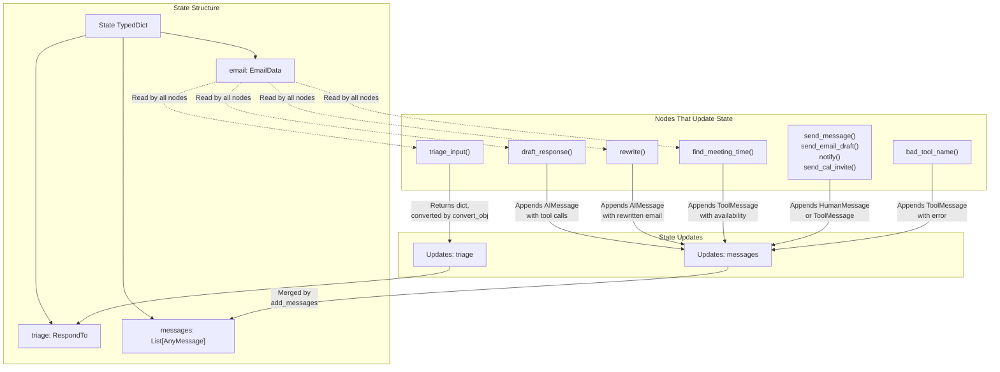
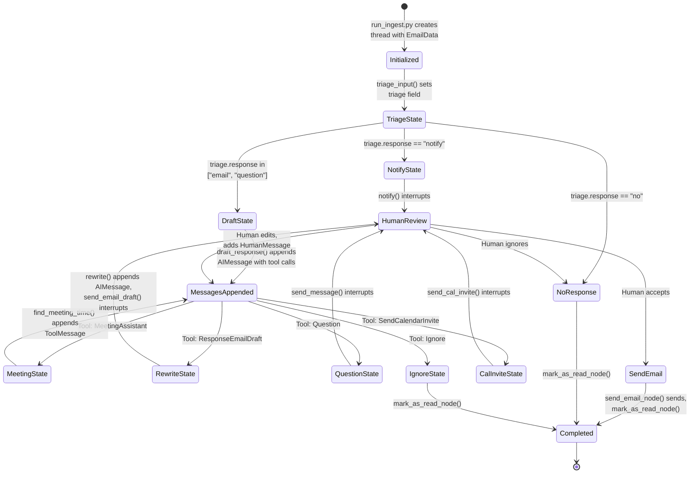

<!-- source: DeepWiki mcp.deepwiki.com · repo langchain-ai/executive-ai-assistant · page 1.3 Core Data Structures and State Management · fetched 2026-10-26 -->

# Core Data Structures and State Management

<details>
<summary>Relevant source files</summary>

The following files were used as context for generating this wiki page:

- [eaia/main/find_meeting_time.py](eaia/main/find_meeting_time.py)
- [eaia/main/graph.py](eaia/main/graph.py)
- [eaia/schemas.py](eaia/schemas.py)

</details>


This page documents the core data structures used throughout EAIA and how state is managed as emails flow through the processing pipeline. It covers the central `State` TypedDict, the `EmailData` schema for email representation, Pydantic models for LLM outputs, and LangGraph's state reducer patterns (`add_messages` and `convert_obj`).

For information about how state flows through the orchestration graph and node routing, see [StateGraph Orchestration](#2.5). For details on persistent storage of prompts and history, see [Memory and Storage](#4.2).

## State TypedDict

The `State` TypedDict defined in [eaia/schemas.py:91-94]() serves as the canonical representation of processing context throughout the email processing pipeline. It contains three fields:

```python
class State(TypedDict):
    email: EmailData
    triage: Annotated[RespondTo, convert_obj]
    messages: Annotated[List[AnyMessage], add_messages]
```

| Field | Type | Purpose | Reducer |
|-------|------|---------|---------|
| `email` | `EmailData` | The current email being processed | None (immutable) |
| `triage` | `RespondTo` | Classification decision from triage node | `convert_obj` |
| `messages` | `List[AnyMessage]` | Conversation history with the LLM | `add_messages` |

The `email` field is populated during ingestion and remains unchanged throughout processing. The `triage` and `messages` fields are updated by various nodes as the email flows through the graph.

**Sources:** [eaia/schemas.py:91-94]()

## EmailData Schema

`EmailData` is a TypedDict that structures raw email data fetched from Gmail into a consistent format:

```python
class EmailData(TypedDict):
    id: str
    thread_id: str
    from_email: str
    subject: str
    page_content: str
    send_time: str
    to_email: str
```

### Field Descriptions

| Field | Description | Example |
|-------|-------------|---------|
| `id` | Unique Gmail message ID | `"18c5f..."` |
| `thread_id` | Gmail thread ID | `"18c5e..."` |
| `from_email` | Sender's email address | `"sender@example.com"` |
| `subject` | Email subject line | `"Meeting request"` |
| `page_content` | Full email body (plain text or HTML converted to text) | Email content string |
| `send_time` | Timestamp when email was sent | ISO 8601 format |
| `to_email` | Recipient's email address | `"user@example.com"` |

This structure is created during email ingestion (see [Email Ingestion](#2.1)) and populated into the `State.email` field at the start of each processing run.

**Sources:** [eaia/schemas.py:10-17]()

## LLM Output Schemas

EAIA uses Pydantic `BaseModel` classes to enforce structured outputs from LLM calls. Each schema represents a specific type of action or decision the LLM can make.

### Triage Decision Schema

```python
class RespondTo(BaseModel):
    logic: str = Field(
        description="logic on WHY the response choice is the way it is", default=""
    )
    response: Literal["no", "email", "notify", "question"] = "no"
```

The `RespondTo` schema enforces that triage decisions are one of four types:
- `"no"` - Ignore the email (mark as read)
- `"email"` - Draft a response email
- `"notify"` - Send notification without drafting
- `"question"` - Ask user a clarifying question

**Sources:** [eaia/schemas.py:20-24]()

### Email Draft Schemas

Two schemas represent different types of email drafts:

```python
class ResponseEmailDraft(BaseModel):
    """Draft of an email to send as a response."""
    content: str
    new_recipients: List[str]

class NewEmailDraft(BaseModel):
    """Draft of a new email to send."""
    content: str
    recipients: List[str]
```

`ResponseEmailDraft` is used when replying to an existing thread and may add new recipients (CC/BCC). `NewEmailDraft` is used for composing entirely new emails.

**Sources:** [eaia/schemas.py:27-38]()

### Rewrite Schema

```python
class ReWriteEmail(BaseModel):
    """Logic for rewriting an email"""
    tone_logic: str = Field(
        description="Logic for what the tone of the rewritten email should be"
    )
    rewritten_content: str = Field(description="Content rewritten with the new tone")
```

This schema enforces that rewrite operations include both reasoning about tone adjustments and the actual rewritten content.

**Sources:** [eaia/schemas.py:41-47]()

### Tool Schemas

Four schemas represent tools the LLM can invoke during draft generation:

```python
class Question(BaseModel):
    """Question to ask user."""
    content: str

class Ignore(BaseModel):
    """Call this to ignore the email. Only call this if user has said to do so."""
    ignore: bool

class MeetingAssistant(BaseModel):
    """Call this to have user's meeting assistant look at it."""
    call: bool

class SendCalendarInvite(BaseModel):
    """Call this to send a calendar invite."""
    emails: List[str]
    title: str
    start_time: str  # Format: "2024-07-01T14:00:00"
    end_time: str    # Format: "2024-07-01T14:00:00"
```

These schemas are bound to the LLM in `draft_response.py` using tool binding patterns.

**Sources:** [eaia/schemas.py:50-80]()

## State Reducers and Annotations

LangGraph uses annotations to control how state updates are merged. EAIA employs two reducer functions.

### add_messages Reducer

The `messages` field uses LangGraph's built-in `add_messages` reducer:

```python
messages: Annotated[List[AnyMessage], add_messages]
```

This reducer:
- Accumulates messages into a conversation history
- Prevents duplicate messages (based on message ID)
- Handles message updates and deletions via `RemoveMessage`
- Maintains correct ordering of the conversation

Nodes can append messages by returning `{"messages": [new_message]}`, and the reducer automatically merges them with existing messages.

**Sources:** [eaia/schemas.py:7](), [eaia/schemas.py:94]()

### convert_obj Reducer

The `triage` field uses a custom `convert_obj` function:

```python
def convert_obj(o, m):
    if isinstance(m, dict):
        return RespondTo(**m)
    else:
        return m

triage: Annotated[RespondTo, convert_obj]
```

This reducer ensures that triage updates are properly typed. When a node returns a dictionary for the triage field, it's automatically converted to a `RespondTo` instance. This is necessary because Pydantic models cannot be directly mixed with TypedDict without explicit conversion.

**Sources:** [eaia/schemas.py:84-88](), [eaia/schemas.py:93]()

## State Flow Diagram

The following diagram shows how `State` flows through the graph nodes and which nodes update which fields:



**Sources:** [eaia/schemas.py:91-94](), [eaia/main/graph.py:162-190]()

## State Access Patterns in Nodes

Different nodes access and update state in specific patterns. The table below summarizes common access patterns:

| Node | Reads From State | Updates To State | Return Format |
|------|------------------|------------------|---------------|
| `triage_input` | `email` | `triage` | `{"triage": RespondTo}` or dict |
| `draft_response` | `email`, `messages` | `messages` | `{"messages": [AIMessage]}` |
| `rewrite` | `email`, `messages` | `messages` | `{"messages": [AIMessage]}` |
| `find_meeting_time` | `email`, `messages` | `messages` | `{"messages": [ToolMessage]}` |
| `send_email_draft` | `email`, `messages` | `messages` | `{"messages": [HumanMessage]}` |
| `mark_as_read_node` | `email` | None | `{}` |

### Example: State Access in find_meeting_time

The `find_meeting_time` node demonstrates typical state access patterns:

```python
async def find_meeting_time(state: State, config: RunnableConfig):
    # Read email data
    email_thread = state["email"]["page_content"]
    author = state["email"]["from_email"]
    subject = state["email"]["subject"]
    
    # Read existing messages
    messages = state.get("messages") or []
    messages = messages[:-1]  # Remove last message
    
    # ... processing ...
    
    # Return update to messages field
    prediction = state["messages"][-1]
    tool_call = prediction.tool_calls[0]
    return {
        "messages": [
            ToolMessage(
                content=result["messages"][-1].content, 
                tool_call_id=tool_call["id"]
            )
        ]
    }
```

This pattern shows:
1. Reading from `state["email"]` to access email data
2. Reading from `state["messages"]` to access conversation history
3. Returning a dict with `"messages"` key to append new messages

**Sources:** [eaia/main/find_meeting_time.py:66-96]()

## Schema-to-Code Mapping

The following diagram maps the Pydantic schemas to their usage locations in the codebase:

```mermaid
graph TB
    subgraph "Schemas in eaia/schemas.py"
        EmailData["EmailData<br/>(TypedDict)"]
        State["State<br/>(TypedDict)"]
        RespondTo["RespondTo<br/>(BaseModel)"]
        ResponseEmailDraft["ResponseEmailDraft<br/>(BaseModel)"]
        ReWriteEmail["ReWriteEmail<br/>(BaseModel)"]
        Question["Question<br/>(BaseModel)"]
        MeetingAssistant["MeetingAssistant<br/>(BaseModel)"]
        SendCalendarInvite["SendCalendarInvite<br/>(BaseModel)"]
        Ignore["Ignore<br/>(BaseModel)"]
    end
    
    subgraph "Usage in Processing Nodes"
        TriageNode["triage.py<br/>triage_input()"]
        DraftNode["draft_response.py<br/>draft_response()"]
        RewriteNode["rewrite.py<br/>rewrite()"]
        MeetingNode["find_meeting_time.py<br/>find_meeting_time()"]
        GraphFile["graph.py<br/>route_after_triage()<br/>take_action()<br/>enter_after_human()"]
    end
    
    subgraph "LLM Integration"
        StructuredOutput["with_structured_output()"]
        ToolBinding["bind_tools()"]
    end
    
    State -.->|"Function parameter"| TriageNode
    State -.->|"Function parameter"| DraftNode
    State -.->|"Function parameter"| RewriteNode
    State -.->|"Function parameter"| MeetingNode
    State -.->|"Function parameter"| GraphFile
    
    RespondTo -->|"Enforced by"| StructuredOutput
    StructuredOutput -->|"Used in"| TriageNode
    
    ReWriteEmail -->|"Enforced by"| StructuredOutput
    StructuredOutput -->|"Used in"| RewriteNode
    
    Question -->|"Bound as tool"| ToolBinding
    ResponseEmailDraft -->|"Bound as tool"| ToolBinding
    MeetingAssistant -->|"Bound as tool"| ToolBinding
    SendCalendarInvite -->|"Bound as tool"| ToolBinding
    Ignore -->|"Bound as tool"| ToolBinding
    ToolBinding -->|"Used in"| DraftNode
    
    RespondTo -.->|"Read by"| GraphFile
    Question -.->|"Routing logic"| GraphFile
    ResponseEmailDraft -.->|"Routing logic"| GraphFile
    MeetingAssistant -.->|"Routing logic"| GraphFile
    SendCalendarInvite -.->|"Routing logic"| GraphFile
    Ignore -.->|"Routing logic"| GraphFile
```



**Sources:** [eaia/schemas.py:1-101](), [eaia/main/triage.py](), [eaia/main/draft_response.py](), [eaia/main/rewrite.py](), [eaia/main/find_meeting_time.py:1-96](), [eaia/main/graph.py:1-191]()

## Conditional Routing Based on State

The orchestration graph uses state values to make routing decisions. Three key routing functions examine state to determine the next node:

### route_after_triage

```python
def route_after_triage(
    state: State,
) -> Literal["draft_response", "mark_as_read_node", "notify"]:
    if state["triage"].response == "email":
        return "draft_response"
    elif state["triage"].response == "no":
        return "mark_as_read_node"
    elif state["triage"].response == "notify":
        return "notify"
    elif state["triage"].response == "question":
        return "draft_response"
    else:
        raise ValueError
```

This function reads `state["triage"].response` to route after triage classification.

**Sources:** [eaia/main/graph.py:30-42]()

### take_action

```python
def take_action(
    state: State,
) -> Literal[
    "send_message",
    "rewrite",
    "mark_as_read_node",
    "find_meeting_time",
    "send_cal_invite",
    "bad_tool_name",
]:
    prediction = state["messages"][-1]
    if len(prediction.tool_calls) != 1:
        raise ValueError
    tool_call = prediction.tool_calls[0]
    if tool_call["name"] == "Question":
        return "send_message"
    elif tool_call["name"] == "ResponseEmailDraft":
        return "rewrite"
    elif tool_call["name"] == "Ignore":
        return "mark_as_read_node"
    elif tool_call["name"] == "MeetingAssistant":
        return "find_meeting_time"
    elif tool_call["name"] == "SendCalendarInvite":
        return "send_cal_invite"
    else:
        return "bad_tool_name"
```

This function examines the last message in `state["messages"]` to determine which tool was called by the LLM.

**Sources:** [eaia/main/graph.py:45-70]()

### enter_after_human

```python
def enter_after_human(
    state,
) -> Literal[
    "mark_as_read_node", "draft_response", "send_email_node", "send_cal_invite_node"
]:
    messages = state.get("messages") or []
    if len(messages) == 0:
        if state["triage"].response == "notify":
            return "mark_as_read_node"
        raise ValueError
    else:
        if isinstance(messages[-1], (ToolMessage, HumanMessage)):
            return "draft_response"
        else:
            execute = messages[-1].tool_calls[0]
            if execute["name"] == "ResponseEmailDraft":
                return "send_email_node"
            elif execute["name"] == "SendCalendarInvite":
                return "send_cal_invite_node"
            elif execute["name"] == "Ignore":
                return "mark_as_read_node"
            elif execute["name"] == "Question":
                return "draft_response"
            else:
                raise ValueError
```

This function determines routing after human interaction by examining both `state["triage"]` and `state["messages"]`.

**Sources:** [eaia/main/graph.py:88-112]()

## Email Template Formatting

The `email_template` string defined in [eaia/schemas.py:97-101]() provides a consistent format for displaying email content to LLMs:

```python
email_template = """From: {author}
To: {to}
Subject: {subject}

{email_thread}"""
```

This template is used throughout processing nodes to format email data into a readable string for LLM consumption. For example, in `find_meeting_time.py`, the template is populated with values from `state["email"]`:

```python
input_message = meeting_prompts.format(
    email_thread=state["email"]["page_content"],
    author=state["email"]["from_email"],
    subject=state["email"]["subject"],
    # ... other fields
)
```

**Sources:** [eaia/schemas.py:97-101](), [eaia/main/find_meeting_time.py:73-81]()

## State Lifecycle Summary

The complete lifecycle of state through the system:



Key transitions:
1. **Initialized**: State contains `email` field populated from Gmail
2. **TriageState**: `triage` field is set with classification decision
3. **MessagesAppended**: `messages` field grows as nodes append to conversation
4. **HumanReview**: State pauses for human input via `HumanInterrupt`
5. **Completed**: State processing finishes, email marked as read

**Sources:** [eaia/main/graph.py:1-191](), [eaia/schemas.py:91-94]()

---

