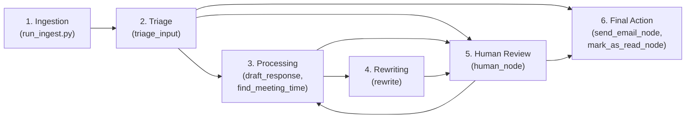
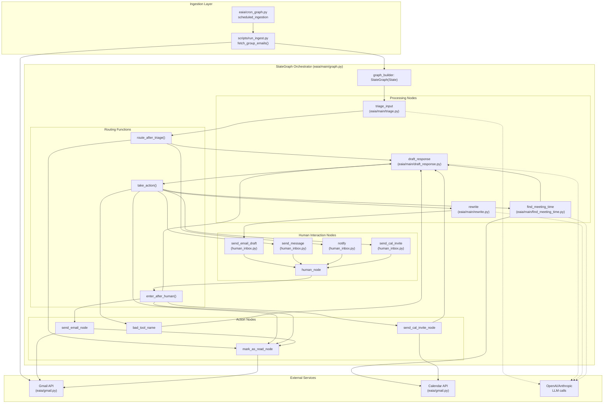
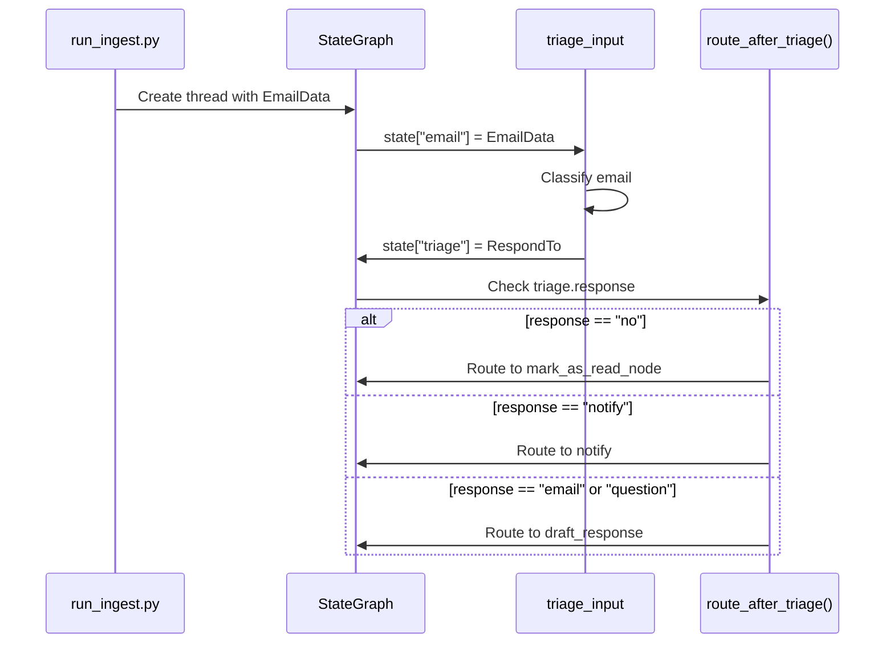
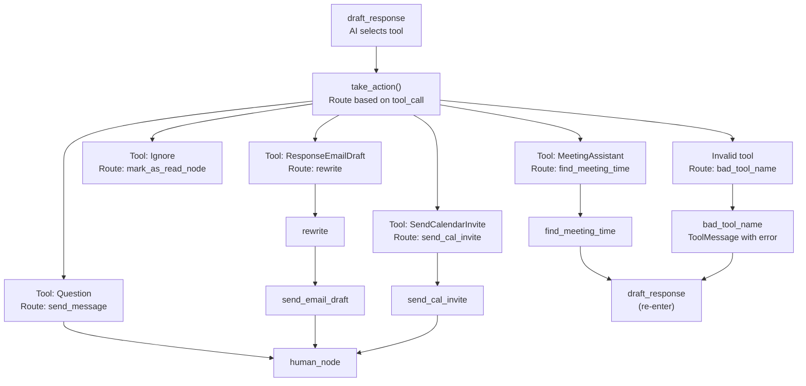
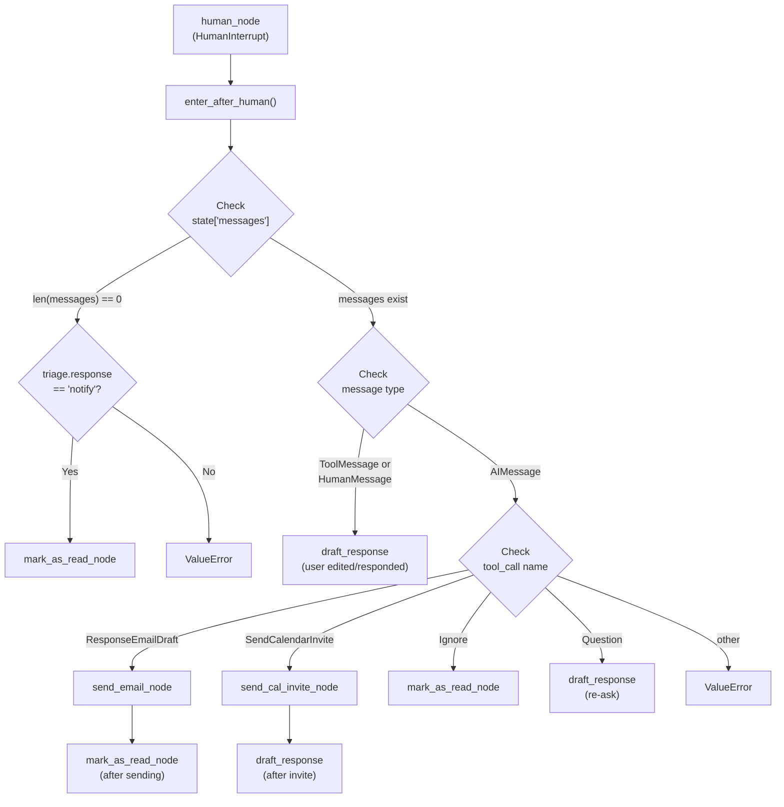

<!-- source: DeepWiki mcp.deepwiki.com · repo langchain-ai/executive-ai-assistant · page 2 Email Processing System · fetched 2026-10-26 -->

# Email Processing System

Relevant source files

The following files were used as context for generating this wiki page:

- [README.md](README.md)
- [eaia/main/graph.py](eaia/main/graph.py)

This document provides an overview of the complete email processing pipeline in EAIA, from email ingestion through classification, response generation, rewriting, and final actions. It explains how the `StateGraph` orchestrator coordinates processing nodes, manages state flow, and integrates with external services.

For detailed information about specific subsystems:
- Email fetching and thread creation: see [Email Ingestion](#2.1)
- Classification logic and decision-making: see [Email Triage Logic](#2.2)
- Draft generation and tone adjustment: see [Email Response Generation](#2.3)
- Meeting scheduling and calendar queries: see [Calendar Integration](#2.4)
- StateGraph coordination and routing: see [StateGraph Orchestration](#2.5)

For setup and configuration: see [Installation and Setup](#1.1) and [Configuration](#5).

## Pipeline Overview

The email processing pipeline consists of five distinct stages that transform incoming emails into actionable outputs:

**Sources:** [README.md:1-179](), [eaia/main/graph.py:1-191]()

### Stage Descriptions

| Stage | Purpose | Key Functions | Output |
|-------|---------|---------------|--------|
| **Ingestion** | Fetch emails from Gmail, create LangGraph threads | `fetch_group_emails`, `run_ingest.py` | `EmailData` objects, thread creation |
| **Triage** | Classify emails into response categories | `triage_input` | `RespondTo` with decision: "no", "notify", "email", "question" |
| **Processing** | Generate draft responses, query calendar | `draft_response`, `find_meeting_time` | Tool calls: `ResponseEmailDraft`, `Question`, `MeetingAssistant`, `SendCalendarInvite` |
| **Rewriting** | Adjust tone according to user preferences | `rewrite` | Modified email draft with adjusted tone |
| **Human Review** | Present work to user via Agent Inbox | `send_email_draft`, `notify`, `send_message`, `send_cal_invite` | User action: accept, edit, ignore, response |
| **Final Action** | Execute approved actions | `send_email_node`, `mark_as_read_node`, `send_cal_invite_node` | Gmail API calls to send/mark emails |

**Sources:** [eaia/main/graph.py:1-191](), [README.md:66-104]()

## System Components

The following diagram maps the high-level processing stages to their concrete implementations in the codebase:

**Sources:** [eaia/main/graph.py:1-191](), [README.md:1-179]()

## Processing Flow

The `StateGraph` in [eaia/main/graph.py:162-190]() defines the complete processing workflow. Each node processes the `State` object and makes routing decisions based on the current state.

### Entry Point and Triage

The graph entry point is the `triage_input` node ([graph.py:176]()):

The routing logic in [graph.py:30-42]() implements the three-way classification:

| Triage Response | Route Target | Behavior |
|----------------|--------------|----------|
| `"no"` | `mark_as_read_node` | Mark email as read, end processing |
| `"notify"` | `notify` | Send notification to user, no draft generated |
| `"email"` | `draft_response` | Generate draft response |
| `"question"` | `draft_response` | Ask user for clarification |

**Sources:** [eaia/main/graph.py:30-42](), [eaia/main/graph.py:162-176]()

### Draft Response and Tool Selection

The `draft_response` node ([eaia/main/draft_response.py]()) generates an AI message with tool calls. The `take_action` function ([graph.py:45-70]()) routes based on the selected tool:

The tool call routing in [graph.py:55-70]() checks `tool_calls[0]["name"]` and dispatches accordingly. Invalid tool names route to `bad_tool_name` ([graph.py:73-85]()), which injects an error message and re-enters `draft_response`.

**Sources:** [eaia/main/graph.py:45-85](), [eaia/main/graph.py:177-183]()

### Human Interaction and Final Actions

After processing, work is presented to the user via the `human_node` ([graph.py:153-154]()). The `enter_after_human` function ([graph.py:88-112]()) determines the next action based on user response:

The routing logic handles four scenarios:

1. **No messages + notify triage**: Mark as read without action
2. **User feedback** (`ToolMessage` or `HumanMessage`): Re-enter `draft_response` with feedback
3. **User accepted `ResponseEmailDraft`**: Execute via `send_email_node`
4. **User accepted `SendCalendarInvite`**: Execute via `send_cal_invite_node`

**Sources:** [eaia/main/graph.py:88-112](), [eaia/main/graph.py:186-189]()

## Core Data Structures

The processing pipeline operates on a central `State` TypedDict ([eaia/schemas.py]()) that flows through all nodes:

| Field | Type | Purpose | Updated By |
|-------|------|---------|------------|
| `email` | `EmailData` | Current email being processed | Ingestion (initial) |
| `messages` | `list[AnyMessage]` | Conversation history | `draft_response`, `rewrite`, tool nodes (via `add_messages` reducer) |
| `triage` | `RespondTo` | Classification decision | `triage_input` |

### EmailData Schema

The `EmailData` structure ([eaia/schemas.py]()) represents a Gmail email with fields:

- `id`: Gmail message ID
- `thread_id`: Gmail thread ID  
- `from_email`: Sender email address
- `from_name`: Sender display name
- `to_email`: Recipient email address
- `subject`: Email subject line
- `body`: Email body content
- `date`: Timestamp
- `snippet`: Email preview text

**Sources:** [eaia/schemas.py]()

### RespondTo Schema

The `RespondTo` schema ([eaia/main/triage.py]()) contains the triage classification:

- `response`: One of `"no"`, `"notify"`, `"email"`, `"question"`
- `rationale`: Explanation for the classification decision

**Sources:** [eaia/main/triage.py]()

### Tool Call Schemas

The `draft_response` node uses tool binding with these schemas ([eaia/main/draft_response.py]()):

- `ResponseEmailDraft`: Email draft with `content`, `new_recipients` fields
- `Question`: User query with `question` field
- `MeetingAssistant`: Meeting query with `request` field
- `SendCalendarInvite`: Calendar invite with `emails`, `title`, `start_time`, `end_time` fields

**Sources:** [eaia/main/draft_response.py]()

## Integration Points

The email processing system integrates with external services through well-defined interfaces:

### Gmail API Integration

Functions in [eaia/gmail.py]() provide Gmail operations:

- `fetch_group_emails(minutes_since, email)`: Fetch emails from last N minutes
- `send_email(message_id, content, email, addn_recipients)`: Send reply email
- `mark_as_read(message_id, email)`: Mark email as read
- `get_events_for_days(email, days, start_day)`: Query calendar events
- `send_calendar_invite(emails, title, start_time, end_time, sender_email)`: Create calendar event

These functions use Google OAuth authentication configured via [scripts/setup_gmail.py]().

**Sources:** [eaia/gmail.py](), [README.md:32-47]()

### LLM Integration

Processing nodes call LLM APIs through LangChain abstractions:

- `triage_input` ([eaia/main/triage.py]()): Uses `ChatOpenAI` or `ChatAnthropic` with structured output
- `draft_response` ([eaia/main/draft_response.py]()): Uses tool binding with multiple tools
- `rewrite` ([eaia/main/rewrite.py]()): Uses structured output for tone adjustment
- `find_meeting_time` ([eaia/main/find_meeting_time.py]()): Uses `create_react_agent` with calendar tools

**Sources:** [eaia/main/triage.py](), [eaia/main/draft_response.py](), [eaia/main/rewrite.py](), [eaia/main/find_meeting_time.py]()

### Agent Inbox Integration

Human interaction nodes ([eaia/main/human_inbox.py]()) use `AgentInboxClient` to present work:

- `send_email_draft`: Display draft for review
- `send_message`: Display question for user
- `notify`: Send notification without draft
- `send_cal_invite`: Display calendar invite for approval

These nodes inject `HumanInterrupt` exceptions that pause execution until user response arrives via Agent Inbox.

**Sources:** [eaia/main/human_inbox.py](), [README.md:90-104]()

## Configuration and Customization

The processing pipeline behavior is controlled by [eaia/main/config.yaml]():

| Configuration Key | Used By | Purpose |
|-------------------|---------|---------|
| `triage_no` | `triage_input` | Guidelines for ignoring emails |
| `triage_notify` | `triage_input` | Guidelines for notification-only emails |
| `triage_email` | `triage_input` | Guidelines for drafting responses |
| `response_preferences` | `draft_response` | Content preferences for drafts |
| `rewrite_preferences` | `rewrite` | Tone and style preferences |
| `schedule_preferences` | `draft_response`, `find_meeting_time` | Meeting scheduling preferences |
| `background_preferences` | `draft_response` | Contextual information for drafts |

Configuration is loaded via `get_config(config)` ([eaia/main/config.py]()) and merged with prompts stored in `BaseStore`.

**Sources:** [eaia/main/config.yaml](), [README.md:49-64]()

## Execution Models

The email processing system supports two execution models:

### Local Development

Run locally with [README.md:72-88]():

1. Start development server: `langgraph dev` (port 2024)
2. Trigger ingestion: `python scripts/run_ingest.py --minutes-since 120 --url http://127.0.0.1:2024`
3. Connect Agent Inbox to `http://127.0.0.1:2024` with graph ID `main`

### Production Deployment

Deploy to LangGraph Platform with [README.md:106-159]():

1. Deploy to LangGraph Platform via GitHub integration
2. Set up cron job: `python scripts/setup_cron.py --url ${DEPLOYMENT_URL}`
3. Automated ingestion via [eaia/cron_graph.py]() on schedule
4. Connect Agent Inbox to production deployment URL

The cron graph ([eaia/cron_graph.py]()) calls `run_ingest.py` with configurable parameters (`minutes_since`, `early`, `rerun`) to periodically check for new emails.

**Sources:** [README.md:66-159](), [eaia/cron_graph.py]()

---

