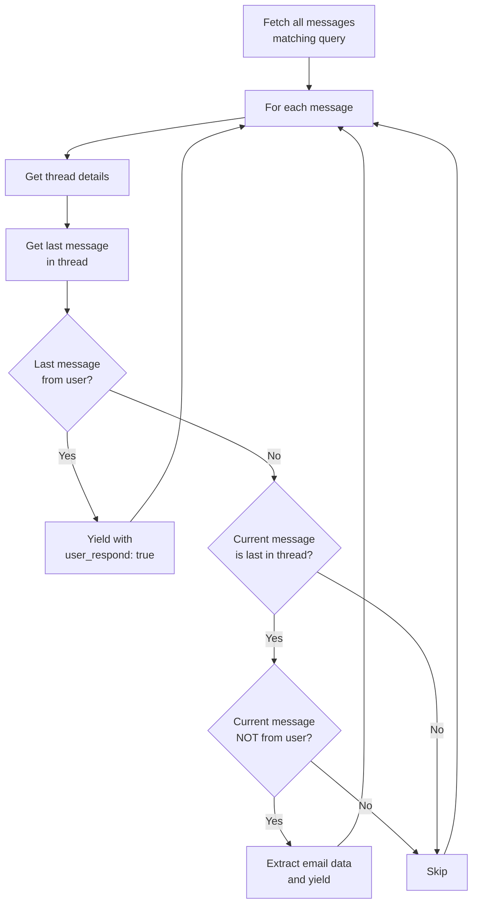
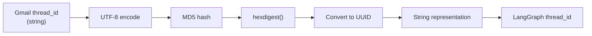
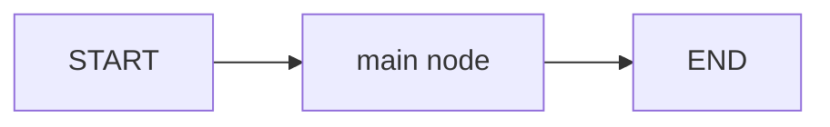
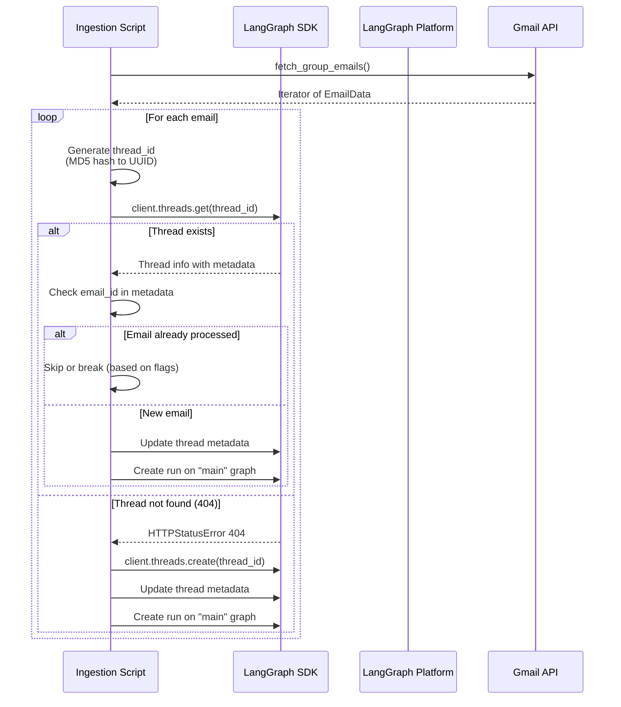

<!-- source: DeepWiki mcp.deepwiki.com · repo langchain-ai/executive-ai-assistant · page 2.1 Email Ingestion · fetched 2026-10-26 -->

# Email Ingestion

<details>
<summary>Relevant source files</summary>

The following files were used as context for generating this wiki page:

- [eaia/cron_graph.py](eaia/cron_graph.py)
- [eaia/gmail.py](eaia/gmail.py)
- [scripts/run_ingest.py](scripts/run_ingest.py)

</details>


## Purpose and Scope

Email ingestion is the entry point for the EAIA system. It fetches emails from Gmail, transforms them into structured `EmailData` objects, and creates or updates LangGraph threads for processing. This document covers the Gmail API integration, thread ID generation logic, and the two ingestion mechanisms (manual and automated).

For information about OAuth setup and credential management, see [Installation and Setup](#1.1). For details on what happens after ingestion (email classification and processing), see [Email Triage Logic](#2.2).

---

## System Overview

The email ingestion system operates through two primary entry points that share common logic:

1. **Manual Ingestion**: The `run_ingest.py` script allows developers to manually trigger email fetching, typically during development or testing
2. **Automated Ingestion**: The `cron_graph.py` StateGraph enables scheduled email checking in production deployments

Both mechanisms use the same core `fetch_group_emails()` function from `gmail.py` to retrieve emails, apply the same thread ID generation algorithm to ensure consistency, and create runs on the main StateGraph for processing.

**Sources:** [scripts/run_ingest.py:1-135](), [eaia/cron_graph.py:1-55](), [eaia/gmail.py:187-286]()

---

## Gmail API Integration

### Authentication and Credentials

The system authenticates with Gmail using OAuth2 credentials managed by LangChain Auth. The `get_credentials()` function retrieves tokens for a specific user email:

```python
async def get_credentials(
    user_email: str,
    langsmith_api_key: str | None = None
) -> Credentials
```

This function:
- Creates a LangChain Auth `Client` using the LangSmith API key
- Authenticates with Google's OAuth provider using the `user_email` as the user ID
- Requests scopes for Gmail modification and Calendar access
- Returns a `Credentials` object suitable for Google API calls

**Sources:** [eaia/gmail.py:30-83]()

### Fetching Emails

The `fetch_group_emails()` function is the core email retrieval mechanism:

```python
async def fetch_group_emails(
    to_email,
    minutes_since: int = 30,
    gmail_token: str | None = None,
    gmail_secret: str | None = None,
) -> Iterable[EmailData]
```

#### Query Construction

The function constructs a Gmail query to find relevant emails:

```
(to:{user_email} OR from:{user_email}) after:{timestamp}
```

This query retrieves:
- Emails sent **to** the user
- Emails sent **from** the user (to detect user responses)
- Only emails received after a specified timestamp (controlled by `minutes_since` parameter)

**Sources:** [eaia/gmail.py:187-198]()

### Email Filtering Logic

The function implements sophisticated filtering to determine which emails require processing:



The logic ensures:
- **User Response Detection**: If the last message in a thread is from the user, it yields a marker indicating the user already responded (preventing duplicate responses)
- **Actionable Emails Only**: Only emails where the current message is the last in the thread and NOT from the user are processed
- **Recent Emails**: Emails are already filtered by timestamp in the query

**Sources:** [eaia/gmail.py:216-281]()

### Email Data Extraction

For each processable email, the function extracts structured data:

| Field | Source | Description |
|-------|--------|-------------|
| `from_email` | `From` header | Sender address (or `Reply-To` if present) |
| `to_email` | `To` header | Recipient address |
| `subject` | `Subject` header | Email subject line |
| `page_content` | Message body | Extracted via `extract_message_part()` |
| `id` | Message ID | Gmail message identifier |
| `thread_id` | Thread ID | Gmail thread identifier |
| `send_time` | `Date` header | ISO format timestamp |

The `extract_message_part()` function recursively walks through MIME parts to find either plain text or HTML content, decoding base64-encoded data.

**Sources:** [eaia/gmail.py:246-280](), [eaia/gmail.py:86-101]()

---

## Thread ID Generation

### Deterministic UUID Generation

A critical component of the ingestion system is generating consistent thread identifiers across runs. Both `run_ingest.py` and `cron_graph.py` use identical logic:

```python
thread_id = str(
    uuid.UUID(hex=hashlib.md5(email["thread_id"].encode("UTF-8")).hexdigest())
)
```

#### Algorithm Steps



This process:
1. Takes Gmail's native `thread_id` (a string identifier)
2. Encodes it as UTF-8 bytes
3. Computes an MD5 hash
4. Converts the hash digest to a UUID format
5. Stringifies the UUID for use as a LangGraph thread ID

#### Why This Matters

- **Consistency**: The same Gmail thread always maps to the same LangGraph thread, regardless of when ingestion runs
- **Idempotency**: Re-running ingestion for the same time period doesn't create duplicate processing threads
- **Thread Continuity**: Multiple emails in the same Gmail conversation are processed in the same LangGraph thread context

**Sources:** [scripts/run_ingest.py:44-46](), [eaia/cron_graph.py:22-24]()

---

## Ingestion Mechanisms

### Manual Ingestion: `run_ingest.py`

The manual ingestion script provides developer control over email fetching:

#### Script Parameters

| Parameter | Type | Default | Description |
|-----------|------|---------|-------------|
| `--url` | string | `http://127.0.0.1:2024` | LangGraph server URL to target |
| `--minutes-since` | int | 60 | Fetch emails from last N minutes |
| `--early` | int | 1 | Break when encountering already-seen emails |
| `--rerun` | int | 0 | Reprocess all emails even if seen |
| `--gmail-token` | string | None | (Deprecated) Gmail OAuth token |
| `--gmail-secret` | string | None | (Deprecated) Gmail OAuth secret |
| `--email` | string | None | Email address to fetch for (overrides config) |

#### Usage Examples

```bash
# Local development - fetch last hour of emails
python scripts/run_ingest.py

# Target production deployment
python scripts/run_ingest.py --url https://your-deployment.langraph.app

# Fetch last 2 hours, process all even if seen
python scripts/run_ingest.py --minutes-since 120 --rerun 1

# Fetch for specific email address
python scripts/run_ingest.py --email user@example.com
```

**Sources:** [scripts/run_ingest.py:78-134]()

### Automated Ingestion: `cron_graph.py`

The automated ingestion system is implemented as a LangGraph StateGraph designed for scheduled execution:

#### State Schema

```python
class JobKickoff(TypedDict):
    minutes_since: int
```

The graph accepts a single parameter controlling the time window for email fetching.

#### Graph Structure



The graph is minimal by design - it contains a single node that performs all ingestion logic.

#### Deployment Pattern

In production, this graph is deployed to LangGraph Platform and triggered by cron jobs (see [Automated Email Processing](#6.3)). The cron scheduler invokes the graph with a specified `minutes_since` value, typically set to match the cron interval to ensure no emails are missed.

**Sources:** [eaia/cron_graph.py:1-55]()

---

## Email Processing Workflow

### Thread Management

Both ingestion mechanisms follow the same workflow for each email:



**Sources:** [scripts/run_ingest.py:44-75](), [eaia/cron_graph.py:17-47]()

### Metadata Management

Each LangGraph thread maintains metadata to track processing state:

```python
metadata = {
    "email_id": email["id"]  # Gmail message ID of most recently processed email
}
```

This metadata enables:
- **Deduplication**: Checking if an email has already been processed in this thread
- **State Recovery**: Understanding the last email processed if the system restarts
- **Thread History**: Tracking which emails have been handled for a given conversation

The metadata is updated before creating a new run:

```python
await client.threads.update(thread_id, metadata={"email_id": email["id"]})
```

**Sources:** [scripts/run_ingest.py:59-68](), [eaia/cron_graph.py:37-40]()

### Run Creation

After ensuring the thread exists and is up-to-date, a new run is created on the `main` graph:

```python
await client.runs.create(
    thread_id,
    "main",
    input={"email": email},
    multitask_strategy="rollback",
)
```

Key parameters:
- **thread_id**: The generated UUID linking this run to the email thread
- **"main"**: The graph name to execute (defined in `graph.py`)
- **input**: The `EmailData` object to process
- **multitask_strategy="rollback"**: If a new run is created while one is active, rollback the current run

This invokes the main StateGraph which routes the email through triage, drafting, and other processing nodes (see [StateGraph Orchestration](#2.5)).

**Sources:** [scripts/run_ingest.py:70-75](), [eaia/cron_graph.py:42-47]()

### User Response Handling

When `fetch_group_emails()` detects that the user has already responded (last message in thread is from the user), it yields a special marker:

```python
yield {
    "id": message["id"],
    "thread_id": message["threadId"],
    "user_respond": True,
}
```

The ingestion logic handles this case specially:

```python
if "user_respond" in email:
    await client.threads.update_state(thread_id, None, as_node="__end__")
    continue
```

This immediately moves the thread to the END state, preventing any further processing. This is crucial because:
- The user has already handled the email manually
- No AI response is needed
- The thread should be marked as complete to avoid retriggering

**Sources:** [eaia/gmail.py:239-243](), [scripts/run_ingest.py:50-58](), [eaia/cron_graph.py:28-36]()

---

## Deduplication and Control Flags

### Email Deduplication

The system implements deduplication at the thread level by comparing the current email's ID with the `email_id` stored in thread metadata:

```python
recent_email = thread_info["metadata"].get("email_id")
if recent_email == email["id"]:
    # Email already processed
```

When a duplicate is detected, behavior depends on control flags.

**Sources:** [scripts/run_ingest.py:59-67]()

### Early Termination: `--early` Flag

The `early` flag (default: `1` / `True`) controls behavior when a duplicate email is encountered:

```python
if recent_email == email["id"]:
    if early:
        break  # Stop processing further emails
    else:
        if rerun:
            pass  # Continue to rerun logic
        else:
            continue  # Skip this email, continue to next
```

**When `early=True` (default)**:
- Encountering a previously-seen email terminates the entire ingestion run
- Assumes emails are returned in reverse chronological order
- Optimization: if we've already processed this email, we've processed all earlier emails too

**When `early=False`**:
- The script continues processing all emails in the time window
- Useful for ensuring completeness if email ordering is uncertain
- Required when using `--rerun` flag

**Sources:** [scripts/run_ingest.py:61-67]()

### Reprocessing: `--rerun` Flag

The `rerun` flag (default: `0` / `False`) forces reprocessing of previously-seen emails:

```python
if recent_email == email["id"]:
    if early:
        break
    else:
        if rerun:
            pass  # Allow reprocessing
        else:
            continue  # Skip
```

**When `rerun=True`**:
- Thread metadata is updated with the current email ID
- A new run is created even if this email was previously processed
- Useful for testing changes to processing logic
- **Requires `early=False`** to work properly

**When `rerun=False` (default)**:
- Duplicate emails are skipped
- Prevents redundant processing and duplicate responses

**Sources:** [scripts/run_ingest.py:64-67]()

### Control Flag Combinations

| `early` | `rerun` | Behavior |
|---------|---------|----------|
| True | False | Stop at first seen email (default, most efficient) |
| True | True | Invalid - early termination prevents rerun |
| False | False | Skip seen emails, process all new emails |
| False | True | Reprocess all emails in time window |

---

## Configuration Integration

### Email Address Resolution

Both ingestion mechanisms need to know which email address to fetch for. This is determined in order of precedence:

1. **Command-line argument** (manual ingestion only):
   ```python
   if email is None:
       email_address = get_config({"configurable": {}})["email"]
   else:
       email_address = email
   ```

2. **Configuration file**: Via `get_config()` which loads from `config.yaml`

The automated `cron_graph.py` always uses the config:

```python
email = get_config(config)["email"]
```

**Sources:** [scripts/run_ingest.py:21-24](), [eaia/cron_graph.py:19]()

### LangGraph Client Configuration

The ingestion scripts connect to LangGraph Platform using the SDK client:

**Manual Ingestion**:
```python
if url is None:
    client = get_client(url="http://127.0.0.1:2024")  # Local development
else:
    client = get_client(url=url)  # Specified URL
```

**Automated Ingestion**:
```python
client = get_client()  # Uses environment variables
```

In production deployment on LangGraph Platform, the automated graph inherits connection configuration from the platform environment.

**Sources:** [scripts/run_ingest.py:25-30](), [eaia/cron_graph.py:10]()

---

## Error Handling

### Thread Lookup Failures

The most common error case is when a thread doesn't exist yet. This is handled gracefully:

```python
try:
    thread_info = await client.threads.get(thread_id)
except httpx.HTTPStatusError as e:
    if "user_respond" in email:
        continue  # Skip user responses if thread missing
    if e.response.status_code == 404:
        thread_info = await client.threads.create(thread_id=thread_id)
    else:
        raise e  # Re-raise unexpected errors
```

This pattern:
- Creates threads on-demand when they don't exist
- Gracefully handles user-respond markers even if thread is missing
- Propagates unexpected HTTP errors for debugging

**Sources:** [scripts/run_ingest.py:47-55](), [eaia/cron_graph.py:26-33]()

### Email Parsing Failures

Individual email parsing failures are logged but don't stop the entire ingestion process:

```python
try:
    # Email parsing and processing logic
    yield { ... }
except Exception:
    logger.info(f"Failed on {message}")
```

This ensures one malformed email doesn't prevent processing of other emails in the batch.

**Sources:** [eaia/gmail.py:282-283]()

---

## Summary

The email ingestion system provides a robust foundation for the EAIA pipeline:

- **Gmail Integration**: Uses OAuth2 authentication and queries Gmail API for recent emails
- **Thread Consistency**: MD5-based UUID generation ensures deterministic thread mapping
- **Dual Mechanisms**: Manual script for development, automated graph for production
- **Smart Filtering**: Detects user responses and actionable emails requiring processing
- **Deduplication**: Thread metadata prevents reprocessing the same email
- **Flexible Control**: Flags enable different processing strategies (early termination, rerun)

After ingestion creates a run with `EmailData` input, the main StateGraph takes over to triage and process the email (see [Email Triage Logic](#2.2) and [StateGraph Orchestration](#2.5)).

**Sources:** [eaia/gmail.py:1-450](), [scripts/run_ingest.py:1-135](), [eaia/cron_graph.py:1-55]()

---

