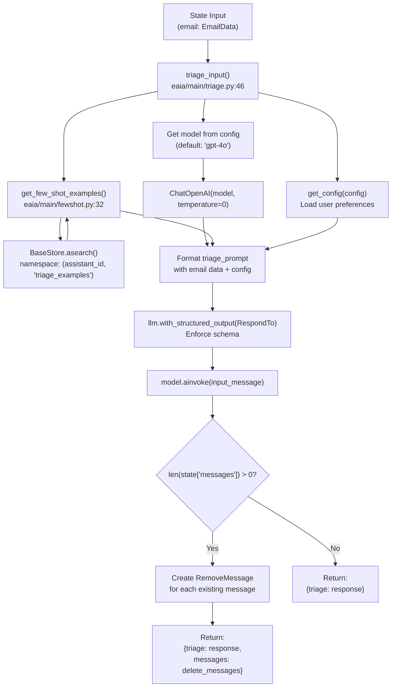
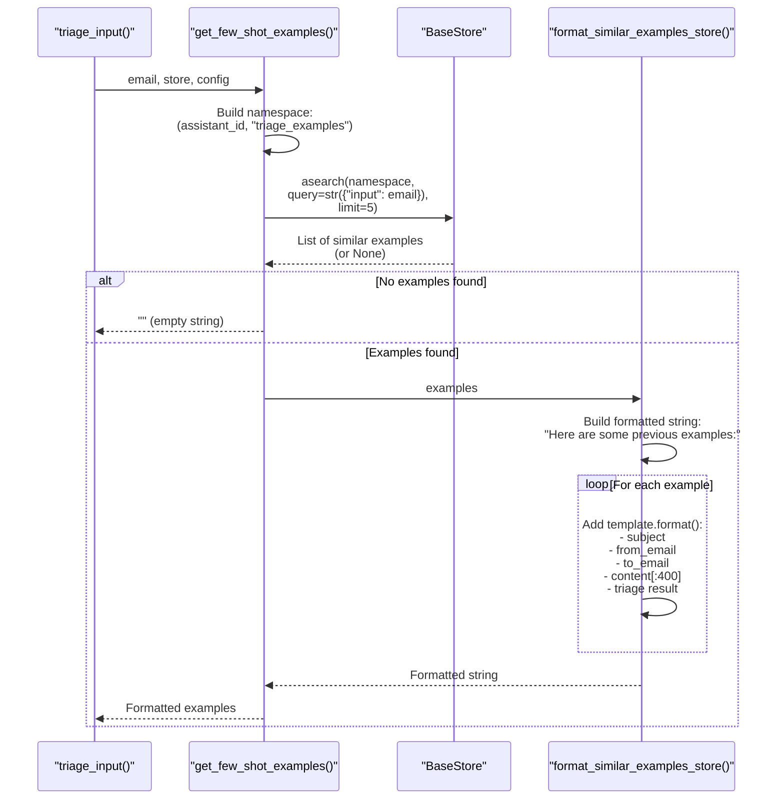

<!-- source: DeepWiki mcp.deepwiki.com · repo langchain-ai/executive-ai-assistant · page 2.2 Email Triage Logic · fetched 2026-10-26 -->

# Email Triage Logic

<details>
<summary>Relevant source files</summary>

The following files were used as context for generating this wiki page:

- [eaia/main/fewshot.py](eaia/main/fewshot.py)
- [eaia/main/triage.py](eaia/main/triage.py)

</details>


This page documents the email triage system implemented in `eaia/main/triage.py`, which performs the initial classification of incoming emails. The triage system determines whether an email should be ignored, requires a drafted response, or needs user notification without a response. For information about what happens after triage (response generation), see [Email Response Generation](#2.3). For configuration of triage rules, see [Email Preferences Configuration](#5.1).

**Sources:** [eaia/main/triage.py:1-73]()

## Three-Way Classification System

The triage system classifies each email into one of three categories, represented by the `RespondTo` schema:

| Response Type | Value | Meaning | Subsequent Action |
|---------------|-------|---------|-------------------|
| **No Response** | `"no"` | Email is not worth responding to or notifying about | Email marked as read, processing ends |
| **Email Response** | `"email"` | Email requires a drafted response | Proceeds to draft_response.py |
| **Notification** | `"notify"` | Important for user to know about, but no response needed | User notified via Agent Inbox |

The classification is driven by user-configured rules defined in `config.yaml`:
- `triage_no`: Description of emails to ignore
- `triage_email`: Description of emails requiring responses
- `triage_notify`: Description of emails requiring notification only

**Sources:** [eaia/main/triage.py:16-43](), [eaia/schemas.py]()

## Triage Workflow



**Workflow Steps:**

1. **Model Configuration**: Retrieves the LLM model from `config["configurable"]["model"]`, defaulting to `"gpt-4o"` [eaia/main/triage.py:47-48]()

2. **Few-Shot Example Retrieval**: Calls `get_few_shot_examples()` to retrieve up to 5 semantically similar historical triage decisions from BaseStore [eaia/main/triage.py:49]()

3. **User Configuration Loading**: Loads user-specific triage rules and preferences via `get_config()` [eaia/main/triage.py:50]()

4. **Prompt Formatting**: Populates the `triage_prompt` template with:
   - Email metadata (from, to, subject)
   - Email thread content
   - Few-shot examples
   - User configuration (name, background, triage rules)
   [eaia/main/triage.py:51-63]()

5. **Structured Output Binding**: Applies `with_structured_output(RespondTo)` to enforce the response schema and uses `tool_choice` to guarantee the RespondTo function is called [eaia/main/triage.py:64-66]()

6. **LLM Invocation**: Sends the formatted prompt to the LLM [eaia/main/triage.py:67]()

7. **Message Cleanup**: If previous messages exist in state (e.g., from a re-run), creates `RemoveMessage` objects to clear them before returning the triage decision [eaia/main/triage.py:68-70]()

**Sources:** [eaia/main/triage.py:46-72](), [eaia/main/fewshot.py:32-40](), [eaia/main/config.py]()

## Prompt Template Structure

The `triage_prompt` template [eaia/main/triage.py:16-43]() follows a structured format:

### Identity and Context
```
You are {full_name}'s executive assistant. You are a top-notch executive assistant 
who cares about {name} performing as well as possible.

{background}.
```
Establishes the assistant's role and loads user background from configuration.

### Task Description
```
{name} gets lots of emails. Your job is to categorize the below email to see 
whether is it worth responding to.
```

### Classification Rules
Three sections define the classification criteria using user-configured descriptions:

1. **Emails not worth responding to**: `{triage_no}` - Examples of emails to ignore
2. **Emails worth responding to**: `{triage_email}` - Examples requiring draft responses
3. **Emails to notify about**: `{triage_notify}` - Examples requiring notification only

### Decision Instructions
```
For emails not worth responding to, respond `no`. 
For something where {name} should respond over email, respond `email`. 
If it's important to notify {name}, but no email is required, respond `notify`.

If unsure, opt to `notify` {name} - you will learn from this in the future.
```
The prompt explicitly instructs the LLM to prefer `notify` when uncertain, as this triggers user feedback that improves future triage accuracy via the reflection system.

### Few-Shot Examples
```
{fewshotexamples}
```
Inserts 0-5 similar historical triage decisions retrieved from BaseStore.

### Current Email
```
Please determine how to handle the below email thread:

From: {author}
To: {to}
Subject: {subject}

{email_thread}
```
Presents the current email for classification.

**Sources:** [eaia/main/triage.py:16-43]()

## Few-Shot Learning Mechanism



The few-shot learning system retrieves similar historical triage decisions to guide the LLM:

### Storage and Retrieval

**Namespace**: Examples are stored in BaseStore under the namespace `(assistant_id, "triage_examples")` [eaia/main/fewshot.py:33-36](), enabling per-user example storage.

**Semantic Search**: The system uses `BaseStore.asearch()` with the email as the query, retrieving up to 5 semantically similar examples [eaia/main/fewshot.py:37](). This leverages embedding-based similarity to find relevant historical decisions.

**Storage Structure**: Each example stored includes:
- `value["input"]`: The original email data (subject, from, to, content)
- `value["triage"]`: The triage decision ("no", "email", or "notify")

### Example Formatting

The `format_similar_examples_store()` function [eaia/main/fewshot.py:17-29]() transforms retrieved examples into a formatted string:

```
Here are some previous examples:

Email Subject: {subject}
Email From: {from_email}
Email To: {to_email}
Email Content: 
```
{content (first 400 chars)}
```
> Triage Result: {result}

------------

[Additional examples follow same format]
```

**Content Truncation**: Email content is truncated to 400 characters [eaia/main/fewshot.py:25]() to keep the prompt concise while providing sufficient context.

**Empty State Handling**: If no examples are found, an empty string is returned [eaia/main/fewshot.py:38-39](), allowing the triage to proceed without few-shot guidance.

### Learning Over Time

Examples are added to BaseStore when users interact with triage decisions via Agent Inbox. The `save_email()` function (documented in [Memory and Storage](#4.2)) persists triage outcomes, gradually building a personalized example database that improves classification accuracy.

**Sources:** [eaia/main/fewshot.py:1-41](), [eaia/main/triage.py:49]()

## Configuration Integration

The triage system integrates with user-specific configuration loaded from `config.yaml`:

| Config Field | Type | Usage in Prompt | Purpose |
|-------------|------|-----------------|---------|
| `name` | string | `{name}` | Short name reference throughout prompt |
| `full_name` | string | `{full_name}` | Formal identity in opening |
| `background` | string | `{background}` | User context and priorities |
| `triage_no` | string | `{triage_no}` | Rules for emails to ignore |
| `triage_email` | string | `{triage_email}` | Rules for emails requiring responses |
| `triage_notify` | string | `{triage_notify}` | Rules for notification-only emails |

### Configuration Loading

The `get_config()` function [eaia/main/triage.py:50]() retrieves configuration from `RunnableConfig`, which is populated from `config.yaml` at graph initialization. This allows the same triage code to work for different users with different preferences.

### Example Configuration Values

From the typical `config.yaml` structure:

```yaml
triage_no: |
  - Newsletters or marketing emails
  - Automated notifications from services
  - Emails already handled by someone else

triage_email: |
  - Direct questions requiring your input
  - Meeting requests
  - Partnership or business opportunities

triage_notify: |
  - FYI emails from team members
  - Status updates on important projects
  - Urgent issues that others are handling
```

These string values are directly inserted into the `triage_prompt` template, making the classification rules fully customizable without code changes.

**Sources:** [eaia/main/triage.py:50-63](), [eaia/main/config.py](), [eaia/main/config.yaml]()

## State Management and Output

### Input State

The `triage_input` function receives `State` containing:
- `email`: EmailData object with all email metadata and content
- `messages`: List of any previous messages in the conversation (may be empty)

### Output State Update

The function returns a dictionary that updates the State:

**Standard Case** (no previous messages):
```python
{"triage": response}
```
Updates only the `triage` field with the `RespondTo` decision [eaia/main/triage.py:72]().

**Cleanup Case** (previous messages exist):
```python
{"triage": response, "messages": delete_messages}
```
Updates `triage` and also removes previous messages using `RemoveMessage` objects [eaia/main/triage.py:68-70](). This cleanup is necessary when re-running triage on the same email thread, ensuring stale messages don't interfere with downstream processing.

### RespondTo Schema

The `RespondTo` schema (defined in `eaia/schemas.py`) enforces the three-way classification:

```python
class RespondTo(BaseModel):
    response: Literal["no", "notify", "email"]
```

By using `with_structured_output(RespondTo)` and setting `tool_choice` [eaia/main/triage.py:64-66](), the system guarantees:
1. The LLM response conforms to the expected schema
2. The `response` field contains exactly one of the three valid values
3. No additional parsing or validation is required

### State Flow After Triage

```mermaid
flowchart LR
    Triage["triage_input()<br/>Updates state.triage"]
    
    RouteAfterTriage["route_after_triage()<br/>in graph.py"]
    
    MarkRead["mark_as_read()<br/>gmail.py"]
    Notify["notify()<br/>human_inbox.py"]
    Draft["draft_response()<br/>draft_response.py"]
    
    Triage --> RouteAfterTriage
    
    RouteAfterTriage -->|response == "no"| MarkRead
    RouteAfterTriage -->|response == "notify"| Notify
    RouteAfterTriage -->|response == "email"| Draft
```

The `route_after_triage` conditional edge in the StateGraph (see [StateGraph Orchestration](#2.5)) reads `state["triage"]["response"]` to determine the next processing node:
- `"no"` → Directly to email marking (no further processing)
- `"notify"` → Human notification without drafting
- `"email"` → Response drafting pipeline

**Sources:** [eaia/main/triage.py:46-72](), [eaia/schemas.py](), [eaia/main/graph.py]()

## Model Configuration

The triage system supports dynamic model selection:

```python
model = config["configurable"].get("model", "gpt-4o")
llm = ChatOpenAI(model=model, temperature=0)
```
[eaia/main/triage.py:47-48]()

**Default Model**: `"gpt-4o"` provides a balance of speed and accuracy for classification tasks.

**Temperature**: Set to `0` for deterministic, consistent classification decisions.

**Runtime Override**: The model can be overridden at runtime via the `config` parameter, enabling:
- Testing with different models
- Per-user model preferences
- Cost optimization strategies

**Supported Models**: Any model supported by `ChatOpenAI`, including:
- `gpt-4o` (default, recommended)
- `gpt-4o-mini` (faster, more cost-effective)
- `o1` series (for more complex reasoning, though overkill for triage)

**Sources:** [eaia/main/triage.py:47-48]()

---

