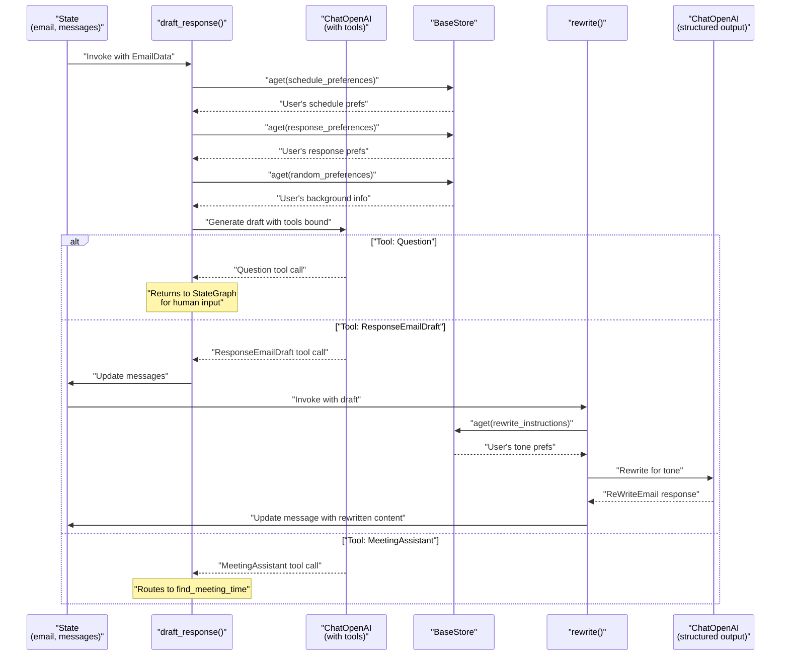
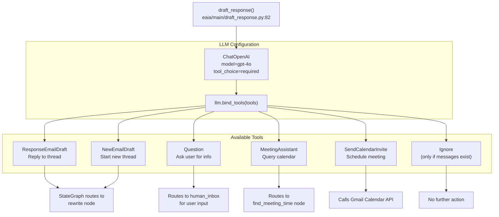
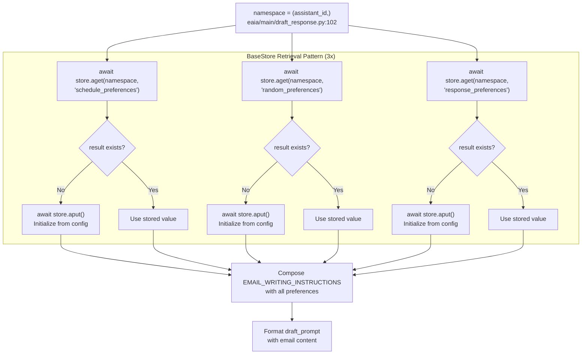
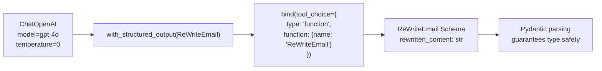
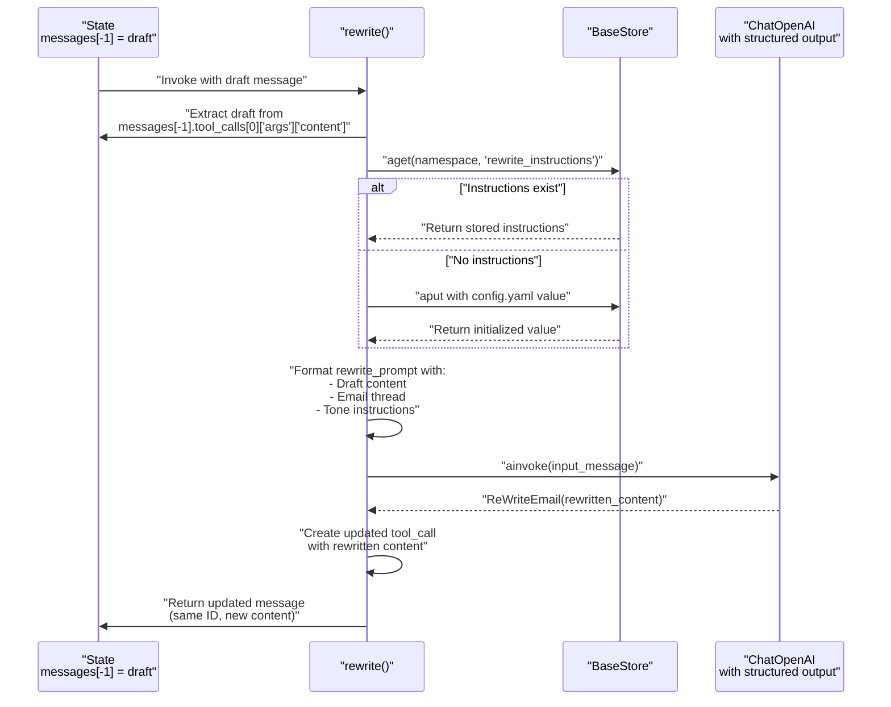
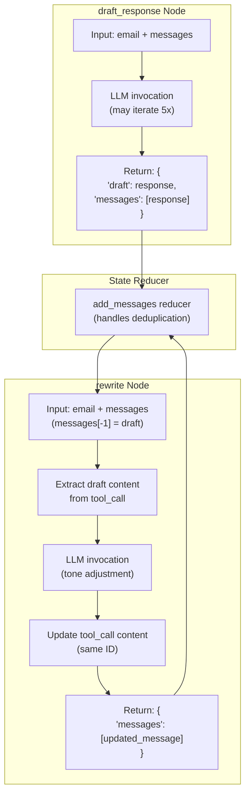
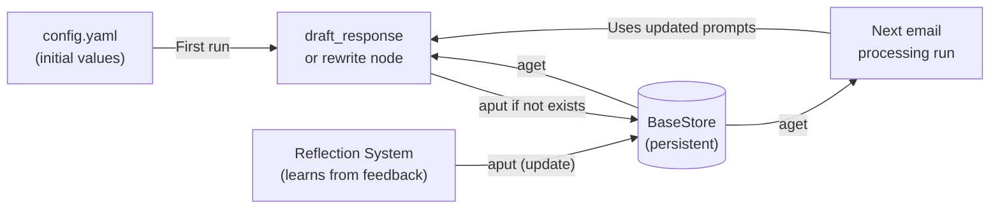

<!-- source: DeepWiki mcp.deepwiki.com · repo langchain-ai/executive-ai-assistant · page 2.3 Email Response Generation · fetched 2026-10-26 -->

# Email Response Generation

<details>
<summary>Relevant source files</summary>

The following files were used as context for generating this wiki page:

- [eaia/main/draft_response.py](eaia/main/draft_response.py)
- [eaia/main/rewrite.py](eaia/main/rewrite.py)

</details>


## Purpose and Scope

This document covers the email response generation system, which creates draft replies to incoming emails. The system operates in two stages: initial draft generation via `draft_response.py` and tone adjustment via `rewrite.py`. This page focuses on the drafting and rewriting mechanics; for email classification logic that determines whether a draft is needed, see [Email Triage Logic](#2.2). For how drafted emails are presented to users, see [Human-in-the-Loop Interface](#3).

---

## Two-Stage Response Generation

The email response generation system follows a two-stage architecture:

1. **Draft Generation** (`draft_response.py`): An LLM equipped with multiple tools generates an initial response that is factually correct and includes necessary information
2. **Tone Adjustment** (`rewrite.py`): A separate LLM rewrites the draft to match the user's writing style without changing factual content

This separation ensures that content generation (which may require tool calls for information gathering) is independent from style adjustment (which focuses purely on tone and phrasing).



**Sources:**
- [eaia/main/draft_response.py:82-154]()
- [eaia/main/rewrite.py:33-79]()

---

## Draft Generation

### Function Overview

The `draft_response` function [eaia/main/draft_response.py:82-154]() is the core drafting node in the StateGraph. It generates initial email responses by invoking an LLM with multiple tools bound, allowing the assistant to take various actions based on the email context.

**Function Signature:**
```python
async def draft_response(state: State, config: RunnableConfig, store: BaseStore)
```

**Parameters:**
| Parameter | Type | Purpose |
|-----------|------|---------|
| `state` | `State` | Contains `email` (EmailData) and `messages` (conversation history) |
| `config` | `RunnableConfig` | Provides model selection and assistant_id for namespace |
| `store` | `BaseStore` | Persistent storage for user-specific prompts |

**Returns:** Dictionary with keys:
- `draft`: The LLM response containing tool call
- `messages`: List containing the response message (added to state via `add_messages` reducer)

**Sources:**
- [eaia/main/draft_response.py:82-154]()

### Tool Binding Architecture

The draft generation system uses LangChain's tool binding pattern to provide the LLM with five distinct capabilities:



**Tool Selection Logic:**

The system includes all five primary tools [eaia/main/draft_response.py:91-97](), and conditionally adds the `Ignore` tool if there are existing messages in the conversation [eaia/main/draft_response.py:98-100](). This allows the LLM to signal that no further action is needed if a previous exchange has resolved the matter.

The `tool_choice="required"` parameter [eaia/main/draft_response.py:89]() forces the LLM to call exactly one tool, ensuring structured output rather than freeform text.

**Tool Descriptions:**

| Tool Class | Purpose | When Used | Result |
|------------|---------|-----------|--------|
| `ResponseEmailDraft` | Reply to current thread | Most common case for responses | Routes to rewrite node |
| `NewEmailDraft` | Start new email thread | Introductions, follow-ups to different recipients | Routes to rewrite node |
| `Question` | Request information from user | Missing details, unclear preferences | Routes to human_inbox for input |
| `MeetingAssistant` | Get calendar availability | Scheduling meetings, finding times | Routes to find_meeting_time node |
| `SendCalendarInvite` | Send calendar event | When time is confirmed and calendar is free | Sends invite via Gmail API |
| `Ignore` | Take no action | Previous exchange resolved the issue | Marks as complete |

**Sources:**
- [eaia/main/draft_response.py:84-100]()
- [eaia/schemas.py:60-48321]() (tool definitions)

### Prompt Retrieval and Composition

The draft generation system uses a sophisticated prompt composition strategy that retrieves user-specific preferences from BaseStore and combines them with a master template.

**Prompt Retrieval Flow:**



**Prompt Types and Storage Keys:**

The system retrieves three types of prompts from BaseStore:

| Storage Key | Config Source | Purpose | Used In Template Section |
|-------------|---------------|---------|--------------------------|
| `schedule_preferences` | `config.yaml:schedule_preferences` | Meeting scheduling guidelines | Line 55 of EMAIL_WRITING_INSTRUCTIONS |
| `random_preferences` | `config.yaml:background_preferences` | Background information about user | Line 72 of EMAIL_WRITING_INSTRUCTIONS |
| `response_preferences` | `config.yaml:response_preferences` | Email content preferences | Line 48 of EMAIL_WRITING_INSTRUCTIONS |

**Retrieval Pattern:**

Each prompt type follows the same lazy initialization pattern [eaia/main/draft_response.py:103-125]():

1. Attempt to retrieve from BaseStore using namespace `(assistant_id,)` and storage key
2. If found and contains `"data"` field, use stored value
3. If not found, initialize with value from `config.yaml` via `get_config()`
4. Store initialized value in BaseStore for future use

This pattern enables the [Learning and Reflection System](#4) to update prompts over time while ensuring they're always available.

**Template Composition:**

The `EMAIL_WRITING_INSTRUCTIONS` template [eaia/main/draft_response.py:19-72]() is formatted with:
- User identification: `name`, `full_name`, `background`
- Retrieved preferences: `schedule_preferences`, `random_preferences`, `response_preferences`

The formatted template is then embedded in `draft_prompt` [eaia/main/draft_response.py:134-142]() along with the email content using `email_template`.

**Sources:**
- [eaia/main/draft_response.py:101-133]()
- [eaia/main/draft_response.py:19-79]()
- [eaia/main/config.py]() (get_config function)

### Iterative Tool Call Validation

The draft generation system implements a validation loop to ensure the LLM produces exactly one valid tool call, preventing malformed responses.

**Validation Loop:**

```python
# From eaia/main/draft_response.py:146-154
while i < 5:
    response = await model.ainvoke(messages)
    if len(response.tool_calls) != 1:
        i += 1
        messages += [{"role": "user", "content": "Please call a valid tool call."}]
    else:
        break
```

**Loop Behavior:**

| Iteration | Condition | Action |
|-----------|-----------|--------|
| Initial | Always runs | Invoke LLM with tools bound |
| Check | `len(response.tool_calls) != 1` | LLM called 0 tools or multiple tools |
| Retry | If check fails | Append correction message and re-invoke |
| Success | Exactly 1 tool call | Break loop and return |
| Max retries | After 5 attempts | Return last response (may be invalid) |

**Why Validation is Needed:**

Despite `tool_choice="required"` [eaia/main/draft_response.py:89](), LLMs occasionally:
- Fail to call any tool
- Attempt to call multiple tools simultaneously (despite `parallel_tool_calls=False`)
- Generate malformed tool calls

The validation loop corrects these issues by providing explicit feedback to the LLM, typically resulting in a valid tool call on the second attempt.

**Return Value:**

The function returns a dictionary [eaia/main/draft_response.py:154]() with:
- `draft`: The full LLM response object (contains tool call)
- `messages`: List containing the response (added to State via `add_messages` reducer)

The `draft` key is temporary state used by subsequent nodes, while `messages` becomes part of the persistent conversation history.

**Sources:**
- [eaia/main/draft_response.py:146-154]()

---

## Tone Adjustment

### Function Overview

The `rewrite` function [eaia/main/rewrite.py:33-79]() adjusts the tone and style of drafted emails to match the user's writing preferences without altering factual content. This node executes after `draft_response` produces a `ResponseEmailDraft` or `NewEmailDraft` tool call.

**Function Signature:**
```python
async def rewrite(state: State, config, store)
```

**Parameters:**
| Parameter | Type | Purpose |
|-----------|------|---------|
| `state` | `State` | Contains `email` and `messages` (including draft) |
| `config` | `RunnableConfig` | Provides model selection and assistant_id |
| `store` | `BaseStore` | Storage for `rewrite_instructions` prompt |

**Returns:** Dictionary with key:
- `messages`: List containing updated message with rewritten content

**Sources:**
- [eaia/main/rewrite.py:33-79]()

### Structured Output Pattern

The rewrite system uses LangChain's `with_structured_output` pattern to enforce schema compliance and extract the rewritten text reliably.

**Structured Output Configuration:**



**Implementation:**

```python
# From eaia/main/rewrite.py:59-61
model = llm.with_structured_output(ReWriteEmail).bind(
    tool_choice={"type": "function", "function": {"name": "ReWriteEmail"}}
)
```

**Why This Pattern:**

The structured output pattern [eaia/main/rewrite.py:59-61]() provides three benefits:

1. **Type Safety**: The response is automatically parsed into a `ReWriteEmail` Pydantic model, guaranteeing the `rewritten_content` field exists and is a string
2. **No Parsing Errors**: Unlike string extraction or regex parsing, the LLM is forced to produce valid JSON matching the schema
3. **Tool Choice Enforcement**: The `bind(tool_choice=...)` ensures the LLM cannot refuse to rewrite or generate freeform text

**ReWriteEmail Schema:**

```python
class ReWriteEmail(BaseModel):
    rewritten_content: str
```

The schema is minimal, containing only the rewritten email text. All other fields (recipients, subject, etc.) are preserved from the original draft.

**Sources:**
- [eaia/main/rewrite.py:59-62]()
- [eaia/schemas.py]() (ReWriteEmail definition)

### Draft Rewriting Process

The rewrite process extracts the original draft, retrieves tone instructions, rewrites the content, and updates the conversation state.

**Rewriting Flow:**



**Step-by-Step Process:**

1. **Extract Original Draft** [eaia/main/rewrite.py:36-37]():
   ```python
   prev_message = state["messages"][-1]
   draft = prev_message.tool_calls[0]["args"]["content"]
   ```
   The draft content is in the `content` argument of the tool call from `draft_response`.

2. **Retrieve Tone Instructions** [eaia/main/rewrite.py:38-49]():
   - Get namespace from `assistant_id` in config
   - Attempt to retrieve `rewrite_instructions` from BaseStore
   - If not found, initialize with `rewrite_preferences` from `config.yaml`
   - Use stored or initialized instructions

3. **Format Prompt** [eaia/main/rewrite.py:50-58]():
   The `rewrite_prompt` template includes:
   - User's name
   - Tone instructions (from BaseStore)
   - Original draft
   - Full email thread context

4. **Invoke LLM** [eaia/main/rewrite.py:62]():
   ```python
   response = await model.ainvoke(input_message)
   ```
   Returns a `ReWriteEmail` object with `rewritten_content` field.

5. **Update Tool Call** [eaia/main/rewrite.py:63-72]():
   Create a new tool call dictionary that:
   - Preserves the original tool call ID
   - Preserves the tool name (ResponseEmailDraft or NewEmailDraft)
   - Preserves all other arguments (recipients, subject, etc.)
   - Replaces only the `content` field with `response.rewritten_content`

6. **Create Updated Message** [eaia/main/rewrite.py:73-78]():
   Build a new message dictionary with:
   - Same role (`"assistant"`)
   - Same message ID
   - Same content field (empty or descriptive text)
   - Updated `tool_calls` list with rewritten content

7. **Return Updated Message** [eaia/main/rewrite.py:79]():
   The returned message replaces the previous draft message in State via the `add_messages` reducer, which handles message updates based on ID.

**Key Design Decision:**

The rewrite function modifies the existing message rather than appending a new one. This keeps the conversation history clean and ensures the StateGraph sees only the final, rewritten version when routing to `human_inbox`.

**Sources:**
- [eaia/main/rewrite.py:33-79]()
- [eaia/main/rewrite.py:10-30]() (prompt template)

---

## State Updates and Message Flow

The draft and rewrite nodes interact with the StateGraph's `State` object through careful message management and state updates.

**State Fields Used:**

| State Field | Type | Read By | Written By | Purpose |
|-------------|------|---------|------------|---------|
| `email` | `EmailData` | Both nodes | Ingestion | Contains incoming email content |
| `messages` | `List[AnyMessage]` | Both nodes | Both nodes | Conversation history with LLM |
| `draft` | `AIMessage` | - | `draft_response` | Temporary draft storage (not persisted) |

**Message Management Pattern:**



**Message Addition vs. Update:**

The `add_messages` reducer (defined in StateGraph annotations) handles both appending new messages and updating existing ones:

- **Append**: When message ID doesn't exist in current messages list
- **Update**: When message ID matches an existing message (replaces that message)

The `draft_response` node creates a new message with a unique ID, triggering append behavior. The `rewrite` node preserves that ID [eaia/main/rewrite.py:74](), triggering update behavior and replacing the draft with its rewritten version.

**State Flow Example:**

1. **After Triage**: `State.messages = []`, `State.email = EmailData(...)`
2. **After Draft**: `State.messages = [AIMessage(id="123", tool_calls=[ResponseEmailDraft(...)])]`
3. **After Rewrite**: `State.messages = [AIMessage(id="123", tool_calls=[ResponseEmailDraft(content=rewritten)])]`

Note that the list still contains exactly one message, but its content has been updated.

**Question Tool Special Case:**

When `draft_response` returns a `Question` tool call [eaia/main/draft_response.py:94](), the StateGraph routes to `human_inbox` instead of `rewrite`. After the user provides an answer, the graph re-invokes `draft_response` with the updated messages list (now containing the Question and user's response), allowing the LLM to continue with more context.

This enables multi-turn interactions within a single email processing run:
1. Draft generates Question
2. Human provides answer
3. Draft generates ResponseEmailDraft with answer incorporated
4. Rewrite adjusts tone
5. Final draft sent to human for approval

**Sources:**
- [eaia/main/draft_response.py:154]() (return value)
- [eaia/main/rewrite.py:79]() (return value)
- [eaia/schemas.py]() (State definition with add_messages reducer)
- [eaia/main/graph.py]() (StateGraph routing)

---

## Prompt Storage and Learning Integration

Both `draft_response` and `rewrite` retrieve prompts from BaseStore, enabling the [Learning and Reflection System](#4) to improve behavior over time.

**Prompt Storage Schema:**

| Namespace | Key | Initial Source | Used By | Updatable By |
|-----------|-----|----------------|---------|--------------|
| `(assistant_id,)` | `schedule_preferences` | `config.yaml:schedule_preferences` | `draft_response` | Reflection system |
| `(assistant_id,)` | `random_preferences` | `config.yaml:background_preferences` | `draft_response` | Reflection system |
| `(assistant_id,)` | `response_preferences` | `config.yaml:response_preferences` | `draft_response` | Reflection system |
| `(assistant_id,)` | `rewrite_instructions` | `config.yaml:rewrite_preferences` | `rewrite` | Reflection system |

**Read-Update Cycle:**



**Learning Integration:**

When users edit drafts or provide feedback via [Human Response Types](#3.2), the [Prompt Reflection Mechanism](#4.1) analyzes the corrections and updates the relevant prompts in BaseStore. On the next email processing run, `draft_response` and `rewrite` retrieve the updated prompts, incorporating learned preferences.

For example:
- User edits draft to add more technical detail → `response_preferences` updated to include "provide technical details"
- User edits tone to be more casual → `rewrite_instructions` updated to use more casual language
- User changes meeting duration preferences → `schedule_preferences` updated with new defaults

This creates a continuous improvement loop where the assistant adapts to user preferences without requiring manual configuration changes.

**Sources:**
- [eaia/main/draft_response.py:102-125]() (prompt retrieval)
- [eaia/main/rewrite.py:38-49]() (instruction retrieval)
- [eaia/reflection_graphs.py]() (prompt update mechanism)

---

