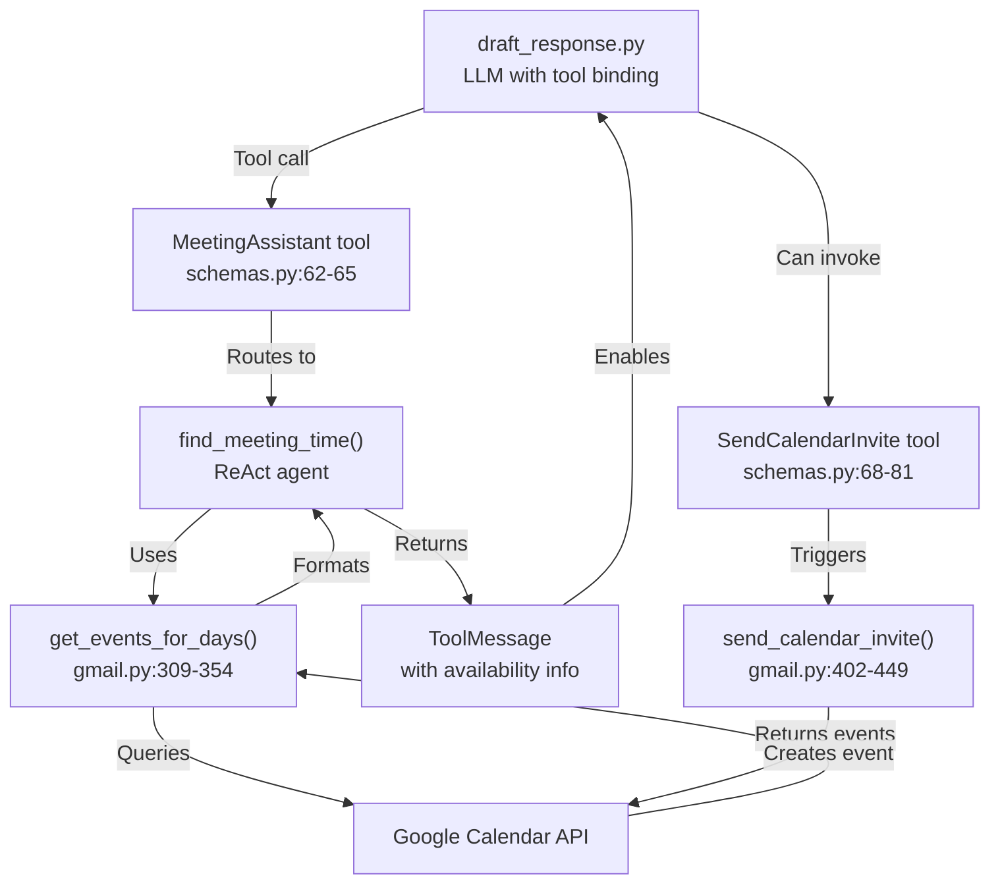
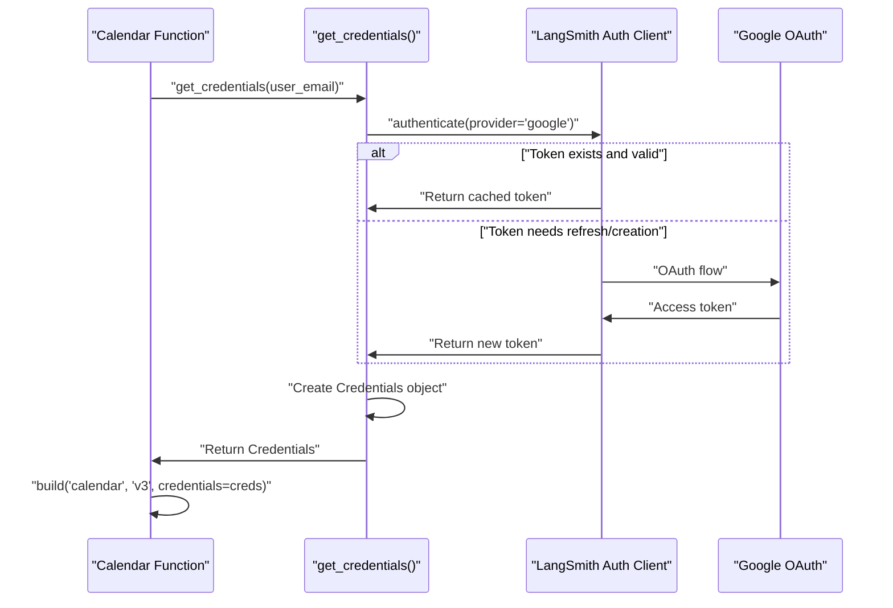
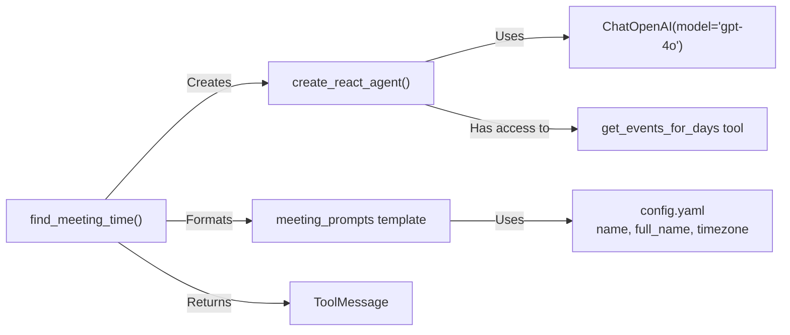
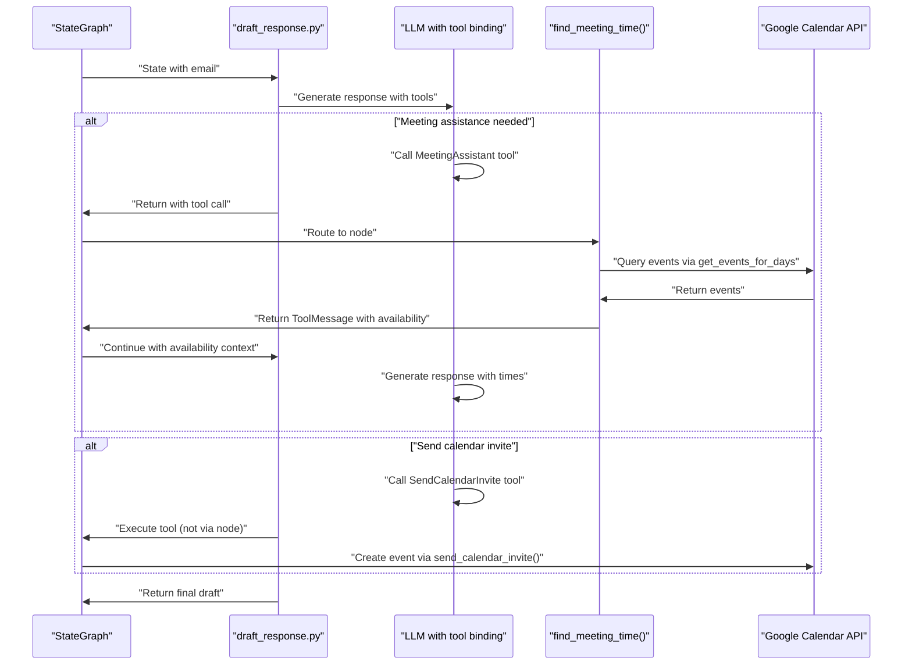
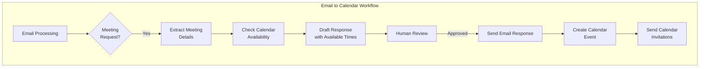
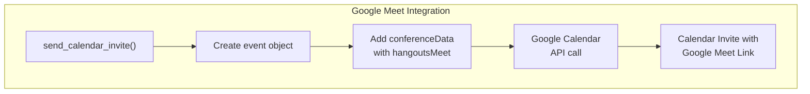

<!-- source: DeepWiki mcp.deepwiki.com · repo langchain-ai/executive-ai-assistant · page 2.4 Calendar Integration · fetched 2026-10-26 -->

# Calendar Integration

<details>
<summary>Relevant source files</summary>

The following files were used as context for generating this wiki page:

- [eaia/gmail.py](eaia/gmail.py)
- [eaia/main/find_meeting_time.py](eaia/main/find_meeting_time.py)
- [eaia/schemas.py](eaia/schemas.py)

</details>


The Calendar Integration system enables EAIA to handle meeting scheduling through Google Calendar API integration. The core implementation consists of a ReAct agent in `find_meeting_time.py` that queries calendar availability and two tool schemas (`MeetingAssistant`, `SendCalendarInvite`) that enable LLM-driven scheduling decisions.

For context on how calendar operations fit into the email processing workflow, see [Email Response Generation](#2.3) and [StateGraph Orchestration](#2.5).

## Overview

Calendar functionality is implemented through three primary components:

1. **`find_meeting_time` ReAct Agent** ([eaia/main/find_meeting_time.py:66-96]()): Uses `create_react_agent()` with the `get_events_for_days` tool to query calendar availability and synthesize meeting time recommendations
2. **Tool Schemas** ([eaia/schemas.py:62-81]()): `MeetingAssistant` routes to the agent, `SendCalendarInvite` triggers calendar event creation
3. **Calendar API Functions** ([eaia/gmail.py:309-449]()): `get_events_for_days()` retrieves events, `send_calendar_invite()` creates calendar invites with Google Meet links

**Calendar Integration in Processing Pipeline**



Sources: [eaia/main/find_meeting_time.py:66-96](), [eaia/schemas.py:62-81](), [eaia/gmail.py:309-449]()

## Authentication

Calendar access uses the same OAuth 2.0 flow as Gmail access, managed through LangSmith Auth. The `get_credentials()` function ([eaia/gmail.py:30-83]()) authenticates with the required scopes:

```python
_SCOPES = [
    "https://www.googleapis.com/auth/gmail.modify",
    "https://www.googleapis.com/auth/calendar",
]
```

**OAuth Flow via LangSmith Auth**



The `get_credentials()` function is called by `get_events_for_days()` ([eaia/gmail.py:330]()) and `send_calendar_invite()` ([eaia/gmail.py:406]()) to obtain authenticated Google API credentials. OAuth setup is handled during initial system configuration via `scripts/setup_gmail.py`.

Sources: [eaia/gmail.py:24-83]()

## ReAct Agent: `find_meeting_time`

The `find_meeting_time()` function ([eaia/main/find_meeting_time.py:66-96]()) implements a ReAct agent using LangChain's `create_react_agent()`. This agent is invoked when the `MeetingAssistant` tool is called during email response generation.

**Agent Configuration**



**Prompt Template Structure**

The `meeting_prompts` template ([eaia/main/find_meeting_time.py:15-63]()) instructs the agent to:
- Survey the user's calendar using available tools
- Check availability for specific times if mentioned in email
- Find valid meeting times if requested
- Return high-density factual responses (e.g., "Harrison is free 9:30-10")
- Suggest time slots in chunks (not split into 15-minute increments)

**Example Invocation Flow**

1. `draft_response.py` LLM calls `MeetingAssistant` tool
2. Graph routes to `find_meeting_time()` node
3. Agent receives formatted prompt with email content and user config
4. Agent uses `get_events_for_days` tool to query calendar
5. Agent synthesizes availability information
6. Returns `ToolMessage` with availability summary
7. Graph routes back to `draft_response.py` with availability context

Sources: [eaia/main/find_meeting_time.py:15-96]()

## Calendar Query Tool: `get_events_for_days`

The `get_events_for_days()` function ([eaia/gmail.py:309-354]()) is a LangChain `@tool` that retrieves calendar events for specified dates.

**Tool Schema**

```python
class CalInput(BaseModel):
    date_strs: list[str] = Field(
        description="The days for which to retrieve events. Each day should be represented by dd-mm-yyyy string."
    )
```

**Implementation Details**

| Component | Description |
|-----------|-------------|
| **Input Format** | List of date strings in `dd-mm-yyyy` format |
| **Authentication** | Retrieves user email from `config` via `get_config()`, calls `get_credentials()` |
| **API Query** | Calls `service.events().list()` with `timeMin`/`timeMax` for each date |
| **Output Format** | Formatted string with events per day via `print_events()` |

**Date Processing**

The tool converts each date string to datetime boundaries:
```python
day = datetime.strptime(date_str, "%d-%m-%Y").date()
start_of_day = datetime.combine(day, time.min).isoformat() + "Z"
end_of_day = datetime.combine(day, time.max).isoformat() + "Z"
```

**Event Formatting**

The `print_events()` helper ([eaia/gmail.py:374-399]()) formats events with:
- Event summary (title)
- Start/end times in user's timezone via `format_datetime_with_timezone()` ([eaia/gmail.py:357-371]())
- Timezone conversion using `pytz` (default: US/Pacific)

Sources: [eaia/gmail.py:303-399]()

## Calendar Invite Tool: `SendCalendarInvite`

The `SendCalendarInvite` schema ([eaia/schemas.py:68-81]()) enables the LLM in `draft_response.py` to trigger calendar event creation.

**Tool Schema Definition**

```python
class SendCalendarInvite(BaseModel):
    """Call this to send a calendar invite."""
    emails: List[str] = Field(
        description="List of emails to send the calendar invitation for. Do NOT make any emails up!"
    )
    title: str = Field(description="Name of the meeting")
    start_time: str = Field(
        description="Start time for the meeting, should be in `2024-07-01T14:00:00` format"
    )
    end_time: str = Field(
        description="End time for the meeting, should be in `2024-07-01T14:00:00` format"
    )
```

**Event Creation via `send_calendar_invite()`**

The `send_calendar_invite()` function ([eaia/gmail.py:402-449]()) creates calendar events with:

| Feature | Implementation |
|---------|----------------|
| **Attendees** | Adds all specified emails plus user's email |
| **Google Meet** | Automatically creates Meet link via `conferenceData` with `hangoutsMeet` type |
| **Reminders** | Email reminder 24 hours before, popup 10 minutes before |
| **Timezone** | Defaults to PST, configurable via `timezone` parameter |
| **Notifications** | Sends notifications to all attendees via `sendNotifications=True` |

**Google Meet Integration**

```python
"conferenceData": {
    "createRequest": {
        "requestId": f"{title}-{start_datetime.isoformat()}",
        "conferenceSolutionKey": {"type": "hangoutsMeet"},
    }
}
```

This automatically generates a unique Google Meet link for the event.

Sources: [eaia/schemas.py:68-81](), [eaia/gmail.py:402-449]()

## Configuration

Calendar behavior is controlled by fields in `config.yaml` that are accessed via `get_config()` ([eaia/main/config.py]()).

**Configuration Fields Used in Calendar Operations**

| Field | Usage | Location |
|-------|-------|----------|
| `name` | Short name used in prompts ("Harrison") | [find_meeting_time.py:78]() |
| `full_name` | Full name in prompts ("Harrison Chase") | [find_meeting_time.py:79]() |
| `timezone` | Timezone for displaying times (e.g., "PST") | [find_meeting_time.py:80]() |
| `email` | User's email for calendar authentication | [get_events_for_days:328]() |
| `schedule_preferences` | Custom scheduling instructions (optional) | Used in `draft_response.py` prompts |

**Timezone Handling**

- `format_datetime_with_timezone()` converts UTC times to specified timezone (default: "US/Pacific")
- The `find_meeting_time` agent prompt includes user's timezone preference
- `send_calendar_invite()` accepts timezone parameter (defaults to "PST")

Sources: [eaia/main/find_meeting_time.py:72-80](), [eaia/gmail.py:328-330](), [eaia/gmail.py:357-371]()

## Integration with Email Processing Pipeline

Calendar functionality integrates with the main processing graph through tool calling in `draft_response.py`.

**Tool Calling Flow**



**Tool Binding in `draft_response.py`**

The draft response LLM has access to multiple tools including:
- `Question`: Ask user for clarification
- `ResponseEmailDraft`: Generate email response
- `MeetingAssistant`: Route to meeting time finder (invokes `find_meeting_time` node)
- `SendCalendarInvite`: Create calendar event directly

When `MeetingAssistant` is called, the graph's conditional routing detects the tool call and routes execution to the `find_meeting_time` node ([eaia/main/find_meeting_time.py:66-96]()). The resulting `ToolMessage` is added to state messages, providing availability context for subsequent LLM calls.

Sources: [eaia/main/find_meeting_time.py:82-96](), [eaia/schemas.py:62-81]()

## Data Flow

**State Management During Calendar Operations**

The `find_meeting_time()` function operates on the `State` object and updates the `messages` field:

1. Receives `State` with email data and existing messages
2. Extracts the previous tool call from messages: `prediction = state["messages"][-1]`
3. Removes the routing tool call: `messages = messages[:-1]`
4. Invokes ReAct agent with formatted prompt + remaining messages
5. Returns `ToolMessage` containing availability information, linked to original tool call ID

**ToolMessage Structure**

```python
return {
    "messages": [
        ToolMessage(
            content=result["messages"][-1].content,  # Agent's availability summary
            tool_call_id=tool_call["id"]  # Links to MeetingAssistant tool call
        )
    ]
}
```

This ToolMessage is appended to state messages via the `add_messages` reducer, enabling the LLM to continue response generation with calendar availability context.

Sources: [eaia/main/find_meeting_time.py:82-96](), [eaia/schemas.py:91-94]()

## Integration with Email Processing

Calendar functionality is tightly integrated with the email processing workflow:



Sources: [eaia/gmail.py:288-325](), [eaia/gmail.py:373-419]()

### Meeting Request Recognition

The system detects meeting requests in emails through the email triage process. When a scheduling request is identified, the system:

1. Checks calendar availability for relevant dates
2. Proposes suitable meeting times based on availability and preferences
3. After human approval, schedules the meeting and sends invitations

## Google Meet Integration

Calendar invites automatically include Google Meet conference links, enabling seamless video conferencing:



Sources: [eaia/gmail.py:401-407]()

The Google Meet integration is handled through the `conferenceData` parameter in the event creation request, which automatically generates a unique Meet link for each calendar event.

---

