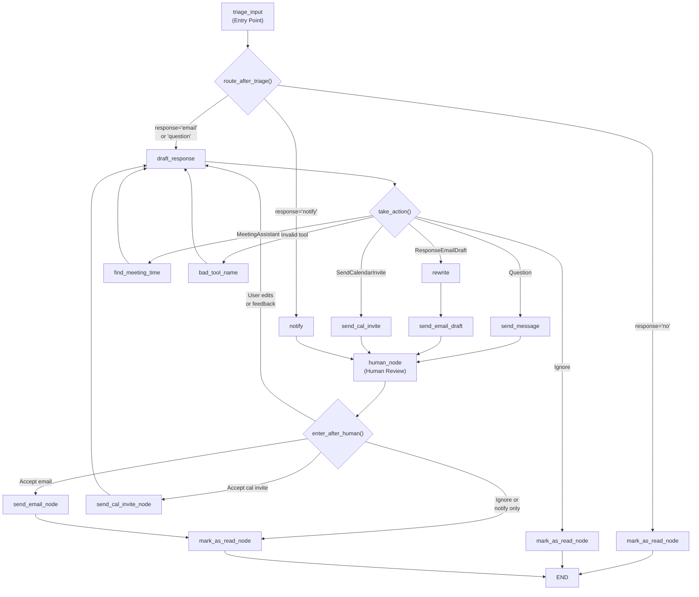
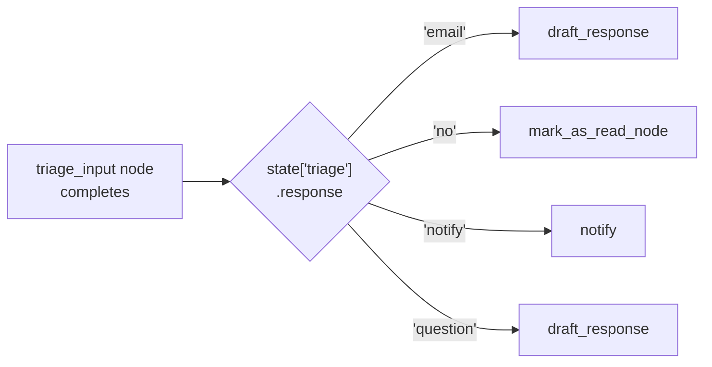
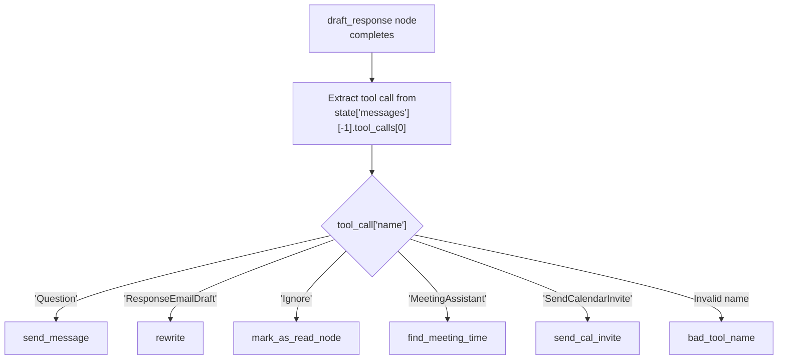
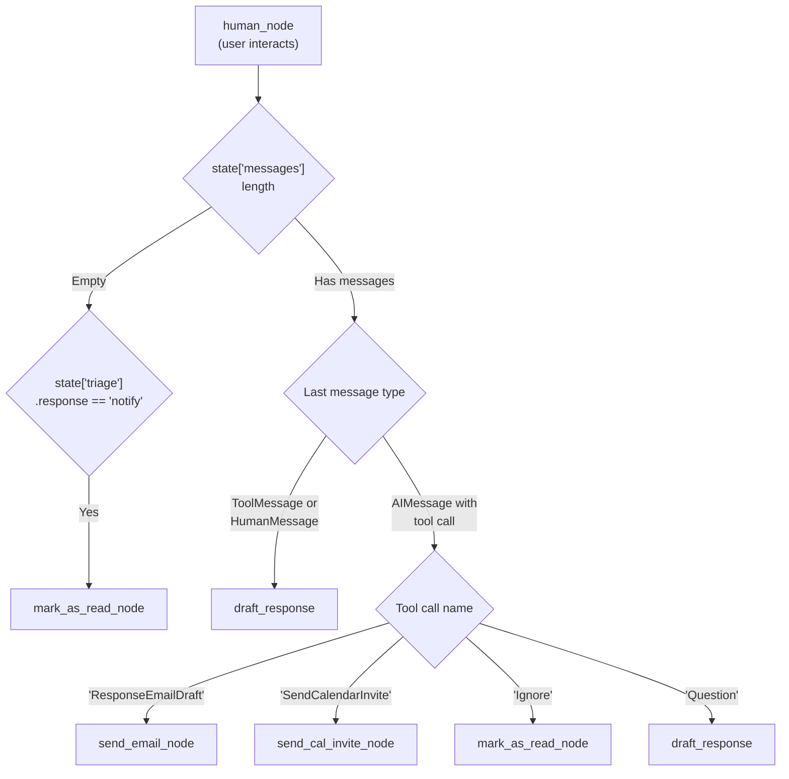
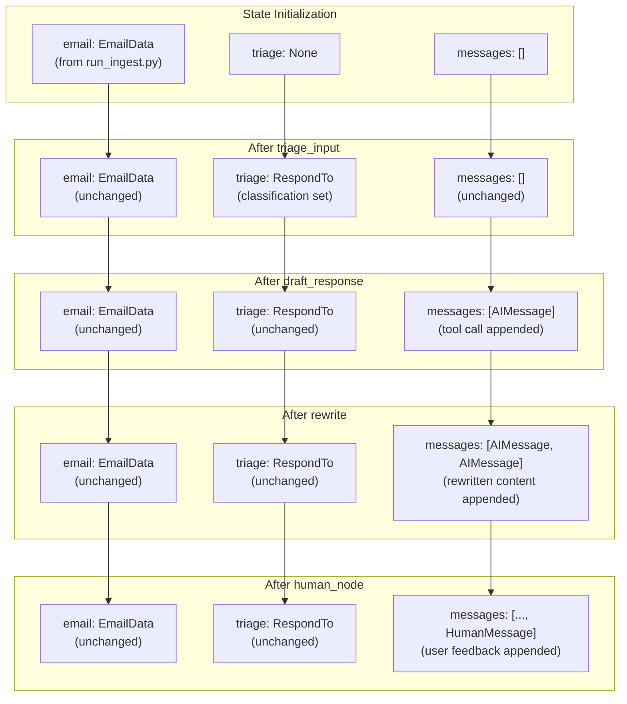
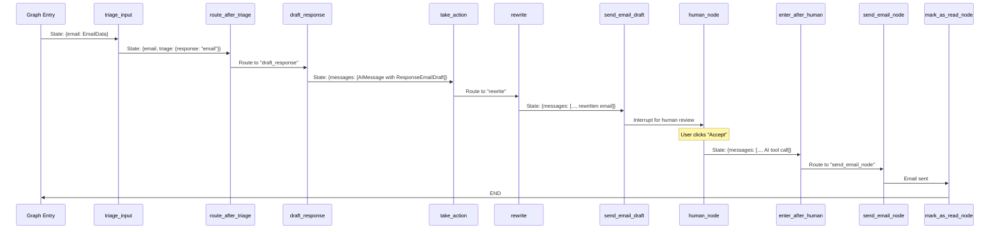
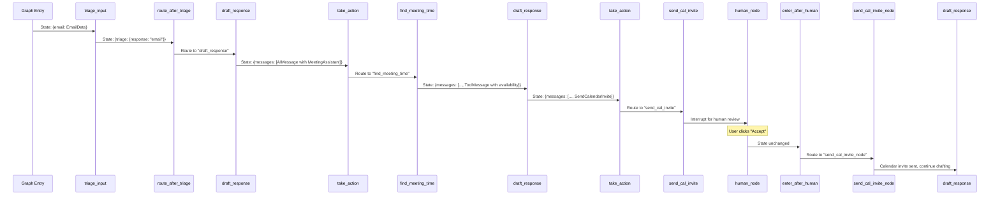
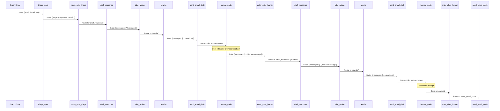

<!-- source: DeepWiki mcp.deepwiki.com · repo langchain-ai/executive-ai-assistant · page 2.5 StateGraph Orchestration · fetched 2026-10-26 -->

# StateGraph Orchestration

<details>
<summary>Relevant source files</summary>

The following files were used as context for generating this wiki page:

- [eaia/main/find_meeting_time.py](eaia/main/find_meeting_time.py)
- [eaia/main/graph.py](eaia/main/graph.py)
- [eaia/schemas.py](eaia/schemas.py)

</details>


## Purpose and Scope

This document provides a detailed explanation of the StateGraph orchestration system implemented in [`eaia/main/graph.py`](). The StateGraph serves as the central coordinator for all email processing operations in the Executive AI Assistant, routing emails through triage, drafting, rewriting, and human approval stages based on conditional logic.

For information about the individual processing nodes (triage, draft, rewrite, meeting), see their respective pages: [Email Triage Logic](#2.2), [Email Response Generation](#2.3), and [Calendar Integration](#2.4). For details on the State data structure, see [Core Data Structures and State Management](#1.3). For human interaction mechanics, see [Human-in-the-Loop Interface](#3).

---

## Graph Architecture Overview

The StateGraph is implemented using LangGraph's `StateGraph` class from `langgraph.graph`. The graph consists of **14 nodes** and **3 conditional routing functions** that determine the execution path based on state values.

### Core Graph Structure



**Sources:** [`eaia/main/graph.py:162-190`]()

---

## Node Structure

The StateGraph contains 14 nodes organized into functional categories:

### Processing Nodes

| Node | Function | Purpose |
|------|----------|---------|
| `triage_input` | [`eaia/main/triage.py:triage_input`]() | Classifies incoming email into "no", "notify", "email", or "question" |
| `draft_response` | [`eaia/main/draft_response.py:draft_response`]() | Generates email drafts or asks questions using LLM with tool binding |
| `rewrite` | [`eaia/main/rewrite.py:rewrite`]() | Adjusts tone and style of drafted emails |
| `find_meeting_time` | [`eaia/main/find_meeting_time.py:find_meeting_time`]() | Uses ReAct agent to query calendar and find availability |

### Human Interaction Nodes

| Node | Function | Purpose |
|------|----------|---------|
| `human_node` | [`eaia/main/graph.py:153-154`]() | Interrupts execution for human review (empty pass-through) |
| `send_message` | [`eaia/main/human_inbox.py:send_message`]() | Sends question to Agent Inbox |
| `send_email_draft` | [`eaia/main/human_inbox.py:send_email_draft`]() | Sends email draft to Agent Inbox for approval |
| `notify` | [`eaia/main/human_inbox.py:notify`]() | Sends notification without draft |
| `send_cal_invite` | [`eaia/main/human_inbox.py:send_cal_invite`]() | Sends calendar invite proposal to Agent Inbox |

### Action Execution Nodes

| Node | Function | Purpose |
|------|----------|---------|
| `send_email_node` | [`eaia/main/graph.py:133-145`]() | Executes approved email send via Gmail API |
| `send_cal_invite_node` | [`eaia/main/graph.py:115-130`]() | Executes approved calendar invite send |
| `mark_as_read_node` | [`eaia/main/graph.py:148-150`]() | Marks email as read in Gmail |
| `bad_tool_name` | [`eaia/main/graph.py:73-85`]() | Handles invalid tool name errors from LLM |

**Sources:** [`eaia/main/graph.py:163-174`]()

---

## Conditional Routing Logic

The StateGraph uses three conditional routing functions that inspect state and determine the next node to execute. These functions implement the core decision-making logic of the orchestration system.

### route_after_triage

```python
def route_after_triage(state: State) -> Literal["draft_response", "mark_as_read_node", "notify"]
```

**Location:** [`eaia/main/graph.py:30-42`]()

**Purpose:** Routes emails after triage classification based on the `state["triage"].response` field.

**Routing Logic:**



| Response Value | Next Node | Meaning |
|----------------|-----------|---------|
| `"email"` | `draft_response` | Email requires a drafted response |
| `"question"` | `draft_response` | Unclear situation, need to ask user a question |
| `"no"` | `mark_as_read_node` | Email should be ignored and marked as read |
| `"notify"` | `notify` | Important email but no draft needed |

The `RespondTo` schema in [`eaia/schemas.py:20-24`]() defines these response types using a `Literal` type annotation.

**Sources:** [`eaia/main/graph.py:30-42`](), [`eaia/schemas.py:20-24`]()

### take_action

```python
def take_action(state: State) -> Literal["send_message", "rewrite", "mark_as_read_node", "find_meeting_time", "send_cal_invite", "bad_tool_name"]
```

**Location:** [`eaia/main/graph.py:45-70`]()

**Purpose:** Routes based on which tool the `draft_response` node called. The last message in `state["messages"]` contains the LLM's tool call.

**Routing Logic:**



| Tool Name | Next Node | Purpose |
|-----------|-----------|---------|
| `"Question"` | `send_message` | LLM needs clarification from user |
| `"ResponseEmailDraft"` | `rewrite` | LLM generated draft, needs tone adjustment |
| `"Ignore"` | `mark_as_read_node` | User instructed to ignore email |
| `"MeetingAssistant"` | `find_meeting_time` | Needs calendar availability lookup |
| `"SendCalendarInvite"` | `send_cal_invite` | Ready to send calendar invite |
| Other | `bad_tool_name` | Invalid tool name, return error to LLM |

The tool schemas are defined in [`eaia/schemas.py:27-80`]().

**Sources:** [`eaia/main/graph.py:45-70`](), [`eaia/schemas.py:27-80`]()

### enter_after_human

```python
def enter_after_human(state) -> Literal["mark_as_read_node", "draft_response", "send_email_node", "send_cal_invite_node"]
```

**Location:** [`eaia/main/graph.py:88-112`]()

**Purpose:** Routes after `human_node` based on user action. This function determines whether to execute the approved action, re-draft with feedback, or mark as read.

**Routing Logic:**



**Decision Table:**

| Condition | Next Node | User Action |
|-----------|-----------|-------------|
| `messages` is empty AND `triage.response == "notify"` | `mark_as_read_node` | User dismissed notification |
| Last message is `ToolMessage` or `HumanMessage` | `draft_response` | User provided feedback/edits |
| Last message has `ResponseEmailDraft` tool call | `send_email_node` | User accepted email draft |
| Last message has `SendCalendarInvite` tool call | `send_cal_invite_node` | User accepted calendar invite |
| Last message has `Ignore` tool call | `mark_as_read_node` | User chose to ignore |
| Last message has `Question` tool call | `draft_response` | User answered question |

**Sources:** [`eaia/main/graph.py:88-112`]()

---

## State Management

The StateGraph operates on the `State` TypedDict defined in [`eaia/schemas.py:91-94`]():

```python
class State(TypedDict):
    email: EmailData
    triage: Annotated[RespondTo, convert_obj]
    messages: Annotated[List[AnyMessage], add_messages]
```

### State Fields

| Field | Type | Purpose | Reducer |
|-------|------|---------|---------|
| `email` | `EmailData` | Current email being processed | None (replaced) |
| `triage` | `RespondTo` | Classification result from triage | `convert_obj` (converts dict to Pydantic) |
| `messages` | `List[AnyMessage]` | Conversation history with LLM | `add_messages` (accumulates, prevents duplicates) |

### State Flow Through Nodes



**Key State Management Patterns:**

1. **Email Immutability:** The `email` field is set once at graph entry and never modified
2. **Triage Set-Once:** The `triage` field is set by `triage_input` and used for routing
3. **Message Accumulation:** The `messages` field accumulates via `add_messages` reducer, which:
   - Prevents duplicate messages (same ID)
   - Maintains conversation history
   - Allows nodes to append without overwriting

**Sources:** [`eaia/schemas.py:91-94`](), [`eaia/schemas.py:7`]()

---

## Graph Construction and Compilation

The graph is constructed using the builder pattern in [`eaia/main/graph.py:162-190`]():

### Construction Steps

**1. Initialize Builder with State and Config Schema:**
```python
class ConfigSchema(TypedDict):
    db_id: int
    model: str

graph_builder = StateGraph(State, config_schema=ConfigSchema)
```
[`eaia/main/graph.py:157-162`]()

**2. Add Nodes:**
```python
graph_builder.add_node(human_node)
graph_builder.add_node(triage_input)
graph_builder.add_node(draft_response)
# ... 11 more nodes
```
[`eaia/main/graph.py:163-174`]()

**3. Define Entry Point:**
```python
graph_builder.set_entry_point("triage_input")
```
[`eaia/main/graph.py:176`]()

**4. Add Conditional Edges:**
```python
graph_builder.add_conditional_edges("triage_input", route_after_triage)
graph_builder.add_conditional_edges("draft_response", take_action)
graph_builder.add_conditional_edges("human_node", enter_after_human)
```
[`eaia/main/graph.py:175,177,189`]()

**5. Add Static Edges:**
```python
graph_builder.add_edge("send_message", "human_node")
graph_builder.add_edge("rewrite", "send_email_draft")
graph_builder.add_edge("find_meeting_time", "draft_response")
# ... more edges
```
[`eaia/main/graph.py:178-188`]()

**6. Compile:**
```python
graph = graph_builder.compile()
```
[`eaia/main/graph.py:190`]()

### Edge Types

| Edge Type | Example | Purpose |
|-----------|---------|---------|
| Conditional | `"triage_input" → route_after_triage()` | Dynamic routing based on state |
| Static | `"rewrite" → "send_email_draft"` | Fixed transition |
| Terminal | `"mark_as_read_node" → END` | Ends graph execution |

**Sources:** [`eaia/main/graph.py:157-190`]()

---

## Execution Flow Examples

### Example 1: Simple Email Response



**Sources:** [`eaia/main/graph.py`]()

### Example 2: Meeting Scheduling



**Sources:** [`eaia/main/graph.py`]()

### Example 3: User Provides Feedback



**Sources:** [`eaia/main/graph.py`]()

---

## Error Handling

### bad_tool_name Node

The `bad_tool_name` node handles cases where the LLM calls a tool that doesn't exist, typically due to hallucination or typos.

**Implementation:** [`eaia/main/graph.py:73-85`]()

**Logic:**
1. Extract tool call from `state["messages"][-1].tool_calls[0]`
2. Clean the tool name (remove colons which sometimes appear)
3. Create a `ToolMessage` with error description
4. Return updated state with error message
5. Route back to `draft_response` for retry

**Example Tool Name Errors:**
- `"ResponseEmailDraft:"` (extra colon) → cleaned to `"ResponseEmailDraft"`
- `"SendEmail"` (wrong name) → error message returned

This pattern allows the LLM to self-correct by seeing the error message in context.

**Sources:** [`eaia/main/graph.py:73-85`]()

---

## Configuration Schema

The StateGraph accepts runtime configuration through `ConfigSchema`:

```python
class ConfigSchema(TypedDict):
    db_id: int
    model: str
```
[`eaia/main/graph.py:157-159`]()

This configuration is accessed by nodes via `config["configurable"]`:
- `db_id`: Used for BaseStore namespace selection
- `model`: Selects LLM model (e.g., "gpt-4o", "claude-3-5-sonnet")

The `get_config()` helper function in [`eaia/main/config.py`]() loads user preferences from the BaseStore using `db_id`.

**Sources:** [`eaia/main/graph.py:157-159`](), [`eaia/main/find_meeting_time.py:68`]()

---

## Graph Invocation

The compiled graph is invoked by the LangGraph Platform when a run is created via [`scripts/run_ingest.py`](). The ingestion script:

1. Fetches emails from Gmail
2. Creates/updates LangGraph threads (one per email thread)
3. Invokes the graph with initial state: `{"email": EmailData}`

The graph then executes nodes according to the routing logic until reaching `END` or `human_node` (which interrupts for human review).

**Sources:** [`eaia/main/graph.py:190`]()

---

