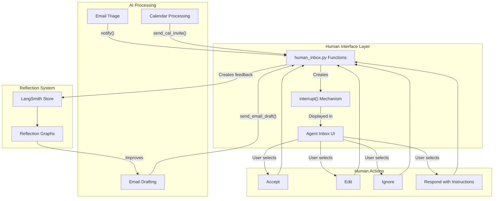
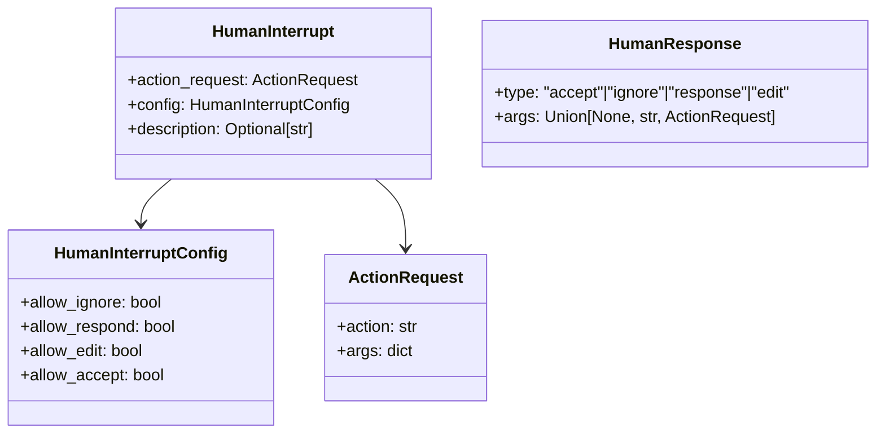
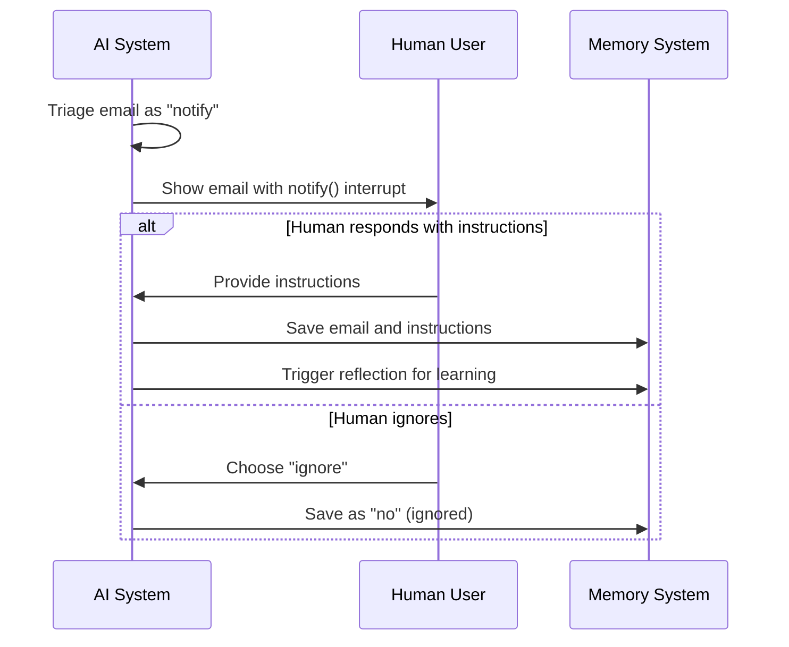
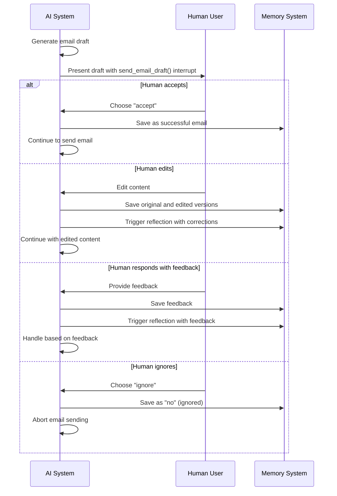
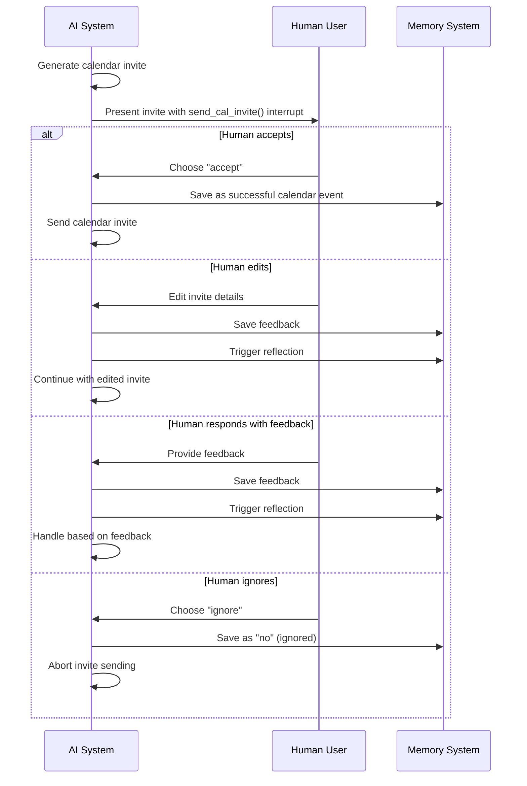
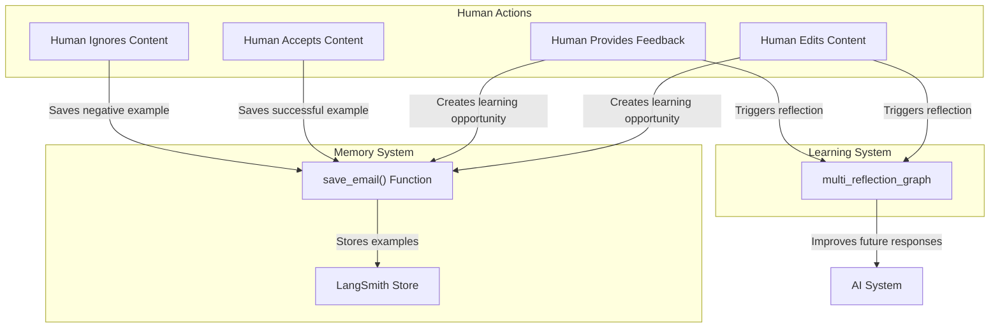
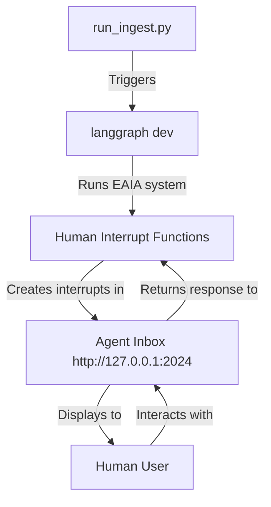
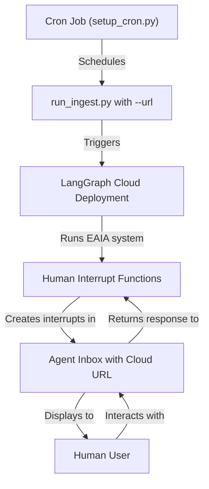

<!-- source: DeepWiki mcp.deepwiki.com · repo langchain-ai/executive-ai-assistant · page 3 Human-in-the-Loop Interface · fetched 2026-10-26 -->

# Human-in-the-Loop Interface

Relevant source files

The following files were used as context for generating this wiki page:

- [README.md](README.md)
- [eaia/main/human_inbox.py](eaia/main/human_inbox.py)

## Purpose and Scope

This document describes the Human-in-the-Loop Interface system in the Executive AI Assistant (EAIA). This system enables human oversight of AI-generated content by allowing users to review, edit, approve or reject actions before they're executed. This document focuses specifically on the interrupt mechanisms, decision flows, and Agent Inbox integration. For information about how this system integrates with email processing, see [Email Processing System](#2), and for Agent Inbox specific details, see [Agent Inbox Integration](#3.1).

## Architecture Overview

The Human-in-the-Loop Interface serves as the critical bridge between automated AI processing and human decision-making in the EAIA system.

### System Components

Sources: [eaia/main/human_inbox.py:1-396]()

### Core Components

The Human-in-the-Loop system consists of these key elements:

1. **Interrupt Mechanism**: Pauses AI execution to request human input
2. **Human Interface Layer**: Functions that format AI outputs for human review
3. **Agent Inbox UI**: Where humans review and interact with AI-generated content
4. **Human Action Handlers**: Code to process different types of human responses
5. **Reflection System**: Stores and learns from human feedback

## Interrupt Mechanism

The system uses LangGraph's interrupt mechanism to pause execution and wait for human input. The core structures that enable this are:

Sources: [eaia/main/human_inbox.py:16-37]()

## Human Decision Flows

The interface supports four main types of human intervention points, each with different available actions.

### Notification Flow

Sources: [eaia/main/human_inbox.py:240-297]()

### Email Draft Review Flow

Sources: [eaia/main/human_inbox.py:139-237]()

### Calendar Invite Review Flow

Sources: [eaia/main/human_inbox.py:300-395]()

## Human Response Types

The system supports four types of human responses, each with different implications for workflow:

| Response Type | Description | Available In | Effect on Workflow |
|---------------|-------------|--------------|-------------------|
| `accept` | Accept content as-is | Email drafts, Calendar invites | Proceeds with sending/scheduling |
| `edit` | Modify the content | Email drafts, Calendar invites | Proceeds with modified content |
| `ignore` | Reject the content | All interrupts | Aborts the action, marks as ignored |
| `response` | Provide textual feedback | All interrupts | Varies by context; may restart flow |

Sources: [eaia/main/human_inbox.py:34-37](), [eaia/main/human_inbox.py:146-152](), [eaia/main/human_inbox.py:308-314]()

## Email Visualization

When presenting emails to humans, the system formats them using a consistent Markdown template that includes:

- Email subject as heading
- Link to view the original email in Gmail
- Sender and recipient information
- Email content

The template is rendered using the `_generate_email_markdown` function which creates a standardized view for all email-related interrupts.

Sources: [eaia/main/human_inbox.py:39-58]()

## Feedback and Learning System

The human-in-the-loop system includes a feedback mechanism that enables the AI to learn from human interactions:

When the human edits content or provides feedback, the system:

1. Saves the original content, the human's feedback/edits, and email metadata
2. Triggers a reflection process via `multi_reflection_graph`
3. Associates feedback with specific prompt types to focus learning
4. Uses these examples to improve future responses

Sources: [eaia/main/human_inbox.py:61-71](), [eaia/main/human_inbox.py:213-230]()

## Agent Inbox Integration

The system integrates with the Agent Inbox UI, which provides the visual interface for human review.

### Local Setup

### Cloud Setup

Sources: [README.md:92-103](), [README.md:145-152]()

## Implementation Details

The human-in-the-loop interface uses several key technical components:

1. **LangGraph's interrupt mechanism**: Used to pause execution and wait for human input
2. **TypedDict classes**: Define the structure of interrupts and responses
3. **Markdown formatting**: For displaying email content
4. **LangSmith integration**: For storing examples and tracking feedback
5. **LangGraph Client**: For triggering reflection runs

The system is designed to work both locally during development and in the cloud for production use.

Sources: [eaia/main/human_inbox.py:4-10](), [eaia/main/human_inbox.py:13]()

---

