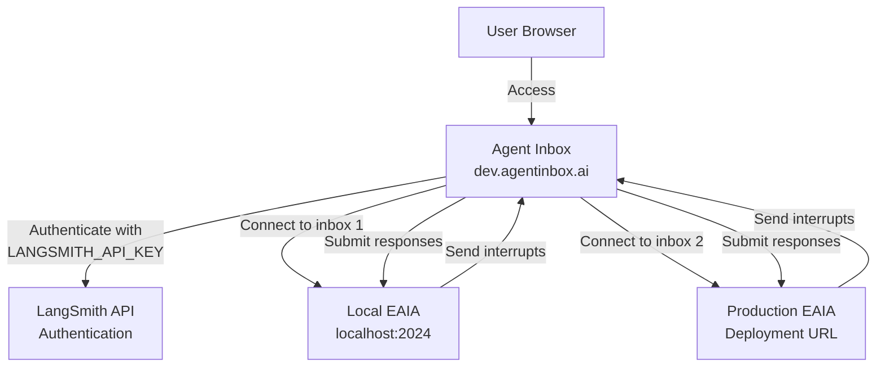
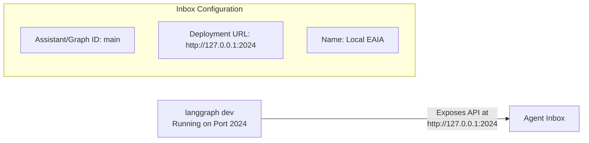
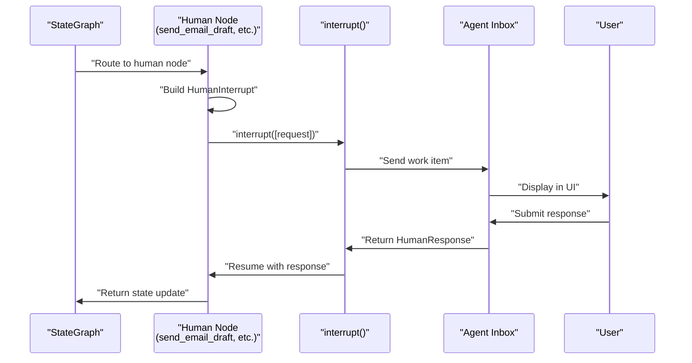
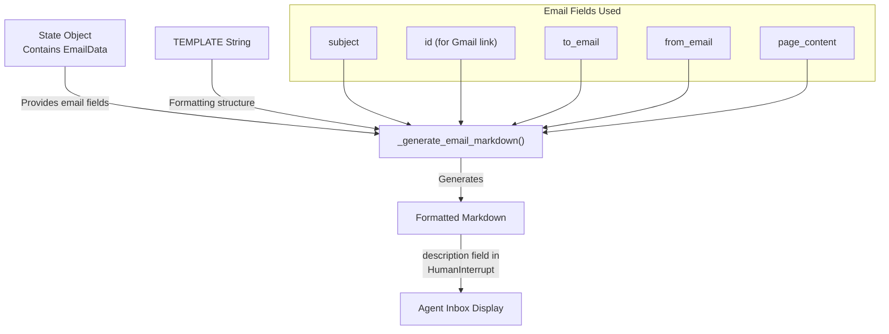
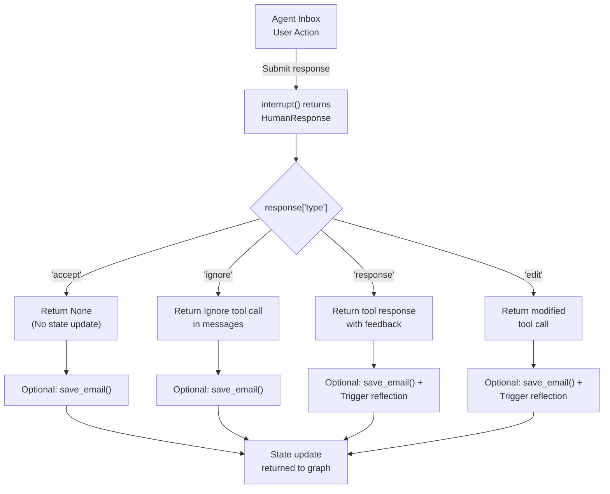
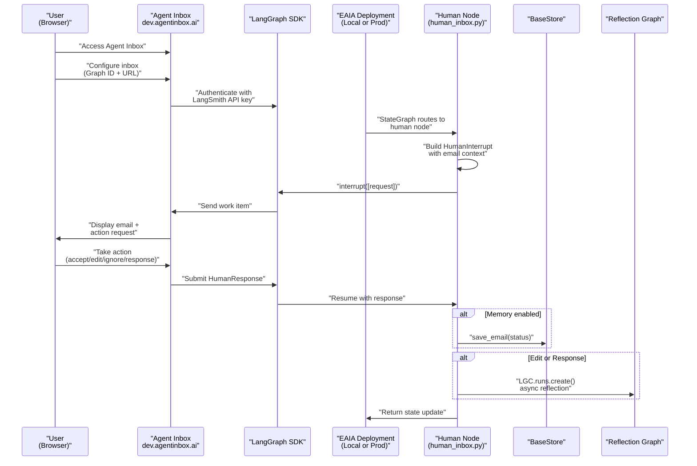

<!-- source: DeepWiki mcp.deepwiki.com · repo langchain-ai/executive-ai-assistant · page 3.1 Agent Inbox Integration · fetched 2026-10-26 -->

# Agent Inbox Integration

<details>
<summary>Relevant source files</summary>

The following files were used as context for generating this wiki page:

- [README.md](README.md)
- [eaia/main/human_inbox.py](eaia/main/human_inbox.py)

</details>


## Purpose and Scope

Agent Inbox is the user interface for reviewing and approving EAIA's work. This document covers the technical configuration and integration details for connecting Agent Inbox (hosted at dev.agentinbox.ai) to both local development and production EAIA deployments. For information about the human response types and feedback mechanisms, see [Human Response Types](#3.2). For deployment setup details, see [Local Development](#6.1) and [LangGraph Platform Deployment](#6.2).

---

## Agent Inbox Overview

Agent Inbox is a web-based interface that connects to LangGraph deployments via the LangGraph SDK. It receives work items from EAIA through LangGraph's interrupt mechanism and presents them to users for review, editing, or approval. The interface supports multiple inboxes, allowing users to manage both development and production EAIA instances simultaneously.

**Key Features:**
- Display email context with links to Gmail
- Present agent-generated drafts and notifications
- Provide action buttons based on interrupt configuration
- Submit user responses back to the running graph
- Support multiple concurrent inbox connections

**Sources:** [README.md:94-104](), [README.md:139-150]()

---

## Connection Configuration

### Accessing Agent Inbox

Agent Inbox is hosted at `https://dev.agentinbox.ai/`. Users must provide their LangSmith API key to authenticate and access deployments.



**Sources:** [README.md:94-104](), [README.md:139-150]()

---

### Adding an Inbox

To configure an inbox connection:

1. Navigate to `Settings` in Agent Inbox
2. Input your LangSmith API key (required for authentication)
3. Click `Add Inbox`
4. Configure the following parameters:

| Parameter | Description | Example Value |
|-----------|-------------|---------------|
| `Assistant/Graph ID` | The graph identifier in the deployment | `main` |
| `Deployment URL` | The URL of the LangGraph deployment | `http://127.0.0.1:2024` or production URL |
| `Name` | A human-readable name for this inbox | `Local EAIA` or `Prod EAIA` |

5. Click `Submit` to save the inbox configuration

**Sources:** [README.md:96-102](), [README.md:145-150]()

---

## Local Development Configuration

For local development using `langgraph dev`, configure Agent Inbox as follows:



**Configuration Values:**
- **Assistant/Graph ID:** `main`
- **Deployment URL:** `http://127.0.0.1:2024`
- **Name:** `Local EAIA` (or any descriptive name)

This configuration allows Agent Inbox to communicate with the local development server started by `langgraph dev`, which runs on port 2024 by default.

**Sources:** [README.md:90-104]()

---

## Production Deployment Configuration

For production deployments on LangGraph Platform:

**Configuration Values:**
- **Assistant/Graph ID:** `main`
- **Deployment URL:** `${LANGGRAPH_DEPLOYMENT_URL}` (obtained from LangGraph Platform)
- **Name:** `Prod EAIA` (or any descriptive name)

The deployment URL is provided by LangGraph Platform after deploying the application. This URL enables Agent Inbox to connect to the production instance and receive work items.

**Sources:** [README.md:139-150]()

---

## Technical Integration Architecture

### Interrupt Mechanism

Agent Inbox integration relies on LangGraph's `interrupt()` function, which pauses graph execution and sends work items to connected clients. EAIA uses this mechanism in [eaia/main/human_inbox.py]() to present four types of work to users.



**Sources:** [eaia/main/human_inbox.py:1-11](), [eaia/main/human_inbox.py:89](), [eaia/main/human_inbox.py:155]()

---

### Data Structures

#### HumanInterrupt Structure

The `HumanInterrupt` TypedDict defines what Agent Inbox receives:

```python
class HumanInterrupt(TypedDict):
    action_request: ActionRequest
    config: HumanInterruptConfig
    description: Optional[str]
```

| Field | Type | Description |
|-------|------|-------------|
| `action_request` | `ActionRequest` | The action being proposed with arguments |
| `config` | `HumanInterruptConfig` | Controls which response types are allowed |
| `description` | `Optional[str]` | Markdown-formatted context (email content) |

**ActionRequest Structure:**

```python
class ActionRequest(TypedDict):
    action: str
    args: dict
```

Contains the tool name (e.g., `"ResponseEmailDraft"`, `"SendCalendarInvite"`) and its arguments.

**Sources:** [eaia/main/human_inbox.py:16-32]()

---

#### HumanInterruptConfig Structure

The `HumanInterruptConfig` controls which response buttons appear in Agent Inbox:

```python
class HumanInterruptConfig(TypedDict):
    allow_ignore: bool
    allow_respond: bool
    allow_edit: bool
    allow_accept: bool
```

Different node types use different configurations:

| Node Type | Ignore | Respond | Edit | Accept |
|-----------|--------|---------|------|--------|
| `send_message` | ✓ | ✓ | ✗ | ✗ |
| `notify` | ✓ | ✓ | ✗ | ✗ |
| `send_email_draft` | ✓ | ✓ | ✓ | ✓ |
| `send_cal_invite` | ✓ | ✓ | ✓ | ✓ |

**Sources:** [eaia/main/human_inbox.py:16-21](), [eaia/main/human_inbox.py:80-86](), [eaia/main/human_inbox.py:146-153]()

---

#### HumanResponse Structure

Agent Inbox returns a `HumanResponse` when users take action:

```python
class HumanResponse(TypedDict):
    type: Literal["accept", "ignore", "response", "edit"]
    args: Union[None, str, ActionRequest]
```

| Response Type | `args` Type | Description |
|---------------|-------------|-------------|
| `accept` | `None` | User approves the action as-is |
| `ignore` | `None` | User rejects the action |
| `response` | `str` | User provides textual feedback/instructions |
| `edit` | `ActionRequest` | User modifies the action arguments |

**Sources:** [eaia/main/human_inbox.py:34-37]()

---

## Work Item Display

### Email Context Rendering

EAIA generates markdown descriptions for each interrupt to provide email context in Agent Inbox. The `_generate_email_markdown()` function creates this content:



**Template Format:**

```markdown
# {subject}

[Click here to view the email]({url})

**To**: {to}
**From**: {_from}

{page_content}
```

The Gmail URL is constructed as: `https://mail.google.com/mail/u/0/#inbox/{email_id}`

**Sources:** [eaia/main/human_inbox.py:39-58]()

---

## Integration Points by Node Type

EAIA implements four human-in-the-loop nodes, each calling `interrupt()` with different configurations:

### send_message

**Purpose:** Request user feedback on a question or clarification

**Configuration:**
```python
"config": {
    "allow_ignore": True,
    "allow_respond": True,
    "allow_edit": False,
    "allow_accept": False,
}
```

**Tool Call Source:** `Question` tool from [eaia/main/draft_response.py]()

**Sources:** [eaia/main/human_inbox.py:73-88]()

---

### send_email_draft

**Purpose:** Present a drafted email for approval, editing, or feedback

**Configuration:**
```python
"config": {
    "allow_ignore": True,
    "allow_respond": True,
    "allow_edit": True,
    "allow_accept": True,
}
```

**Tool Call Source:** `ResponseEmailDraft` or `NewEmailDraft` from [eaia/main/draft_response.py]()

**Sources:** [eaia/main/human_inbox.py:139-154]()

---

### notify

**Purpose:** Alert user to an important email without drafting a response

**Configuration:**
```python
"config": {
    "allow_ignore": True,
    "allow_respond": True,
    "allow_edit": False,
    "allow_accept": False,
}
```

**Action Request:** `{"action": "Notify", "args": {}}`

**Sources:** [eaia/main/human_inbox.py:240-254]()

---

### send_cal_invite

**Purpose:** Present a calendar invite for approval or editing

**Configuration:**
```python
"config": {
    "allow_ignore": True,
    "allow_respond": True,
    "allow_edit": True,
    "allow_accept": True,
}
```

**Tool Call Source:** `SendCalendarInvite` from [eaia/main/draft_response.py]()

**Sources:** [eaia/main/human_inbox.py:300-315]()

---

## Response Processing Flow

When users take action in Agent Inbox, the response flows back through the interrupted node:



**Memory and Reflection:**
- If `memory=true` in config, all responses trigger `save_email()` to record triage status
- `response` and `edit` types additionally trigger asynchronous reflection via `LGC.runs.create(None, "multi_reflection_graph", input=rewrite_state)`

**Sources:** [eaia/main/human_inbox.py:96-136](), [eaia/main/human_inbox.py:162-237](), [eaia/main/human_inbox.py:61-71]()

---

## LangGraph SDK Client

Agent Inbox uses the LangGraph SDK to communicate with EAIA deployments. The SDK client is instantiated in [eaia/main/human_inbox.py:13]():

```python
from langgraph_sdk import get_client

LGC = get_client()
```

This client is used to trigger asynchronous reflection runs when users provide feedback:

```python
await LGC.runs.create(None, "multi_reflection_graph", input=rewrite_state)
```

The client connects to the deployment URL configured in Agent Inbox settings and uses the LangSmith API key for authentication.

**Sources:** [eaia/main/human_inbox.py:10-13](), [eaia/main/human_inbox.py:117]()

---

## Complete Integration Flow



**Sources:** [README.md:94-104](), [eaia/main/human_inbox.py:73-136](), [eaia/main/human_inbox.py:139-237]()

---

