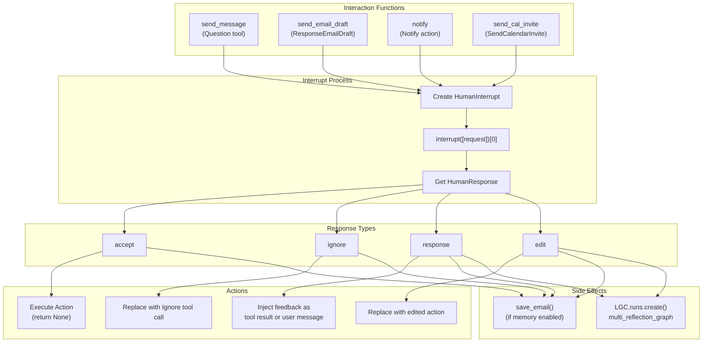
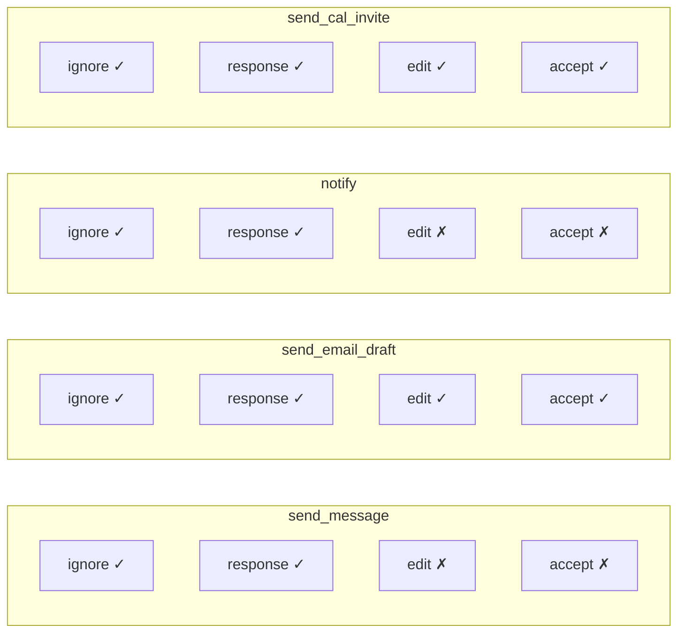
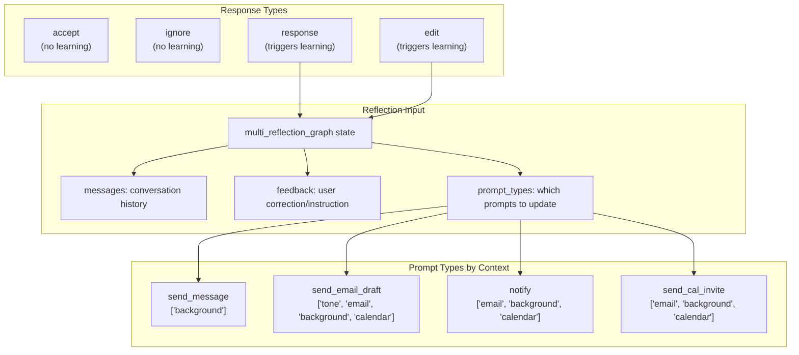

<!-- source: DeepWiki mcp.deepwiki.com · repo langchain-ai/executive-ai-assistant · page 3.2 Human Response Types · fetched 2026-10-26 -->

# Human Response Types

<details>
<summary>Relevant source files</summary>

The following files were used as context for generating this wiki page:

- [eaia/main/human_inbox.py](eaia/main/human_inbox.py)

</details>


This page documents the four human response types that users can provide when reviewing work from the Executive AI Assistant: `accept`, `ignore`, `edit`, and `response`. It explains the `HumanInterrupt` and `HumanResponse` data structures, what each response type triggers, and how different interaction contexts allow different response types.

For information about how these responses are displayed in the Agent Inbox interface, see [Agent Inbox Integration](#3.1). For details on how responses trigger the learning system, see [Prompt Reflection Mechanism](#4.1).

---

## Overview

The human-in-the-loop system presents work to users via the `interrupt()` function from LangGraph. Each interruption packages an action request with configuration specifying which response types are allowed. Users review the work in Agent Inbox and provide one of four response types, which then determines how the system proceeds.

The response types serve different purposes:

| Response Type | Purpose | Triggers Learning | Available In |
|---------------|---------|-------------------|--------------|
| `accept` | Approve and execute the proposed action | No | Email drafts, Calendar invites |
| `ignore` | Reject the action without providing feedback | No | All contexts |
| `response` | Provide textual feedback or instructions | Yes | All contexts |
| `edit` | Modify the action's arguments | Yes | Email drafts, Calendar invites |

**Sources:** [eaia/main/human_inbox.py:34-36]()

---

## Data Structures

### HumanInterrupt

The `HumanInterrupt` TypedDict defines what is sent to the user when work needs review:

```python
class HumanInterrupt(TypedDict):
    action_request: ActionRequest
    config: HumanInterruptConfig
    description: Optional[str]
```

- `action_request`: Contains the action name and arguments that the AI proposes to execute
- `config`: Specifies which response types are allowed for this particular interaction
- `description`: Markdown-formatted context (typically the email being processed)

The `ActionRequest` structure:

```python
class ActionRequest(TypedDict):
    action: str
    args: dict
```

The `HumanInterruptConfig` structure:

```python
class HumanInterruptConfig(TypedDict):
    allow_ignore: bool
    allow_respond: bool
    allow_edit: bool
    allow_accept: bool
```

**Sources:** [eaia/main/human_inbox.py:16-32]()

### HumanResponse

The `HumanResponse` TypedDict defines the structure of user responses:

```python
class HumanResponse(TypedDict):
    type: Literal["accept", "ignore", "response", "edit"]
    args: Union[None, str, ActionRequest]
```

- `type`: The response type selected by the user
- `args`: Payload that varies by type:
  - `None` for `accept` and `ignore`
  - `str` for `response` (the user's feedback text)
  - `ActionRequest` for `edit` (the modified action)

**Sources:** [eaia/main/human_inbox.py:34-36]()

---

## Response Type Details

### Accept

The `accept` response type approves the AI's proposed action without modification. When a user accepts:

1. The action proceeds to execution (email is sent, calendar invite is created)
2. If memory is enabled, the email is saved with status `"email"` via `save_email()`
3. No reflection or learning is triggered (the AI got it right)
4. The function returns `None`, allowing the graph to proceed

**Availability:** Only for email drafts (`send_email_draft`) and calendar invites (`send_cal_invite`)

**Implementation:**

```python
elif response["type"] == "accept":
    if memory:
        await save_email(state, config, store, "email")
    return None
```

**Sources:** [eaia/main/human_inbox.py:231-234](), [eaia/main/human_inbox.py:388-391]()

---

### Ignore

The `ignore` response type rejects the AI's proposed action without providing feedback. When a user ignores:

1. The action is replaced with an `Ignore` tool call with `ignore: True`
2. If memory is enabled, the email is saved with status `"no"` via `save_email()`
3. No reflection or learning is triggered
4. The graph proceeds to the next step, which typically marks the email as read

**Availability:** All contexts (`send_message`, `send_email_draft`, `notify`, `send_cal_invite`)

**Implementation:**

```python
elif response["type"] == "ignore":
    msg = {
        "role": "assistant",
        "content": "",
        "id": state["messages"][-1].id,
        "tool_calls": [
            {
                "id": tool_call["id"],
                "name": "Ignore",
                "args": {"ignore": True},
            }
        ],
    }
    if memory:
        await save_email(state, config, store, "no")
```

**Sources:** [eaia/main/human_inbox.py:118-132](), [eaia/main/human_inbox.py:184-198](), [eaia/main/human_inbox.py:279-293](), [eaia/main/human_inbox.py:345-359]()

---

### Response

The `response` type allows users to provide textual feedback or instructions. When a user provides a response:

1. The feedback is injected into the conversation as a tool result or user message
2. If memory is enabled, the email is saved with status `"email"` via `save_email()`
3. A reflection graph run is triggered asynchronously via `LGC.runs.create(None, "multi_reflection_graph", ...)`
4. The specific prompt types to update vary by context

**Availability:** All contexts (`send_message`, `send_email_draft`, `notify`, `send_cal_invite`)

**Context-Specific Behavior:**

| Context | Prompt Types Updated | Feedback Format |
|---------|---------------------|-----------------|
| `send_message` | `["background"]` | `"{user} responded in this way: {feedback}"` |
| `send_email_draft` | `["tone", "email", "background", "calendar"]` | `"Error, {user} interrupted and gave this feedback: {feedback}"` |
| `notify` | `["email", "background", "calendar"]` | `"{user} gave these instructions: {feedback}"` |
| `send_cal_invite` | `["email", "background", "calendar"]` | `"{user} interrupted gave these instructions: {feedback}"` |

**Implementation Example (send_email_draft):**

```python
if response["type"] == "response":
    msg = {
        "type": "tool",
        "name": tool_call["name"],
        "content": f"Error, {user} interrupted and gave this feedback: {response['args']}",
        "tool_call_id": tool_call["id"],
    }
    if memory:
        await save_email(state, config, store, "email")
        rewrite_state = {
            "messages": [...] + state["messages"],
            "feedback": f"Error, {user} interrupted and gave this feedback: {response['args']}",
            "prompt_types": ["tone", "email", "background", "calendar"],
            "assistant_key": config["configurable"].get("assistant_id", "default"),
        }
        await LGC.runs.create(None, "multi_reflection_graph", input=rewrite_state)
```

**Sources:** [eaia/main/human_inbox.py:96-117](), [eaia/main/human_inbox.py:162-183](), [eaia/main/human_inbox.py:262-278](), [eaia/main/human_inbox.py:323-344]()

---

### Edit

The `edit` response type allows users to modify the AI's proposed action arguments. When a user edits:

1. The modified action replaces the original in the message history
2. If memory is enabled, the email is saved with status `"email"` via `save_email()`
3. A reflection graph run is triggered with both the original draft and the corrected version
4. The feedback message for reflection is `"A better response would have been: {corrected}"`

**Availability:** Only for email drafts (`send_email_draft`) and calendar invites (`send_cal_invite`)

**Implementation (send_email_draft):**

```python
elif response["type"] == "edit":
    msg = {
        "role": "assistant",
        "content": state["messages"][-1].content,
        "id": state["messages"][-1].id,
        "tool_calls": [
            {
                "id": tool_call["id"],
                "name": tool_call["name"],
                "args": response["args"]["args"],
            }
        ],
    }
    if memory:
        corrected = response["args"]["args"]["content"]
        await save_email(state, config, store, "email")
        rewrite_state = {
            "messages": [
                {
                    "role": "user",
                    "content": f"Draft a response to this email:\n\n{_email_template}",
                },
                {
                    "role": "assistant",
                    "content": state["messages"][-1].tool_calls[0]["args"]["content"],
                },
            ],
            "feedback": f"A better response would have been: {corrected}",
            "prompt_types": ["tone", "email", "background", "calendar"],
            "assistant_key": config["configurable"].get("assistant_id", "default"),
        }
        await LGC.runs.create(None, "multi_reflection_graph", input=rewrite_state)
```

**Sources:** [eaia/main/human_inbox.py:199-230](), [eaia/main/human_inbox.py:360-387]()

---

## Interaction Contexts

The system uses four different functions to handle human interaction, each with different allowed response types:

### send_message

**Purpose:** Handles Question tool calls where the AI needs clarification from the user.

**Allowed Response Types:** `ignore`, `response`

**Configuration:**
```python
"config": {
    "allow_ignore": True,
    "allow_respond": True,
    "allow_edit": False,
    "allow_accept": False,
}
```

**Learning:** Updates `["background"]` prompt type when user provides a response.

**Sources:** [eaia/main/human_inbox.py:73-136]()

---

### send_email_draft

**Purpose:** Handles ResponseEmailDraft tool calls where the AI proposes to send an email.

**Allowed Response Types:** `accept`, `ignore`, `response`, `edit`

**Configuration:**
```python
"config": {
    "allow_ignore": True,
    "allow_respond": True,
    "allow_edit": True,
    "allow_accept": True,
}
```

**Learning:** Updates `["tone", "email", "background", "calendar"]` prompt types for `response` or `edit`.

**Sources:** [eaia/main/human_inbox.py:139-237]()

---

### notify

**Purpose:** Handles notification actions where the AI wants to alert the user without proposing a draft.

**Allowed Response Types:** `ignore`, `response`

**Configuration:**
```python
"config": {
    "allow_ignore": True,
    "allow_respond": True,
    "allow_edit": False,
    "allow_accept": False,
}
```

**Learning:** Updates `["email", "background", "calendar"]` prompt types when user provides a response.

**Sources:** [eaia/main/human_inbox.py:240-297]()

---

### send_cal_invite

**Purpose:** Handles SendCalendarInvite tool calls where the AI proposes to create a calendar event.

**Allowed Response Types:** `accept`, `ignore`, `response`, `edit`

**Configuration:**
```python
"config": {
    "allow_ignore": True,
    "allow_respond": True,
    "allow_edit": True,
    "allow_accept": True,
}
```

**Learning:** Updates `["email", "background", "calendar"]` prompt types for `response` or `edit`.

**Sources:** [eaia/main/human_inbox.py:300-395]()

---

## Response Flow Diagram



**Sources:** [eaia/main/human_inbox.py:73-395]()

---

## Response Type Availability Matrix

The following diagram shows which response types are available in each interaction context:



**Sources:** [eaia/main/human_inbox.py:81-86](), [eaia/main/human_inbox.py:147-152](), [eaia/main/human_inbox.py:247-252](), [eaia/main/human_inbox.py:308-313]()

---

## Learning Trigger Summary

When memory is enabled in the configuration, certain response types trigger the reflection system to learn from user feedback:



The reflection system runs asynchronously via `await LGC.runs.create(None, "multi_reflection_graph", input=rewrite_state)`, meaning the human interaction function returns immediately without waiting for learning to complete.

**Sources:** [eaia/main/human_inbox.py:103-117](), [eaia/main/human_inbox.py:169-183](), [eaia/main/human_inbox.py:212-230](), [eaia/main/human_inbox.py:264-278](), [eaia/main/human_inbox.py:330-344](), [eaia/main/human_inbox.py:373-387]()

---

## Email Status Recording

The `save_email()` function records the triage status to BaseStore when memory is enabled:

| Response Type | Status Recorded | Meaning |
|---------------|-----------------|---------|
| `accept` | `"email"` | Email was engaged with (action approved) |
| `ignore` | `"no"` | Email was dismissed |
| `response` | `"email"` | Email was engaged with (feedback provided) |
| `edit` | `"email"` | Email was engaged with (action edited) |

The status is stored in BaseStore under namespace `(assistant_id, "triage_examples")` with the email ID as the key. This creates a history for:
- Deduplication (avoiding re-processing the same email)
- Analytics (tracking engagement patterns)
- Few-shot examples (improving triage accuracy)

**Implementation:**

```python
async def save_email(state: State, config, store: BaseStore, status: str):
    namespace = (
        config["configurable"].get("assistant_id", "default"),
        "triage_examples",
    )
    key = state["email"]["id"]
    response = await store.aget(namespace, key)
    if response is None:
        data = {"input": state["email"], "triage": status}
        await store.aput(namespace, str(uuid.uuid4()), data)
```

**Sources:** [eaia/main/human_inbox.py:61-70]()

---

