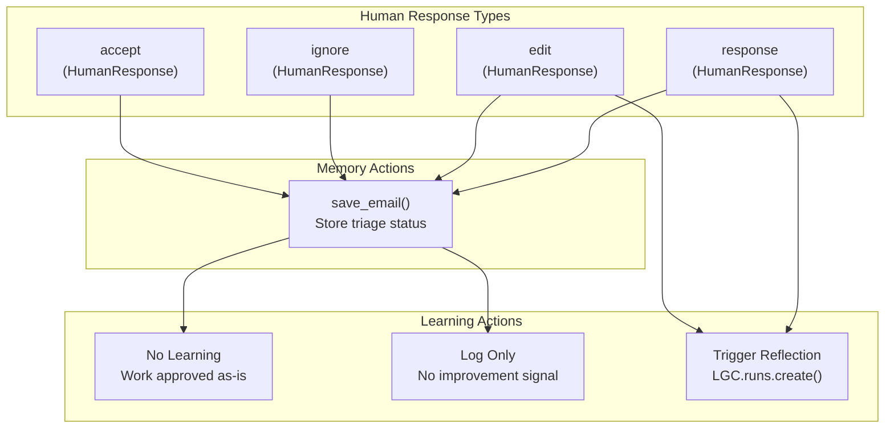
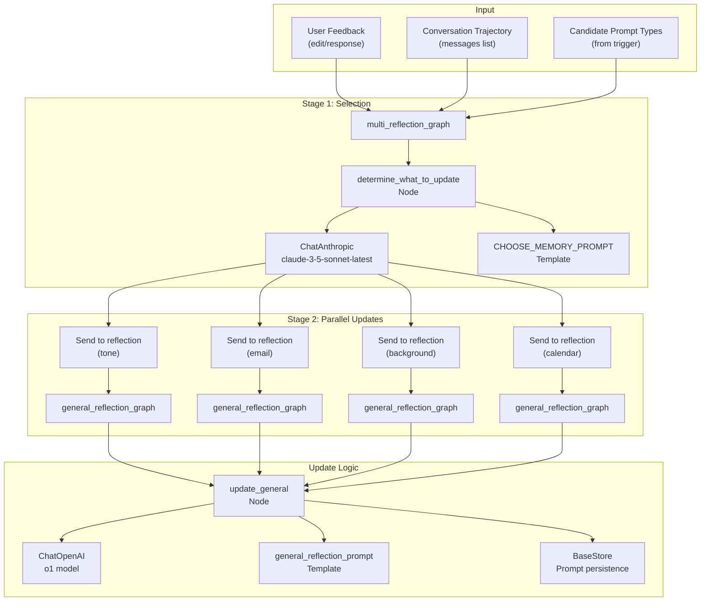
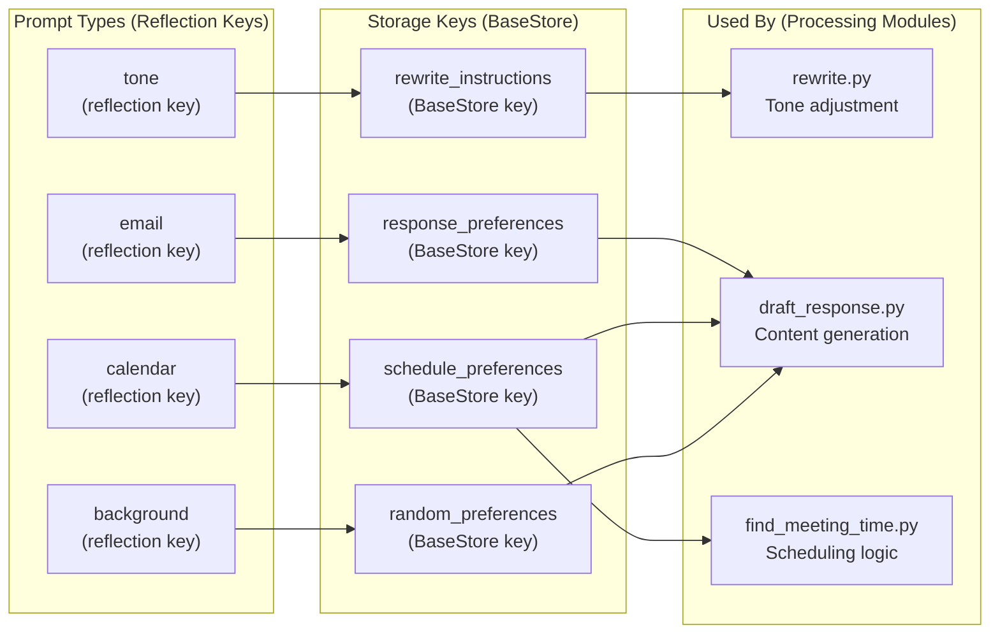
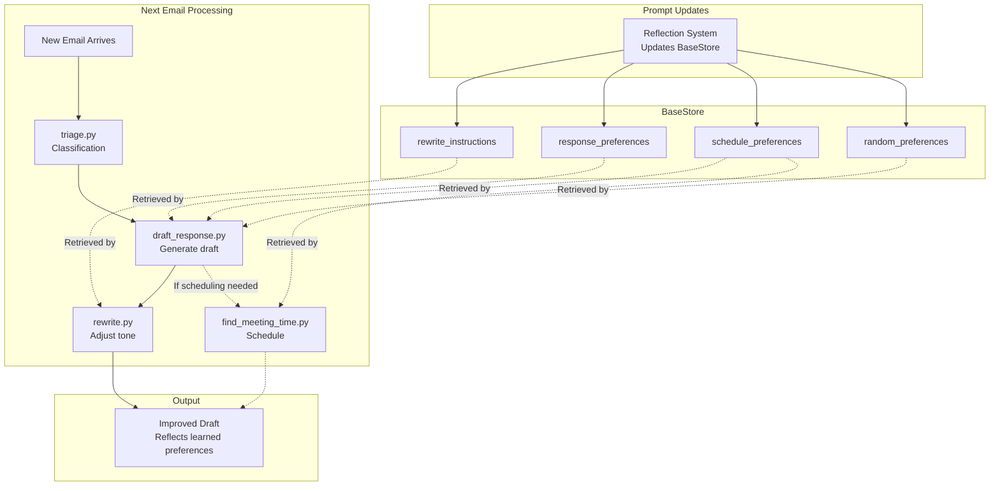

<!-- source: DeepWiki mcp.deepwiki.com · repo langchain-ai/executive-ai-assistant · page 4 Learning and Reflection System · fetched 2026-10-26 -->

# Learning and Reflection System

<details>
<summary>Relevant source files</summary>

The following files were used as context for generating this wiki page:

- [eaia/main/human_inbox.py](eaia/main/human_inbox.py)
- [eaia/reflection_graphs.py](eaia/reflection_graphs.py)

</details>


## Purpose and Scope

The Learning and Reflection System enables EAIA to continuously improve its behavior by learning from user feedback. When users interact with the assistant's work through Agent Inbox—accepting, editing, ignoring, or responding to drafts—the system captures this feedback and uses it to update internal prompts that guide future behavior. This creates a personalized assistant that adapts to individual communication styles, preferences, and needs over time.

This page covers the feedback collection mechanism, the two-stage reflection process, the four types of learnable prompts, and how updated prompts affect subsequent email processing. For information about the human interaction interface, see [Human-in-the-Loop Interface](#3). For prompt storage mechanisms, see [Memory and Storage](#4.2).

---

## Feedback Collection Points

The system collects learning signals through four human interaction functions defined in [eaia/main/human_inbox.py:1-396](). Each function presents work to users and captures their response, triggering different learning pathways based on the response type.

### Human Interaction Functions

| Function | Purpose | Tool Presented | Allowed Response Types |
|----------|---------|----------------|----------------------|
| `send_message` | Present questions to user | `Question` tool call | ignore, response |
| `send_email_draft` | Present email drafts | `ResponseEmailDraft` or `NewEmailDraft` | accept, ignore, edit, response |
| `notify` | Notify user without draft | Notification only | ignore, response |
| `send_cal_invite` | Present calendar invites | `SendCalendarInvite` | accept, ignore, edit, response |

**Sources:** [eaia/main/human_inbox.py:74-137](), [eaia/main/human_inbox.py:140-238](), [eaia/main/human_inbox.py:241-297](), [eaia/main/human_inbox.py:301-395]()

### Response Types and Learning Triggers



**Response Type Behavior:**

- **accept**: User approves the AI's work without changes. Email is saved with triage status "email" but no reflection is triggered since the output was correct. [eaia/main/human_inbox.py:231-234]()

- **ignore**: User rejects the action entirely. Email is saved with triage status "no" but provides no specific feedback for improvement. [eaia/main/human_inbox.py:184-198]()

- **edit**: User modifies the AI's output (only available for drafts and calendar invites). The original and corrected versions are passed to reflection, triggering updates to all relevant prompt types. [eaia/main/human_inbox.py:199-230]()

- **response**: User provides instructions or feedback. This feedback is passed to reflection along with the conversation trajectory. [eaia/main/human_inbox.py:96-117]()

**Sources:** [eaia/main/human_inbox.py:34-37](), [eaia/main/human_inbox.py:16-21]()

### Conditional Reflection Triggering

Reflection only occurs when the `memory` configuration flag is enabled in `config.yaml`. When triggered, the system creates an asynchronous run of `multi_reflection_graph` without blocking the main workflow:

```python
# From send_email_draft when user provides response
await LGC.runs.create(None, "multi_reflection_graph", input=rewrite_state)
```

The `rewrite_state` includes:
- **messages**: The conversation history showing the email and AI's draft
- **feedback**: The user's correction or instructions
- **prompt_types**: Which prompt categories are candidates for update
- **assistant_key**: The user's namespace for storing prompts

Different interaction functions trigger different sets of prompt types based on what was being evaluated:

| Function | Triggered Prompt Types | Rationale |
|----------|----------------------|-----------|
| `send_message` | background | Questions reveal user information |
| `send_email_draft` | tone, email, background, calendar | Drafts exercise all capabilities |
| `notify` | email, background, calendar | Notifications involve response/scheduling preferences |
| `send_cal_invite` | email, background, calendar | Calendar invites involve scheduling logic |

**Sources:** [eaia/main/human_inbox.py:103-117](), [eaia/main/human_inbox.py:169-183](), [eaia/main/human_inbox.py:264-278](), [eaia/main/human_inbox.py:330-344]()

---

## Reflection System Architecture

The reflection system uses a two-stage architecture: a selection stage that determines which prompts are relevant to update, followed by parallel update stages that generate improved prompts.

### Two-Stage Reflection Process



**Sources:** [eaia/reflection_graphs.py:1-191]()

### Selection Stage: `determine_what_to_update`

The selection stage uses an LLM to analyze the feedback and trajectory, deciding which prompt types are actually relevant to update. This prevents unnecessary updates and focuses learning effort.

The `determine_what_to_update` node [eaia/reflection_graphs.py:150-178]():
1. Formats a prompt with the trajectory, feedback, and available prompt type descriptions
2. Uses `ChatAnthropic` with `claude-3-5-sonnet-latest` to analyze relevance
3. Returns a list of prompt types worth updating (can be empty)
4. Creates parallel `Send` commands for each selected type

The prompt template `CHOOSE_MEMORY_PROMPT` [eaia/reflection_graphs.py:122-141]() instructs the LLM to select only prompt types where "the feedback seems like it has info relevant to the prompt."

**Selection Logic:**
```python
class MemoryToUpdate(TypedDict):
    memory_types_to_update: list[str]

response = reflection_model.with_structured_output(MemoryToUpdate).invoke(prompt)
```

For each selected type, a `Send` object is created with:
- The conversation messages
- The user feedback
- The specific `prompt_key` for storage (e.g., "rewrite_instructions")
- Type-specific update `instructions`

**Sources:** [eaia/reflection_graphs.py:150-178](), [eaia/reflection_graphs.py:122-141]()

### Update Stage: `general_reflection_graph`

Each selected prompt type triggers an instance of `general_reflection_graph` [eaia/reflection_graphs.py:97-101](), which runs in parallel with other updates. The graph contains a single `update_general` node [eaia/reflection_graphs.py:64-93]() that:

1. **Retrieves the current prompt** from `BaseStore` using the namespace `(assistant_id,)` and the prompt-type-specific key
2. **Formats the reflection prompt** with:
   - Current prompt text
   - Conversation trajectory (formatted via `get_trajectory_clean`)
   - User feedback
   - Type-specific instructions (e.g., `TONE_INSTRUCTIONS`)
3. **Invokes OpenAI's o1 model** using structured output to get:
   - `logic`: The LLM's reasoning about whether to update
   - `update_prompt`: Boolean flag
   - `new_prompt`: The updated prompt text (if updating)
4. **Persists the new prompt** to `BaseStore` if `update_prompt` is `True`

**The Reflection LLM:** The system uses `ChatOpenAI(model="o1")` [eaia/reflection_graphs.py:65]() for its advanced reasoning capabilities. The o1 model is particularly suited for this meta-reasoning task of analyzing agent behavior and generating improved instructions.

**Sources:** [eaia/reflection_graphs.py:64-93](), [eaia/reflection_graphs.py:97-101]()

### Reflection Prompt Template

The `general_reflection_prompt` [eaia/reflection_graphs.py:34-61]() provides the o1 model with:

```
<current_prompt>
{current_prompt}
</current_prompt>

<trajectory>
{trajectory}
</trajectory>

<feedback>
{feedback}
</feedback>

<instructions>
{instructions}
</instructions>
```

The instructions are prompt-type-specific and constrain what aspects can be updated. For example, `TONE_INSTRUCTIONS` [eaia/reflection_graphs.py:8]() states: "Only update the prompt to include instructions on the **style and tone and format** of the response. Do NOT update the prompt to include anything about the actual content."

The model is explicitly told: "You do not need to update the prompt - if you don't want to, just return `update_prompt = False`", preventing unnecessary changes when feedback isn't relevant.

**Sources:** [eaia/reflection_graphs.py:34-61](), [eaia/reflection_graphs.py:8-11]()

---

## Prompt Types and Storage

The system maintains four distinct prompt types, each controlling different aspects of the assistant's behavior. These prompts are stored in `BaseStore` under user-specific namespaces and are retrieved during email processing.

### Prompt Type Mapping



**Sources:** [eaia/reflection_graphs.py:103-120]()

### Prompt Type Definitions

The mappings between reflection keys, storage keys, and update instructions are defined in three dictionaries [eaia/reflection_graphs.py:103-120]():

**`MEMORY_TO_UPDATE`** - Descriptions used during selection:
```python
{
    "tone": "Instruction about the tone and style and format of the resulting email...",
    "background": "Background information about the user...",
    "email": "Instructions about the type of content to be included in email...",
    "calendar": "Instructions about how to send calendar invites..."
}
```

**`MEMORY_TO_UPDATE_KEYS`** - Storage keys in BaseStore:
```python
{
    "tone": "rewrite_instructions",
    "background": "random_preferences",
    "email": "response_preferences",
    "calendar": "schedule_preferences"
}
```

**`MEMORY_TO_UPDATE_INSTRUCTIONS`** - Update constraints:
```python
{
    "tone": TONE_INSTRUCTIONS,
    "background": BACKGROUND_INSTRUCTIONS,
    "email": RESPONSE_INSTRUCTIONS,
    "calendar": SCHEDULE_INSTRUCTIONS
}
```

**Sources:** [eaia/reflection_graphs.py:103-120]()

### Prompt Type Purposes

| Reflection Key | Storage Key | Scope | Update Constraint | Used In |
|----------------|-------------|-------|-------------------|---------|
| `tone` | `rewrite_instructions` | Style, tone, format of emails | Only style/tone/format, not content | `rewrite.py` |
| `email` | `response_preferences` | Content to include in responses | Only content, not tone/style/format | `draft_response.py` |
| `calendar` | `schedule_preferences` | Calendar invite preferences (title, length, time) | Only scheduling logistics | `draft_response.py`, `find_meeting_time.py` |
| `background` | `random_preferences` | User information, contacts, addresses | General background info, not tone or scheduling | `draft_response.py` |

The strict separation enforced by update instructions ensures that feedback about tone doesn't accidentally modify content preferences, and vice versa. This modularity makes the learning system more robust and predictable.

**Sources:** [eaia/reflection_graphs.py:8-11]()

---

## Reflection State Management

The reflection graphs use dedicated state schemas to manage the multi-stage process.

### `ReflectionState` Schema

Used by `general_reflection_graph` [eaia/reflection_graphs.py:21-25]():

```python
class ReflectionState(MessagesState):
    feedback: Optional[str]      # User's correction or instructions
    prompt_key: str              # Storage key (e.g., "rewrite_instructions")
    assistant_key: str           # User namespace
    instructions: str            # Type-specific update constraints
```

This extends `MessagesState` to include the conversation history plus reflection-specific metadata.

**Sources:** [eaia/reflection_graphs.py:21-25]()

### `MultiMemoryInput` Schema

Used by `multi_reflection_graph` [eaia/reflection_graphs.py:144-147]():

```python
class MultiMemoryInput(MessagesState):
    prompt_types: list[str]      # Candidate types (e.g., ["tone", "email"])
    feedback: str                # User feedback
    assistant_key: str           # User namespace
```

The `prompt_types` list comes from the human interaction function that triggered reflection, indicating which prompts are potentially relevant based on what was being evaluated.

**Sources:** [eaia/reflection_graphs.py:144-147]()

### Parallel Execution Pattern

The `multi_reflection_graph` uses LangGraph's `Send` and `Command` API to execute updates in parallel [eaia/reflection_graphs.py:167-178]():

```python
sends = []
for t in response["memory_types_to_update"]:
    _state = {
        "messages": state["messages"],
        "feedback": state["feedback"],
        "prompt_key": MEMORY_TO_UPDATE_KEYS[t],
        "assistant_key": state["assistant_key"],
        "instructions": MEMORY_TO_UPDATE_INSTRUCTIONS[t],
    }
    send = Send("reflection", _state)
    sends.append(send)
return Command(goto=sends)
```

Each `Send` object routes to the `reflection` node (which calls `general_reflection_graph`) with its own state. All reflection nodes execute concurrently, improving efficiency when multiple prompt types need updates.

**Sources:** [eaia/reflection_graphs.py:167-178](), [eaia/reflection_graphs.py:182-183]()

---

## Storage and Retrieval

### BaseStore Organization

Prompts are stored in `BaseStore` using a namespace structure:

```
(assistant_id,) / prompt_key
```

- **Namespace**: `(assistant_id,)` - A single-element tuple containing the user's identifier from `config["configurable"]["assistant_id"]`
- **Key**: One of the four storage keys (`rewrite_instructions`, `response_preferences`, `schedule_preferences`, `random_preferences`)

The `update_general` function retrieves the current prompt [eaia/reflection_graphs.py:67-69]():

```python
namespace = (state["assistant_key"],)
key = state["prompt_key"]
result = await store.aget(namespace, key)
```

After reflection, if the LLM decides to update, the new prompt is persisted [eaia/reflection_graphs.py:90-93]():

```python
if output["update_prompt"]:
    await store.aput(
        namespace, key, {"data": output["new_prompt"]}, index=False
    )
```

The `index=False` parameter indicates that this data should not be indexed for semantic search—it's retrieved by exact namespace/key lookup.

**Sources:** [eaia/reflection_graphs.py:67-69](), [eaia/reflection_graphs.py:90-93]()

### Triage Example Storage

In addition to prompt storage, the `save_email` function [eaia/main/human_inbox.py:61-70]() persists triage decisions for building few-shot examples:

```python
namespace = (
    config["configurable"].get("assistant_id", "default"),
    "triage_examples",
)
key = state["email"]["id"]
data = {"input": state["email"], "triage": status}
await store.aput(namespace, str(uuid.uuid4()), data)
```

This stores each email with its final triage status ("email", "no", "notify"), which can be retrieved by the triage module to improve classification accuracy over time.

**Sources:** [eaia/main/human_inbox.py:61-70]()

---

## Integration with Processing Pipeline

Updated prompts take effect immediately on the next email processed by the system. Each processing module retrieves relevant prompts from `BaseStore` at runtime.

### Prompt Usage Flow



**Sources:** [eaia/main/draft_response.py](), [eaia/main/rewrite.py](), [eaia/main/find_meeting_time.py]()

### Continuous Improvement Loop

The complete learning cycle:

1. **User interacts** with draft/question/notification/invite in Agent Inbox
2. **Response captured** by `send_email_draft`, `send_message`, `notify`, or `send_cal_invite`
3. **Reflection triggered** (if edit or response, and memory enabled) via `LGC.runs.create()`
4. **Selection phase** determines relevant prompt types via `determine_what_to_update`
5. **Update phase** uses o1 model to generate improved prompts in parallel
6. **Prompts persisted** to `BaseStore` under user's namespace
7. **Next email** retrieves updated prompts during processing
8. **Improved behavior** reflects learned preferences
9. **Cycle repeats** with each user interaction

This creates a personalized assistant that becomes increasingly accurate and aligned with user preferences over time, without requiring manual prompt engineering.

**Sources:** [eaia/main/human_inbox.py:103-117](), [eaia/main/human_inbox.py:169-183](), [eaia/reflection_graphs.py:150-178](), [eaia/reflection_graphs.py:64-93]()

---

## Async Reflection Execution

A critical design decision is that reflection happens **asynchronously** and does not block the main workflow. When reflection is triggered via `LGC.runs.create()`, the call returns immediately without waiting for completion:

```python
# From send_email_draft
await LGC.runs.create(None, "multi_reflection_graph", input=rewrite_state)
# Execution continues immediately; reflection runs in background
```

This ensures:
- **Responsive UI**: Users aren't blocked waiting for reflection to complete
- **Non-blocking workflow**: The main graph can finish and release the thread
- **Eventual consistency**: Updated prompts become available after reflection completes

The tradeoff is that improvements from one interaction won't immediately affect that same thread's continued processing, but will be available for all subsequent emails.

**Sources:** [eaia/main/human_inbox.py:117](), [eaia/main/human_inbox.py:183]()

---

## Reflection Model Selection

The system uses different LLM models for the two reflection stages, optimized for their respective tasks:

| Stage | Model | Rationale |
|-------|-------|-----------|
| Selection (`determine_what_to_update`) | `claude-3-5-sonnet-latest` | Fast, cost-effective for analyzing relevance |
| Update (`update_general`) | `o1` | Advanced reasoning for meta-cognitive task of improving prompts |

The o1 model is particularly well-suited for the update stage because generating improved instructions requires:
- Deep understanding of the user's feedback
- Analysis of what went wrong in the original prompt
- Synthesis of new instructions that address the issue
- Preservation of other prompt aspects that were working well

**Sources:** [eaia/reflection_graphs.py:65](), [eaia/reflection_graphs.py:152]()

---

## Memory Configuration

Reflection is controlled by the `memory` flag in `config.yaml`. When disabled, the system still presents work to users and accepts feedback, but no learning occurs:

```python
# From send_email_draft
prompt_config = get_config(config)
memory = prompt_config["memory"]
# ...
if memory:
    await save_email(state, config, store, "email")
    # ... trigger reflection
```

This allows users to:
- Test the system without accumulating learning data
- Disable learning in production if desired
- Clear separation between feedback collection and learning

**Sources:** [eaia/main/human_inbox.py:141-143](), [eaia/main/human_inbox.py:169-183]()

---

