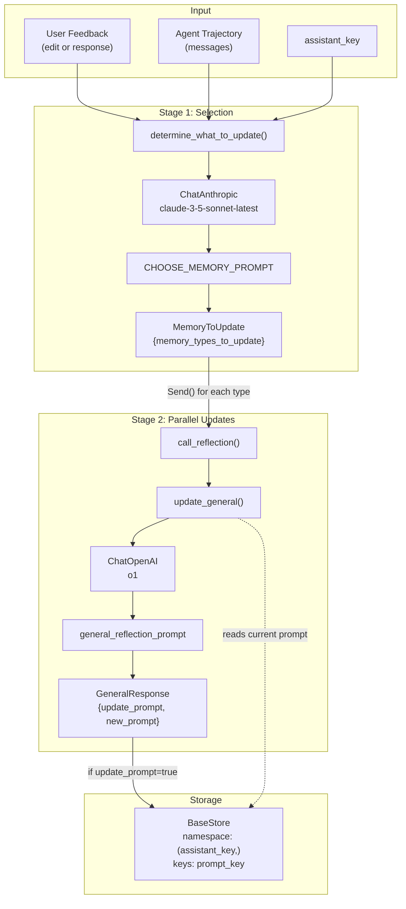
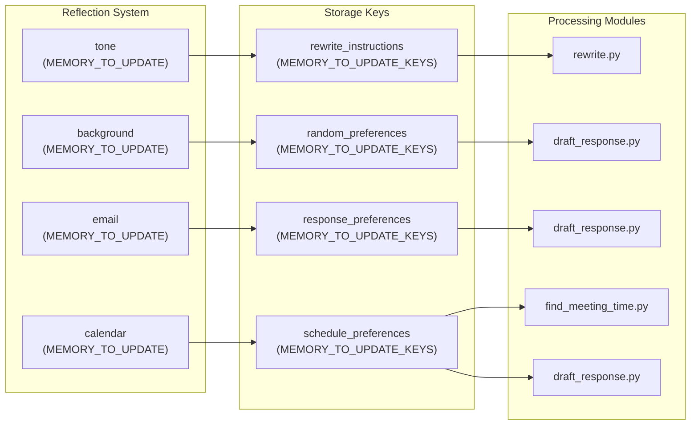
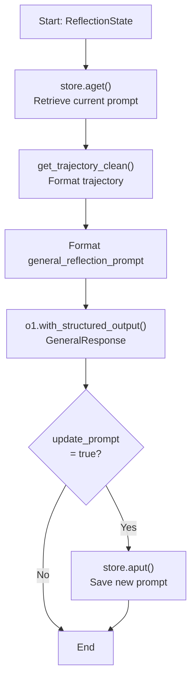
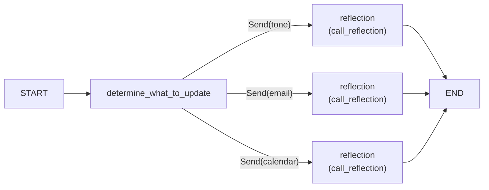

<!-- source: DeepWiki mcp.deepwiki.com · repo langchain-ai/executive-ai-assistant · page 4.1 Prompt Reflection Mechanism · fetched 2026-10-26 -->

# Prompt Reflection Mechanism

<details>
<summary>Relevant source files</summary>

The following files were used as context for generating this wiki page:

- [eaia/reflection_graphs.py](eaia/reflection_graphs.py)

</details>


## Purpose and Scope

The Prompt Reflection Mechanism enables EAIA to learn from user feedback by automatically updating system prompts. When users edit AI-generated drafts or provide explicit feedback, this system analyzes the corrections and improves the prompts that guide future email processing.

This document covers the reflection system implemented in `eaia/reflection_graphs.py`, including the two-stage reflection process (`multi_reflection_graph` and `general_reflection_graph`), the four prompt types that can be updated, and how these updates are persisted to storage.

For information about how user feedback is collected and triggers reflection, see [Human Response Types](#3.2). For details on how updated prompts are retrieved and used during email processing, see [Memory and Storage](#4.2).

**Sources:** [eaia/reflection_graphs.py:1-191]()

---

## System Architecture

The reflection system operates as a two-stage pipeline that selectively updates relevant prompts based on user feedback:

### Diagram: Two-Stage Reflection Pipeline



**Sources:** [eaia/reflection_graphs.py:150-190]()

### Stage 1: Selection

The first stage (`determine_what_to_update`) analyzes the user feedback and agent trajectory to identify which prompt types are relevant to update. This prevents unnecessary updates and focuses learning on the specific aspects of behavior that need improvement.

**Input State:**
- `messages`: Agent trajectory showing what the AI did
- `feedback`: User's correction or instruction
- `prompt_types`: Available prompt types to consider
- `assistant_key`: User namespace for storage

**Output:**
- List of `Send()` commands, one per selected prompt type, each containing state for the update stage

**Sources:** [eaia/reflection_graphs.py:150-179]()

### Stage 2: Update

The second stage (`update_general`) executes in parallel for each selected prompt type, generating improved prompts based on:
- Current prompt content
- Agent trajectory
- User feedback
- Type-specific instructions

**Input State (`ReflectionState`):**
- `messages`: Agent trajectory
- `feedback`: User feedback
- `prompt_key`: Storage key for this prompt type
- `assistant_key`: User namespace
- `instructions`: Type-specific update constraints

**Output:**
- Updated prompt stored in BaseStore (if `update_prompt=true`)

**Sources:** [eaia/reflection_graphs.py:64-101]()

---

## Prompt Type Taxonomy

The reflection system manages four distinct prompt types, each controlling different aspects of EAIA's behavior:

| Prompt Type | Storage Key | Used By | Purpose |
|-------------|-------------|---------|---------|
| **tone** | `rewrite_instructions` | `rewrite.py` | Style, tone, and format of emails |
| **background** | `random_preferences` | `draft_response.py` | Background information about the user |
| **email** | `response_preferences` | `draft_response.py` | Content and response strategy |
| **calendar** | `schedule_preferences` | `draft_response.py`, `find_meeting_time.py` | Meeting scheduling preferences |

**Sources:** [eaia/reflection_graphs.py:103-120]()

### Type-Specific Update Constraints

Each prompt type has explicit instructions that constrain what the reflection LLM can modify:

**Tone (`TONE_INSTRUCTIONS`):**
- Updates: Style, tone, and format
- Excludes: Actual content
- Special consideration: Different tones for different people

**Background (`BACKGROUND_INSTRUCTIONS`):**
- Updates: Relevant background information (emails, addresses, etc.)
- Excludes: Tone, style, or calendar instructions

**Email (`RESPONSE_INSTRUCTIONS`):**
- Updates: Content strategy and what to include
- Excludes: Tone, style, or format

**Calendar (`SCHEDULE_INSTRUCTIONS`):**
- Updates: Calendar invite preferences (title, length, timing)
- Excludes: Everything else

**Sources:** [eaia/reflection_graphs.py:8-11]()

### Diagram: Prompt Type to Code Entity Mapping



**Sources:** [eaia/reflection_graphs.py:103-120]()

---

## Selection Stage: `determine_what_to_update`

The selection stage uses an LLM to analyze feedback and decide which prompt types require updates.

### Function Signature

```python
async def determine_what_to_update(state: MultiMemoryInput)
```

**Input State (`MultiMemoryInput`):**
- `messages`: List[BaseMessage] - Agent trajectory
- `prompt_types`: list[str] - Available prompt types
- `feedback`: str - User feedback
- `assistant_key`: str - User namespace

**Sources:** [eaia/reflection_graphs.py:144-179]()

### Selection Logic

1. **Trajectory Formatting**: Converts messages to readable format via `get_trajectory_clean()`
2. **Prompt Construction**: Builds `CHOOSE_MEMORY_PROMPT` with trajectory, feedback, and prompt type descriptions
3. **LLM Invocation**: Calls Claude 3.5 Sonnet with structured output enforcing `MemoryToUpdate` schema
4. **Send Commands**: Creates parallel `Send()` commands for each selected prompt type

### Structured Output Schema

```python
class MemoryToUpdate(TypedDict):
    memory_types_to_update: list[str]
```

The LLM returns a list of prompt type identifiers (e.g., `["tone", "email"]`) that are relevant to the feedback.

**Sources:** [eaia/reflection_graphs.py:163-178]()

### Selection Prompt Template

The `CHOOSE_MEMORY_PROMPT` template provides:
- Agent trajectory context
- User feedback
- Descriptions of each prompt type
- Instructions to select only relevant types
- Explicit permission to select none if feedback is not useful

**Sources:** [eaia/reflection_graphs.py:122-141]()

---

## Update Stage: `update_general`

The update stage generates improved prompts using advanced reasoning capabilities.

### Function Signature

```python
async def update_general(state: ReflectionState, config, store: BaseStore)
```

**Input State (`ReflectionState`):**
- `messages`: List[BaseMessage] - Agent trajectory
- `feedback`: str - User feedback
- `prompt_key`: str - Storage key for this prompt type
- `assistant_key`: str - User namespace
- `instructions`: str - Type-specific update constraints

**Sources:** [eaia/reflection_graphs.py:64-94]()

### Update Logic Flow



**Sources:** [eaia/reflection_graphs.py:64-94]()

### Structured Output Schema

```python
class GeneralResponse(TypedDict):
    logic: str
    update_prompt: bool
    new_prompt: str
```

- `logic`: Reasoning about whether/how to update
- `update_prompt`: Boolean decision flag
- `new_prompt`: Complete replacement prompt (if updating)

**Sources:** [eaia/reflection_graphs.py:28-32]()

### Update Prompt Template

The `general_reflection_prompt` template provides:
- Current prompt content
- Agent trajectory showing what went wrong
- User feedback explaining the issue
- Type-specific instructions constraining updates
- Explicit permission to not update if feedback is not applicable

The template emphasizes returning the **full prompt**, allowing the LLM to:
- Preserve relevant existing instructions
- Override or remove irrelevant content
- Add new guidance based on feedback

**Sources:** [eaia/reflection_graphs.py:34-61]()

---

## Parallel Execution Model

The reflection system executes multiple prompt updates concurrently using LangGraph's `Send()` API.

### Multi-Reflection Graph Structure



**Sources:** [eaia/reflection_graphs.py:186-190]()

### Execution Flow

1. **Selection**: `determine_what_to_update` analyzes feedback and returns `Command(goto=sends)` with multiple `Send()` commands
2. **Parallel Dispatch**: LangGraph routes each `Send()` to a separate `call_reflection` node execution
3. **Independent Updates**: Each `call_reflection` node invokes `general_reflection_graph` with its specific state
4. **Concurrent Execution**: All updates run in parallel, each reading and writing to different prompt keys
5. **Completion**: All parallel executions complete before the graph finishes

### `call_reflection` Wrapper

```python
async def call_reflection(state: ReflectionState):
    await general_reflection_graph.ainvoke(state)
```

This wrapper exists to enable parallel execution of the general reflection graph for multiple prompt types simultaneously.

**Sources:** [eaia/reflection_graphs.py:182-183]()

---

## Storage Integration

The reflection system integrates with BaseStore to persist prompt updates.

### Namespace Structure

```
namespace: (assistant_key,)
```

Each user's prompts are stored in a namespace tuple containing only their `assistant_key`. This isolates prompts per user, enabling personalized learning.

**Sources:** [eaia/reflection_graphs.py:67]()

### Storage Operations

**Read Current Prompt:**
```python
result = await store.aget(namespace, key)
current_prompt = result.value["data"]
```

**Write Updated Prompt:**
```python
await store.aput(
    namespace, key, {"data": output["new_prompt"]}, index=False
)
```

The `index=False` parameter indicates that prompt values should not be indexed for search.

**Sources:** [eaia/reflection_graphs.py:69-93]()

### Storage Key to Prompt Type Mapping

| Storage Key | Prompt Type | Description |
|-------------|-------------|-------------|
| `rewrite_instructions` | tone | Tone and style preferences |
| `random_preferences` | background | User background information |
| `response_preferences` | email | Email content strategy |
| `schedule_preferences` | calendar | Meeting scheduling rules |

**Sources:** [eaia/reflection_graphs.py:109-114]()

---

## LLM Configuration

The reflection system uses different LLM models for different stages, optimizing for capability vs. cost.

### Selection Stage Model

```python
reflection_model = ChatAnthropic(model="claude-3-5-sonnet-latest")
```

**Purpose:** Analyze feedback and select relevant prompt types  
**Rationale:** Fast, cost-effective classification task  
**Location:** `determine_what_to_update`

**Sources:** [eaia/reflection_graphs.py:152]()

### Update Stage Model

```python
reflection_model = ChatOpenAI(model="o1", disable_streaming=True)
```

**Purpose:** Generate improved prompts with deep reasoning  
**Rationale:** OpenAI's o1 provides advanced reasoning capabilities for complex prompt improvement  
**Configuration:** Streaming disabled (o1 does not support streaming)  
**Location:** `update_general`

**Sources:** [eaia/reflection_graphs.py:65]()

### Structured Output Enforcement

Both stages use `with_structured_output()` to enforce schema compliance:

**Selection Stage:**
```python
reflection_model.with_structured_output(MemoryToUpdate).invoke(prompt)
```

**Update Stage:**
```python
reflection_model.with_structured_output(
    GeneralResponse, method="json_schema"
).ainvoke(prompt)
```

The o1 model requires explicit `method="json_schema"` specification.

**Sources:** [eaia/reflection_graphs.py:79-81, 166]()

---

## Graph Compilation

### General Reflection Graph

```python
general_reflection_graph = StateGraph(ReflectionState)
general_reflection_graph.add_node(update_general)
general_reflection_graph.add_edge(START, "update_general")
general_reflection_graph.add_edge("update_general", END)
general_reflection_graph = general_reflection_graph.compile()
```

This simple linear graph executes a single prompt update.

**Sources:** [eaia/reflection_graphs.py:97-101]()

### Multi-Reflection Graph

```python
multi_reflection_graph = StateGraph(MultiMemoryInput)
multi_reflection_graph.add_node(determine_what_to_update)
multi_reflection_graph.add_node("reflection", call_reflection)
multi_reflection_graph.add_edge(START, "determine_what_to_update")
multi_reflection_graph = multi_reflection_graph.compile()
```

This graph uses dynamic routing via `Send()` commands to enable parallel reflection node execution. No explicit edge from `determine_what_to_update` to `reflection` is needed—the `Command(goto=sends)` handles routing.

**Sources:** [eaia/reflection_graphs.py:186-190]()

---

## Integration with Main System

The reflection system is triggered asynchronously after human feedback:

1. User edits draft or provides feedback via Agent Inbox
2. Human inbox node captures feedback and trajectory
3. System invokes `multi_reflection_graph` via LangGraph Client (non-blocking)
4. Reflection completes asynchronously, updating prompts in BaseStore
5. Next email processing run uses updated prompts

This asynchronous design ensures user workflows are not blocked by learning operations.

For details on how feedback triggers reflection, see [Human Response Types](#3.2). For how updated prompts are loaded during processing, see [Email Response Generation](#2.3) and [Memory and Storage](#4.2).

**Sources:** [eaia/reflection_graphs.py:1-191]()

---

