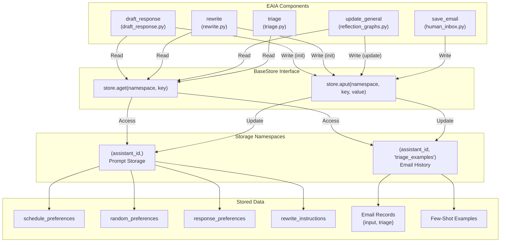
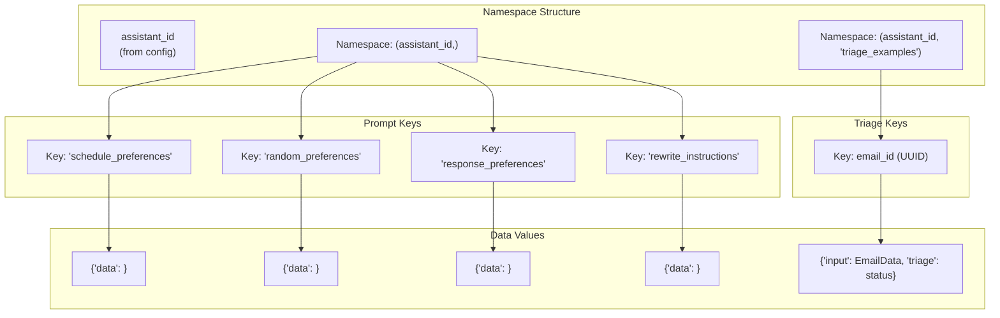
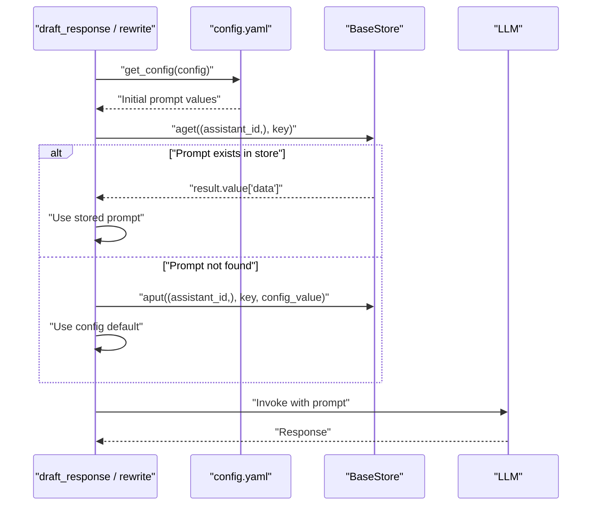
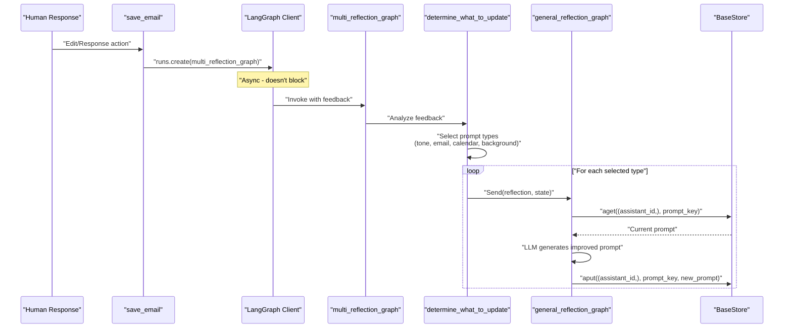
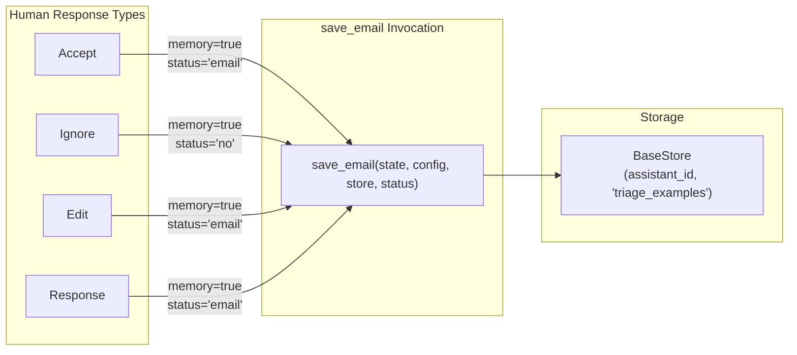
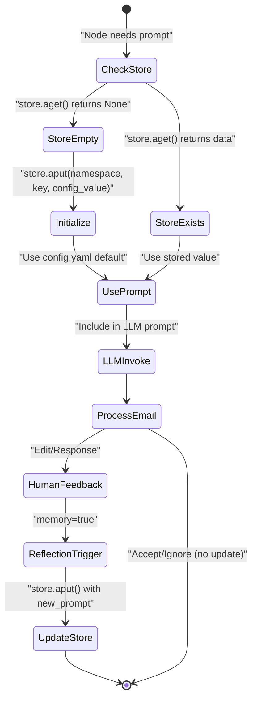

<!-- source: DeepWiki mcp.deepwiki.com · repo langchain-ai/executive-ai-assistant · page 4.2 Memory and Storage · fetched 2026-10-26 -->

# Memory and Storage

<details>
<summary>Relevant source files</summary>

The following files were used as context for generating this wiki page:

- [eaia/main/draft_response.py](eaia/main/draft_response.py)
- [eaia/main/human_inbox.py](eaia/main/human_inbox.py)
- [eaia/reflection_graphs.py](eaia/reflection_graphs.py)

</details>


This document describes the persistent storage layer in the Executive AI Assistant (EAIA) system, focusing on how `BaseStore` is used to persist prompts, email history, and few-shot examples across sessions. This enables the system to learn from user feedback and improve its behavior over time.

For information about how the reflection system updates prompts based on feedback, see [Prompt Reflection Mechanism](#4.1). For configuration of memory behavior, see [Email Preferences Configuration](#5.1).

## Overview

EAIA uses LangGraph's `BaseStore` as its persistence layer to maintain:

1. **User-specific prompts** that guide LLM behavior in drafting and rewriting emails
2. **Email triage history** for deduplication and analytics
3. **Few-shot examples** to improve triage classification accuracy

All storage operations are namespaced by `assistant_id` to support multi-user deployments, and the `memory` configuration flag controls whether data is persisted during human interactions.

**Sources:** [eaia/main/human_inbox.py:1-8](), [eaia/main/draft_response.py:1-6](), [eaia/reflection_graphs.py:1-11]()

## BaseStore Architecture



**BaseStore Operations**

The system uses two primary `BaseStore` operations:

| Operation | Purpose | Usage Pattern |
|-----------|---------|---------------|
| `store.aget(namespace, key)` | Retrieve stored data | Read prompts before LLM invocation, retrieve email history |
| `store.aput(namespace, key, value, index=False)` | Store or update data | Initialize default prompts, update improved prompts, save email records |

The `BaseStore` is passed to nodes via LangGraph's dependency injection, appearing as the third parameter after `state` and `config` in node functions.

**Sources:** [eaia/main/draft_response.py:82-125](), [eaia/reflection_graphs.py:64-93](), [eaia/main/human_inbox.py:61-70]()

## Namespace Organization



All storage is organized using a two-level namespace hierarchy:

1. **Prompt Storage Namespace:** `(assistant_id,)`
   - Contains user-specific prompt customizations
   - Keys: `schedule_preferences`, `random_preferences`, `response_preferences`, `rewrite_instructions`
   - Values: `{"data": <prompt_text>}`

2. **Triage Examples Namespace:** `(assistant_id, "triage_examples")`
   - Contains historical email triage decisions
   - Keys: Individual UUIDs per email
   - Values: `{"input": <EmailData>, "triage": <status>}`

The `assistant_id` is retrieved from `config["configurable"].get("assistant_id", "default")` and defaults to `"default"` for single-user deployments.

**Sources:** [eaia/main/draft_response.py:102-125](), [eaia/main/human_inbox.py:62-65](), [eaia/reflection_graphs.py:67-68]()

## Prompt Storage and Lifecycle

### Prompt Types and Mapping

The system maintains four distinct prompt types, each controlling different aspects of email processing:

| Prompt Type | Storage Key | Used By | Controls | Updated By Reflection |
|-------------|-------------|---------|----------|---------------------|
| **Tone/Style** | `rewrite_instructions` | `rewrite.py` | Email tone, style, format | Yes (via "tone" type) |
| **Response Content** | `response_preferences` | `draft_response.py` | Email content guidance | Yes (via "email" type) |
| **Scheduling** | `schedule_preferences` | `draft_response.py`, `find_meeting_time.py` | Calendar invite preferences | Yes (via "calendar" type) |
| **Background** | `random_preferences` | `draft_response.py` | User context, contact info | Yes (via "background" type) |

**Sources:** [eaia/reflection_graphs.py:103-120](), [eaia/main/draft_response.py:102-125]()

### Prompt Read Pattern



When processing nodes need prompts, they follow this pattern:

1. Retrieve prompt from `BaseStore` using `store.aget(namespace, key)`
2. If prompt exists (`result and "data" in result.value`), use `result.value["data"]`
3. If prompt doesn't exist, initialize from `config.yaml` using `store.aput()`
4. Include prompt in LLM system message or instructions

This lazy initialization ensures prompts from `config.yaml` are used on first run, then persisted for future updates via reflection.

**Sources:** [eaia/main/draft_response.py:102-133]()

### Prompt Update Pattern



The reflection system updates prompts asynchronously:

1. **Trigger:** User provides feedback via "edit" or "response" action in [eaia/main/human_inbox.py:199-230]()
2. **Selection:** `determine_what_to_update` analyzes which prompt types are relevant [eaia/reflection_graphs.py:150-178]()
3. **Parallel Update:** For each selected type, `general_reflection_graph` runs in parallel [eaia/reflection_graphs.py:64-93]()
4. **Storage:** Updated prompts are written back to `BaseStore` with `index=False` [eaia/reflection_graphs.py:90-93]()

The mapping between reflection type and storage key is defined in:

```python
MEMORY_TO_UPDATE_KEYS = {
    "tone": "rewrite_instructions",
    "background": "random_preferences",
    "email": "response_preferences",
    "calendar": "schedule_preferences",
}
```

**Sources:** [eaia/reflection_graphs.py:109-120](), [eaia/reflection_graphs.py:150-178](), [eaia/main/human_inbox.py:212-230]()

## Email History Storage

### save_email Function

The `save_email` function persists email triage decisions for each processed email:

```python
async def save_email(state: State, config, store: BaseStore, status: str):
    namespace = (
        config["configurable"].get("assistant_id", "default"),
        "triage_examples",
    )
    key = state["email"]["id"]
    response = await store.aget(namespace, key)
    if response is None:
        data = {"input": state["email"], "triage": status}
        await store.aput(namespace, str(uuid.uuid4()), data)
```

**Key Behaviors:**

- **Namespace:** `(assistant_id, "triage_examples")` separates email history from prompts
- **Deduplication:** Checks if `email["id"]` already exists before storing [eaia/main/human_inbox.py:67-68]()
- **Status Values:** `"email"` (engaged), `"no"` (ignored) [eaia/main/human_inbox.py:69]()
- **Key Generation:** Uses `str(uuid.uuid4())` for unique record keys [eaia/main/human_inbox.py:70]()

**Sources:** [eaia/main/human_inbox.py:61-70]()

### When Email History is Saved



Email history is saved conditionally based on the `memory` configuration flag:

| Response Type | Status Saved | Triggered From | Condition |
|---------------|-------------|----------------|-----------|
| `accept` | `"email"` | [eaia/main/human_inbox.py:232-233]() | `if memory:` |
| `ignore` | `"no"` | [eaia/main/human_inbox.py:131-132](), [eaia/main/human_inbox.py:197-198]() | `if memory:` |
| `edit` | `"email"` | [eaia/main/human_inbox.py:213-214]() | `if memory:` |
| `response` | `"email"` | [eaia/main/human_inbox.py:103-104]() | `if memory:` |

**Note:** The `memory` flag is retrieved from `config.yaml` via `get_config(config)["memory"]` in each human inbox function.

**Sources:** [eaia/main/human_inbox.py:75-76](), [eaia/main/human_inbox.py:141-142](), [eaia/main/human_inbox.py:232-233]()

## Memory Configuration Flag

The `memory` configuration flag controls all storage persistence:

```yaml
# config.yaml
memory: true  # Enable storage of email history and prompt updates
```

**When `memory: true`:**
- Email triage status is saved via `save_email()` after all human responses
- Reflection system is triggered to update prompts based on feedback
- Few-shot examples accumulate for future triage improvements

**When `memory: false`:**
- No email history is saved (all `if memory:` blocks are skipped)
- Reflection system is not triggered
- System uses only initial `config.yaml` prompts without learning

This flag provides a "dry-run" mode where the system can process emails without persisting any data.

**Sources:** [eaia/main/human_inbox.py:75-76](), [eaia/main/human_inbox.py:103-117](), [eaia/main/human_inbox.py:169-183]()

## Storage Access Patterns

### Read-Heavy vs Write-Heavy Components

| Component | Storage Pattern | Frequency | Purpose |
|-----------|----------------|-----------|---------|
| `draft_response.py` | Read (3 keys), Write (init only) | Every email requiring draft | Retrieve prompts for email generation |
| `rewrite.py` | Read (1 key), Write (init only) | Every drafted email | Retrieve tone instructions |
| `triage.py` | Read (few-shot examples) | Every email | Improve classification accuracy |
| `human_inbox.py` | Write (email history) | After human response | Record triage decisions |
| `reflection_graphs.py` | Read + Write (selected prompts) | After edit/response | Update prompts based on feedback |

**Sources:** [eaia/main/draft_response.py:82-154](), [eaia/reflection_graphs.py:64-93](), [eaia/main/human_inbox.py:61-70]()

### Initialization vs Update Pattern



The system uses a two-phase storage pattern:

**Phase 1: Initialization** (First Run)
- Nodes check `store.aget()` for existing prompts
- If not found, write defaults from `config.yaml` using `store.aput()`
- This happens in [eaia/main/draft_response.py:102-125]()

**Phase 2: Updates** (Subsequent Runs via Reflection)
- Reflection system reads current prompts with `store.aget()`
- LLM generates improved versions based on feedback
- Writes back with `store.aput()` in [eaia/reflection_graphs.py:90-93]()

This pattern ensures graceful initialization while allowing continuous improvement.

**Sources:** [eaia/main/draft_response.py:102-125](), [eaia/reflection_graphs.py:64-93]()

## Data Persistence and Lifecycle

All data stored in `BaseStore` persists across:
- Individual email processing runs
- Graph executions
- Server restarts (when using persistent store backend)

The lifecycle of stored data:

1. **Initial Setup:** Prompts initialized from `config.yaml` on first use
2. **Runtime Updates:** Prompts updated via reflection after user feedback
3. **Cross-Session:** Same prompts used for all future email processing
4. **Multi-User:** Isolated by `assistant_id` namespace for concurrent users

The `index=False` parameter in `store.aput()` calls indicates data should not be indexed for search, as it's accessed by direct key lookup.

**Sources:** [eaia/reflection_graphs.py:91-93](), [eaia/main/draft_response.py:108-117]()

---

