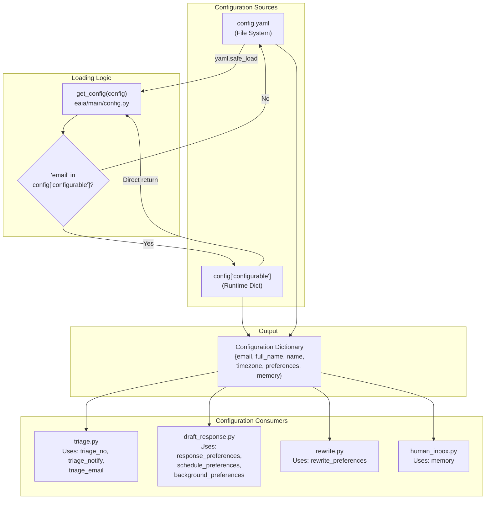

<!-- source: DeepWiki mcp.deepwiki.com · repo langchain-ai/executive-ai-assistant · page 5 Configuration · fetched 2026-10-26 -->

# Configuration

Relevant source files

The following files were used as context for generating this wiki page:

- [eaia/main/config.py](eaia/main/config.py)
- [eaia/main/config.yaml](eaia/main/config.yaml)

EAIA provides two primary configuration mechanisms: a YAML-based user preferences file (`config.yaml`) and environment variables for API credentials. This page provides an overview of how configuration is loaded and managed throughout the system.

For detailed information on individual configuration fields and email behavior customization, see [Email Preferences Configuration](#5.1). For environment variable setup, see [Environment Variables](#5.2). For initial system setup including OAuth and API key configuration, see [Installation and Setup](#1.1).

## Configuration Loading Architecture

EAIA implements a dual-source configuration system that supports both file-based and runtime configuration. The loading mechanism enforces an "all or nothing" policy to prevent partial configuration states.

**Configuration Loading Flow**

The `get_config()` function [eaia/main/config.py:7-15]() implements the configuration loading logic. It accepts a `config` dictionary parameter and follows this decision flow:

1. **Check for Runtime Configuration**: If the key `"email"` exists in `config["configurable"]`, the entire `configurable` dictionary is returned. This enables dynamic configuration for testing or programmatic invocation.

2. **Load File-Based Configuration**: If `"email"` is not present in `configurable`, the system loads configuration from `config.yaml` located in the same directory as `config.py` using `yaml.safe_load()`.

This "all or nothing" design prevents mixing configuration sources, which could lead to inconsistent behavior or difficult-to-debug issues.

**Sources:** [eaia/main/config.py:1-16]()

## Configuration Structure Overview

The configuration dictionary contains both user identification data and behavioral preferences that guide EAIA's decision-making across all processing components.

| Configuration Key | Type | Purpose | Used By |
|------------------|------|---------|---------|
| `email` | string | User's email address for identification | Ingestion, Gmail API |
| `full_name` | string | User's complete name for email signatures | Draft response generation |
| `name` | string | User's preferred short name | Draft response generation |
| `background` | string | User context and role description | Draft response generation |
| `timezone` | string | User's timezone for scheduling | Meeting time finding |
| `schedule_preferences` | string | Meeting scheduling guidelines | Draft response, meeting finding |
| `background_preferences` | string | Additional context for specific scenarios | Draft response generation |
| `response_preferences` | string | Content guidelines for email responses | Draft response generation |
| `rewrite_preferences` | string | Tone and style adjustment rules | Email rewriting |
| `triage_no` | string | Rules for emails to ignore | Email triage |
| `triage_notify` | string | Rules for notification-only emails | Email triage |
| `triage_email` | string | Rules for emails requiring responses | Email triage |
| `memory` | boolean | Enable/disable persistent memory | Human inbox, reflection |

The preferences fields (`schedule_preferences`, `background_preferences`, `response_preferences`, `rewrite_preferences`) are injected directly into LLM prompts to guide model behavior. The triage fields (`triage_no`, `triage_notify`, `triage_email`) define classification rules for the email triage system.

**Sources:** [eaia/main/config.yaml:1-53]()

## Configuration Consumption Patterns

Different components of EAIA consume specific subsets of the configuration dictionary based on their functional responsibilities.

```mermaid
graph TB
    subgraph "Configuration Dictionary"
        Config["get_config(config)<br/>Returns dict with all keys"]
    end
    
    subgraph "Identity & Context"
        Email["email"]
        FullName["full_name"]
        Name["name"]
        Background["background"]
        Timezone["timezone"]
    end
    
    subgraph "Behavioral Preferences"
        SchedulePref["schedule_preferences"]
        BackgroundPref["background_preferences"]
        ResponsePref["response_preferences"]
        RewritePref["rewrite_preferences"]
    end
    
    subgraph "Triage Rules"
        TriageNo["triage_no"]
        TriageNotify["triage_notify"]
        TriageEmail["triage_email"]
    end
    
    subgraph "System Settings"
        Memory["memory"]
    end
    
    Config --> Email
    Config --> FullName
    Config --> Name
    Config --> Background
    Config --> Timezone
    Config --> SchedulePref
    Config --> BackgroundPref
    Config --> ResponsePref
    Config --> RewritePref
    Config --> TriageNo
    Config --> TriageNotify
    Config --> TriageEmail
    Config --> Memory
    
    subgraph "Component Usage"
        TriageComponent["triage.py<br/>triage_input()"]
        DraftComponent["draft_response.py<br/>draft_email_or_ask_question()"]
        RewriteComponent["rewrite.py<br/>rewrite_email()"]
        MeetingComponent["find_meeting_time.py<br/>find_meeting_time_graph"]
        HumanComponent["human_inbox.py<br/>send_email_draft(), etc."]
    end
    
    TriageNo --> TriageComponent
    TriageNotify --> TriageComponent
    TriageEmail --> TriageComponent
    
    ResponsePref --> DraftComponent
    SchedulePref --> DraftComponent
    BackgroundPref --> DraftComponent
    Name --> DraftComponent
    FullName --> DraftComponent
    Background --> DraftComponent
    
    RewritePref --> RewriteComponent
    FullName --> RewriteComponent
    
    SchedulePref --> MeetingComponent
    Timezone --> MeetingComponent
    
    Memory --> HumanComponent
```

**Component-Specific Configuration Usage**

- **triage.py**: Consumes the three triage rule strings (`triage_no`, `triage_notify`, `triage_email`) to classify incoming emails. These rules are embedded in few-shot examples and system prompts to guide the classification LLM.

- **draft_response.py**: Uses identity fields (`name`, `full_name`, `background`) for context, and behavioral preferences (`response_preferences`, `schedule_preferences`, `background_preferences`) to guide response generation. The LLM prompt construction incorporates these fields to match the user's communication style and preferences.

- **rewrite.py**: Applies `rewrite_preferences` to adjust the tone and style of drafted emails. The `full_name` is used for signature generation.

- **find_meeting_time.py**: References `schedule_preferences` for meeting length defaults and `timezone` for time localization when presenting availability.

- **human_inbox.py**: Checks the `memory` boolean flag to determine whether to persist email interactions to BaseStore for deduplication and reflection learning.

**Sources:** [eaia/main/config.yaml:1-53](), [eaia/main/config.py:7-15]()

## Configuration File Location

The `config.yaml` file must be located at `eaia/main/config.yaml` relative to the project root. The loading logic uses `Path(__file__).absolute().parent` [eaia/main/config.py:4]() to resolve the path relative to the `config.py` module location.

For deployment to LangGraph Platform, the `config.yaml` file must be included in the repository at this exact location. The platform will read the file when initializing the graph.

For local development with `langgraph dev`, the same file location is required. Developers can modify `config.yaml` and restart the development server to apply changes.

**Sources:** [eaia/main/config.py:1-16]()

## Environment Variables

In addition to the YAML configuration file, EAIA requires several environment variables for API authentication and external service integration:

- `OPENAI_API_KEY`: Authentication for OpenAI LLM models (gpt-4o, o1)
- `ANTHROPIC_API_KEY`: Authentication for Anthropic LLM models (claude-3-5-sonnet)
- `LANGSMITH_API_KEY`: Authentication for LangSmith tracing and OAuth provider management

These environment variables must be set in the execution environment before running EAIA. For detailed setup instructions and optional variables, see [Environment Variables](#5.2).

**Sources:** Referenced from system architecture diagrams and README documentation

## Configuration Validation

The current implementation does not perform explicit validation of configuration values. The system assumes:

1. All required fields exist in `config.yaml`
2. String fields contain valid YAML syntax
3. The `memory` field is a boolean value
4. The `email` field contains a valid email address

Missing or malformed configuration values will typically result in runtime errors when components attempt to access them. Developers should ensure `config.yaml` is properly formatted and contains all required fields before deployment.

**Sources:** [eaia/main/config.py:7-15]()

## Configuration Customization

To customize EAIA's behavior, users modify `config.yaml` fields directly. The preference strings (`response_preferences`, `rewrite_preferences`, `schedule_preferences`, `background_preferences`) support natural language descriptions that are interpreted by LLMs during processing.

The triage rule strings (`triage_no`, `triage_notify`, `triage_email`) support multi-line YAML strings using the pipe (`|`) syntax [eaia/main/config.yaml:10-49](), enabling complex, human-readable classification rules with bullet points and detailed examples.

For guidance on customizing specific behaviors, see:
- [Email Preferences Configuration](#5.1) for detailed field descriptions
- [Customizing Triage Logic](#8.1) for modifying classification behavior
- [Customizing Email Response Logic](#8.2) for modifying drafting behavior

**Sources:** [eaia/main/config.yaml:1-53]()

---

