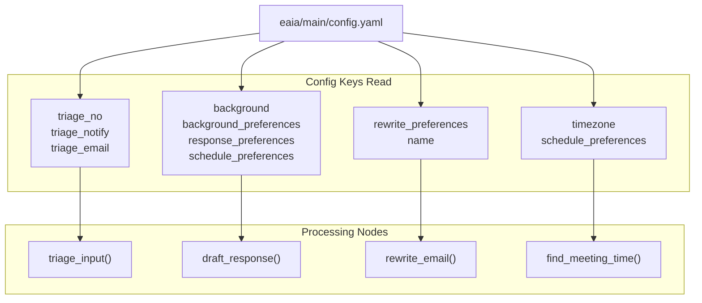
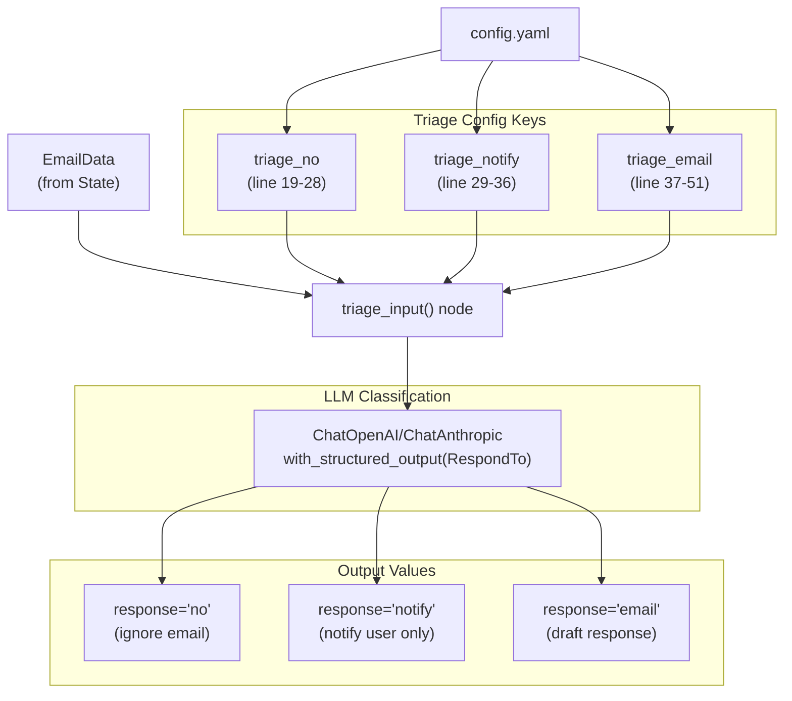
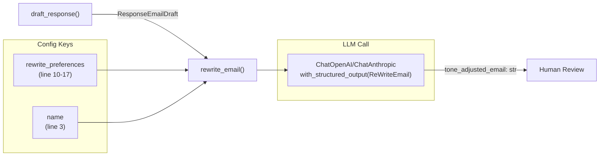
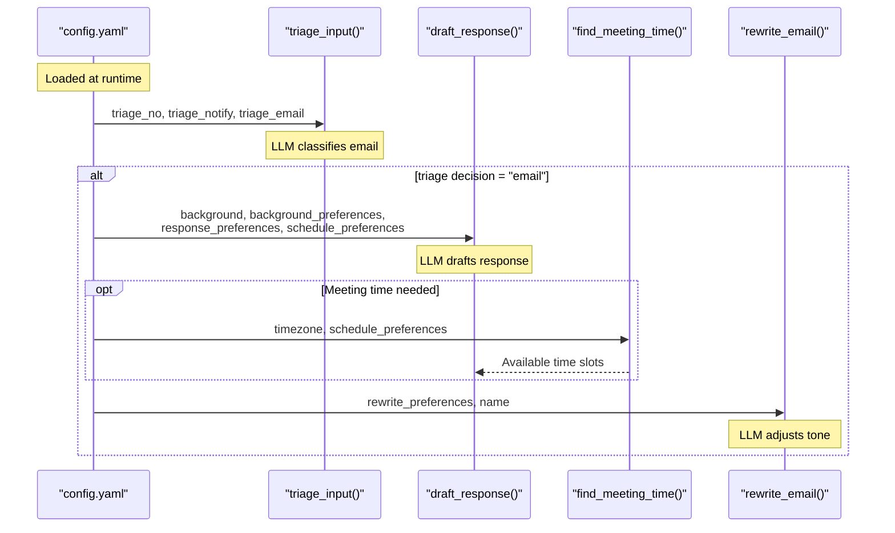

<!-- source: DeepWiki mcp.deepwiki.com · repo langchain-ai/executive-ai-assistant · page 5.1 Email Preferences Configuration · fetched 2026-10-26 -->

# Email Preferences Configuration

<details>
<summary>Relevant source files</summary>

The following files were used as context for generating this wiki page:

- [README.md](README.md)
- [eaia/main/config.yaml](eaia/main/config.yaml)

</details>


## Purpose and Scope

This document details the structure and usage of `eaia/main/config.yaml`, which controls email triage classification, response generation behavior, tone adjustment, and calendar scheduling preferences. The configuration file contains required fields that are loaded at runtime by various processing components. For environment variables and API credentials, see page 5.2.

## Configuration File Location and Loading

Email preferences are defined in `eaia/main/config.yaml`. This file is loaded by processing components that read specific configuration keys to guide their behavior.



**Configuration Loading by Processing Nodes**

Sources: [eaia/main/config.yaml:1-53](), [README.md:48-64]()

## Required Configuration Parameters

All parameters in `config.yaml` are required. The file structure follows a flat YAML schema with the following top-level keys:

| Parameter | Type | Used By | Purpose |
|-----------|------|---------|---------|
| `email` | String | `scripts/run_ingest.py`, Gmail API calls | Primary email address for monitoring and sending |
| `full_name` | String | Email drafting | Full name for email signatures |
| `name` | String | `rewrite_email()` | First name used in tone adjustment |
| `background` | String | `draft_response()` | User context for response generation |
| `timezone` | String | `find_meeting_time()` | Default timezone (e.g., `"PST"`) |
| `schedule_preferences` | String | `draft_response()`, `find_meeting_time()` | Calendar meeting defaults |
| `background_preferences` | String | `draft_response()` | Context for CC'ing contacts |
| `response_preferences` | String | `draft_response()` | Content guidelines for drafts |
| `rewrite_preferences` | String | `rewrite_email()` | Tone and style rules |
| `triage_no` | String | `triage_input()` | Rules for ignoring emails |
| `triage_notify` | String | `triage_input()` | Rules for notification-only emails |
| `triage_email` | String | `triage_input()` | Rules for drafting responses |
| `memory` | Boolean | `human_inbox.py` | Enable/disable reflection system |

Sources: [eaia/main/config.yaml:1-53](), [README.md:51-64]()

## Triage Configuration Keys

The triage system in `eaia/main/triage.py` classifies incoming emails using three configuration strings. Each string contains multi-line guidelines that are injected into the LLM prompt.



**Triage Configuration Flow to Classification Output**

### `triage_no` Configuration

String containing guidelines for emails that should be ignored (marked as read with no action). Rules are formatted as bulleted list items. Examples from [eaia/main/config.yaml:19-28]():

- Automated service emails
- Vendor cold outreach
- Thread conversations where others should respond
- Service notifications (Ramp, Rewatch, Stripe)
- Google Docs comment notifications
- Automated calendar invitations

### `triage_notify` Configuration

String containing guidelines for emails requiring user notification without draft generation. Examples from [eaia/main/config.yaml:29-36]():

- Newly shared Google Docs
- DocuSign signature requests (not already completed)
- Technical questions about user's domain expertise
- Emails with clear action items

### `triage_email` Configuration

String containing guidelines for emails where `draft_response()` should generate a draft. Examples from [eaia/main/config.yaml:37-51]():

- Direct questions from clients
- Meeting scheduling requests
- Introduction coordination emails
- First response to new thread participants
- Emails from pre-existing relationships
- Direct emails from lawyers or board members
- Award/event invitations

The `triage_input()` function constructs an LLM prompt containing these three configuration strings and uses `with_structured_output(RespondTo)` to return a structured classification.

Sources: [eaia/main/config.yaml:19-51](), [README.md:62-64]()

## Response Generation Configuration Keys

Four configuration strings control how `draft_response()` and `rewrite_email()` generate and adjust email responses.

### `schedule_preferences`

String defining default calendar meeting parameters. Used by `draft_response()` when constructing meeting proposals and by `find_meeting_time()` when suggesting times.

Example from [eaia/main/config.yaml:5]():
```yaml
schedule_preferences: By default, unless specified otherwise, you should make meetings 30 minutes long.
```

This value is included in the system prompt for the drafting agent and the `MeetingAssistant` tool.

### `background_preferences`

Multi-line string providing contextual information about contacts to CC or involve. Used by `draft_response()` to determine when to add additional recipients to email threads.

Example from [eaia/main/config.yaml:6-7]():
```yaml
background_preferences: |
  LangChain has a product marketer - Linda. For emails where she may be relevant, 
  please loop her in. If possible, just add her to the thread and let her handle 
  any asks (not Harrison).
```

This configuration enables the LLM to recognize scenarios where specific team members should be included.

### `response_preferences`

String defining content guidelines and information to include in responses. Used by `draft_response()` to guide what information should be provided.

Example from [eaia/main/config.yaml:8]():
```yaml
response_preferences:
```

Note: In the example configuration, this field is empty but must be present. Users can add guidelines like "Include Calendly links for external meetings" or "Always mention timezone when discussing schedules."

### `rewrite_preferences`

Multi-line string defining tone, style, and formatting rules. Used by `rewrite_email()` to adjust draft responses before sending to human review.



**Rewrite Configuration in Processing Flow**

Example from [eaia/main/config.yaml:10-17]():
```yaml
rewrite_preferences: |
  Harrison has a few rules for how he likes his emails to be written:
  - He generally likes to match their tone. If they write formally, then so will he.
  - If working with an assistant to schedule, then he is usually more formal
  - If conversing with someone he seems to know well, then he is more direct
  - Harrison REALLY does not want anyone to know he is using an assistant
  - When Harrison is casual, he generally does not include greetings or sign offs
```

The `rewrite_email()` function constructs a prompt using these preferences and the user's `name` field to personalize the tone adjustment.

Sources: [eaia/main/config.yaml:5-17](), [README.md:57-61]()

## Configuration Usage in Processing Nodes

The configuration file is loaded and consumed by specific nodes in the StateGraph. Each node reads relevant configuration keys to guide LLM behavior.

### `triage_input()` Node

Located in `eaia/main/triage.py`. Reads:
- `triage_no`
- `triage_notify` 
- `triage_email`

These strings are injected into the classification prompt along with the email content and thread history. The LLM (OpenAI or Anthropic) uses `with_structured_output(RespondTo)` to return a structured classification decision.

### `draft_response()` Node

Located in `eaia/main/draft_response.py`. Reads:
- `background`
- `background_preferences`
- `response_preferences`
- `schedule_preferences`

These values are included in the system prompt for the drafting agent. The node also has access to tools (`Question`, `ResponseEmailDraft`, `MeetingAssistant`, `SendCalendarInvite`) and uses tool binding to generate structured outputs.

### `find_meeting_time()` Agent

Located in `eaia/main/find_meeting_time.py`. Reads:
- `timezone`
- `schedule_preferences`

This ReAct agent uses these values when querying calendar availability via `get_events_for_days` tool and when constructing meeting time suggestions.

### `rewrite_email()` Node

Located in `eaia/main/rewrite.py`. Reads:
- `rewrite_preferences`
- `name`

These values guide the tone adjustment LLM call. The function uses `with_structured_output(ReWriteEmail)` to ensure the output includes the `tone_adjusted_email` field.



**Configuration Flow Through Processing Nodes**

Sources: [eaia/main/triage.py](), [eaia/main/draft_response.py](), [eaia/main/find_meeting_time.py](), [eaia/main/rewrite.py]()

## Memory Configuration

The `memory` boolean field controls whether the reflection system is enabled. When set to `true`, the system triggers reflection after user feedback.

```yaml
memory: true
```

When `memory=true`:
- `human_inbox.py` nodes (`send_email_draft`, `send_message`, etc.) invoke `save_email()` to persist triage decisions to BaseStore
- User edit/response actions trigger `multi_reflection_graph` asynchronously via LangGraph Client
- Reflection updates prompts stored in BaseStore under keys: `rewrite_instructions`, `response_preferences`, `schedule_preferences`, `random_preferences`

When `memory=false`:
- Email processing occurs normally
- User feedback is not used to update prompts
- BaseStore is not updated with triage history

See page 4.1 for detailed reflection system documentation.

Sources: [eaia/main/config.yaml:52](), [eaia/main/human_inbox.py](), [eaia/reflection_graphs.py]()

## Configuration File Structure

The complete `config.yaml` structure with data types:

| Key | Type | Format | Example |
|-----|------|--------|---------|
| `email` | String | Email address | `harrison@langchain.dev` |
| `full_name` | String | Full name | `Harrison Chase` |
| `name` | String | First name | `Harrison` |
| `background` | String | Single line | `CEO and co-founder of LangChain` |
| `timezone` | String | Timezone identifier | `PST` |
| `schedule_preferences` | String | Single or multi-line | `By default, make meetings 30 minutes` |
| `background_preferences` | String (multi-line) | Pipe notation | `\|` for multi-line YAML |
| `response_preferences` | String | Single or multi-line | Can be empty string |
| `rewrite_preferences` | String (multi-line) | Pipe notation | Bulleted list format |
| `triage_no` | String (multi-line) | Pipe notation | Bulleted list of rules |
| `triage_notify` | String (multi-line) | Pipe notation | Bulleted list of rules |
| `triage_email` | String (multi-line) | Pipe notation | Bulleted list of rules |
| `memory` | Boolean | `true` or `false` | `true` |

All fields are required. Missing fields will cause runtime errors when processing nodes attempt to read configuration values.

Sources: [eaia/main/config.yaml:1-53](), [README.md:51-64]()

## Best Practices

1. **Be Specific**: Provide detailed rules for triage categories to ensure accurate classification.

2. **Add Context**: Include relevant background information that helps generate appropriate responses.

3. **Define Style Clearly**: Be explicit about tone, formality, and style preferences.

4. **Maintain Consistency**: Ensure triage rules and response preferences are aligned with each other.

5. **Regular Updates**: Review and update configurations as communication patterns change.

6. **Test Thoroughly**: After configuration changes, review the system's responses to ensure they match expectations.

Sources: [README.md:48-63](), [eaia/main/config.yaml:1-53]()

---

