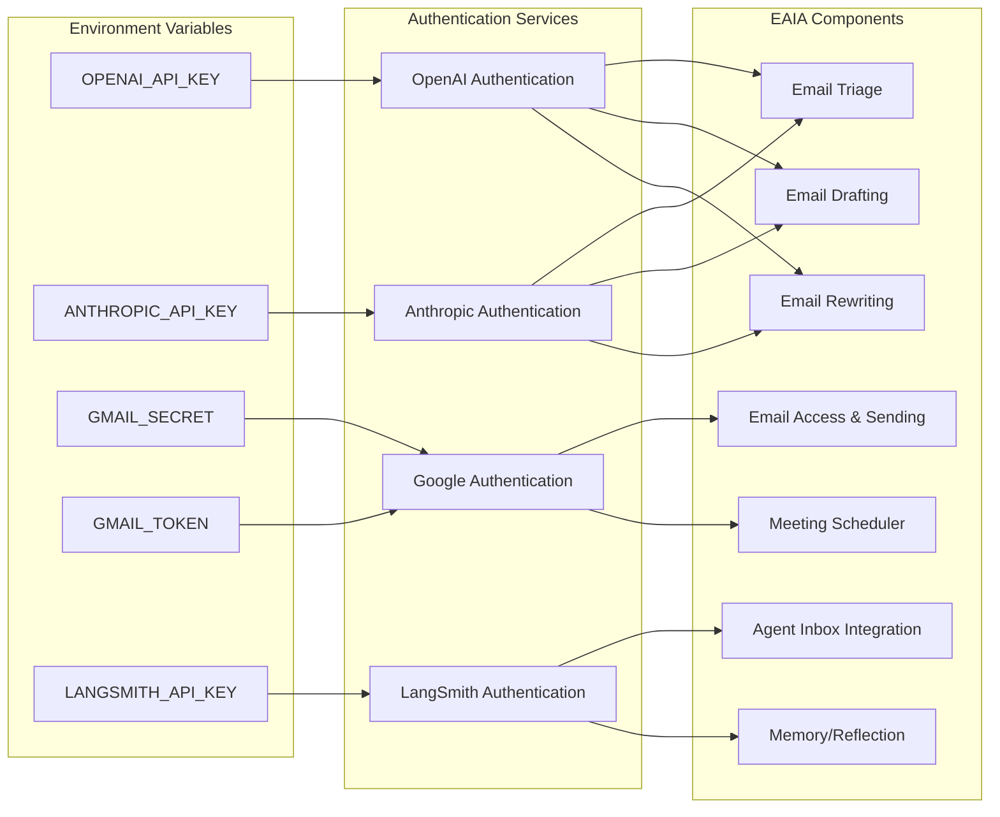
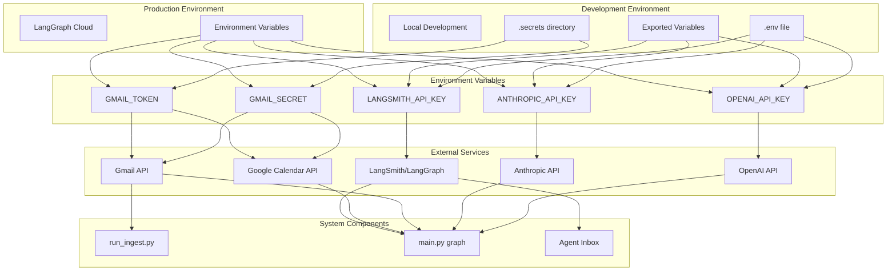

<!-- source: DeepWiki mcp.deepwiki.com · repo langchain-ai/executive-ai-assistant · page 5.2 Environment Variables · fetched 2026-10-26 -->

# Environment Variables

<details>
<summary>Relevant source files</summary>

The following files were used as context for generating this wiki page:

- [.env.example](.env.example)
- [README.md](README.md)

</details>


This page provides a comprehensive reference for the environment variables required to run the Executive AI Assistant (EAIA). Environment variables are essential for configuring authentication with external services, enabling API access, and ensuring the system runs correctly in both development and production environments.

For information about configuring email preferences and system behavior, see [Email Preferences Configuration](#4.1).

## Overview of Required Environment Variables

The Executive AI Assistant requires several environment variables to function properly:

| Environment Variable | Purpose | Required For |
|---------------------|---------|-------------|
| `OPENAI_API_KEY` | Authentication with OpenAI API | Email drafting, triage, rewriting |
| `ANTHROPIC_API_KEY` | Authentication with Anthropic API | Alternative LLM provider |
| `GMAIL_SECRET` | Gmail API client secret | Email access and sending |
| `GMAIL_TOKEN` | Gmail API auth token | Email access and sending |
| `LANGSMITH_API_KEY` | Authentication with LangSmith | Monitoring, memory, and Agent Inbox integration |

Sources: [README.md:31-47](), [.env.example:1-5]()

## Setting Up Environment Variables

### Local Development

For local development, you can set environment variables in two ways:

1. **Direct export in terminal:**
   ```bash
   export OPENAI_API_KEY=your_key_here
   export ANTHROPIC_API_KEY=your_key_here
   export LANGSMITH_API_KEY=your_key_here
   ```

2. **Using an `.env` file:**
   - Create a `.env` file at the project root based on `.env.example`
   - Fill in the required values
   - Ensure this file is not committed to version control

For Google API credentials specifically:
1. Create a `.secrets` directory: `mkdir eaia/.secrets`
2. Download client secret from Google Cloud Console
3. Move client secret to `.secrets/secrets.json`
4. Generate token with: `python scripts/setup_gmail.py`
5. This creates `eaia/.secrets/token.json`

Sources: [README.md:31-47]()

### LangGraph Cloud Deployment

When deploying to LangGraph Cloud, environment variables are configured during deployment:

1. Navigate to LangSmith deployments page
2. Click "New Deployment" 
3. Connect to your GitHub repo
4. Add environment variables:
   - `OPENAI_API_KEY`
   - `ANTHROPIC_API_KEY` 
   - `GMAIL_SECRET` - Copy content from `eaia/.secrets/secrets.json`
   - `GMAIL_TOKEN` - Copy content from `eaia/.secrets/token.json`

Sources: [README.md:113-124]()

## Authentication Flow

The following diagram illustrates how environment variables are used in the authentication flow for external services:



Sources: [README.md:31-47](), [README.md:113-124]()

## Environment Variables in System Context

This diagram shows how environment variables relate to the overall system architecture:



Sources: [README.md:31-47](), [README.md:113-124](), [README.md:165-180]()

## Obtaining API Keys and Credentials

### Google API Setup

1. Enable the Gmail API from [Google Cloud Console](https://developers.google.com/gmail/api/quickstart/python#enable_the_api)
2. Authorize credentials for a desktop application
3. Download the client secret

> **Note**: For personal Gmail accounts (non-Google Workspace), select "External" as the User Type in the OAuth consent screen and add your email as a test user to avoid verification errors.

Sources: [README.md:33-40]()

### LLM API Keys

1. **OpenAI API Key**: Obtain from [OpenAI Platform](https://platform.openai.com/)
2. **Anthropic API Key**: Obtain from [Anthropic Console](https://console.anthropic.com/)

### LangSmith API Key

Obtain from [LangSmith](https://smith.langchain.com/) - requires a LangSmith Plus account for LangGraph Cloud deployments.

## Security Best Practices

When working with environment variables, especially those containing sensitive API keys:

1. Never commit `.env` files or the `.secrets` directory to version control
2. Use appropriate permissions when setting up cloud deployment environment variables
3. Rotate API keys periodically
4. Use separate API keys for development and production environments
5. Consider using a secrets management solution for production deployments

## Troubleshooting

Common issues related to environment variables:

| Issue | Possible Solutions |
|-------|-------------------|
| "Missing API key" errors | Verify environment variables are properly set and accessible to the application |
| Gmail authentication errors | Ensure both `GMAIL_SECRET` and `GMAIL_TOKEN` are correctly set up; may need to regenerate token if expired |
| "App has not completed verification" error | Add your email as a test user in Google Cloud Console for personal Gmail accounts |
| LangGraph Cloud deployment failures | Check that all environment variables are correctly configured in the deployment settings |

Sources: [README.md:39-40]()

---

