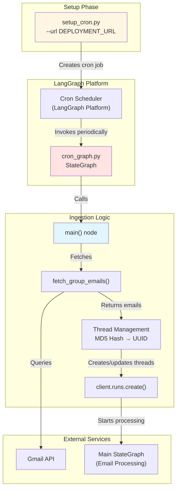
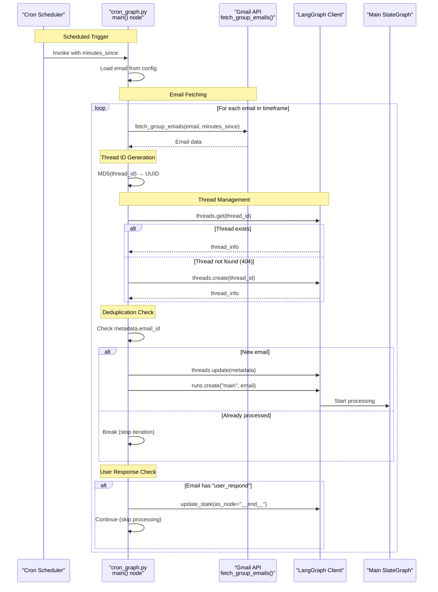
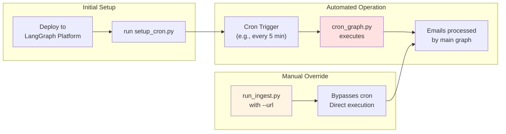

<!-- source: DeepWiki mcp.deepwiki.com · repo langchain-ai/executive-ai-assistant · page 6.3 Automated Email Processing · fetched 2026-10-26 -->

# Automated Email Processing

<details>
<summary>Relevant source files</summary>

The following files were used as context for generating this wiki page:

- [README.md](README.md)
- [eaia/cron_graph.py](eaia/cron_graph.py)
- [scripts/run_ingest.py](scripts/run_ingest.py)

</details>


This document explains how EAIA implements automated, scheduled email processing in production deployments. It covers the three key components that enable periodic email ingestion: `setup_cron.py` for cron job configuration, `cron_graph.py` for scheduled orchestration, and `run_ingest.py` for the core ingestion logic with its various parameters.

For manual email ingestion in development or one-off production runs, see [Email Ingestion](#2.1). For general deployment configuration, see [LangGraph Platform Deployment](#6.2).

## Overview

EAIA supports two ingestion modes:

| Mode | Script | Use Case | Trigger |
|------|--------|----------|---------|
| **Manual** | `run_ingest.py` | Development, testing, one-off production runs | Executed by user |
| **Automated** | `cron_graph.py` | Production continuous operation | LangGraph Platform cron schedule |

The automated mode enables EAIA to continuously monitor a Gmail inbox without manual intervention, processing new emails as they arrive based on a configured schedule.

## System Architecture



**Sources:** [README.md:152-159](), [eaia/cron_graph.py:1-55]()

## Setting Up Automated Processing

### Cron Job Configuration

The `setup_cron.py` script configures a LangGraph Platform cron job to invoke `cron_graph.py` on a regular schedule:

```bash
python scripts/setup_cron.py --url ${LANGGRAPH_DEPLOYMENT_URL}
```

This command creates a cron job in the LangGraph Platform that periodically triggers the `cron_graph` to check for new emails. The cron job configuration is managed entirely by LangGraph Platform.

**Sources:** [README.md:152-159]()

### Cron Graph Structure

The `cron_graph.py` defines a simple StateGraph with a single node that orchestrates email ingestion:

| Component | Type | Purpose |
|-----------|------|---------|
| `JobKickoff` | TypedDict | State schema containing `minutes_since` parameter |
| `main()` | Node function | Fetches emails and creates/updates LangGraph threads |
| StateGraph | Graph | Orchestrates the ingestion workflow |

The graph structure is minimal:

```
START → main → END
```

**Sources:** [eaia/cron_graph.py:1-55]()

## Email Ingestion Flow



**Sources:** [eaia/cron_graph.py:17-48]()

## Core Ingestion Logic

### Thread ID Generation

Both `cron_graph.py` and `run_ingest.py` use identical thread ID generation logic to ensure consistent mapping between Gmail threads and LangGraph threads:

```python
thread_id = str(
    uuid.UUID(hex=hashlib.md5(email["thread_id"].encode("UTF-8")).hexdigest())
)
```

This deterministic conversion ensures:
- Same Gmail thread always maps to same LangGraph thread
- Thread IDs are valid UUIDs (required by LangGraph Platform)
- Cross-deployment consistency (same thread ID locally and in production)

**Sources:** [eaia/cron_graph.py:22-24](), [scripts/run_ingest.py:44-46]()

### Deduplication Strategy

The ingestion logic implements deduplication by tracking the most recent email ID in thread metadata:

| Check | Location | Purpose |
|-------|----------|---------|
| `metadata.email_id` | Thread metadata | Stores ID of most recently processed email |
| `email["id"]` comparison | Current email | Determines if email was already processed |
| Early break | Loop control | Stops iteration when duplicate found |

**Deduplication Flow:**

1. Retrieve thread metadata: `recent_email = thread_info["metadata"].get("email_id")`
2. Compare with current email: `if recent_email == email["id"]`
3. If match found, stop processing (assumes emails are ordered newest-first)
4. If new email, update metadata: `threads.update(thread_id, metadata={"email_id": email["id"]})`

**Sources:** [eaia/cron_graph.py:37-41](), [scripts/run_ingest.py:59-68]()

### User Response Handling

Emails containing a `"user_respond"` field are handled specially:

```python
if "user_respond" in email:
    await client.threads.update_state(thread_id, None, as_node="__end__")
    continue
```

This logic:
- Detects emails sent by the user (not received)
- Terminates any active processing on that thread
- Skips creating new runs for user-sent emails

This prevents EAIA from processing its own outbound emails or user responses.

**Sources:** [eaia/cron_graph.py:28-36](), [scripts/run_ingest.py:50-58]()

## run_ingest.py Parameters

The `run_ingest.py` script provides manual control over ingestion behavior through command-line parameters:

### Parameter Reference

| Parameter | Type | Default | Purpose |
|-----------|------|---------|---------|
| `--url` | str | `http://127.0.0.1:2024` | Target deployment URL |
| `--minutes-since` | int | 60 | Fetch emails from last N minutes |
| `--early` | int (bool) | 1 (True) | Break when encountering seen emails |
| `--rerun` | int (bool) | 0 (False) | Reprocess already-seen emails |
| `--gmail-token` | str | None | Override Gmail OAuth token |
| `--gmail-secret` | str | None | Override Gmail OAuth credentials |
| `--email` | str | None | Override email address to monitor |

**Sources:** [scripts/run_ingest.py:78-122]()

### Parameter Behavior Matrix

The `--early` and `--rerun` parameters interact to control duplicate handling:

| early | rerun | Behavior |
|-------|-------|----------|
| 1 | 0 | **Standard**: Stop when duplicate found, skip duplicate |
| 0 | 0 | **Process all**: Don't stop, skip duplicates |
| 0 | 1 | **Reprocess all**: Don't stop, reprocess duplicates |
| 1 | 1 | **Invalid**: Stop when duplicate found, but also reprocess it (illogical) |

**Implementation:**

```python
if recent_email == email["id"]:
    if early:
        break  # Stop iteration
    else:
        if rerun:
            pass  # Continue and reprocess
        else:
            continue  # Skip this email
```

**Sources:** [scripts/run_ingest.py:60-67]()

### Common Usage Patterns

**Development testing** (reprocess recent emails):
```bash
python scripts/run_ingest.py --minutes-since 120 --rerun 1 --early 0
```

**Production manual run** (process new emails only):
```bash
python scripts/run_ingest.py --minutes-since 60 --rerun 0 --early 1 --url ${DEPLOYMENT_URL}
```

**Full reprocessing** (replay all emails in timeframe):
```bash
python scripts/run_ingest.py --minutes-since 1440 --rerun 1 --early 0 --url ${DEPLOYMENT_URL}
```

**Sources:** [README.md:78-89](), [README.md:124-137]()

## Cron Graph Configuration

### State Schema

The `JobKickoff` TypedDict defines the input state for `cron_graph.py`:

```python
class JobKickoff(TypedDict):
    minutes_since: int
```

When the cron job is triggered, LangGraph Platform provides this state. The `minutes_since` value determines the email fetch window.

**Sources:** [eaia/cron_graph.py:13-15]()

### Main Node Implementation

The `main()` node function orchestrates the complete ingestion process:

```python
async def main(state: JobKickoff, config):
    minutes_since: int = state["minutes_since"]
    email = get_config(config)["email"]

    async for email in fetch_group_emails(email, minutes_since=minutes_since):
        # Thread management and run creation logic
```

Key operations:
1. Extract `minutes_since` from state
2. Load email address from configuration
3. Iterate over fetched emails asynchronously
4. For each email: generate thread ID, manage thread state, create run

**Sources:** [eaia/cron_graph.py:17-48]()

### Graph Compilation

The graph is compiled as a standard LangGraph StateGraph:

```python
graph = StateGraph(JobKickoff)
graph.add_node(main)
graph.add_edge(START, "main")
graph.add_edge("main", END)
graph = graph.compile()
```

This creates a simple linear graph suitable for scheduled execution by LangGraph Platform's cron system.

**Sources:** [eaia/cron_graph.py:50-54]()

## Run Creation and Multitasking

### Run Creation Parameters

When creating a new run for email processing, the ingestion logic specifies:

```python
await client.runs.create(
    thread_id,
    "main",
    input={"email": email},
    multitask_strategy="rollback",
)
```

| Parameter | Value | Purpose |
|-----------|-------|---------|
| `thread_id` | UUID | Associates run with LangGraph thread |
| `"main"` | Graph name | Specifies which graph to execute |
| `input` | `{"email": email}` | Provides email data to StateGraph |
| `multitask_strategy` | `"rollback"` | Handles concurrent runs on same thread |

**Sources:** [eaia/cron_graph.py:42-47](), [scripts/run_ingest.py:70-75]()

### Multitask Strategy

The `multitask_strategy="rollback"` parameter ensures safe concurrent processing:

- If a run is already active on the thread, the new run waits
- When the new run starts, it uses the latest state (including any updates from the previous run)
- This prevents conflicting state updates when multiple emails arrive in quick succession

This is critical for production environments where emails may arrive while previous emails are still being processed.

**Sources:** [eaia/cron_graph.py:46](), [scripts/run_ingest.py:74]()

## Deployment Workflow



**Workflow Steps:**

1. **Deploy**: Deploy EAIA to LangGraph Platform via GitHub integration (see [LangGraph Platform Deployment](#6.2))
2. **Setup Cron**: Run `setup_cron.py` to configure scheduled execution
3. **Automated Operation**: LangGraph Platform triggers `cron_graph` on schedule
4. **Manual Override**: Use `run_ingest.py` for immediate ingestion or testing

**Sources:** [README.md:106-159]()

## Monitoring and Debugging

### Email Count Tracking

The `run_ingest.py` script includes built-in monitoring output:

```python
print(f"📧 Fetching emails for {email_address} from last {minutes_since} minutes...")

email_count = 0
async for email in fetch_group_emails(...):
    email_count += 1
    print(f"📬 Email {email_count}: {email.get('subject', 'No Subject')} from {email.get('from_email', 'Unknown')}")
```

This provides visibility into:
- Number of emails fetched
- Email subjects and senders
- Real-time progress during ingestion

**Sources:** [scripts/run_ingest.py:32-42]()

### Thread State Inspection

To debug thread processing, inspect thread metadata via LangGraph Client:

```python
thread_info = await client.threads.get(thread_id)
recent_email = thread_info["metadata"].get("email_id")
```

The `email_id` in metadata indicates the last processed email, useful for:
- Verifying deduplication logic
- Identifying stuck threads
- Understanding processing history

**Sources:** [scripts/run_ingest.py:48-59]()

## Differences: Cron vs Manual Ingestion

| Aspect | cron_graph.py | run_ingest.py |
|--------|---------------|---------------|
| **Execution** | Triggered by LangGraph Platform cron | Manually invoked via CLI |
| **Parameters** | Fixed `minutes_since` from state | Customizable via CLI arguments |
| **Early Break** | Always breaks on duplicate | Configurable with `--early` |
| **Reprocessing** | Never reruns duplicates | Configurable with `--rerun` |
| **Use Case** | Production continuous operation | Development, testing, one-off runs |
| **Configuration** | Deployment-level | Per-invocation |

Both scripts share identical core logic for thread management, deduplication, and run creation, ensuring consistency between automated and manual ingestion modes.

**Sources:** [eaia/cron_graph.py:1-55](), [scripts/run_ingest.py:1-135]()

---

