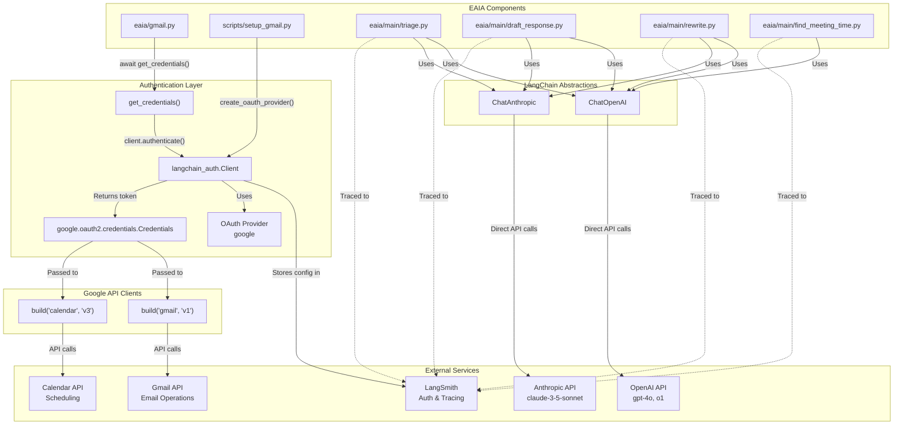
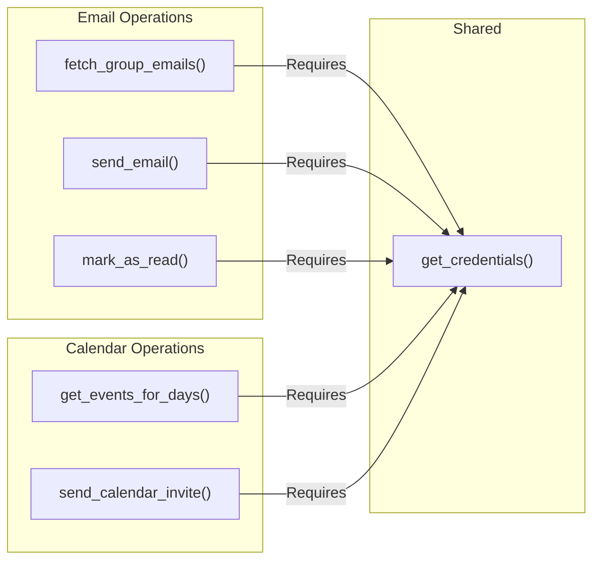
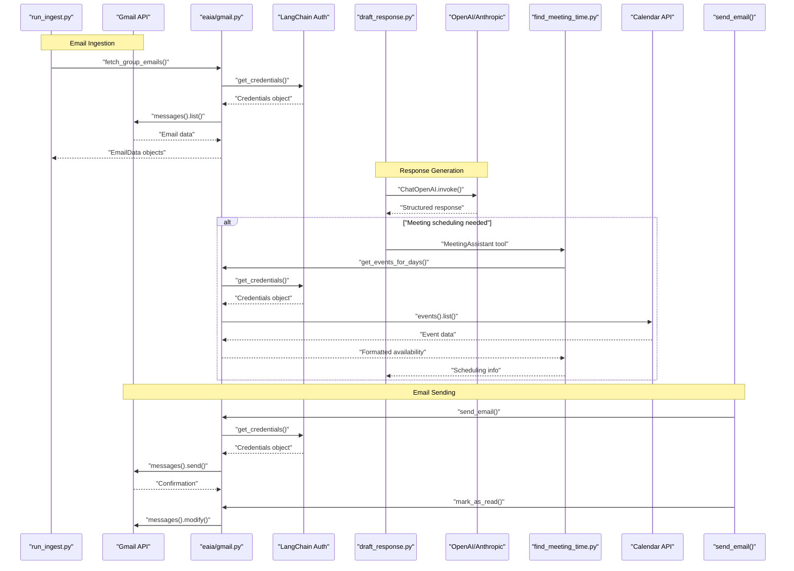

<!-- source: DeepWiki mcp.deepwiki.com · repo langchain-ai/executive-ai-assistant · page 7 External Integrations · fetched 2026-10-26 -->

# External Integrations

<details>
<summary>Relevant source files</summary>

The following files were used as context for generating this wiki page:

- [eaia/gmail.py](eaia/gmail.py)
- [scripts/setup_gmail.py](scripts/setup_gmail.py)

</details>


This document provides an overview of how EAIA integrates with external services to provide email management, calendar scheduling, and AI-powered response generation capabilities. The system relies on three primary categories of external integrations: Google Workspace APIs (Gmail and Calendar), Large Language Model providers (OpenAI and Anthropic), and LangSmith for authentication and observability.

For detailed information about Gmail and Calendar API functions and OAuth setup, see [Gmail and Calendar APIs](#7.1). For LLM integration patterns and model usage, see [LLM Integration](#7.2). For configuration of API keys and credentials, see [Environment Variables](#5.2).

## Integration Architecture Overview

The following diagram illustrates how external services integrate with EAIA's core components and the authentication flows that enable these integrations:



**Sources:** `eaia/gmail.py`, `scripts/setup_gmail.py`, Diagram 1 and Diagram 4 from high-level architecture

## Authentication and Credential Management

EAIA uses two distinct authentication mechanisms depending on the external service category:

### OAuth 2.0 for Google Services

Google Workspace APIs (Gmail and Calendar) require OAuth 2.0 authentication managed through LangChain Auth (`langchain_auth`). This approach centralizes credential storage and automatic token refresh in LangSmith.

**Setup Process:**

The `setup_gmail.py` script creates a one-time OAuth provider configuration:

| Step | Function | Purpose |
|------|----------|---------|
| 1 | Load secrets from `eaia/.secrets/secrets.json` | Extract Google OAuth client ID and secret |
| 2 | `Client(api_key)` | Initialize LangChain Auth client |
| 3 | `create_oauth_provider()` | Register Google OAuth provider in LangSmith |
| 4 | Store configuration | Provider config persisted in LangSmith |

**Runtime Authentication:**

The `get_credentials()` function [eaia/gmail.py:30-83]() handles runtime authentication:

1. Creates `langchain_auth.Client` with LangSmith API key
2. Calls `client.authenticate(provider="google", scopes=_SCOPES, user_id=user_email)`
3. If `auth_result.needs_auth` is true, provides OAuth URL for user authorization
4. Waits for completion using `client.wait_for_completion()` with 300s timeout
5. Returns `google.oauth2.credentials.Credentials` object

The scopes requested are defined at [eaia/gmail.py:24-27]():
```python
_SCOPES = [
    "https://www.googleapis.com/auth/gmail.modify",
    "https://www.googleapis.com/auth/calendar",
]
```

**Sources:** `eaia/gmail.py:30-83`, `scripts/setup_gmail.py:13-84`

### API Key Authentication for LLM Providers

OpenAI and Anthropic APIs use simple API key authentication via environment variables:

| Provider | Environment Variable | Usage |
|----------|---------------------|--------|
| OpenAI | `OPENAI_API_KEY` | Passed to `ChatOpenAI` constructor |
| Anthropic | `ANTHROPIC_API_KEY` | Passed to `ChatAnthropic` constructor |
| LangSmith | `LANGSMITH_API_KEY` | Used for tracing and OAuth client |

LangChain's `ChatOpenAI` and `ChatAnthropic` classes automatically read these environment variables, requiring no explicit credential passing in application code.

**Sources:** Diagram 4 from high-level architecture, `pyproject.toml` dependencies

## Integration Categories

### Google Workspace Integration

EAIA integrates with Gmail and Google Calendar through the `eaia/gmail.py` module, which provides a unified interface for email and calendar operations. All functions use the `build()` factory from `googleapiclient.discovery` to create service clients.

**Key Functions:**



The `get_credentials()` function serves as the central authentication point for all Google API operations. Each operation function calls it to obtain fresh credentials before building the service client.

**Sources:** `eaia/gmail.py:30-450`

### LLM Provider Integration

EAIA integrates with multiple LLM providers through LangChain's unified interfaces, enabling model selection based on task requirements and providing fallback options.

**Model Usage by Component:**

| Component | Models Used | Purpose |
|-----------|------------|---------|
| `triage.py` | gpt-4o, claude-3-5-sonnet | Email classification |
| `draft_response.py` | gpt-4o, claude-3-5-sonnet | Response generation with tools |
| `rewrite.py` | gpt-4o, claude-3-5-sonnet | Tone adjustment |
| `find_meeting_time.py` | gpt-4o | ReAct agent for scheduling |
| `reflection_graphs.py` | o1, gpt-4o | Prompt improvement |

The system uses `with_structured_output()` to enforce Pydantic schema compliance and `bind_tools()` to provide function calling capabilities to the LLMs.

**Sources:** Diagram 4 from high-level architecture, multiple processing component files

### LangSmith Integration

LangSmith serves dual purposes in EAIA:

1. **Authentication Provider**: Stores OAuth credentials and manages token refresh for Google APIs
2. **Observability Platform**: Captures traces of all LLM calls, providing visibility into token usage, latency, and model behavior

All LangGraph execution is automatically traced to LangSmith when `LANGSMITH_API_KEY` is set, requiring no explicit tracing code in application components.

**Sources:** `scripts/setup_gmail.py`, Diagram 1 from high-level architecture

## Data Flow Through External Services

The following sequence diagram illustrates how a typical email processing flow interacts with external services:



**Sources:** `eaia/gmail.py`, Diagram 2 from high-level architecture, `scripts/run_ingest.py`

## Error Handling and Resilience

The integration layer implements several patterns for handling external service failures:

**Google API Authentication:**
- Token refresh is automatic through LangChain Auth
- `get_credentials()` supports interactive re-authentication if tokens expire
- 300-second timeout for OAuth completion flow [eaia/gmail.py:64]()

**Email Fetching:**
- Pagination support for large result sets [eaia/gmail.py:200-213]()
- Try-catch blocks around individual message processing to prevent batch failures [eaia/gmail.py:217-283]()
- Logging of failed message processing without interrupting the batch

**Calendar Operations:**
- Returns "No events found" message if calendar query returns empty results [eaia/gmail.py:381-382]()
- Timezone-aware datetime formatting with fallback handling [eaia/gmail.py:357-371]()

**LLM Calls:**
- Model selection flexibility allows switching between providers
- LangChain's built-in retry logic handles transient API failures
- Structured output validation ensures response format compliance

**Sources:** `eaia/gmail.py:30-450`, LangChain documentation

## Integration Testing and Development

**Local Development Setup:**

For local testing of Google API integrations:
1. Run `scripts/setup_gmail.py` once to configure OAuth provider
2. First API call will trigger interactive OAuth flow in browser
3. Subsequent calls use cached credentials from LangSmith

**Environment Configuration:**

Required environment variables for all integrations:

| Variable | Purpose | Used By |
|----------|---------|---------|
| `LANGSMITH_API_KEY` | Auth client and tracing | All components |
| `OPENAI_API_KEY` | OpenAI API access | LLM processing components |
| `ANTHROPIC_API_KEY` | Anthropic API access | LLM processing components |

**Testing Individual Integrations:**

Each integration can be tested independently:
- **Gmail**: `fetch_group_emails()` can be called directly with email address
- **Calendar**: `get_events_for_days()` is exposed as a LangChain tool
- **LLMs**: `ChatOpenAI` and `ChatAnthropic` can be instantiated directly

**Sources:** `scripts/setup_gmail.py`, README.md setup instructions, `eaia/gmail.py`

## Rate Limits and Quotas

External services impose rate limits that EAIA must respect:

**Google APIs:**
- Gmail API: 250 quota units per user per second
- Calendar API: 500 queries per 100 seconds per user
- Batch operations reduce quota consumption

**LLM Providers:**
- OpenAI: Varies by tier and model (typically 3,500+ RPM for GPT-4)
- Anthropic: Varies by tier (typically 1,000+ RPM for Claude)

EAIA's architecture naturally respects these limits through:
- Sequential processing of emails rather than parallel requests
- Human-in-the-loop approval creating natural throttling
- Scheduled ingestion intervals (configurable, typically 5-30 minutes)

**Sources:** Google API documentation, OpenAI/Anthropic API documentation, `scripts/setup_cron.py`

---

