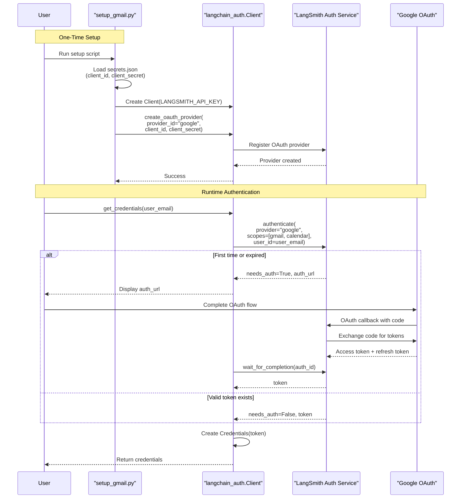
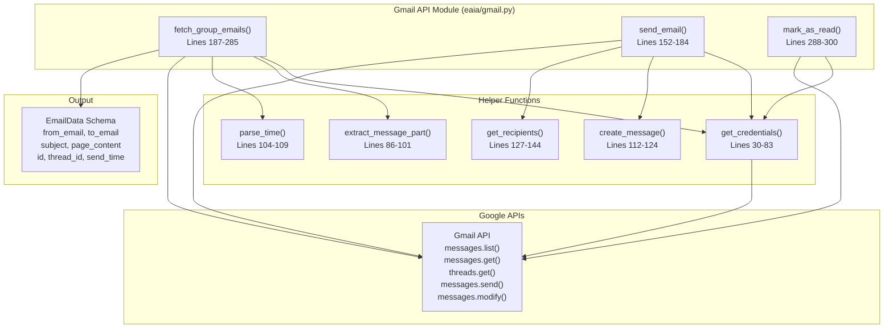
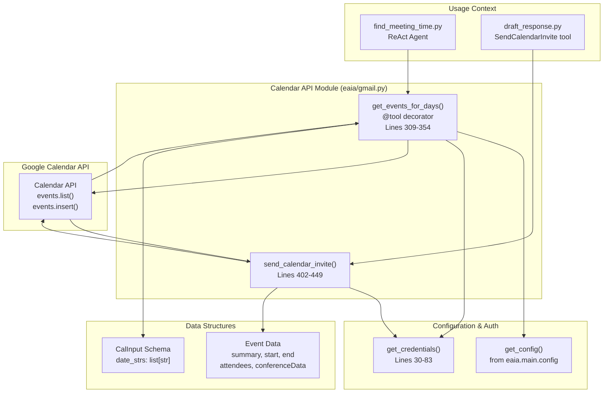

<!-- source: DeepWiki mcp.deepwiki.com · repo langchain-ai/executive-ai-assistant · page 7.1 Gmail and Calendar APIs · fetched 2026-10-26 -->

# Gmail and Calendar APIs

<details>
<summary>Relevant source files</summary>

The following files were used as context for generating this wiki page:

- [eaia/gmail.py](eaia/gmail.py)
- [scripts/setup_gmail.py](scripts/setup_gmail.py)

</details>


This document describes how EAIA integrates with Google's Gmail and Calendar APIs, including OAuth authentication via LangChain Auth, email fetching and sending, calendar event querying, and meeting scheduling. 

For information about how emails flow through the processing pipeline after ingestion, see [Email Processing System](#2). For LLM integration details, see [LLM Integration](#7.2). For OAuth setup instructions, see [Installation and Setup](#1.1).

## Overview

EAIA communicates with Gmail and Calendar APIs through the `eaia/gmail.py` module, which provides a set of functions for:

- **Authentication**: OAuth 2.0 credential management via LangSmith Auth
- **Email Operations**: Fetching, sending, and marking emails as read
- **Calendar Operations**: Querying availability and sending calendar invites

All Google API interactions require OAuth credentials with two scopes: `https://www.googleapis.com/auth/gmail.modify` for email operations and `https://www.googleapis.com/auth/calendar` for calendar operations [eaia/gmail.py:24-27]().

**Sources:** eaia/gmail.py, README.md

## OAuth Authentication Architecture

### LangChain Auth Integration

EAIA uses LangChain Auth (via `langchain_auth.Client`) to manage Google OAuth credentials, eliminating the need for local token storage and handling token refresh automatically. The OAuth provider must be configured once using `scripts/setup_gmail.py`.



**Sources:** eaia/gmail.py:30-83, scripts/setup_gmail.py

### Provider Setup Process

The `setup_gmail.py` script configures the Google OAuth provider in LangSmith Auth:

| Step | Action | Code Reference |
|------|--------|----------------|
| 1 | Load `secrets.json` from `eaia/.secrets/` | [scripts/setup_gmail.py:22-35]() |
| 2 | Extract `client_id` and `client_secret` | [scripts/setup_gmail.py:38-46]() |
| 3 | Create `langchain_auth.Client` with `LANGSMITH_API_KEY` | [scripts/setup_gmail.py:49]() |
| 4 | Check if provider already exists | [scripts/setup_gmail.py:53-62]() |
| 5 | Call `create_oauth_provider()` with Google endpoints | [scripts/setup_gmail.py:66-73]() |

The provider configuration includes:
- `provider_id`: `"google"`
- `auth_url`: `https://accounts.google.com/o/oauth2/auth`
- `token_url`: `https://oauth2.googleapis.com/token`

**Sources:** scripts/setup_gmail.py:13-84

### Runtime Credential Retrieval

The `get_credentials()` function retrieves valid OAuth credentials at runtime [eaia/gmail.py:30-83]():

```python
async def get_credentials(
    user_email: str,
    langsmith_api_key: str | None = None
) -> Credentials
```

**Process:**
1. Creates `langchain_auth.Client` with `LANGSMITH_API_KEY`
2. Calls `client.authenticate()` with `provider="google"`, scopes, and `user_id=user_email`
3. If `auth_result.needs_auth` is True:
   - Displays `auth_result.auth_url` for user to complete OAuth flow
   - Calls `wait_for_completion()` with 300-second timeout
4. Creates `google.oauth2.credentials.Credentials` object from token
5. Returns credentials for use with Google API clients

The `user_email` serves as the `user_id` in LangSmith Auth, enabling per-user credential storage [eaia/gmail.py:54]().

**Sources:** eaia/gmail.py:30-83

## Gmail API Functions

EAIA provides three core Gmail API functions, all using credentials obtained via `get_credentials()`:



**Sources:** eaia/gmail.py:86-300

### fetch_group_emails

Fetches emails sent to or from a specified email address within a time window:

```python
async def fetch_group_emails(
    to_email,
    minutes_since: int = 30,
    gmail_token: str | None = None,
    gmail_secret: str | None = None,
) -> Iterable[EmailData]
```

**Parameters:**
- `to_email`: The email address to query (e.g., `harrison@langchain.dev`)
- `minutes_since`: Number of minutes to look back (default: 30)
- `gmail_token`, `gmail_secret`: Deprecated parameters (now unused)

**Process [eaia/gmail.py:187-285]():**

1. **Obtain credentials**: Calls `await get_credentials(to_email)`
2. **Build Gmail service**: `build("gmail", "v1", credentials=creds)`
3. **Calculate timestamp**: `after = int((datetime.now() - timedelta(minutes=minutes_since)).timestamp())`
4. **Query emails**: `query = f"(to:{to_email} OR from:{to_email}) after:{after}"`
5. **Paginate results**: Loops through `messages.list()` pages using `nextPageToken`
6. **Filter threads**: For each message:
   - Gets full message via `messages.get()`
   - Gets thread details via `threads.get()`
   - Checks if last message in thread is from the user (`to_email in last_from_header`)
   - If yes, yields `{"id": ..., "thread_id": ..., "user_respond": True}` (signals no action needed)
   - If last message is NOT from user and current message IS last in thread, processes it
7. **Extract email data**:
   - Subject, From, To headers
   - Reply-To header (overrides From if present) [eaia/gmail.py:257-265]()
   - Send time (parsed via `parse_time()`)
   - Body content (via `extract_message_part()`)
8. **Yield EmailData**: Returns dictionary with fields: `from_email`, `to_email`, `subject`, `page_content`, `id`, `thread_id`, `send_time`

**Key Logic:**
- Only processes emails where the user did NOT send the last message (avoids re-processing own responses)
- Uses pagination to handle large result sets
- Extracts body from MIME parts recursively (handles multipart emails)

**Sources:** eaia/gmail.py:187-285

### send_email

Sends a reply email in an existing thread:

```python
def send_email(
    email_id,
    response_text,
    email_address,
    gmail_token: str | None = None,
    gmail_secret: str | None = None,
    addn_receipients=None,
)
```

**Parameters:**
- `email_id`: ID of the original email to reply to
- `response_text`: Content of the reply
- `email_address`: User's email address
- `addn_receipients`: Additional recipients (optional)

**Process [eaia/gmail.py:152-184]():**

1. **Get credentials**: Synchronously calls `asyncio.run(get_credentials(email_address))`
2. **Build service**: `build("gmail", "v1", credentials=creds)`
3. **Fetch original message**: `messages.get(userId="me", id=email_id)`
4. **Extract metadata**:
   - `Message-ID` header (for threading)
   - `threadId` (to keep reply in same thread)
   - Subject (reused for reply)
5. **Determine recipients**: Calls `get_recipients(headers, email_address, addn_receipients)`
   - Includes all To/CC recipients
   - Includes original sender (From)
   - Excludes user's own email address
6. **Create MIME message**: Calls `create_message()` with:
   - `In-Reply-To` and `References` headers set to original `Message-ID`
   - `threadId` to maintain Gmail thread
7. **Send**: Calls `messages.send(userId="me", body=response_message)`

**Sources:** eaia/gmail.py:152-184, eaia/gmail.py:112-144

### mark_as_read

Marks an email as read by removing the UNREAD label:

```python
def mark_as_read(
    message_id,
    user_email: str,
    gmail_token: str | None = None,
    gmail_secret: str | None = None,
)
```

**Process [eaia/gmail.py:288-300]():**
1. Gets credentials synchronously via `asyncio.run(get_credentials(user_email))`
2. Builds Gmail service
3. Calls `messages.modify(userId="me", id=message_id, body={"removeLabelIds": ["UNREAD"]})`

This function is called when emails are triaged as "no" (ignore) or after successful email send.

**Sources:** eaia/gmail.py:288-300

## Calendar API Functions

EAIA provides two Calendar API functions for meeting scheduling:



**Sources:** eaia/gmail.py:303-449

### get_events_for_days

A LangChain tool that retrieves calendar events for specified days, used by the ReAct agent in `find_meeting_time.py`:

```python
@tool(args_schema=CalInput)
def get_events_for_days(date_strs: list[str]):
    """
    Retrieves events for a list of days.
    Input in the format of ['dd-mm-yyyy', 'dd-mm-yyyy']
    """
```

**Input Schema [eaia/gmail.py:303-306]():**
```python
class CalInput(BaseModel):
    date_strs: list[str] = Field(
        description="The days for which to retrieve events. Each day should be represented by dd-mm-yyyy string."
    )
```

**Process [eaia/gmail.py:309-354]():**

1. **Get configuration**: Uses `ensure_config()` and `get_config(config)` to retrieve user config
2. **Extract user email**: `user_email = user_config["email"]`
3. **Get credentials**: `asyncio.run(get_credentials(user_email))`
4. **Build service**: `build("calendar", "v3", credentials=creds)`
5. **For each date**:
   - Parse date string via `datetime.strptime(date_str, "%d-%m-%Y")`
   - Calculate start/end of day in ISO format with "Z" suffix
   - Query events: `events.list(calendarId="primary", timeMin=start_of_day, timeMax=end_of_day, singleEvents=True, orderBy="startTime")`
   - Format events via `print_events(events)`
6. **Return formatted string**: Concatenates all days with `***FOR DAY {date_str}***` headers

**Event Formatting [eaia/gmail.py:374-399]():**

The `print_events()` helper function formats each event:
- Uses `format_datetime_with_timezone()` to convert UTC times to user's timezone (default: US/Pacific)
- Displays summary, start time, end time
- Separates events with dashes

Example output:
```
***FOR DAY 15-01-2024***

Event: Team Standup
Starts: 2024-01-15 09:00 AM PST
Ends: 2024-01-15 09:30 AM PST
----------------------------------------
Event: Product Review
Starts: 2024-01-15 02:00 PM PST
Ends: 2024-01-15 03:00 PM PST
----------------------------------------
```

**Sources:** eaia/gmail.py:303-399

### send_calendar_invite

Creates and sends a calendar invite with Google Meet conference:

```python
def send_calendar_invite(
    emails, title, start_time, end_time, email_address, timezone="PST"
)
```

**Parameters:**
- `emails`: List of attendee email addresses
- `title`: Event title/summary
- `start_time`: ISO format datetime string (e.g., `"2024-01-15T14:00:00"`)
- `end_time`: ISO format datetime string
- `email_address`: User's email address (added to attendees)
- `timezone`: Timezone string (default: `"PST"`)

**Process [eaia/gmail.py:402-449]():**

1. **Get credentials**: `asyncio.run(get_credentials(email_address))`
2. **Build service**: `build("calendar", "v3", credentials=creds)`
3. **Parse times**: Convert ISO strings to datetime objects
4. **Ensure user included**: `emails = list(set(emails + [email_address]))`
5. **Build event object**:
   ```python
   event = {
       "summary": title,
       "start": {"dateTime": start_datetime.isoformat(), "timeZone": timezone},
       "end": {"dateTime": end_datetime.isoformat(), "timeZone": timezone},
       "attendees": [{"email": email} for email in emails],
       "reminders": {
           "useDefault": False,
           "overrides": [
               {"method": "email", "minutes": 24 * 60},  # 1 day before
               {"method": "popup", "minutes": 10}
           ]
       },
       "conferenceData": {
           "createRequest": {
               "requestId": f"{title}-{start_datetime.isoformat()}",
               "conferenceSolutionKey": {"type": "hangoutsMeet"}
           }
       }
   }
   ```
6. **Insert event**: `events.insert(calendarId="primary", body=event, sendNotifications=True, conferenceDataVersion=1)`
7. **Return status**: Returns `True` on success, `False` on exception

**Key Features:**
- Automatically creates Google Meet conference link
- Sends email notifications to all attendees
- Sets two reminders (1 day before via email, 10 minutes before via popup)
- Uses unique `requestId` to prevent duplicate conference creation

**Sources:** eaia/gmail.py:402-449

## Email Data Structures and Utilities

### EmailData Schema

The `EmailData` schema (defined in `eaia/schemas.py`) structures email information returned by `fetch_group_emails()`:

| Field | Type | Description | Example |
|-------|------|-------------|---------|
| `from_email` | str | Sender email address | `"sender@example.com"` |
| `to_email` | str | Recipient email address | `"harrison@langchain.dev"` |
| `subject` | str | Email subject line | `"Meeting Request"` |
| `page_content` | str | Email body content | Full text or HTML body |
| `id` | str | Gmail message ID | `"18c1f2b3..."` |
| `thread_id` | str | Gmail thread ID | `"18c1f2b3..."` |
| `send_time` | str | ISO timestamp | `"2024-01-15T14:30:00"` |

Special case: `user_respond=True` flag indicates the user was the last to respond in the thread (no processing needed).

**Sources:** eaia/schemas.py, eaia/gmail.py:272-280

### Helper Functions

#### extract_message_part

Recursively extracts email body from MIME multipart messages [eaia/gmail.py:86-101]():

- Checks `mimeType` for `text/plain` or `text/html`
- Decodes base64-encoded `body.data`
- Recursively processes `parts` array for nested MIME structures
- Returns first non-empty body found or `"No message body available."`

#### create_message

Builds RFC 2822 compliant email message for threading [eaia/gmail.py:112-124]():

- Creates `MIMEMultipart` message
- Sets `In-Reply-To` and `References` headers to original message ID (ensures proper threading)
- Generates new `Message-ID` via `email.utils.make_msgid()`
- Base64-encodes entire message
- Returns dict with `raw` (encoded message) and `threadId`

#### get_recipients

Determines reply recipients from email headers [eaia/gmail.py:127-144]():

- Collects all addresses from `To` and `CC` headers
- Adds `From` address (original sender)
- Removes user's own email address
- Supports additional recipients via parameter
- Returns deduplicated list

#### parse_time

Parses email date headers into datetime objects [eaia/gmail.py:104-109]():

- Uses `dateutil.parser.parse()` for flexible parsing
- Raises `ValueError` with context on parsing errors

**Sources:** eaia/gmail.py:86-144

## API Scopes and Permissions

EAIA requires two Google API scopes, defined as `_SCOPES` [eaia/gmail.py:24-27]():

| Scope | Purpose | Required For |
|-------|---------|--------------|
| `https://www.googleapis.com/auth/gmail.modify` | Read and modify (but not delete) emails | `fetch_group_emails()`, `send_email()`, `mark_as_read()` |
| `https://www.googleapis.com/auth/calendar` | Read and write calendar events | `get_events_for_days()`, `send_calendar_invite()` |

These scopes are passed to `client.authenticate()` during credential retrieval [eaia/gmail.py:53]() and registered during provider setup [scripts/setup_gmail.py:66-73]().

**Note:** The `gmail.modify` scope is used instead of `gmail.send` to enable the `mark_as_read()` functionality (requires modify permission).

**Sources:** eaia/gmail.py:24-27, scripts/setup_gmail.py:66-73

---

