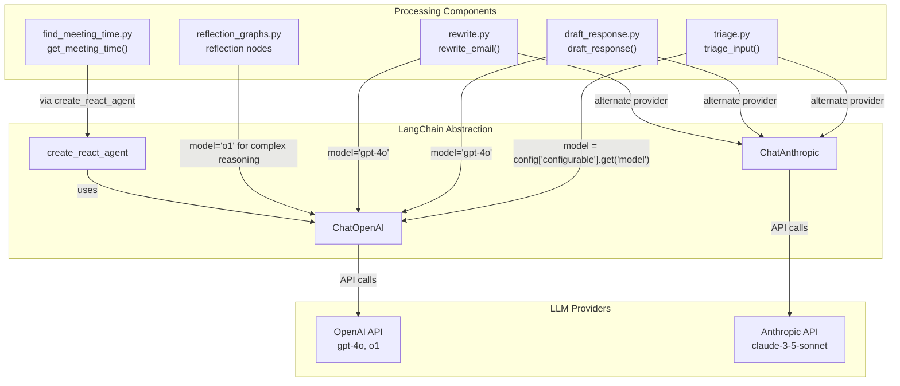
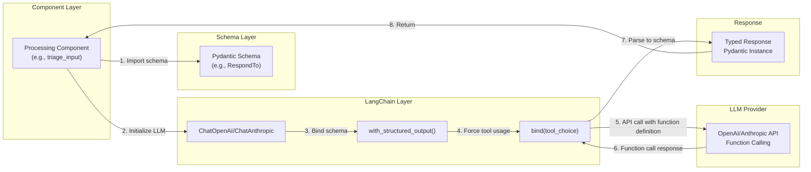
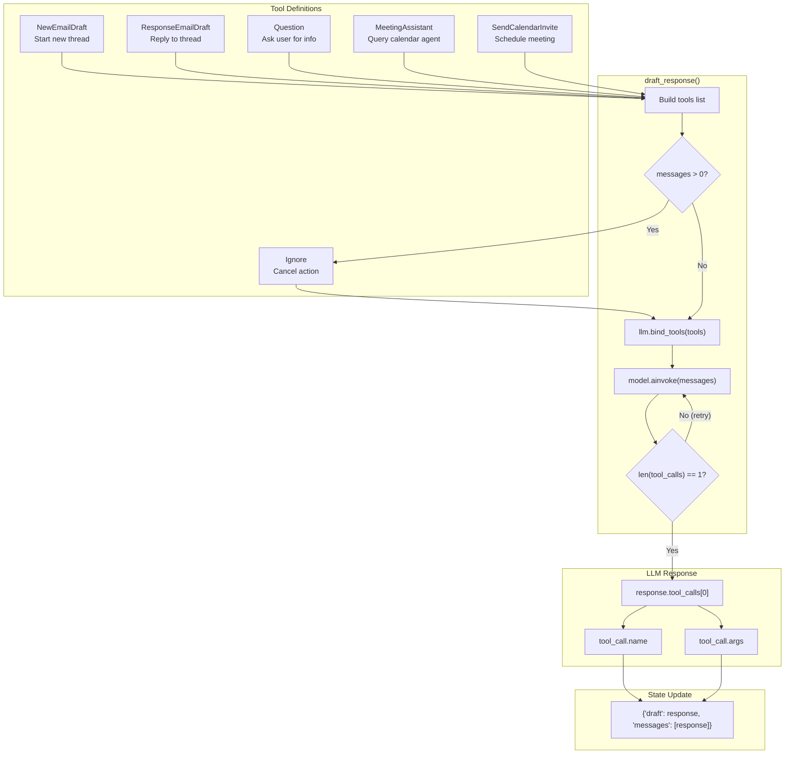
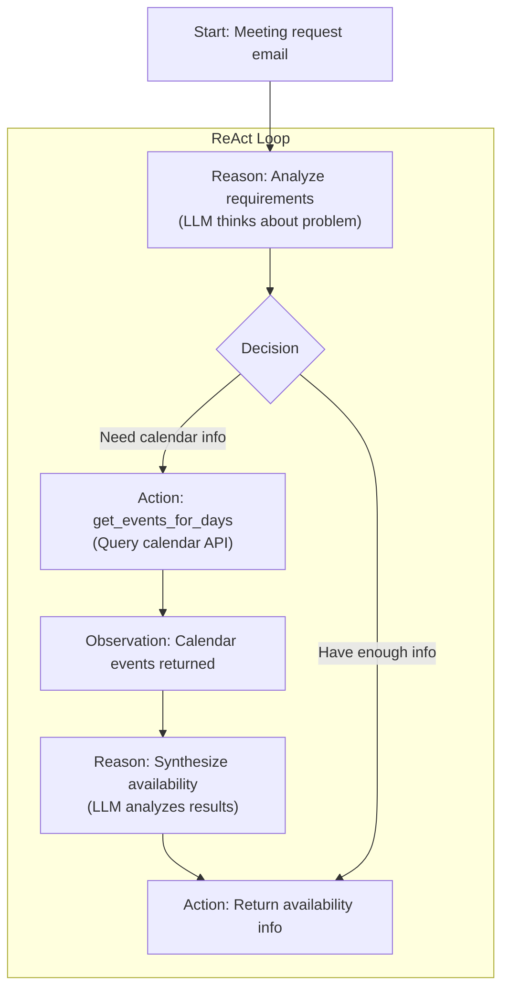
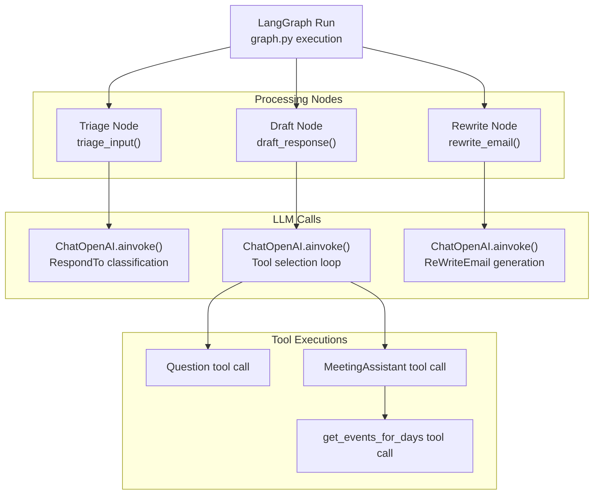

<!-- source: DeepWiki mcp.deepwiki.com · repo langchain-ai/executive-ai-assistant · page 7.2 LLM Integration · fetched 2026-10-26 -->

# LLM Integration

<details>
<summary>Relevant source files</summary>

The following files were used as context for generating this wiki page:

- [eaia/main/draft_response.py](eaia/main/draft_response.py)
- [eaia/main/triage.py](eaia/main/triage.py)
- [pyproject.toml](pyproject.toml)

</details>


## Purpose and Scope

This document explains how EAIA integrates with Large Language Model (LLM) providers to power its intelligent email processing capabilities. It covers the multi-provider architecture supporting OpenAI and Anthropic models, the LangChain abstraction layer, structured output enforcement mechanisms, tool binding patterns, and the ReAct agent implementation. For configuration of LLM API keys, see [Environment Variables](#5.2). For how LLMs are used within specific processing steps, see [Email Triage Logic](#2.2), [Email Response Generation](#2.3), and [Prompt Reflection Mechanism](#4.1).

---

## LLM Provider Architecture

EAIA implements a multi-provider strategy that supports both OpenAI and Anthropic LLMs. This architecture provides flexibility in model selection, enables fallback options, and allows cost optimization by choosing appropriate models for specific tasks.

### Provider Dependencies

The system declares LLM provider dependencies in [pyproject.toml:13-14]():

```
langchain-openai = "^0.2"
langchain-anthropic = "^0.3"
```

These packages provide the unified interfaces `ChatOpenAI` and `ChatAnthropic` that abstract provider-specific implementation details.

### Model Selection

Models are selected at runtime via the `configurable` dictionary in `RunnableConfig`. Each processing component accesses the model configuration as shown in [eaia/main/triage.py:47-48]():

```python
model = config["configurable"].get("model", "gpt-4o")
llm = ChatOpenAI(model=model, temperature=0)
```

The default model is `gpt-4o`, but this can be overridden per-run by setting `configurable["model"]` when invoking the graph.

**Supported Models:**

| Provider | Models | Use Cases |
|----------|--------|-----------|
| OpenAI | `gpt-4o` | General-purpose processing (triage, draft, rewrite) |
| OpenAI | `o1` | Complex reasoning tasks (reflection system) |
| Anthropic | `claude-3-5-sonnet` | Alternative provider for all processing tasks |

### Component-to-Provider Mapping



**Sources:** [eaia/main/triage.py:47-48](), [eaia/main/draft_response.py:84-90](), [pyproject.toml:13-14]()

---

## LangChain Abstraction Layer

EAIA uses LangChain's unified interfaces to interact with LLM providers, providing consistent APIs regardless of the underlying provider.

### ChatOpenAI Interface

The `ChatOpenAI` class provides the primary interface to OpenAI models. Instantiation follows this pattern as seen in [eaia/main/triage.py:48]():

```python
llm = ChatOpenAI(model=model, temperature=0)
```

**Common Configuration Parameters:**

| Parameter | Purpose | Example Values |
|-----------|---------|----------------|
| `model` | Specifies the OpenAI model | `"gpt-4o"`, `"o1"` |
| `temperature` | Controls response randomness | `0` (deterministic), `1` (creative) |
| `parallel_tool_calls` | Enables/disables parallel tool execution | `False` in [draft_response.py:88]() |
| `tool_choice` | Controls tool selection behavior | `"required"` in [draft_response.py:89]() |

### ChatAnthropic Interface

The `ChatAnthropic` class provides equivalent functionality for Anthropic models. The interface is identical to `ChatOpenAI`, enabling easy provider switching:

```python
llm = ChatAnthropic(model="claude-3-5-sonnet", temperature=0)
```

### Model Invocation Patterns

EAIA uses asynchronous invocation throughout for better performance. The standard invocation pattern is:

```python
response = await model.ainvoke(input_message)
```

This pattern appears in [eaia/main/triage.py:67]() for triage classification and [eaia/main/draft_response.py:148]() for draft generation.

**Sources:** [eaia/main/triage.py:4](), [eaia/main/triage.py:48](), [eaia/main/draft_response.py:4](), [eaia/main/draft_response.py:84-90]()

---

## Structured Output Enforcement

A critical architectural pattern in EAIA is the enforcement of structured outputs using Pydantic schemas. This ensures LLM responses conform to expected structures, eliminating parsing errors and enabling type-safe processing.

### Schema Definition

Output schemas are defined as Pydantic models in `eaia/schemas.py`. For example, the triage decision uses the `RespondTo` schema referenced in [eaia/main/triage.py:8-11]():

```python
from eaia.schemas import (
    State,
    RespondTo,
)
```

The `RespondTo` schema defines the three-way classification: `"no"`, `"notify"`, or `"email"`.

### Binding Schemas to Models

The `with_structured_output()` method binds a schema to an LLM, forcing responses to match the schema structure. This is implemented in [eaia/main/triage.py:64-66]():

```python
model = llm.with_structured_output(RespondTo).bind(
    tool_choice={"type": "function", "function": {"name": "RespondTo"}}
)
```

### Structured Output Flow



**Key Benefits:**
- **Type Safety:** Responses are guaranteed to match the schema structure
- **No Parsing Errors:** LangChain handles parsing from function call format to Pydantic instances
- **Validation:** Pydantic validates all fields according to schema constraints
- **IDE Support:** Type hints enable autocomplete and error detection

### Multiple Schema Types

Different components use different schemas based on their output requirements:

| Component | Schema(s) | Purpose |
|-----------|-----------|---------|
| `triage.py` | `RespondTo` | Three-way classification decision |
| `draft_response.py` | `ResponseEmailDraft`, `NewEmailDraft`, `Question`, etc. | Multiple tool options (see Tool Binding section) |
| `rewrite.py` | `ReWriteEmail` | Rewritten email with tone adjustments |
| `find_meeting_time.py` | Varies | ReAct agent output (see ReAct Agent section) |

**Sources:** [eaia/main/triage.py:8-11](), [eaia/main/triage.py:64-66](), [eaia/main/draft_response.py:7-16]()

---

## Tool Binding Patterns

EAIA extensively uses tool binding to provide LLMs with multiple action options. This pattern is most prominent in `draft_response.py`, where the LLM can choose from several tools based on the email context.

### Tool Definition

Tools are defined as Pydantic models in `eaia/schemas.py`. The draft response component imports multiple tools as shown in [eaia/main/draft_response.py:7-16]():

```python
from eaia.schemas import (
    State,
    NewEmailDraft,
    ResponseEmailDraft,
    Question,
    MeetingAssistant,
    SendCalendarInvite,
    Ignore,
    email_template,
)
```

### Binding Tools to LLM

Tools are bound to the LLM using the `bind_tools()` method as implemented in [eaia/main/draft_response.py:91-100]():

```python
tools = [
    NewEmailDraft,
    ResponseEmailDraft,
    Question,
    MeetingAssistant,
    SendCalendarInvite,
]
messages = state.get("messages") or []
if len(messages) > 0:
    tools.append(Ignore)
```

The tools list is then bound to the model at [eaia/main/draft_response.py:144]():

```python
model = llm.bind_tools(tools)
```

### Tool Selection Control

EAIA uses `tool_choice` parameters to control tool selection behavior:

**Required Tool Call** ([eaia/main/draft_response.py:89]()):
```python
llm = ChatOpenAI(
    model=model,
    temperature=0,
    parallel_tool_calls=False,
    tool_choice="required",
)
```
This forces the LLM to call a tool rather than providing a text response.

**Specific Tool Call** ([eaia/main/triage.py:65]()):
```python
model = llm.with_structured_output(RespondTo).bind(
    tool_choice={"type": "function", "function": {"name": "RespondTo"}}
)
```
This forces the LLM to call a specific tool by name.

### Tool Binding Architecture



### Tool Call Validation

The draft response implementation includes validation logic to ensure exactly one tool is called ([eaia/main/draft_response.py:147-153]()):

```python
i = 0
while i < 5:
    response = await model.ainvoke(messages)
    if len(response.tool_calls) != 1:
        i += 1
        messages += [{"role": "user", "content": "Please call a valid tool call."}]
    else:
        break
```

This retry mechanism handles cases where the LLM doesn't call exactly one tool, with a maximum of 5 attempts.

### Parallel vs Sequential Tool Calls

EAIA disables parallel tool calls ([eaia/main/draft_response.py:88]()):
```python
parallel_tool_calls=False
```

This ensures the LLM calls tools one at a time, which is appropriate for EAIA's workflow where each tool represents a distinct action (draft email, ask question, etc.) that shouldn't happen simultaneously.

**Sources:** [eaia/main/draft_response.py:7-16](), [eaia/main/draft_response.py:85-100](), [eaia/main/draft_response.py:144](), [eaia/main/draft_response.py:147-153]()

---

## ReAct Agent Pattern

The `find_meeting_time.py` component implements the ReAct (Reasoning and Acting) pattern using LangGraph's `create_react_agent` function. This pattern enables multi-step reasoning where the agent can query calendar availability and synthesize information before responding.

### ReAct Agent Construction

The ReAct agent is created by:
1. Initializing an LLM (typically ChatOpenAI)
2. Defining tools (e.g., `get_events_for_days` for calendar queries)
3. Providing a system prompt
4. Calling `create_react_agent(llm, tools, state_modifier=prompt)`

### Reasoning-Action Loop

The ReAct pattern operates in cycles:



### Tools in ReAct Agent

The meeting time agent uses calendar query tools:

| Tool | Purpose | API Called |
|------|---------|------------|
| `get_events_for_days` | Retrieves calendar events for specified date range | Gmail Calendar API |

The agent can call these tools multiple times, reasoning about the results between calls, enabling complex multi-step workflows like:
1. Query this week's calendar
2. If no slots found, query next week
3. Synthesize available time slots
4. Format availability information for email

### ReAct vs Standard Tool Binding

| Pattern | Use Case | Implementation |
|---------|----------|----------------|
| **Standard Tool Binding** | Single-step decision (draft, question, etc.) | `llm.bind_tools()` in `draft_response.py` |
| **ReAct Agent** | Multi-step reasoning with tool calls | `create_react_agent()` in `find_meeting_time.py` |

**Sources:** Based on system architecture diagrams and component descriptions. Specific implementation in `eaia/main/find_meeting_time.py` (not provided in full but referenced in context).

---

## Model Selection Strategy

EAIA employs different models for different tasks based on complexity and cost considerations:

### Task-to-Model Mapping

| Task | Default Model | Rationale |
|------|---------------|-----------|
| Email Triage | `gpt-4o` | Fast classification, cost-effective for high volume |
| Email Drafting | `gpt-4o` | Balanced performance and cost for generation |
| Tone Rewriting | `gpt-4o` | Lightweight style transformation |
| Meeting Scheduling | `gpt-4o` (via ReAct) | Complex multi-step reasoning required |
| Prompt Reflection | `o1` | Advanced reasoning for prompt improvement |

### Runtime Model Override

All components support runtime model override via the `configurable` dictionary:

```python
model = config["configurable"].get("model", "gpt-4o")
```

This enables experimentation with different models without code changes. To use a different model, set it when invoking the graph:

```python
await graph.ainvoke(
    input_data,
    config={"configurable": {"model": "claude-3-5-sonnet"}}
)
```

### Temperature Settings

EAIA consistently uses `temperature=0` across all components for deterministic, reproducible outputs:

```python
llm = ChatOpenAI(model=model, temperature=0)
```

This is appropriate for a production assistant where consistency is valued over creativity.

**Sources:** [eaia/main/triage.py:47-48](), [eaia/main/draft_response.py:85-87]()

---

## Observability and Tracing

LangSmith provides observability for all LLM calls in EAIA, enabling monitoring, debugging, and optimization.

### LangSmith Integration

LangSmith integration is configured via environment variable (see [Environment Variables](#5.2)):
```
LANGSMITH_API_KEY=<your-key>
```

The LangSmith dependency is declared in [pyproject.toml:18]():
```
langsmith = "^0.3.45"
```

### Automatic Tracing

All LLM invocations are automatically traced by LangGraph when LangSmith is configured. This provides visibility into:

- **Input/Output:** Full prompt and response content
- **Token Usage:** Input tokens, output tokens, total tokens
- **Latency:** Time spent in LLM calls
- **Model:** Which model was used (gpt-4o, claude-3-5-sonnet, etc.)
- **Tool Calls:** Which tools were called and with what arguments
- **Errors:** Any failures or retries

### Trace Hierarchy



### Trace Analysis Use Cases

LangSmith traces enable several operational insights:

1. **Cost Optimization:** Identify high-token-usage prompts for optimization
2. **Performance Tuning:** Find slow LLM calls and optimize retry logic
3. **Quality Monitoring:** Review LLM outputs to identify misclassifications or poor drafts
4. **Debugging:** Trace full execution path when investigating issues
5. **Prompt Engineering:** Compare different prompt versions via A/B testing

**Sources:** [pyproject.toml:18](), system architecture diagrams

---

## Error Handling and Retries

### Tool Call Validation

As described in the Tool Binding section, `draft_response.py` implements retry logic for invalid tool calls ([eaia/main/draft_response.py:147-153]()):

```python
i = 0
while i < 5:
    response = await model.ainvoke(messages)
    if len(response.tool_calls) != 1:
        i += 1
        messages += [{"role": "user", "content": "Please call a valid tool call."}]
    else:
        break
```

This handles cases where:
- No tools are called (LLM returns text instead)
- Multiple tools are called (violates single-action requirement)

### Message Cleanup

Components can clean up previous messages when re-processing using `RemoveMessage`. This is implemented in [eaia/main/triage.py:68-72]():

```python
if len(state["messages"]) > 0:
    delete_messages = [RemoveMessage(id=m.id) for m in state["messages"]]
    return {"triage": response, "messages": delete_messages}
else:
    return {"triage": response}
```

This prevents message accumulation during retries or re-triage operations.

**Sources:** [eaia/main/draft_response.py:147-153](), [eaia/main/triage.py:5](), [eaia/main/triage.py:68-72]()

---

## Configuration and Extension

### Adding New LLM Providers

To add a new LLM provider:

1. **Add dependency** to [pyproject.toml]():
   ```toml
   langchain-newprovider = "^x.x"
   ```

2. **Import the chat model**:
   ```python
   from langchain_newprovider import ChatNewProvider
   ```

3. **Initialize with same interface**:
   ```python
   llm = ChatNewProvider(model="model-name", temperature=0)
   ```

4. **Use existing patterns** (structured output, tool binding, etc.)

### Customizing LLM Configuration

To customize LLM behavior per-component:

1. **Temperature:** Adjust in LLM initialization (currently `temperature=0` everywhere)
2. **Max tokens:** Add `max_tokens` parameter to ChatOpenAI/ChatAnthropic
3. **Model override:** Set `config["configurable"]["model"]` at runtime
4. **Tool behavior:** Modify `tool_choice` parameter in `bind()` calls

### Adding New Tools

To add a new tool to `draft_response.py`:

1. **Define Pydantic schema** in `eaia/schemas.py`
2. **Add to tools list** in [eaia/main/draft_response.py:91-97]()
3. **Update prompt** to explain when to use the new tool
4. **Handle tool response** in the graph

**Sources:** [pyproject.toml:8-24](), [eaia/main/triage.py:4](), [eaia/main/draft_response.py:91-100]()

---

