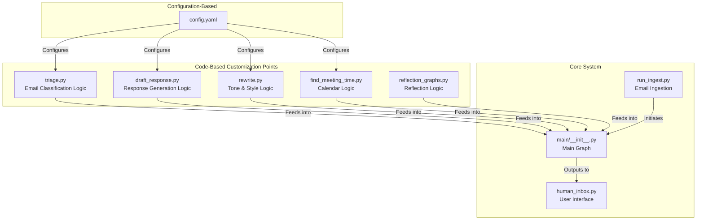
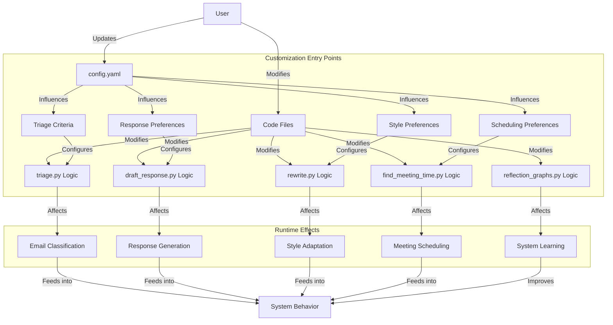
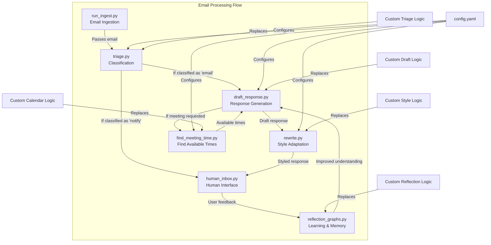

<!-- source: DeepWiki mcp.deepwiki.com · repo langchain-ai/executive-ai-assistant · page 8 Customization · fetched 2026-10-26 -->

# Customization

Relevant source files

The following files were used as context for generating this wiki page:

- [README.md](README.md)

This document provides a technical guide for customizing and extending the Executive AI Assistant (EAIA) system beyond the standard configuration options. While basic behavior can be controlled through the configuration file, deeper customization requires modifying the underlying code components. For configuration-based customization, see [Configuration](#4).

## Customization Architecture

The EAIA system is designed with modularity in mind, allowing for customization at multiple levels of the architecture. The diagram below shows the main customization points in the system and their relationships.

Sources: [README.md:163-180]()

## Key Customization Points

The system has five primary customization points that can be modified to alter behavior beyond configuration:

| Component | File Path | Purpose | 
|-----------|-----------|---------|
| Triage Logic | `eaia/main/triage.py` | Controls how emails are categorized and prioritized |
| Email Draft Logic | `eaia/main/draft_response.py` | Controls how email responses are generated |
| Tone & Style Logic | `eaia/main/rewrite.py` | Controls the tone and style of generated emails |
| Calendar Logic | `eaia/main/find_meeting_time.py` | Controls how available meeting times are identified |
| Reflection Logic | `eaia/reflection_graphs.py` | Controls how the system learns from past interactions |

Sources: [README.md:167-180]()

## Customization Process Overview

The following diagram illustrates how customizations flow through the system:

Sources: [README.md:163-180]()

## Customizing Triage Logic

The triage component determines how incoming emails are categorized and processed. The system categorizes emails into three primary categories:

1. **Ignore** - Emails that don't require any action
2. **Notify** - Emails that should be brought to the user's attention but don't require an AI-generated response
3. **Email** - Emails that the AI should draft a response for

While basic triage rules can be set in the configuration file, more complex customization requires modifying the triage logic code.

### Triage Logic Customization

To customize the triage logic:

1. Locate the `triage.py` file in the `eaia/main/` directory
2. Modify the classification logic to adjust how emails are categorized
3. The triage function takes email content as input and produces a classification and explanation

The key customization points in the triage logic are:

- Email categorization criteria
- Priority detection for urgent messages
- Identification of emails requiring human intervention
- Pattern recognition for routine emails

For more detailed information about triage customization, see [Customizing Triage Logic](#6.1).

Sources: [README.md:170-171]()

## Customizing Email Draft Logic

The email draft component is responsible for generating appropriate responses to emails. Customizing this component allows you to change how the system crafts responses.

### Email Draft Logic Customization

To customize the email draft logic:

1. Locate the `draft_response.py` file in the `eaia/main/` directory
2. Modify the response generation logic to adjust how responses are crafted
3. Update any prompt templates to guide the LLM in generating specific types of responses

Key areas for customization include:

- Prompt engineering for response generation
- Meeting detection and scheduling logic integration
- Response formatting and structure
- Integration with other components (calendar, style, etc.)

For more detailed information about email draft customization, see [Customizing Email Response Logic](#6.2).

Sources: [README.md:179-180]()

## Customizing Tone & Style Logic

The tone and style component controls how email responses are rewritten to match the desired tone, formality, and style. This component is particularly important for ensuring the AI's responses align with the user's communication style.

### Tone & Style Logic Customization

To customize the tone and style logic:

1. Locate the `rewrite.py` file in the `eaia/main/` directory
2. Modify the rewriting logic to adjust how the system adapts response tone and style
3. Update any prompt templates for style transformation

Key areas for customization include:

- Style parameters and formality levels
- Personality traits to reflect in communication
- Industry-specific communication norms
- Adaptation to different recipient relationships

Sources: [README.md:176-177]()

## Customizing Calendar Logic

The calendar component manages the scheduling of meetings and finding available time slots. Customizing this component allows control over how the system interacts with the user's calendar.

### Calendar Logic Customization

To customize the calendar logic:

1. Locate the `find_meeting_time.py` file in the `eaia/main/` directory
2. Modify the calendar integration logic to adjust how available times are found
3. Update meeting scheduling preferences and constraints

Key areas for customization include:

- Time slot selection algorithms
- Meeting duration and buffer preferences
- Calendar API integration customization
- Meeting invitation formatting

Sources: [README.md:173-174]()

## Customizing Reflection Logic

The reflection component enables the system to learn from past interactions and improve over time. This is a more advanced customization area that affects the system's memory and learning capabilities.

### Reflection Logic Customization

To customize the reflection logic:

1. Locate the `reflection_graphs.py` file in the `eaia/` directory
2. Modify the reflection logic to adjust how the system learns from interactions
3. Update any prompt templates for memory storage and retrieval

Key areas for customization include:

- Memory storage mechanisms
- Learning patterns from past interactions
- Information extraction from email exchanges
- Prioritization of remembered information

Sources: [README.md:167-168]()

## Integration with Other Components

When customizing individual components, it's important to consider how changes will affect the overall system. The following diagram illustrates how customized components integrate with each other and the main system:

Sources: [README.md:163-180]()

## Best Practices for Customization

When customizing the EAIA system, follow these best practices to ensure stability and maintainability:

1. **Incremental Changes**: Make small, targeted changes and test thoroughly before proceeding
2. **Preserve Interfaces**: Ensure customized components maintain the same input/output interfaces
3. **Configuration First**: Use configuration options when possible before modifying code
4. **Test Thoroughly**: Test customizations with a variety of email scenarios
5. **Document Changes**: Document any code modifications for future reference
6. **Version Control**: Use version control to track changes and allow for rollbacks
7. **Consider LLM Prompts**: Many customizations can be achieved by modifying prompt templates rather than core logic

## Conclusion

The EAIA system offers multiple customization points to adapt its behavior to specific needs. While the configuration file provides a straightforward way to adjust basic behavior, more advanced customization requires modifying the underlying code components. By following the guidelines in this document, you can effectively customize the system while maintaining its overall functionality and stability.

For specific customization guides, refer to:
- [Customizing Triage Logic](#6.1)
- [Customizing Email Response Logic](#6.2)

---

