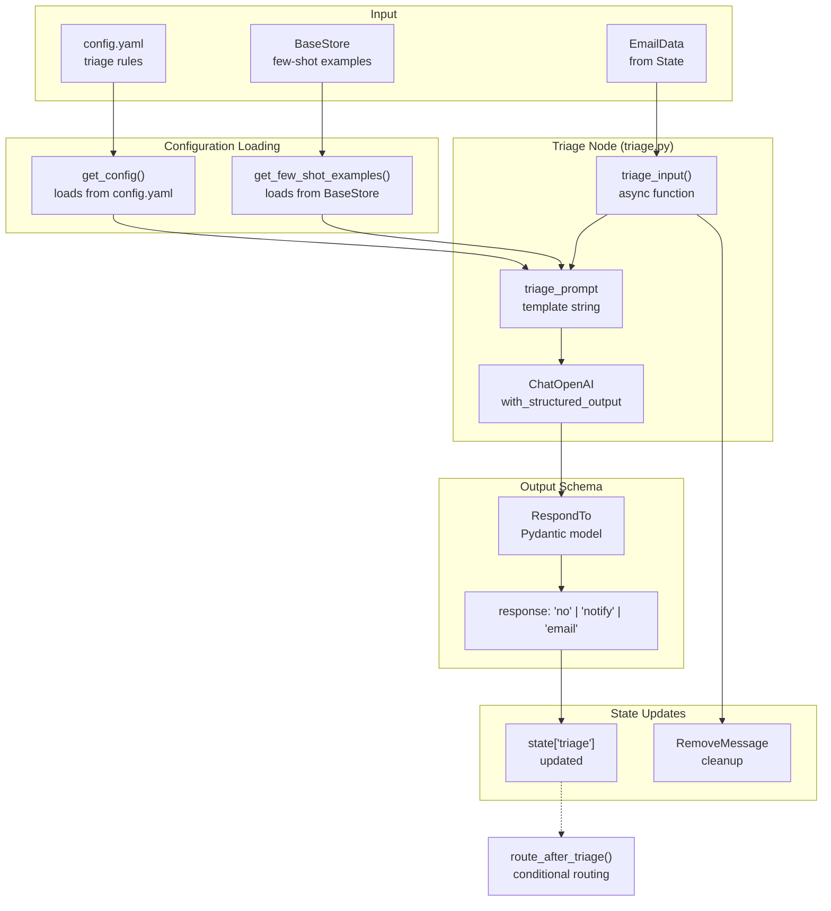
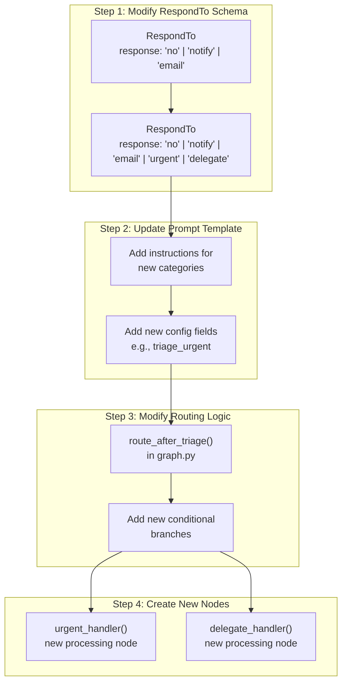
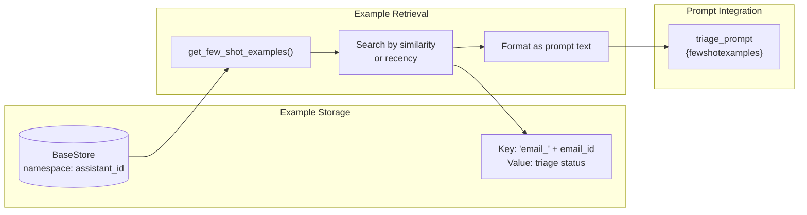

<!-- source: DeepWiki mcp.deepwiki.com · repo langchain-ai/executive-ai-assistant · page 8.1 Customizing Triage Logic · fetched 2026-10-26 -->

# Customizing Triage Logic

<details>
<summary>Relevant source files</summary>

The following files were used as context for generating this wiki page:

- [README.md](README.md)
- [eaia/main/triage.py](eaia/main/triage.py)

</details>


This document explains how to customize the email triage system in EAIA. Triage is the first processing step that classifies incoming emails into three categories: ignore (`no`), notify only (`notify`), or draft response (`email`). This customization is essential for adapting EAIA to your specific email management needs and workflow preferences.

**Scope**: This page covers modifications to the triage classification logic in [eaia/main/triage.py](). For configuration-only changes using `config.yaml`, see [Email Preferences Configuration](#5.1). For understanding how triage fits into the broader email processing pipeline, see [Email Triage Logic](#2.2).

**Sources:** README.md, eaia/main/triage.py

---

## Triage System Architecture

The triage system serves as the decision gateway in the email processing pipeline. Understanding its role and data flow is essential before making customizations.



**Diagram: Triage Node Data Flow**

The triage node receives `EmailData` from state, loads configuration rules from `config.yaml`, retrieves few-shot examples from `BaseStore`, constructs a prompt using the `triage_prompt` template, invokes an LLM with structured output enforcement, and updates the state with a `RespondTo` object containing the classification decision.

**Sources:** eaia/main/triage.py

---

## Triage Prompt Structure

The triage decision is driven by a prompt template that combines user configuration with email content. Understanding this template structure is key to customizing triage behavior.

### Prompt Template Breakdown

The `triage_prompt` variable [eaia/main/triage.py:16-43]() defines the template structure:

| Section | Purpose | Configuration Source |
|---------|---------|---------------------|
| Identity | Establishes assistant role and context | `full_name`, `name`, `background` |
| Ignore Rules | Defines emails to skip | `triage_no` |
| Response Rules | Defines emails requiring drafts | `triage_email` |
| Notification Rules | Defines emails requiring alerts | `triage_notify` |
| Decision Instructions | Specifies output format | Hard-coded in template |
| Few-Shot Examples | Provides classification examples | `{fewshotexamples}` from BaseStore |
| Email Content | Current email to classify | `email_thread`, `author`, `to`, `subject` |

### Configuration Variables

The prompt is populated with values from `config.yaml` via `get_config()` [eaia/main/triage.py:50]():

- `name`: User's first name
- `full_name`: User's full name
- `background`: User context (e.g., "Harrison is the CEO and co-founder of LangChain")
- `triage_no`: Guidelines for ignoring emails
- `triage_email`: Guidelines for drafting responses
- `triage_notify`: Guidelines for notification-only emails

**Sources:** eaia/main/triage.py:16-43, eaia/main/triage.py:50-63

---

## Modifying Classification Rules via Configuration

The simplest way to customize triage behavior is through `config.yaml` without modifying code. This approach is recommended for most users.

### Triage Rule Fields

Edit `eaia/main/config.yaml` to modify these fields:

**triage_no** - Emails to ignore:
```yaml
triage_no: |
  - Automated notifications (GitHub, JIRA, monitoring alerts)
  - Marketing emails and newsletters
  - Social media notifications
  - Emails already handled by someone else
```

**triage_email** - Emails requiring draft responses:
```yaml
triage_email: |
  - Direct questions that can be answered
  - Meeting requests requiring scheduling
  - Partnership or business inquiries
  - Customer support escalations
```

**triage_notify** - Emails requiring notification only:
```yaml
triage_notify: |
  - Important announcements from leadership
  - Urgent issues requiring immediate attention
  - Emails from VIP contacts
  - Legal or compliance matters
```

### Testing Configuration Changes

After modifying `config.yaml`:

1. Restart the LangGraph server (`langgraph dev` for local)
2. Run test ingestion: `python scripts/run_ingest.py --minutes-since 60 --rerun 1`
3. Review triage decisions in Agent Inbox
4. Iterate on rules based on classification accuracy

**Sources:** README.md:50-64, eaia/main/triage.py:51-63

---

## Customizing the Prompt Template

For more advanced customizations, you can modify the `triage_prompt` template itself in [eaia/main/triage.py:16-43]().

### Adding New Sections

To add custom context or instructions, insert new sections into the template:

```python
triage_prompt = """You are {full_name}'s executive assistant. You are a top-notch executive assistant who cares about {name} performing as well as possible.

{background}.

# NEW SECTION EXAMPLE
Current context: {current_context}
Team availability: {team_status}

{name} gets lots of emails. Your job is to categorize the below email to see whether is it worth responding to.

Emails that are not worth responding to:
{triage_no}

# ... rest of template
"""
```

Then update the `input_message` formatting [eaia/main/triage.py:51-63]() to include new variables:

```python
input_message = triage_prompt.format(
    # ... existing parameters
    current_context=get_current_context(),  # Add custom function
    team_status=get_team_availability(),     # Add custom function
)
```

### Modifying Decision Instructions

The decision instructions [eaia/main/triage.py:31-33]() can be modified to change the classification logic:

```python
# Original
"""For emails not worth responding to, respond `no`. For something where {name} should respond over email, respond `email`. If it's important to notify {name}, but no email is required, respond `notify`. \

If unsure, opt to `notify` {name} - you will learn from this in the future."""

# Modified example - bias toward drafting
"""For emails not worth responding to, respond `no`. For something where {name} should respond over email, respond `email`. If it's important to notify {name}, but no email is required, respond `notify`.

If unsure between `email` and `notify`, prefer `email` to draft a response that can be reviewed."""
```

**Sources:** eaia/main/triage.py:16-43, eaia/main/triage.py:51-63

---

## Adding New Triage Categories

To extend beyond the three-category system (`no`, `notify`, `email`), you must modify both the schema and the routing logic.



**Diagram: Adding New Triage Categories**

### Step 1: Modify RespondTo Schema

Edit [eaia/schemas.py]() to extend the `RespondTo` model:

```python
# Original
class RespondTo(BaseModel):
    """Respond to user"""
    response: Literal["no", "notify", "email"]

# Extended
class RespondTo(BaseModel):
    """Respond to user"""
    response: Literal["no", "notify", "email", "urgent", "delegate"]
    reason: Optional[str]  # Optional: Add explanation field
```

### Step 2: Update Prompt Template

Add instructions for new categories in [eaia/main/triage.py:16-43]():

```python
triage_prompt = """You are {full_name}'s executive assistant...

Emails that are not worth responding to:
{triage_no}

Emails that are worth responding to:
{triage_email}

Emails that require urgent attention:
{triage_urgent}

Emails that should be delegated:
{triage_delegate}

There are also other things that {name} should know about, but don't require an email response. For these, you should notify {name} (using the `notify` response). Examples of this include:
{triage_notify}

For emails not worth responding to, respond `no`. 
For urgent matters requiring immediate response, respond `urgent`.
For emails that should be delegated to team members, respond `delegate`.
For something where {name} should respond over email, respond `email`. 
If it's important to notify {name}, but no email is required, respond `notify`.
"""
```

Add corresponding fields to `config.yaml`:

```yaml
triage_urgent: |
  - System outages or critical failures
  - Legal or PR crises
  - Executive escalations

triage_delegate: |
  - Customer support issues within team scope
  - Routine operational questions
  - Follow-up tasks for specific team members
```

### Step 3: Update Routing Logic

Modify `route_after_triage()` in [eaia/main/graph.py]() to handle new categories:

```python
def route_after_triage(state: State):
    """Route based on triage decision"""
    response = state["triage"]["response"]
    
    if response == "no":
        return "mark_as_read"
    elif response == "notify":
        return "notify_user"
    elif response == "email":
        return "draft_response"
    elif response == "urgent":
        return "urgent_handler"
    elif response == "delegate":
        return "delegate_handler"
    else:
        return "notify_user"  # Default fallback
```

### Step 4: Implement New Nodes

Create handler functions for new categories:

```python
async def urgent_handler(state: State, config: RunnableConfig):
    """Handle urgent emails with high priority notification"""
    # Custom urgent handling logic
    return {
        "messages": [
            AIMessage(content=f"URGENT: {state['email']['subject']}")
        ]
    }

async def delegate_handler(state: State, config: RunnableConfig):
    """Determine delegation target and notify"""
    # Custom delegation logic
    return {
        "messages": [
            AIMessage(content=f"Delegate to: {determine_delegate(state)}")
        ]
    }
```

Add new nodes to the StateGraph in [eaia/main/graph.py]():

```python
workflow.add_node("urgent_handler", urgent_handler)
workflow.add_node("delegate_handler", delegate_handler)

workflow.add_conditional_edges(
    "triage_input",
    route_after_triage,
    {
        "mark_as_read": "mark_as_read",
        "notify_user": "notify",
        "draft_response": "draft_response_input",
        "urgent_handler": "urgent_handler",
        "delegate_handler": "delegate_handler",
    }
)
```

**Sources:** eaia/main/triage.py:8-11, eaia/main/triage.py:64-66, eaia/main/graph.py

---

## Few-Shot Examples System

The triage system uses few-shot learning to improve classification accuracy by providing examples of previous decisions.

### How Few-Shot Examples Work

The `get_few_shot_examples()` function [eaia/main/triage.py:49]() retrieves stored examples:



**Diagram: Few-Shot Example Integration**

### Adding Custom Examples

To seed the system with custom examples, add them to BaseStore via the reflection system or directly:

```python
from langgraph.store.base import BaseStore

async def seed_examples(store: BaseStore, assistant_id: str):
    """Seed custom triage examples"""
    examples = [
        {
            "email_id": "example_1",
            "subject": "Weekly newsletter",
            "from": "marketing@company.com",
            "triage": "no",
            "reason": "Automated marketing content"
        },
        {
            "email_id": "example_2", 
            "subject": "Urgent: Production down",
            "from": "ops@company.com",
            "triage": "notify",
            "reason": "Critical system issue"
        }
    ]
    
    for ex in examples:
        await store.aput(
            namespace=(assistant_id, "email"),
            key=f"email_{ex['email_id']}",
            value={"triage_status": ex["triage"]}
        )
```

### Customizing Example Selection

Modify [eaia/main/fewshot.py]() to change how examples are selected:

- Filter by date range (recent examples)
- Filter by sender domain (similar senders)
- Filter by subject keywords (similar topics)
- Limit number of examples (performance vs. accuracy trade-off)

**Sources:** eaia/main/triage.py:49, eaia/main/fewshot.py

---

## Model Selection and Parameters

The triage node uses configurable LLM parameters that can be adjusted for different accuracy/speed trade-offs.

### Model Configuration

The model is selected via the `configurable` parameter [eaia/main/triage.py:47-48]():

```python
async def triage_input(state: State, config: RunnableConfig, store: BaseStore):
    model = config["configurable"].get("model", "gpt-4o")
    llm = ChatOpenAI(model=model, temperature=0)
```

| Model | Speed | Cost | Accuracy | Best For |
|-------|-------|------|----------|----------|
| `gpt-4o` | Fast | Low | High | Production, default |
| `gpt-4o-mini` | Fastest | Lowest | Good | High-volume testing |
| `o1` | Slow | Highest | Highest | Complex triage rules |
| `claude-3-5-sonnet` | Medium | Medium | High | Alternative provider |

### Changing the Default Model

To use a different model by default, modify the default value [eaia/main/triage.py:47]():

```python
model = config["configurable"].get("model", "claude-3-5-sonnet")
```

Or specify at runtime when creating threads:

```python
from langgraph_sdk import get_client

client = get_client()
thread = await client.threads.create()
await client.runs.create(
    thread["thread_id"],
    "main",
    input={"email": email_data},
    config={"configurable": {"model": "o1"}}
)
```

### Temperature and Other Parameters

Temperature is set to `0` [eaia/main/triage.py:48]() for deterministic triage decisions. To experiment with creativity, adjust this parameter:

```python
llm = ChatOpenAI(model=model, temperature=0.3)  # Slightly more varied
```

Other parameters can be added:

```python
llm = ChatOpenAI(
    model=model, 
    temperature=0,
    max_tokens=500,      # Limit response length
    timeout=30.0,        # Request timeout
    max_retries=2        # Retry on failure
)
```

**Sources:** eaia/main/triage.py:47-48

---

## Structured Output Enforcement

The triage node uses LangChain's `with_structured_output()` to enforce response schema compliance.

### RespondTo Schema Binding

The LLM is bound to the `RespondTo` schema [eaia/main/triage.py:64-66]():

```python
model = llm.with_structured_output(RespondTo).bind(
    tool_choice={"type": "function", "function": {"name": "RespondTo"}}
)
response = await model.ainvoke(input_message)
```

This ensures the LLM always returns a valid `RespondTo` object with the `response` field set to one of the allowed literal values.

### Tool Choice Parameter

The `tool_choice` parameter forces the LLM to use the `RespondTo` function, preventing free-form text responses. To allow optional structured output:

```python
model = llm.with_structured_output(RespondTo)
# No tool_choice specified - LLM can choose whether to use schema
```

### Validation and Error Handling

If you extend the schema with additional fields, add validation:

```python
from pydantic import field_validator

class RespondTo(BaseModel):
    response: Literal["no", "notify", "email"]
    confidence: float  # New field
    
    @field_validator('confidence')
    def validate_confidence(cls, v):
        if not 0 <= v <= 1:
            raise ValueError('Confidence must be between 0 and 1')
        return v
```

**Sources:** eaia/main/triage.py:8-11, eaia/main/triage.py:64-67

---

## State Management and Cleanup

The triage node performs state cleanup to prevent message accumulation across re-runs.

### Message Removal Logic

The triage node conditionally removes previous messages [eaia/main/triage.py:68-72]():

```python
if len(state["messages"]) > 0:
    delete_messages = [RemoveMessage(id=m.id) for m in state["messages"]]
    return {"triage": response, "messages": delete_messages}
else:
    return {"triage": response}
```

This cleanup is important when emails are re-triaged (e.g., via `--rerun 1` flag in ingestion).

### Custom State Updates

To add custom state fields during triage:

```python
return {
    "triage": response,
    "triage_timestamp": datetime.now().isoformat(),
    "triage_model": model,
    "messages": delete_messages if state["messages"] else []
}
```

Update the `State` TypedDict in [eaia/schemas.py]() to include new fields:

```python
class State(TypedDict):
    email: EmailData
    messages: Annotated[list[AnyMessage], add_messages]
    triage: RespondTo
    triage_timestamp: str  # New field
    triage_model: str      # New field
```

**Sources:** eaia/main/triage.py:68-72, eaia/schemas.py

---

## Testing and Debugging Triage Changes

After modifying triage logic, systematic testing ensures correct behavior.

### Local Testing Workflow

1. **Start development server**:
   ```bash
   langgraph dev
   ```

2. **Run test ingestion with re-run enabled**:
   ```bash
   python scripts/run_ingest.py --minutes-since 60 --rerun 1 --early 0
   ```

3. **Review results in Agent Inbox**:
   - Connect to `http://127.0.0.1:2024`
   - Check triage decisions
   - Verify new categories appear correctly

4. **Inspect traces in LangSmith**:
   - View full prompt sent to LLM
   - Check structured output response
   - Analyze token usage and latency

### Debugging Common Issues

| Issue | Cause | Solution |
|-------|-------|----------|
| Schema validation errors | RespondTo literal values don't match prompt | Ensure prompt instructions match schema exactly |
| Wrong category selected | Unclear rules in config | Add more specific guidelines and examples |
| Few-shot examples not appearing | BaseStore empty | Seed examples or process emails with memory enabled |
| Model timeout | Complex prompt or slow model | Reduce few-shot examples or use faster model |
| Configuration not loading | config.yaml syntax error | Validate YAML syntax, check indentation |

### Logging Custom Debug Information

Add logging to the triage function for debugging:

```python
import logging

logger = logging.getLogger(__name__)

async def triage_input(state: State, config: RunnableConfig, store: BaseStore):
    model = config["configurable"].get("model", "gpt-4o")
    logger.info(f"Triaging email: {state['email']['subject']}")
    logger.debug(f"Using model: {model}")
    
    # ... existing logic
    
    logger.info(f"Triage decision: {response.response}")
    return {"triage": response}
```

**Sources:** README.md:66-89, README.md:124-137

---

