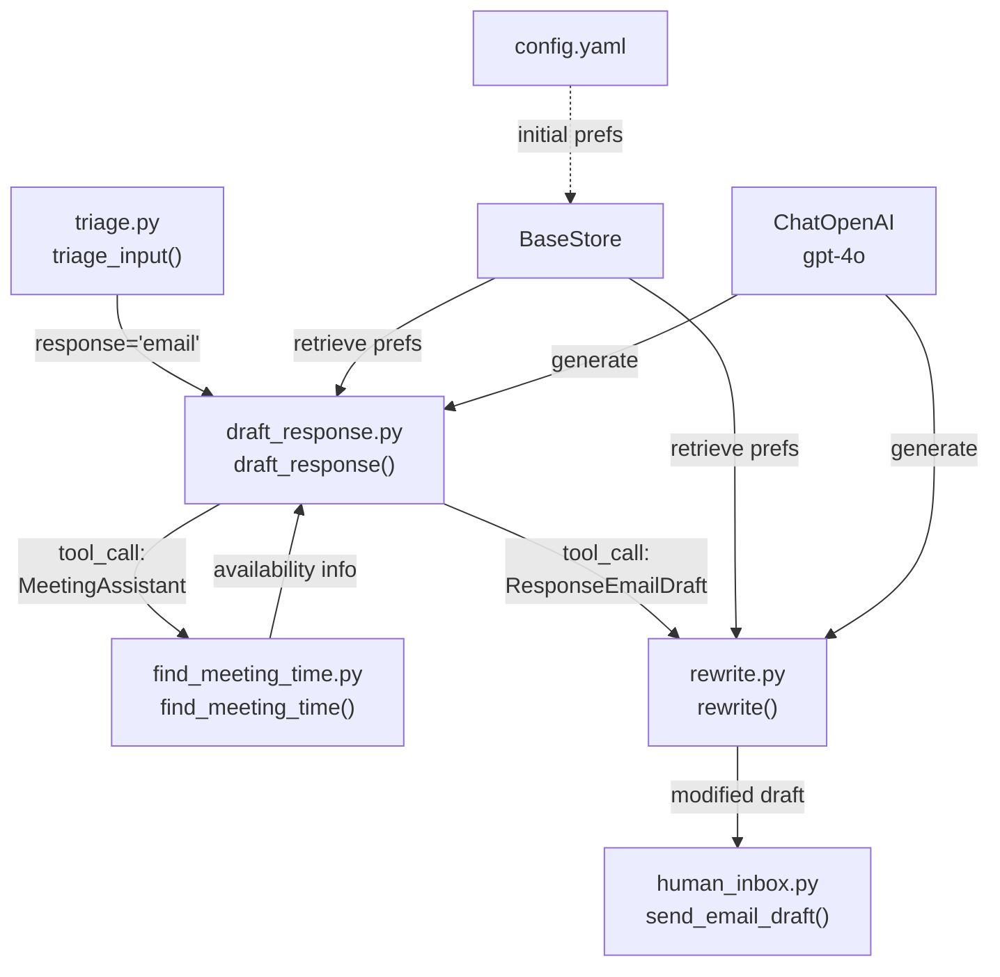
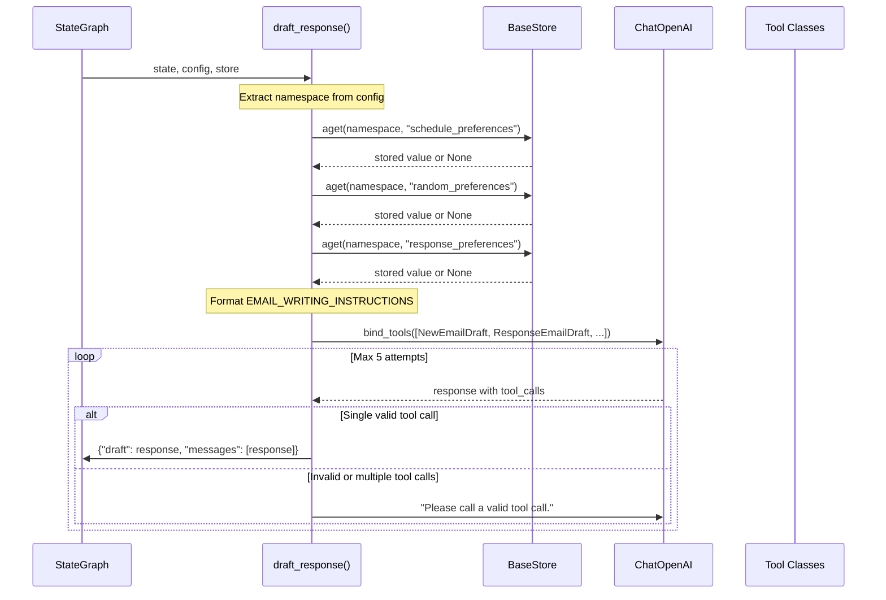
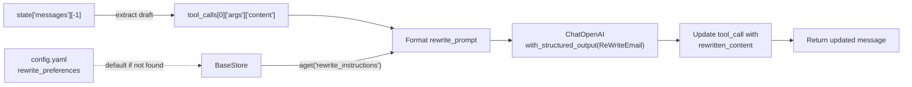
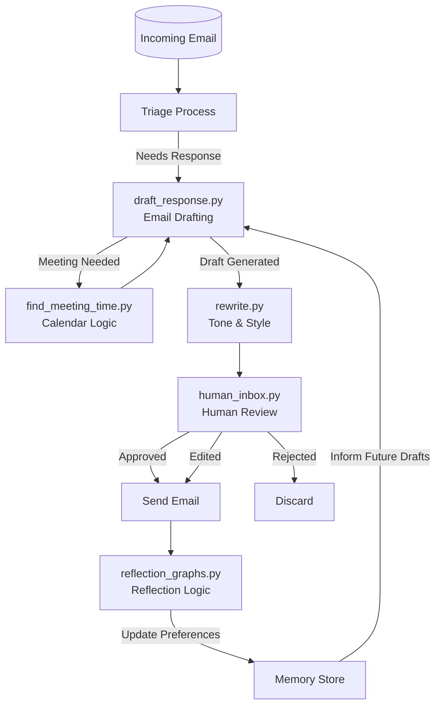

<!-- source: DeepWiki mcp.deepwiki.com · repo langchain-ai/executive-ai-assistant · page 8.2 Customizing Email Response Logic · fetched 2026-10-26 -->

# Customizing Email Response Logic

<details>
<summary>Relevant source files</summary>

The following files were used as context for generating this wiki page:

- [README.md](README.md)
- [eaia/main/draft_response.py](eaia/main/draft_response.py)
- [eaia/main/rewrite.py](eaia/main/rewrite.py)

</details>


This document explains how to modify email response generation in EAIA by editing `draft_response.py` and `rewrite.py`. It covers configuration-based customization through BaseStore and code-level modifications to prompts, tools, and LLM parameters.

For customizing email classification, see page 8.1.

## Response Generation Components

The response generation system consists of two primary modules that process emails after triage classification:

**Component Interaction Flow**



Sources: [eaia/main/draft_response.py:82-154](), [eaia/main/rewrite.py:33-79](), [README.md:172-180]()
</thinking>

## Draft Response Function (`draft_response.py`)

The `draft_response()` function [eaia/main/draft_response.py:82-154]() is the core drafting logic that:

1. Retrieves user preferences from BaseStore
2. Constructs prompts with preferences and email context
3. Invokes LLM with tool binding
4. Returns the selected tool call as a draft

**Function Signature and Store Interaction**



Sources: [eaia/main/draft_response.py:82-154]()
</old_str>
<new_str>
# Customizing Email Response Logic

This document explains how to modify email response generation in EAIA by editing `draft_response.py` and `rewrite.py`. It covers configuration-based customization through BaseStore and code-level modifications to prompts, tools, and LLM parameters.

For customizing email classification, see page 8.1.

## Response Generation Components

The response generation system consists of two primary modules that process emails after triage classification:

**Component Interaction Flow**


Sources: [eaia/main/draft_response.py:82-154](), [eaia/main/rewrite.py:33-79](), [README.md:172-180]()

## Draft Response Function (`draft_response.py`)

The `draft_response()` function [eaia/main/draft_response.py:82-154]() is the core drafting logic that:

1. Retrieves user preferences from BaseStore
2. Constructs prompts with preferences and email context
3. Invokes LLM with tool binding
4. Returns the selected tool call as a draft

**Function Signature and Store Interaction**


Sources: [eaia/main/draft_response.py:82-154]()

### BaseStore Preference Retrieval

The function retrieves three preference keys from BaseStore [eaia/main/draft_response.py:102-125]():

| Key | Default Source | Purpose |
|-----|----------------|---------|
| `schedule_preferences` | `config["schedule_preferences"]` | Meeting scheduling guidelines |
| `random_preferences` | `config["background_preferences"]` | Background context information |
| `response_preferences` | `config["response_preferences"]` | Content and format preferences |

The namespace is extracted from `config["configurable"]["assistant_id"]` [eaia/main/draft_response.py:102](). If a preference key does not exist in BaseStore, the default value from `config.yaml` is stored via `store.aput()`.

### LLM Configuration

The function configures `ChatOpenAI` [eaia/main/draft_response.py:84-90]() with:

```python
model = config["configurable"].get("model", "gpt-4o")
llm = ChatOpenAI(
    model=model,
    temperature=0,
    parallel_tool_calls=False,
    tool_choice="required",
)
```

- `model`: Configurable via `config["configurable"]["model"]`, defaults to `gpt-4o`
- `temperature=0`: Deterministic output
- `parallel_tool_calls=False`: Forces sequential tool calls
- `tool_choice="required"`: Forces LLM to call a tool

Sources: [eaia/main/draft_response.py:84-90]()

### Tool Binding

The function binds tool classes to the LLM [eaia/main/draft_response.py:91-100]():

```python
tools = [
    NewEmailDraft,
    ResponseEmailDraft,
    Question,
    MeetingAssistant,
    SendCalendarInvite,
]
messages = state.get("messages") or []
if len(messages) > 0:
    tools.append(Ignore)
```

The `Ignore` tool is conditionally added if messages exist in state, allowing the agent to skip drafting on subsequent iterations.

Sources: [eaia/main/draft_response.py:7-16](), [eaia/main/draft_response.py:91-100]()

### Prompt Construction

The function constructs the final prompt by formatting two templates:

1. **`EMAIL_WRITING_INSTRUCTIONS`** [eaia/main/draft_response.py:19-72](): Base instructions template that includes:
   - User context (`full_name`, `name`, `background`)
   - Tool usage instructions (Question, ResponseEmailDraft, SendCalendarInvite, etc.)
   - Retrieved preferences (`schedule_preferences`, `random_preferences`, `response_preferences`)

2. **`draft_prompt`** [eaia/main/draft_response.py:73-79](): Combines instructions with email content using `email_template.format()`.

The final formatted message is passed to the LLM [eaia/main/draft_response.py:134-142]():

```python
input_message = draft_prompt.format(
    instructions=_prompt,
    email=email_template.format(
        email_thread=state["email"]["page_content"],
        author=state["email"]["from_email"],
        subject=state["email"]["subject"],
        to=state["email"].get("to_email", ""),
    ),
)
```

Sources: [eaia/main/draft_response.py:19-79](), [eaia/main/draft_response.py:126-142]()

## Rewrite Function (`rewrite.py`)

The `rewrite()` function [eaia/main/rewrite.py:33-79]() adjusts the tone and style of drafts generated by `draft_response()`:

1. Extracts draft content from previous message tool call
2. Retrieves `rewrite_instructions` from BaseStore
3. Constructs rewrite prompt with draft and context
4. Invokes LLM with structured output schema
5. Updates the tool call with rewritten content

**Rewrite Process Flow**



Sources: [eaia/main/rewrite.py:33-79]()

### Rewrite Prompt Template

The `rewrite_prompt` template [eaia/main/rewrite.py:10-30]() instructs the LLM to:

- Maintain factual accuracy (do not add information)
- Adjust tone to match user's style
- Preserve draft structure while modifying language

The template includes the assistant's draft, email thread context, and retrieved `rewrite_instructions` from BaseStore [eaia/main/rewrite.py:38-49]().

### Structured Output

The function uses `with_structured_output(ReWriteEmail)` [eaia/main/rewrite.py:59-61]() to enforce schema compliance:

```python
model = llm.with_structured_output(ReWriteEmail).bind(
    tool_choice={"type": "function", "function": {"name": "ReWriteEmail"}}
)
```

The `ReWriteEmail` schema is defined in `eaia/schemas.py` and contains a `rewritten_content` field.

Sources: [eaia/main/rewrite.py:33-79]()

## Customizing Prompts

### Modifying `EMAIL_WRITING_INSTRUCTIONS`

The `EMAIL_WRITING_INSTRUCTIONS` template [eaia/main/draft_response.py:19-72]() defines the LLM's role and available tools. To customize:

1. Edit the string literal in [eaia/main/draft_response.py:19-72]()
2. Add or modify sections (e.g., new tool usage instructions)
3. Ensure format variables match those passed in `_prompt = EMAIL_WRITING_INSTRUCTIONS.format(...)` [eaia/main/draft_response.py:126-133]()

Example modification: Adding instructions for a new tool type:

```
# Using the `CustomTool` tool

Instructions for when and how to use CustomTool...
```

### Modifying `draft_prompt`

The `draft_prompt` template [eaia/main/draft_response.py:73-79]() combines instructions with email content. To customize:

1. Edit the template string
2. Add additional context fields from `state["email"]`
3. Update the `format()` call [eaia/main/draft_response.py:134-142]() to include new variables

### Modifying `rewrite_prompt`

The `rewrite_prompt` template [eaia/main/rewrite.py:10-30]() controls tone adjustment. To customize:

1. Edit the template string in [eaia/main/rewrite.py:10-30]()
2. Modify tone adjustment guidelines
3. Update the `format()` call [eaia/main/rewrite.py:50-58]() if adding variables

Sources: [eaia/main/draft_response.py:19-79](), [eaia/main/draft_response.py:126-142](), [eaia/main/rewrite.py:10-30](), [eaia/main/rewrite.py:50-58]()

## Customizing Tools

### Available Tool Classes

The tool classes are imported from `eaia.schemas` [eaia/main/draft_response.py:7-16]():

**Tool Class Definitions and Usage**

| Tool Class | Purpose | When Added |
|------------|---------|------------|
| `NewEmailDraft` | Start a new email thread | Always available |
| `ResponseEmailDraft` | Reply to existing thread | Always available |
| `Question` | Ask user for information | Always available |
| `MeetingAssistant` | Invoke calendar agent | Always available |
| `SendCalendarInvite` | Schedule calendar event | Always available |
| `Ignore` | Skip drafting | Only if `len(messages) > 0` |

### Adding New Tools

To add a custom tool:

1. **Define the tool in `eaia/schemas.py`**: Create a Pydantic model with tool call schema
2. **Import in `draft_response.py`**: Add to imports [eaia/main/draft_response.py:7-16]()
3. **Add to tools list**: Include in the `tools` array [eaia/main/draft_response.py:91-100]()
4. **Update `EMAIL_WRITING_INSTRUCTIONS`**: Add usage section describing when and how to use the tool [eaia/main/draft_response.py:19-72]()

Example:
```python
# In eaia/schemas.py
class CustomAction(BaseModel):
    """Description of custom action."""
    action_param: str

# In eaia/main/draft_response.py
from eaia.schemas import CustomAction

tools = [
    NewEmailDraft,
    ResponseEmailDraft,
    Question,
    MeetingAssistant,
    SendCalendarInvite,
    CustomAction,  # Add here
]
```

Sources: [eaia/main/draft_response.py:7-16](), [eaia/main/draft_response.py:91-100]()

## Customizing LLM Parameters

### Model Selection

The model is configurable via `config["configurable"]["model"]` [eaia/main/draft_response.py:84]() and [eaia/main/rewrite.py:34](). To change:

**At runtime (per-invocation):**
```python
config = {
    "configurable": {
        "model": "gpt-4o-mini",  # or "o1", "claude-3-5-sonnet-20241022"
    }
}
```

**By editing code:** Modify the default in `config["configurable"].get("model", "gpt-4o")`.

### Temperature and Sampling

Both functions use `temperature=0` for deterministic output [eaia/main/draft_response.py:87](), [eaia/main/rewrite.py:35](). To enable sampling:

```python
llm = ChatOpenAI(
    model=model,
    temperature=0.7,  # Increase for more creative responses
)
```

### Tool Choice Behavior

The `draft_response()` function enforces tool usage with `tool_choice="required"` [eaia/main/draft_response.py:89](). To allow the LLM to decline tool usage:

```python
llm = ChatOpenAI(
    model=model,
    temperature=0,
    parallel_tool_calls=False,
    tool_choice="auto",  # or specific tool name
)
```

Sources: [eaia/main/draft_response.py:84-90](), [eaia/main/rewrite.py:34-35]()

## Email Response Workflow Customization

The email response process involves several discrete steps that can be customized:



To modify this workflow:

1. Adjust the input/output handling in any of these components
2. Change the decision logic within each component
3. Add new steps or bypass existing ones

Sources: [README.md:166-180]()

## Example Customizations

### Example 1: Adding Custom Signature Logic

To add custom signature logic based on email recipient:

1. Modify the `EMAIL_WRITING_INSTRUCTIONS` template to include guidance about when to use different signatures
2. Update the `response_preferences` in your config file with signature options
3. Ensure the prompt includes instructions for selecting the appropriate signature

### Example 2: Adding Support for Follow-up Scheduling

To enhance the system's ability to schedule follow-ups:

1. Add a new tool in `eaia/schemas.py` (e.g., `ScheduleFollowUp`)
2. Import and add this tool to the `tools` list in `draft_response.py`
3. Update the instruction prompts to guide the LLM on when and how to use this new tool
4. Modify the configuration to include preferences for follow-up scheduling

## Best Practices

When customizing email response logic:

1. Test changes with a variety of email types to ensure consistent behavior
2. Start with configuration changes before modifying code
3. Maintain the separation between triage logic and response logic
4. Keep prompt instructions clear and unambiguous for the LLM
5. Review the generated responses to ensure they match your intended changes

Sources: [README.md:166-180]()

---

