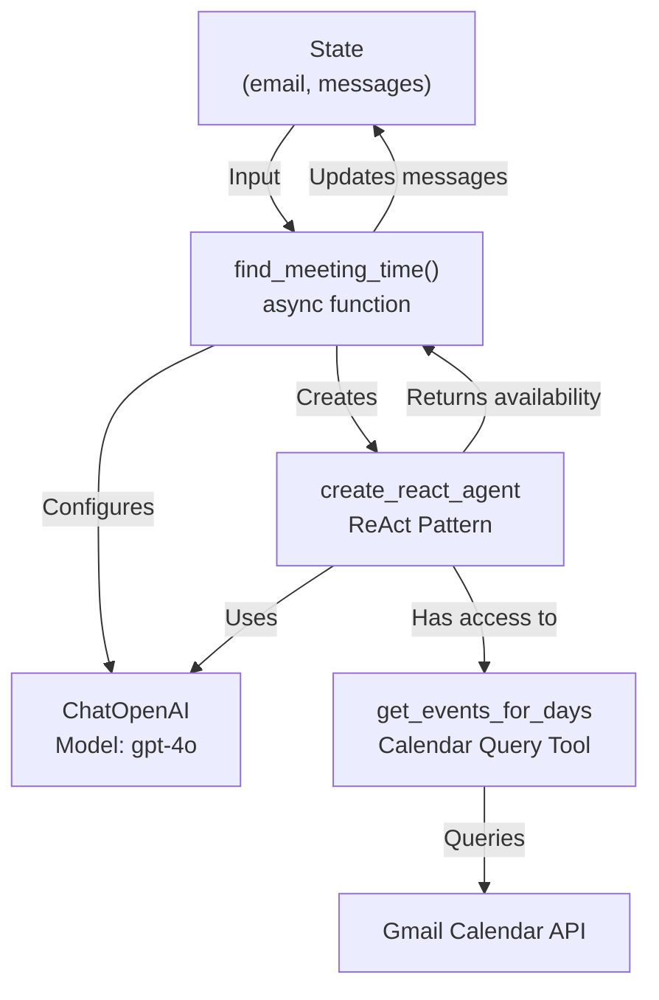
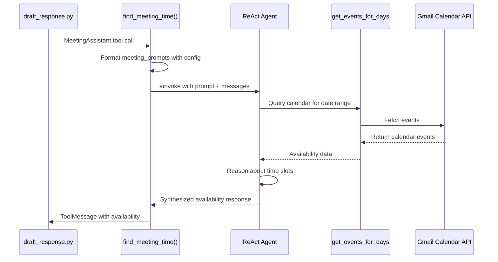
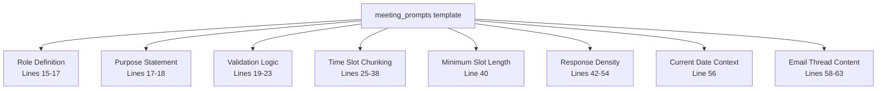
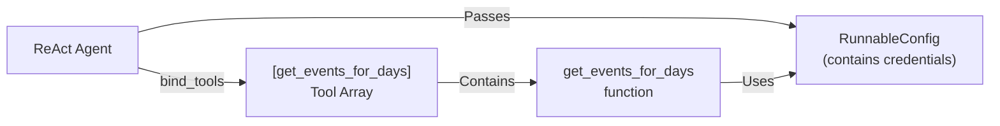
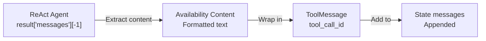

<!-- source: DeepWiki mcp.deepwiki.com · repo langchain-ai/executive-ai-assistant · page 8.3 Customizing Meeting Logic · fetched 2026-10-26 -->

# Customizing Meeting Logic

<details>
<summary>Relevant source files</summary>

The following files were used as context for generating this wiki page:

- [README.md](README.md)
- [eaia/main/find_meeting_time.py](eaia/main/find_meeting_time.py)
- [eaia/schemas.py](eaia/schemas.py)

</details>


## Purpose and Scope

This page explains how to customize the meeting scheduling agent in EAIA by modifying `eaia/main/find_meeting_time.py`. The meeting agent uses the ReAct pattern to query calendar availability and provide scheduling information to email recipients.

For information about how meeting logic integrates into the overall email processing pipeline, see [Calendar Integration](#2.4). For customizing email response generation that may trigger meeting assistance, see [Customizing Email Response Logic](#8.2).

**Sources:** [README.md:171-172]()

---

## Meeting Agent Architecture

The meeting scheduling system is implemented as a ReAct agent that can query calendar information and synthesize availability responses.

### Component Overview



**Sources:** [eaia/main/find_meeting_time.py:1-97]()

### Invocation Flow

The `find_meeting_time` function is invoked when the draft response agent calls the `MeetingAssistant` tool. The flow proceeds as follows:

| Step | Action | Code Reference |
|------|--------|----------------|
| 1 | Extract email context from state | [eaia/main/find_meeting_time.py:66-82]() |
| 2 | Create ReAct agent with calendar tools | [eaia/main/find_meeting_time.py:70]() |
| 3 | Format prompt with user preferences | [eaia/main/find_meeting_time.py:73-81]() |
| 4 | Remove previous tool call from messages | [eaia/main/find_meeting_time.py:82-84]() |
| 5 | Invoke agent with formatted prompt | [eaia/main/find_meeting_time.py:85-87]() |
| 6 | Return result as ToolMessage | [eaia/main/find_meeting_time.py:88-96]() |



**Sources:** [eaia/main/find_meeting_time.py:66-97]()

---

## Prompt Structure and Customization

The core behavior of the meeting agent is controlled by the `meeting_prompts` template string at [eaia/main/find_meeting_time.py:15-63]().

### Prompt Template Structure

The prompt is organized into several sections:

| Section | Purpose | Customization Point |
|---------|---------|---------------------|
| Role definition | Sets agent identity and purpose | Modify tone, responsibilities |
| Time slot checking instructions | Guides how to validate suggested times | Add validation rules |
| Time slot presentation rules | Controls formatting of availability | Adjust granularity, chunking logic |
| Response density guidelines | Enforces concise, factual responses | Change verbosity, style |
| Examples | Demonstrates desired output format | Add/modify examples |



**Sources:** [eaia/main/find_meeting_time.py:15-63]()

### Configuration Variables

The prompt is formatted with configuration values from `config.yaml` and state:

```python
# Configuration variables used in prompt formatting
{
    "name": "First name of user",           # Used for referring to user
    "full_name": "Full name of user",       # Used in role definition
    "timezone": "User's timezone",          # Used for time slot formatting
    "email_thread": "Email content",        # From state["email"]["page_content"]
    "author": "Sender email",               # From state["email"]["from_email"]
    "subject": "Email subject",             # From state["email"]["subject"]
    "current_date": "Current date string"   # Generated at runtime
}
```

**Sources:** [eaia/main/find_meeting_time.py:72-81](), [eaia/main/config.py]()

### Customizing Time Slot Presentation

The prompt includes specific instructions for how time slots should be presented [eaia/main/find_meeting_time.py:25-38]():

**Default behavior:** Consolidate adjacent free time into single blocks
```
1pm-3pm          ✓ Good
NOT
1-1:30pm         ✗ Bad (fragmented)
1:30-2pm
2-2:30pm
```

**To customize:**
1. Modify the chunking instructions at [eaia/main/find_meeting_time.py:25-38]()
2. Adjust minimum slot length at [eaia/main/find_meeting_time.py:40]()
3. Change examples to reflect new formatting

**Sources:** [eaia/main/find_meeting_time.py:25-40]()

### Customizing Response Density

The prompt enforces "extremely high density" responses with minimal commentary [eaia/main/find_meeting_time.py:42-54]():

**Current style:**
- Factual statements only
- No direct email responses
- No extra commentary

**Example responses:**
```
"{name} is free 9:30-10"
"{name} is not free then. But he is free at 10:30"
```

**To modify:**
- Change density instructions at [eaia/main/find_meeting_time.py:42]()
- Update examples at [eaia/main/find_meeting_time.py:44-54]() to reflect desired style
- Adjust tone to be more conversational or formal as needed

**Sources:** [eaia/main/find_meeting_time.py:42-54]()

---

## Calendar Query Integration

The meeting agent uses the `get_events_for_days` tool to query calendar availability.

### Tool Binding



The tool is bound to the agent at [eaia/main/find_meeting_time.py:70]():

```python
agent = create_react_agent(llm, [get_events_for_days])
```

**Sources:** [eaia/main/find_meeting_time.py:70]()

### Tool Interface

The `get_events_for_days` tool accepts:

| Parameter | Type | Description |
|-----------|------|-------------|
| `days` | int | Number of days ahead to query |
| `config` | RunnableConfig | Contains OAuth credentials |

The tool returns structured calendar event data that the agent can reason about to determine availability.

**Sources:** [eaia/gmail.py](), [eaia/main/find_meeting_time.py:70]()

### Message State Management

The function manages conversation state carefully at [eaia/main/find_meeting_time.py:82-84]():

```python
messages = state.get("messages") or []
# we do this because theres currently a tool call just for routing
messages = messages[:-1]
```

**Why this is needed:** The previous message contains the `MeetingAssistant` tool call that triggered this function. This is removed so the agent receives only the email conversation history, not the routing tool call.

**Sources:** [eaia/main/find_meeting_time.py:82-84]()

---

## Common Customizations

### Adjusting Model Selection

**Default model:** `gpt-4o` with `temperature=0` for deterministic responses [eaia/main/find_meeting_time.py:68-69]()

**To change the model:**

1. Modify model selection logic:
```python
# Current implementation
model = config["configurable"].get("model", "gpt-4o")
llm = ChatOpenAI(model=model, temperature=0)
```

2. Consider model characteristics:
   - **gpt-4o**: Balanced performance and cost
   - **o1**: Better reasoning for complex scheduling constraints
   - **gpt-3.5-turbo**: Faster, cheaper for simple availability checks

3. Adjust temperature if non-deterministic responses are desired

**Sources:** [eaia/main/find_meeting_time.py:68-69]()

### Modifying Time Slot Granularity

**Current minimum:** 15 minutes [eaia/main/find_meeting_time.py:40]()

**To customize:**
1. Update the prompt instruction at line 40
2. Adjust chunking logic description if needed
3. Consider adding explicit time slot rounding instructions

**Example modification:**
```python
meeting_prompts = """...
Do not send time slots less than 30 minutes in length.
Round all time slots to the nearest half hour.
..."""
```

**Sources:** [eaia/main/find_meeting_time.py:40]()

### Adding Preference Checking

To incorporate user scheduling preferences more deeply:

1. Add `schedule_preferences` to prompt context:
```python
input_message = meeting_prompts.format(
    # ... existing fields ...
    schedule_preferences=prompt_config["schedule_preferences"],
)
```

2. Update prompt template to reference preferences:
```python
meeting_prompts = """...
When suggesting times, follow these preferences:
{schedule_preferences}
..."""
```

**Sources:** [eaia/main/find_meeting_time.py:72-81](), [eaia/main/config.py]()

### Customizing Availability Logic

To change how the agent determines and presents availability:

1. **Modify calendar query range:** The agent decides how many days to query based on email context. To enforce specific ranges:
```python
# Add explicit guidance in prompt
meeting_prompts = """...
Always check at least 7 days ahead when suggesting times.
If they ask for "next week", check 7-14 days ahead.
..."""
```

2. **Add business hours filtering:** Instruct the agent to only suggest specific hours:
```python
meeting_prompts = """...
Only suggest times between 9am-5pm {tz} on weekdays.
Never suggest weekend times unless explicitly requested.
..."""
```

3. **Add buffer time rules:** Prevent back-to-back meetings:
```python
meeting_prompts = """...
When checking availability, ensure there is at least 15 minutes 
before and after any suggested time slot for transition time.
..."""
```

**Sources:** [eaia/main/find_meeting_time.py:15-63]()

### Changing Response Format

To modify how availability is communicated:

1. **Update examples section** at [eaia/main/find_meeting_time.py:44-54]()
2. **Adjust density instructions** at line 42
3. **Add formatting rules:**
```python
meeting_prompts = """...
Format your response as a bulleted list:
- Monday, Jan 15: 10am-12pm, 2pm-4pm
- Tuesday, Jan 16: 9am-11am

If no times work, suggest the next available day.
..."""
```

**Sources:** [eaia/main/find_meeting_time.py:42-54]()

### Adding Custom Tools

To extend the agent with additional calendar capabilities:

1. **Define new tool function** in `eaia/gmail.py`
2. **Add to tool list:**
```python
agent = create_react_agent(
    llm, 
    [get_events_for_days, your_new_tool]
)
```

3. **Update prompt** to explain when to use the new tool

**Example use cases:**
- Check for conflicts across multiple calendars
- Query specific event types (e.g., "recurring meetings")
- Find optimal meeting times based on travel time
- Check team member availability

**Sources:** [eaia/main/find_meeting_time.py:70]()

---

## Result Integration

The function returns availability information as a `ToolMessage` that flows back to the draft response agent [eaia/main/find_meeting_time.py:88-96]():



The availability information is then used by `draft_response.py` to compose the final email response, incorporating the scheduling information naturally into the email body.

**Sources:** [eaia/main/find_meeting_time.py:88-96](), [eaia/main/graph.py]()

---

## Testing Customizations

After modifying meeting logic:

1. **Run local development server:**
```bash
langgraph dev
```

2. **Ingest test emails with meeting requests:**
```bash
python scripts/run_ingest.py --minutes-since 120 --rerun 1
```

3. **Review agent behavior in Agent Inbox** at `dev.agentinbox.ai`

4. **Check LangSmith traces** to observe:
   - Prompt formatting
   - Tool calls to `get_events_for_days`
   - Agent reasoning steps
   - Final availability output

**Sources:** [README.md:66-104]()

---

