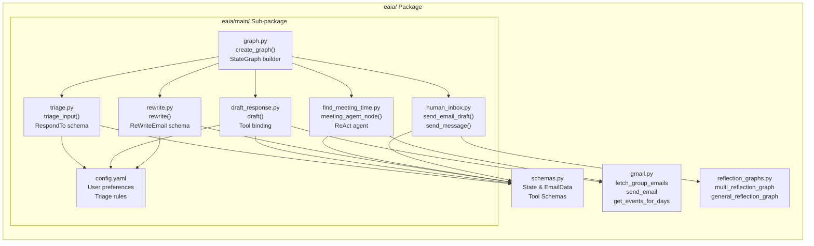
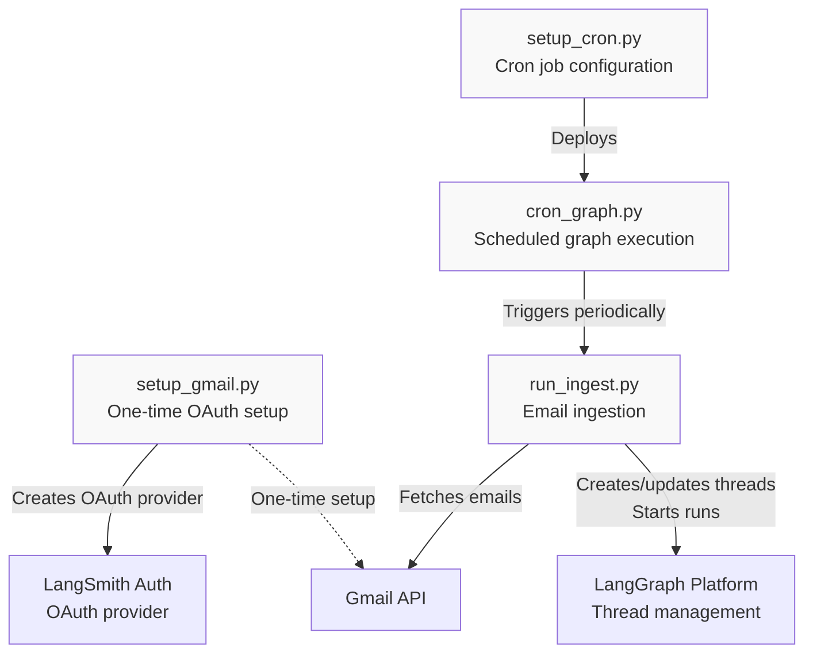

<!-- source: DeepWiki mcp.deepwiki.com · repo langchain-ai/executive-ai-assistant · page 9.1 Project Structure · fetched 2026-10-26 -->

# Project Structure

Relevant source files

The following files were used as context for generating this wiki page:

- [.gitignore](.gitignore)
- [pyproject.toml](pyproject.toml)

This page documents the directory layout and package organization of the Executive AI Assistant (EAIA) codebase. It explains the purpose of each major directory, key files, and how the code is organized into logical modules. For information about specific dependencies and how they're managed, see [Dependencies](#9.2).

## Overview

The EAIA project follows a standard Python package structure with clear separation between core application code (`eaia/`), utility scripts (`scripts/`), and tests (`tests/`). The project uses Poetry for dependency management and LangGraph for graph-based orchestration.

```mermaid
graph TB
    Root["Root Directory"]
    
    Root --> EAIA["eaia/<br/>(Core Package)"]
    Root --> Scripts["scripts/<br/>(Utility Scripts)"]
    Root --> Tests["tests/<br/>(Test Suite)"]
    Root --> Config["Configuration Files"]
    
    EAIA --> Main["eaia/main/<br/>(Processing Pipeline)"]
    EAIA --> ReflectionGraphs["eaia/reflection_graphs.py<br/>(Learning System)"]
    EAIA --> Gmail["eaia/gmail.py<br/>(Gmail/Calendar API)"]
    EAIA --> Schemas["eaia/schemas.py<br/>(Data Structures)"]
    
    Main --> Graph["graph.py<br/>(StateGraph Orchestrator)"]
    Main --> Triage["triage.py<br/>(Email Classification)"]
    Main --> Draft["draft_response.py<br/>(Response Generation)"]
    Main --> Rewrite["rewrite.py<br/>(Tone Adjustment)"]
    Main --> Meeting["find_meeting_time.py<br/>(Calendar Scheduling)"]
    Main --> HumanInbox["human_inbox.py<br/>(Human-in-the-Loop)"]
    Main --> ConfigYAML["config.yaml<br/>(User Preferences)"]
    
    Scripts --> SetupGmail["setup_gmail.py<br/>(OAuth Setup)"]
    Scripts --> RunIngest["run_ingest.py<br/>(Email Ingestion)"]
    Scripts --> SetupCron["setup_cron.py<br/>(Cron Configuration)"]
    Scripts --> CronGraph["cron_graph.py<br/>(Scheduled Processing)"]
    
    Config --> PyProject["pyproject.toml<br/>(Dependencies)"]
    Config --> LangGraph["langgraph.json<br/>(LangGraph Config)"]
    Config --> Gitignore[".gitignore<br/>(VCS Exclusions)"]
    Config --> Env[".env<br/>(Environment Variables)"]
```

**Sources:** [pyproject.toml:1-46](), [.gitignore:1-163]()

## Directory Structure Table

| Path | Type | Purpose |
|------|------|---------|
| `eaia/` | Package | Core application code, contains all processing logic |
| `eaia/main/` | Sub-package | Email processing pipeline components |
| `scripts/` | Directory | Standalone utility scripts for setup and ingestion |
| `tests/` | Directory | Test suite (pytest-based) |
| `pyproject.toml` | Config | Poetry dependency definitions and project metadata |
| `langgraph.json` | Config | LangGraph server configuration |
| `.env` | Config | Environment variables (not in version control) |
| `.secrets/` | Directory | OAuth credentials (excluded from version control) |
| `.langgraph_api/` | Directory | Local LangGraph server artifacts (excluded from version control) |
| `poetry.lock` | Lock file | Locked dependency versions for reproducibility |

**Sources:** [pyproject.toml:1-46](), [.gitignore:159-162]()

## Core Package: `eaia/`

The `eaia/` directory contains the primary application logic organized into several key modules:

### Module Organization

**Sources:** Based on high-level system architecture diagrams and file organization patterns

### Key Modules

#### `eaia/schemas.py`

Contains all Pydantic schemas and TypedDict definitions used throughout the system:

- **`State`**: The central TypedDict that flows through the StateGraph, containing `email`, `messages`, and `triage` fields
- **`EmailData`**: Pydantic model representing structured email data (sender, recipient, subject, body, timestamps, IDs)
- **`RespondTo`**: Schema for triage classification decisions (`"no"`, `"notify"`, or `"email"`)
- **`ResponseEmailDraft`**: Schema for drafted email responses
- **`NewEmailDraft`**: Schema for new outbound emails
- **`ReWriteEmail`**: Schema for tone-adjusted emails
- **`Question`**: Schema for asking user clarification questions
- **`MeetingAssistant`**: Tool schema for querying calendar availability
- **`SendCalendarInvite`**: Tool schema for scheduling meetings

**Sources:** High-level system diagrams (Diagram 4, Diagram 6), referenced across all processing components

#### `eaia/gmail.py`

Provides all Gmail and Google Calendar API integration functions:

- **`fetch_group_emails()`**: Retrieves emails from Gmail within a time window
- **`send_email()`**: Sends email messages
- **`mark_as_read()`**: Marks emails as read after processing
- **`get_events_for_days()`**: Queries calendar events for availability checking
- **`send_calendar_invite()`**: Creates calendar events with meeting details

Uses LangChain Auth for OAuth token management via LangSmith.

**Sources:** High-level system diagrams (Diagram 1, Diagram 7.1)

#### `eaia/reflection_graphs.py`

Implements the learning and feedback system:

- **`multi_reflection_graph`**: Orchestrates parallel prompt updates across multiple prompt types
- **`general_reflection_graph`**: Updates individual prompts based on user feedback
- **`determine_what_to_update()`**: Analyzes feedback to select relevant prompt types for updating

Manages four prompt types stored in BaseStore: `rewrite_instructions`, `response_preferences`, `schedule_preferences`, and `random_preferences`.

**Sources:** High-level system diagrams (Diagram 5), feedback loop architecture

### Sub-package: `eaia/main/`

The `main/` sub-package contains the core processing pipeline components:

| File | Primary Functions/Classes | Purpose |
|------|---------------------------|---------|
| `graph.py` | `create_graph()`, `route_after_triage()`, `take_action()` | StateGraph orchestration and routing logic |
| `triage.py` | `triage_input()` | Email classification into no/notify/email categories |
| `draft_response.py` | `draft()` | Response generation with tool binding (Question, ResponseEmailDraft, MeetingAssistant, SendCalendarInvite) |
| `rewrite.py` | `rewrite()` | Tone adjustment based on user preferences |
| `find_meeting_time.py` | `meeting_agent_node()`, `get_events_for_days()` | ReAct agent for calendar scheduling |
| `human_inbox.py` | `send_email_draft()`, `send_message()`, `notify()`, `send_cal_invite()` | Human-in-the-loop interaction points |
| `config.yaml` | N/A | User preferences configuration (triage rules, tone, scheduling) |

**Sources:** High-level system diagrams (Diagram 1, Diagram 2)

#### `eaia/main/graph.py`

Central orchestration module that builds the StateGraph:

- **`create_graph()`**: Constructs the complete StateGraph with all processing nodes
- **Node definitions**: Maps node names to functions (e.g., `"triage"` → `triage_input`, `"draft"` → `draft`)
- **Conditional edges**: Implements routing logic via `route_after_triage()` and `take_action()`
- **Human-in-the-loop integration**: Connects to `send_email_draft`, `send_message`, `notify`, and `send_cal_invite` nodes

**Sources:** [pyproject.toml:10]() (langgraph dependency), high-level system diagrams (Diagram 1, Diagram 2)

#### `eaia/main/config.yaml`

User-specific configuration file defining:

- **Personal information**: User name, email, timezone, bio
- **Triage rules**: Lists for `triage_no`, `triage_notify`, and `triage_email` classification
- **Tone preferences**: `rewrite_preferences` for style adjustment
- **Response preferences**: `response_preferences` for content guidelines
- **Scheduling preferences**: `schedule_preferences` for meeting defaults
- **Background info**: `random_preferences` for additional context

This file is loaded at runtime and some preferences are stored in BaseStore for dynamic updates via the reflection system.

**Sources:** High-level system diagrams (Diagram 5, Diagram 6)

## Scripts Directory: `scripts/`

The `scripts/` directory contains standalone utility scripts that are executed outside the main application flow:

### Script Purpose Mapping

**Sources:** High-level system diagrams (Diagram 1, Diagram 3)

### Key Scripts

#### `scripts/setup_gmail.py`

One-time setup script for Google OAuth authentication:

- Creates an OAuth provider in LangSmith Auth
- Configures Gmail and Google Calendar API scopes
- Stores refresh tokens for automated access
- Must be run before any email processing can occur

Usage: `python scripts/setup_gmail.py`

**Sources:** High-level system diagrams (Diagram 1, Diagram 3)

#### `scripts/run_ingest.py`

Email ingestion script that fetches emails and creates LangGraph processing runs:

- **`fetch_group_emails()`**: Retrieves recent emails from Gmail
- **Thread ID generation**: Converts Gmail thread IDs to UUIDs via MD5 hashing
- **Thread management**: Creates or updates LangGraph threads
- **Run initiation**: Starts StateGraph execution for each email thread

Command-line parameters:
- `--url`: LangGraph deployment URL (default: `http://127.0.0.1:2024`)
- `--minutes-since`: Time window for email fetching (default: 60)
- `--early`: Force early execution
- `--rerun`: Force reprocessing of existing threads

Usage: `python scripts/run_ingest.py --url ${DEPLOYMENT_URL} --minutes-since 30`

**Sources:** High-level system diagrams (Diagram 2, Diagram 3, Diagram 6)

#### `scripts/setup_cron.py`

Configures scheduled email ingestion on LangGraph Platform:

- Deploys `cron_graph.py` to LangGraph Platform
- Sets up periodic execution schedule
- Ensures continuous email monitoring in production

**Sources:** High-level system diagrams (Diagram 3)

#### `scripts/cron_graph.py`

LangGraph graph definition for scheduled ingestion:

- Defines a simple graph that triggers `run_ingest.py`
- Executed on a schedule by LangGraph Platform
- Handles periodic email checking without manual intervention

**Sources:** High-level system diagrams (Diagram 1, Diagram 3)

## Configuration Files

### `pyproject.toml`

Poetry configuration file defining project metadata and dependencies:

**Key sections:**

- **`[tool.poetry]`**: Package name (`eaia`), version, and metadata
- **`[tool.poetry.dependencies]`**: Core dependencies including:
  - `langgraph ^0.4.5` - StateGraph orchestration framework
  - `langchain ^0.3.9` - LLM abstraction layer
  - `langchain-openai ^0.2` - OpenAI integration
  - `langchain-anthropic ^0.3` - Anthropic integration
  - `google-api-python-client ^2.128.0` - Gmail/Calendar APIs
  - `langchain-auth ^0.1.2` - OAuth management
  - `langgraph-sdk ^0.2` - LangGraph client
  - `langsmith ^0.3.45` - Observability and tracing
- **`[tool.poetry.group.dev.dependencies]`**: Development tools (pytest, ipykernel, etc.)
- **`[build-system]`**: Poetry build backend configuration

**Sources:** [pyproject.toml:1-46]()

### `langgraph.json`

LangGraph server configuration (not shown in provided files, but referenced in architecture):

- Defines graph entry points
- Configures checkpointing and persistence
- Specifies environment variable requirements

**Sources:** High-level system architecture references

### `.gitignore`

Version control exclusions:

**Key exclusions:**
- **`.langgraph_api/`** (line 159): Local LangGraph server artifacts
- **`.secrets/`** (line 162): OAuth credentials and API tokens
- **`.env`** (line 123): Environment variables with sensitive data
- Standard Python artifacts: `__pycache__/`, `*.pyc`, `.pytest_cache/`, etc.

**Sources:** [.gitignore:159-162](), [.gitignore:123]()

## Tests Directory: `tests/`

Test suite structure (not shown in provided files but referenced in pyproject.toml):

**Testing framework:**
- **pytest** (`^8.2.0`) - Test runner
- **pytest-asyncio** (`^0.23.6`) - Async test support
- **pytest-watch** (`^4.2.0`) - Auto-rerun on file changes
- **vcrpy** (`^6.0.1`) - HTTP interaction recording/replay

**Configuration:**
- `asyncio_mode = "auto"` enables automatic async test detection

**Sources:** [pyproject.toml:32-38](), [pyproject.toml:44-45]()

## Package Organization Patterns

### Import Structure

The codebase follows these import patterns:

1. **Cross-module imports**: Modules in `eaia/main/` import from parent `eaia/` package:
   - `from eaia.schemas import State, EmailData, RespondTo`
   - `from eaia.gmail import send_email, mark_as_read`

2. **Script imports**: Scripts in `scripts/` import from `eaia/` package:
   - `from eaia.gmail import fetch_group_emails`
   - `from eaia.main.graph import create_graph`

3. **Relative imports**: Within `eaia/main/`, modules use relative imports:
   - `from .triage import triage_input`
   - `from .draft_response import draft`

**Sources:** Based on standard Python package organization and high-level architecture

### State Management Pattern

State flows through the system following this pattern:

1. **Initialization**: `EmailData` is created from Gmail API response in `run_ingest.py`
2. **State creation**: `EmailData` is inserted into `State` TypedDict
3. **State flow**: `State` passes through graph nodes via StateGraph edges
4. **State updates**: Nodes update `State` fields using reducers (`add_messages`) or direct assignment
5. **State persistence**: LangGraph checkpointing preserves state between interrupts

**Sources:** High-level system diagrams (Diagram 6), StateGraph architecture

### Storage Access Pattern

BaseStore access follows this pattern:

1. **Namespace**: All storage operations use user-specific namespace (typically assistant_id)
2. **Key structure**: Keys combine entity type and identifier (e.g., `("prompt", "rewrite_instructions")`)
3. **Read pattern**: Check for existing value, use default if not found
4. **Write pattern**: Update via `store.put()` with namespace and key tuple
5. **Async operations**: All BaseStore operations are async

**Sources:** High-level system diagrams (Diagram 5, Diagram 6), reflection system architecture

## Development Workflow

The typical development workflow involves these project components:

1. **Initial setup**: Run `scripts/setup_gmail.py` to configure OAuth
2. **Configuration**: Customize `eaia/main/config.yaml` with user preferences
3. **Local development**: Run `langgraph dev` to start local server
4. **Testing ingestion**: Execute `python scripts/run_ingest.py --url http://127.0.0.1:2024`
5. **Agent Inbox**: Connect to local deployment for human-in-the-loop testing
6. **Deployment**: Push to GitHub, deploy to LangGraph Platform
7. **Production cron**: Run `python scripts/setup_cron.py` to enable scheduled ingestion

**Sources:** High-level system diagrams (Diagram 3), development and deployment architecture

---

