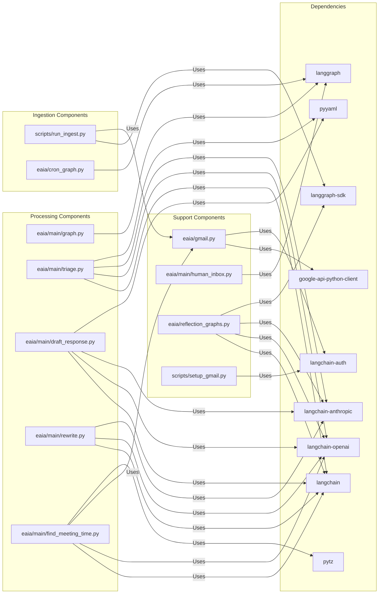

<!-- source: DeepWiki mcp.deepwiki.com · repo langchain-ai/executive-ai-assistant · page 9.2 Dependencies · fetched 2026-10-26 -->

# Dependencies

<details>
<summary>Relevant source files</summary>

The following files were used as context for generating this wiki page:

- [poetry.lock](poetry.lock)
- [pyproject.toml](pyproject.toml)

</details>


## Purpose and Scope

This document explains the complete dependency stack used by the Executive AI Assistant (EAIA), including core runtime dependencies, development dependencies, and how they are managed through Poetry. It provides a technical reference for understanding what external packages EAIA relies on and their specific roles in the system architecture.

For information about environment variables and API keys required to configure these dependencies, see [Environment Variables](#5.2). For detailed integration patterns with external services, see [External Integrations](#7).

## Dependency Management

EAIA uses **Poetry** as its dependency management tool, with all dependencies declared in [`pyproject.toml:8-24`](). Poetry provides:

- **Deterministic builds**: The `poetry.lock` file (not shown but generated by Poetry) ensures consistent dependency versions across all installations
- **Dependency resolution**: Automatically resolves version conflicts and transitive dependencies
- **Virtual environment management**: Isolates project dependencies from system Python packages
- **Build system**: Provides packaging and distribution capabilities through `[build-system]` configuration at [`pyproject.toml:40-42`]()

To install dependencies, run:
```bash
poetry install
```

To add a new dependency:
```bash
poetry add <package-name>
```

To add a development-only dependency:
```bash
poetry add --group dev <package-name>
```

**Sources:** [`pyproject.toml:1-46`]()

---

## Core Runtime Dependencies

### LangGraph Ecosystem

The LangGraph ecosystem forms the architectural backbone of EAIA's orchestration and deployment infrastructure:

| Package | Version | Purpose |
|---------|---------|---------|
| `langgraph` | ^0.4.5 | Core StateGraph orchestration engine for workflow management |
| `langgraph-checkpoint` | ^2.0.0 | Persistence layer for state checkpoints and resumable workflows |
| `langgraph-sdk` | ^0.2 | Client SDK for interacting with LangGraph Platform (used in `run_ingest.py` and `reflection_graphs.py`) |
| `langgraph-cli` | ^0.3.6 | Command-line interface for local development (`langgraph dev`) and deployment |
| `langgraph-api` | ^0.2.134 | API server implementation for LangGraph Platform deployment |

The `langgraph-cli` package includes the `[inmem]` extra at [`pyproject.toml:23`](), which provides an in-memory checkpoint implementation for local development without requiring external storage.

These packages enable:
- **State machine orchestration**: The `StateGraph` from `langgraph` powers the main processing pipeline in `eaia/main/graph.py`
- **Thread management**: Thread creation and run invocation through `langgraph-sdk` in `scripts/run_ingest.py`
- **Human-in-the-loop**: The interrupt/resume mechanism used by `eaia/main/human_inbox.py`
- **Asynchronous learning**: Background reflection invocation via `langgraph-sdk` in `eaia/reflection_graphs.py`

**Sources:** [`pyproject.toml:10-11,17,23-24`]()

### LangChain Framework

LangChain provides the AI/LLM integration layer and abstractions for working with language models:

| Package | Version | Purpose |
|---------|---------|---------|
| `langchain` | ^0.3.9 | Core abstractions including message types, tool binding, and structured output |
| `langchain-openai` | ^0.2 | OpenAI integration providing `ChatOpenAI` class |
| `langchain-anthropic` | ^0.3 | Anthropic integration providing `ChatAnthropic` class |
| `langchain-auth` | ^0.1.2 | OAuth provider abstraction used by `setup_gmail.py` for Google authentication |
| `langsmith` | ^0.3.45 | Observability and tracing for LLM calls and workflows |

These packages are used throughout the processing pipeline:
- **`langchain`**: Base abstractions used in all processing nodes (`triage.py`, `draft_response.py`, `rewrite.py`, `find_meeting_time.py`)
- **`langchain-openai`** and **`langchain-anthropic`**: Provide LLM access with unified interfaces
- **`langchain-auth`**: Enables OAuth setup via `scripts/setup_gmail.py` for Gmail/Calendar access
- **`langsmith`**: Automatic tracing of all LLM calls for monitoring and debugging

**Sources:** [`pyproject.toml:12-14,16,18`]()

### Google Services

| Package | Version | Purpose |
|---------|---------|---------|
| `google-api-python-client` | ^2.128.0 | Official Google API client for Gmail and Calendar operations |

This package provides the low-level Google API access used by `eaia/gmail.py` for:
- Email fetching via Gmail API (`fetch_group_emails`)
- Email sending (`send_email`)
- Calendar event queries (`get_events_for_days`)
- Calendar invitation creation (`send_calendar_invite`)
- Email status management (`mark_as_read`)

Authentication for these APIs is handled via OAuth tokens stored through LangSmith Auth (see `langchain-auth` above).

**Sources:** [`pyproject.toml:15`]()

### Utility Libraries

| Package | Version | Purpose |
|---------|---------|---------|
| `pytz` | * | Timezone handling for calendar operations and timestamp conversions |
| `pyyaml` | * | YAML parsing for `config.yaml` configuration file |
| `python-dateutil` | ^2.9.0.post0 | Date/time parsing and manipulation utilities |
| `python-dotenv` | ^1.0.1 | Environment variable loading from `.env` files |

These utilities support core functionality:
- **`pytz`**: Used in `find_meeting_time.py` for timezone-aware calendar operations
- **`pyyaml`**: Loads user preferences from `eaia/main/config.yaml`
- **`python-dateutil`**: Parses email timestamps and date strings
- **`python-dotenv`**: Enables loading API keys from `.env` files during development

**Sources:** [`pyproject.toml:19-22`]()

---

## Development Dependencies

Development dependencies are specified in the `[tool.poetry.group.dev.dependencies]` section and are only installed in development environments:

| Package | Version | Purpose |
|---------|---------|---------|
| `ipykernel` | ^6.29.4 | Jupyter kernel for interactive development and notebook testing |
| `pytest` | ^8.2.0 | Testing framework for unit and integration tests |
| `pytest-asyncio` | ^0.23.6 | Async test support for testing LangGraph workflows |
| `pytest-watch` | ^4.2.0 | Continuous test execution during development |
| `vcrpy` | ^6.0.1 | HTTP interaction recording/playback for mocking external API calls in tests |
| `langgraph-cli` | ^0.3.6 | Duplicated from main dependencies for development convenience |

The test configuration at [`pyproject.toml:44-45`]() sets `asyncio_mode = "auto"` to enable automatic async test detection by pytest-asyncio.

**Sources:** [`pyproject.toml:32-38,44-45`]()

---

## Dependency Architecture

### Diagram: Dependency Layer Architecture

```mermaid
graph TB
    subgraph "Application Layer"
        EAIA["EAIA Application Code<br/>(eaia/, scripts/)"]
    end
    
    subgraph "Orchestration Layer"
        LangGraph["langgraph ^0.4.5<br/>StateGraph, nodes, routing"]
        LGCheckpoint["langgraph-checkpoint ^2.0.0<br/>State persistence"]
        LGSDK["langgraph-sdk ^0.2<br/>Thread/run management"]
    end
    
    subgraph "AI Framework Layer"
        LangChain["langchain ^0.3.9<br/>Message types, tools, structured output"]
        LCOpenAI["langchain-openai ^0.2<br/>ChatOpenAI"]
        LCAnthropic["langchain-anthropic ^0.3<br/>ChatAnthropic"]
        LCAuth["langchain-auth ^0.1.2<br/>OAuth providers"]
        LangSmith["langsmith ^0.3.45<br/>Tracing & monitoring"]
    end
    
    subgraph "External Service Clients"
        GoogleAPI["google-api-python-client ^2.128.0<br/>Gmail & Calendar APIs"]
    end
    
    subgraph "Utility Layer"
        PyTZ["pytz<br/>Timezone handling"]
        PyYAML["pyyaml<br/>Config parsing"]
        DateUtil["python-dateutil ^2.9.0<br/>Date parsing"]
        DotEnv["python-dotenv ^1.0.1<br/>Environment loading"]
    end
    
    subgraph "Deployment & CLI"
        LGCLI["langgraph-cli ^0.3.6<br/>Development server & deployment"]
        LGAPI["langgraph-api ^0.2.134<br/>Production API server"]
    end
    
    subgraph "Development Tools"
        Pytest["pytest ^8.2.0"]
        PytestAsync["pytest-asyncio ^0.23.6"]
        PytestWatch["pytest-watch ^4.2.0"]
        VCRpy["vcrpy ^6.0.1"]
        IPyKernel["ipykernel ^6.29.4"]
    end
    
    EAIA -->|"Uses"| LangGraph
    EAIA -->|"Uses"| LangChain
    EAIA -->|"Uses"| GoogleAPI
    EAIA -->|"Uses"| PyTZ
    EAIA -->|"Uses"| PyYAML
    EAIA -->|"Uses"| DateUtil
    EAIA -->|"Uses"| DotEnv
    
    LangGraph -->|"Depends on"| LGCheckpoint
    LangGraph -->|"Works with"| LangChain
    
    EAIA -->|"Client for"| LGSDK
    LGSDK -->|"Communicates with"| LGAPI
    
    LangChain -->|"Extended by"| LCOpenAI
    LangChain -->|"Extended by"| LCAnthropic
    LangChain -->|"Extended by"| LCAuth
    LangChain -->|"Traced by"| LangSmith
    
    EAIA -->|"Deployed via"| LGCLI
    LGCLI -->|"Starts"| LGAPI
    
    EAIA -->|"Tested with"| Pytest
    Pytest -->|"Extended by"| PytestAsync
    Pytest -->|"Extended by"| PytestWatch
    Pytest -->|"Uses"| VCRpy
    EAIA -->|"Debugged with"| IPyKernel
```



This diagram shows the layered dependency architecture:

- **Application Layer**: EAIA code sits at the top, consuming all lower layers
- **Orchestration Layer**: LangGraph ecosystem manages workflow state and execution
- **AI Framework Layer**: LangChain ecosystem provides LLM abstractions and integrations
- **External Service Clients**: Google API client enables email and calendar operations
- **Utility Layer**: Supporting libraries for common tasks
- **Deployment & CLI**: Tools for development and production deployment
- **Development Tools**: Testing and debugging infrastructure

**Sources:** [`pyproject.toml:8-38`]()

---

## Dependency-to-Component Mapping

### Diagram: Component Dependency Matrix



This diagram maps each major component to its primary dependencies:

| Component | Primary Dependencies | Purpose |
|-----------|---------------------|---------|
| `scripts/run_ingest.py` | `langgraph-sdk`, `eaia/gmail.py` | Thread creation and email ingestion |
| `eaia/cron_graph.py` | `langgraph` | Scheduled ingestion orchestration |
| `eaia/main/graph.py` | `langgraph` | Main StateGraph definition |
| `eaia/main/triage.py` | `langchain`, `langchain-openai`, `langchain-anthropic`, `pyyaml` | Email classification with LLMs |
| `eaia/main/draft_response.py` | `langchain`, `langchain-openai`, `langchain-anthropic`, `pyyaml` | Response generation with tool binding |
| `eaia/main/rewrite.py` | `langchain`, `langchain-openai`, `langchain-anthropic` | Tone adjustment |
| `eaia/main/find_meeting_time.py` | `langchain`, `langchain-openai`, `eaia/gmail.py`, `pytz` | ReAct agent for scheduling |
| `eaia/gmail.py` | `google-api-python-client`, `langchain-auth` | Gmail/Calendar API wrapper |
| `eaia/main/human_inbox.py` | `langgraph` | Human-in-the-loop interaction |
| `eaia/reflection_graphs.py` | `langchain`, `langchain-openai`, `langchain-anthropic`, `langgraph-sdk` | Prompt learning system |
| `scripts/setup_gmail.py` | `langchain-auth` | OAuth setup |

**Sources:** [`pyproject.toml:8-24`]()

---

## Version Constraints and Compatibility

All version constraints use **caret (`^`)** notation, which allows compatible updates according to semantic versioning:

- `^0.4.5` allows `>=0.4.5, <1.0.0`
- `^0.2` allows `>=0.2.0, <1.0.0`
- `^3.12` (for Python) allows `>=3.12.0, <4.0.0`

Notable version constraints:

| Dependency | Constraint | Rationale |
|------------|------------|-----------|
| Python | ^3.12 | Requires Python 3.12+ for modern async features and type hints |
| langgraph | ^0.4.5 | Pins to 0.4.x series for StateGraph API stability |
| langgraph-checkpoint | ^2.0.0 | Major version 2.x for checkpoint interface |
| langchain | ^0.3.9 | Latest 0.3.x series for structured output support |

The `pytz` and `pyyaml` packages use wildcard `*` version constraints at [`pyproject.toml:19-20`](), indicating no specific version requirements and allowing Poetry to select any compatible version.

**Sources:** [`pyproject.toml:9-24`]()

---

## Adding or Updating Dependencies

### Adding a New Runtime Dependency

To add a new runtime dependency, edit [`pyproject.toml:8-24`]() and run:

```bash
poetry add <package-name>
```

This will:
1. Update `pyproject.toml` with the new dependency
2. Resolve version conflicts with existing dependencies
3. Update `poetry.lock` with the exact version and all transitive dependencies
4. Install the package in the Poetry virtual environment

### Adding a Development Dependency

To add a development-only dependency:

```bash
poetry add --group dev <package-name>
```

This adds the package to the `[tool.poetry.group.dev.dependencies]` section at [`pyproject.toml:32-38`]().

### Updating Dependencies

To update all dependencies to their latest compatible versions:

```bash
poetry update
```

To update a specific dependency:

```bash
poetry update <package-name>
```

### Dependency Security and Maintenance

Consider these factors when managing dependencies:

1. **LangGraph Ecosystem**: These packages are tightly coupled and should be updated together to avoid compatibility issues
2. **LangChain Providers**: The `langchain-openai` and `langchain-anthropic` packages should track the `langchain` core version
3. **Google APIs**: The `google-api-python-client` should be updated regularly for security patches and new API features
4. **Security Updates**: Run `poetry update` regularly to receive security patches for transitive dependencies

**Sources:** [`pyproject.toml:1-46`]()

---

## Package-to-Function Mapping

### Diagram: Detailed Function-Level Dependencies

```mermaid
graph TB
    subgraph "langgraph-sdk Usage"
        GetClient["get_client()<br/>run_ingest.py"]
        CreateThread["client.threads.create()<br/>run_ingest.py"]
        CreateRun["client.runs.create()<br/>run_ingest.py"]
        WaitRun["client.runs.wait()<br/>run_ingest.py"]
        StreamRun["client.runs.stream()<br/>reflection_graphs.py"]
    end
    
    subgraph "langgraph Usage"
        StateGraph_["StateGraph<br/>graph.py, cron_graph.py"]
        AddNode["add_node()<br/>graph.py"]
        AddEdge["add_edge()<br/>graph.py"]
        AddConditional["add_conditional_edges()<br/>graph.py"]
        Interrupt["interrupt()<br/>human_inbox.py"]
        Command_["Command()<br/>human_inbox.py"]
    end
    
    subgraph "langchain Usage"
        ChatModel["ChatOpenAI/ChatAnthropic<br/>All processing nodes"]
        WithStructured["with_structured_output()<br/>triage.py, draft_response.py, rewrite.py"]
        BindTools["bind_tools()<br/>draft_response.py"]
        CreateReact["create_react_agent()<br/>find_meeting_time.py"]
        BaseChatModel["BaseChatMessageHistory<br/>BaseStore usage"]
    end
    
    subgraph "google-api-python-client Usage"
        BuildService["build('gmail', 'v1')<br/>gmail.py"]
        BuildCalendar["build('calendar', 'v3')<br/>gmail.py"]
        MessagesList["users().messages().list()<br/>gmail.py"]
        MessagesSend["users().messages().send()<br/>gmail.py"]
        EventsList["events().list()<br/>gmail.py"]
        EventsInsert["events().insert()<br/>gmail.py"]
    end
    
    subgraph "langchain-auth Usage"
        GetOAuth["get_oauth_providers()<br/>setup_gmail.py"]
        CreateOAuth["create_oauth_provider()<br/>setup_gmail.py"]
        OAuthClient["OAuthClient()<br/>gmail.py"]
        GetCredentials["client.get_credentials()<br/>gmail.py"]
    end
    
    subgraph "Utility Usage"
        LoadYAML["yaml.safe_load()<br/>triage.py, draft_response.py"]
        Timezone["pytz.timezone()<br/>find_meeting_time.py"]
        ParseDate["dateutil.parser.parse()<br/>gmail.py"]
        LoadDotenv["load_dotenv()<br/>Multiple files"]
    end
    
    LGSDK["langgraph-sdk ^0.2"] -.->|"Provides"| GetClient
    LGSDK -.->|"Provides"| CreateThread
    LGSDK -.->|"Provides"| CreateRun
    LGSDK -.->|"Provides"| WaitRun
    LGSDK -.->|"Provides"| StreamRun
    
    LG["langgraph ^0.4.5"] -.->|"Provides"| StateGraph_
    LG -.->|"Provides"| AddNode
    LG -.->|"Provides"| AddEdge
    LG -.->|"Provides"| AddConditional
    LG -.->|"Provides"| Interrupt
    LG -.->|"Provides"| Command_
    
    LC["langchain ^0.3.9<br/>langchain-openai ^0.2<br/>langchain-anthropic ^0.3"] -.->|"Provides"| ChatModel
    LC -.->|"Provides"| WithStructured
    LC -.->|"Provides"| BindTools
    LC -.->|"Provides"| CreateReact
    LC -.->|"Provides"| BaseChatModel
    
    GoogleAPI["google-api-python-client ^2.128.0"] -.->|"Provides"| BuildService
    GoogleAPI -.->|"Provides"| BuildCalendar
    GoogleAPI -.->|"Provides"| MessagesList
    GoogleAPI -.->|"Provides"| MessagesSend
    GoogleAPI -.->|"Provides"| EventsList
    GoogleAPI -.->|"Provides"| EventsInsert
    
    LCAuth["langchain-auth ^0.1.2"] -.->|"Provides"| GetOAuth
    LCAuth -.->|"Provides"| CreateOAuth
    LCAuth -.->|"Provides"| OAuthClient
    LCAuth -.->|"Provides"| GetCredentials
    
    Utilities["pytz, pyyaml, python-dateutil, python-dotenv"] -.->|"Provides"| LoadYAML
    Utilities -.->|"Provides"| Timezone
    Utilities -.->|"Provides"| ParseDate
    Utilities -.->|"Provides"| LoadDotenv
```



This diagram maps specific functions and classes from dependencies to their usage locations in the EAIA codebase, bridging the gap between "package names" (Natural Language Space) and "actual code constructs" (Code Entity Space).

**Sources:** [`pyproject.toml:8-24`]()

---

## Summary

The EAIA dependency stack is organized into functional layers:

1. **Orchestration**: LangGraph ecosystem provides the workflow engine
2. **AI Framework**: LangChain ecosystem provides LLM abstractions and integrations
3. **External Services**: Google API client enables email and calendar operations
4. **Utilities**: Supporting libraries for configuration, timezone handling, and date parsing
5. **Development**: Testing and debugging tools for development workflow

All dependencies are managed through Poetry, with deterministic builds via `poetry.lock` and semantic versioning constraints in `pyproject.toml`. The architecture maintains clear separation between production runtime dependencies and development-only tools.

For configuring API keys and credentials for these dependencies, see [Environment Variables](#5.2). For detailed integration patterns and usage examples, see the relevant component documentation in sections [2](#2) through [4](#4).

**Sources:** [`pyproject.toml:1-46`]()