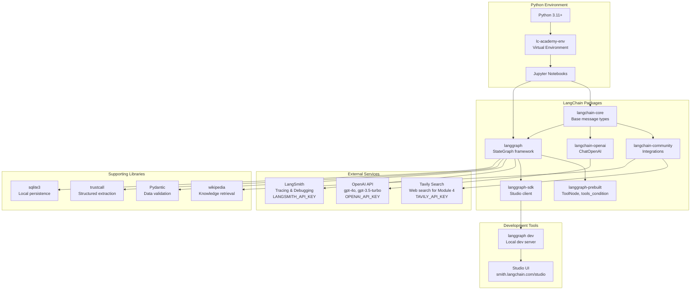
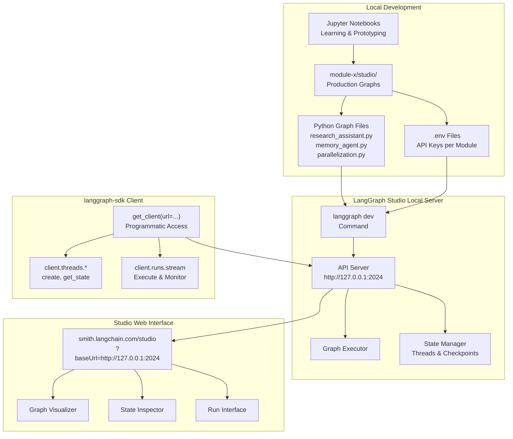

<!-- source: DeepWiki mcp.deepwiki.com · repo langchain-ai/langchain-academy · page 1 Introduction to LangChain Academy · fetched 2026-10-26 -->

# Introduction to LangChain Academy

<details>
<summary>Relevant source files</summary>

The following files were used as context for generating this wiki page:

- [README.md](README.md)

</details>


LangChain Academy is a comprehensive educational resource designed to teach developers the foundational concepts of the LangChain ecosystem, with a particular focus on LangGraph - a framework for building language model applications using a graph-based approach. This repository provides structured, hands-on learning materials that progressively build knowledge from basic concepts to advanced techniques.

For detailed setup instructions and environment configuration, see [Getting Started](#2).

## Purpose and Scope

LangChain Academy aims to provide a structured learning path for developers interested in building sophisticated AI applications using the LangGraph framework. The curriculum is organized into progressive modules that cover fundamental concepts, state management, human-in-the-loop interactions, multi-agent systems, memory handling, and deployment techniques.

The materials are designed to be hands-on, allowing learners to experiment with working examples while understanding the underlying principles of graph-based language model applications.

Sources: [README.md:3-10]()

## Repository Structure

LangChain Academy is organized into modules that build upon each other, progressively introducing more advanced concepts:

**Repository Structure by Module**

```mermaid
flowchart TD
    root["langchain-academy/"]
    readme["README.md"]
    reqs["requirements.txt"]
    
    m0["module-0/\nbasics.ipynb"]
    
    m1["module-1/"]
    m1_agent["agent.ipynb"]
    m1_mem["agent-memory.ipynb"]
    m1_chain["chain.ipynb"]
    m1_graph["simple-graph.ipynb"]
    m1_router["router.ipynb"]
    
    m2["module-2/"]
    m2_schema["multiple-schemas.ipynb"]
    m2_reducer["state-reducers.ipynb"]
    m2_chatbot["chatbot-summarization.ipynb"]
    m2_external["chatbot-external-memory.ipynb"]
    m2_trim["trim-filter-messages.ipynb"]
    
    m3["module-3/"]
    m3_stream["streaming-interruption.ipynb"]
    m3_time["time-travel.ipynb"]
    m3_break["breakpoints.ipynb"]
    m3_edit["edit-state-human-feedback.ipynb"]
    
    m4["module-4/"]
    m4_map["map-reduce.ipynb"]
    m4_sub["sub-graph.ipynb"]
    m4_par["parallelization.ipynb"]
    m4_res["research-assistant.ipynb"]
    m4_studio["studio/"]
    
    m5["module-5/"]
    m5_mem["memory_agent.ipynb"]
    m5_studio["studio/"]
    
    root --> readme
    root --> reqs
    root --> m0
    root --> m1
    root --> m2
    root --> m3
    root --> m4
    root --> m5
    
    m1 --> m1_agent
    m1 --> m1_mem
    m1 --> m1_chain
    m1 --> m1_graph
    m1 --> m1_router
    
    m2 --> m2_schema
    m2 --> m2_reducer
    m2 --> m2_chatbot
    m2 --> m2_external
    m2 --> m2_trim
    
    m3 --> m3_stream
    m3 --> m3_time
    m3 --> m3_break
    m3 --> m3_edit
    
    m4 --> m4_map
    m4 --> m4_sub
    m4 --> m4_par
    m4 --> m4_res
    m4 --> m4_studio
    
    m5 --> m5_mem
    m5 --> m5_studio
```



Each module contains:

1. **Jupyter Notebooks (.ipynb)**: Executable code examples demonstrating specific concepts
2. **Studio Directory**: Modules 4-5 include `studio/` subdirectories containing production-ready graph implementations for deployment with LangGraph Studio

Sources: [README.md:5-10]()

Sources: [README.md:5-10]()

## Learning Path and Module Progression

LangChain Academy follows a carefully designed learning path that builds competency in LangGraph development:

**Learning Progression and Key Technologies**

```mermaid
graph TD
    subgraph Module_0["Module 0: Foundations"]
        M0_setup["Environment Setup"]
        M0_llm["ChatOpenAI Invocation"]
        M0_tools["TavilySearchResults Tool"]
    end
    
    subgraph Module_1["Module 1: Agent Basics"]
        M1_sg["StateGraph Construction"]
        M1_react["ReAct Pattern\nassistant node + tools node"]
        M1_mem["MemorySaver with thread_id"]
        M1_router["tools_condition Routing"]
    end
    
    subgraph Module_2["Module 2: State Management"]
        M2_schema["TypedDict vs Pydantic Schemas"]
        M2_reducer["add_messages Reducer\noperator.add"]
        M2_sqlite["SqliteSaver Persistence"]
        M2_trim["Message Trimming & Filtering"]
    end
    
    subgraph Module_3["Module 3: Production Features"]
        M3_stream["Streaming Modes\nvalues/updates/events"]
        M3_time["get_state_history\nTime Travel"]
        M3_break["interrupt_before Breakpoints"]
        M3_edit["update_state Editing"]
    end
    
    subgraph Module_4["Module 4: Advanced Patterns"]
        M4_map["Send API\nMap-Reduce Pattern"]
        M4_sub["Sub-Graphs with StateGraph"]
        M4_par["Parallel Execution"]
        M4_res["Multi-Agent Research Assistant"]
    end
    
    subgraph Module_5["Module 5: Memory Systems"]
        M5_store["InMemoryStore\nCross-Thread Persistence"]
        M5_trust["Trustcall Extraction"]
        M5_agent["task_mAIstro Agent\nUpdateMemory Tool"]
    end
    
    M0_setup --> M0_llm
    M0_llm --> M0_tools
    M0_tools --> M1_sg
    
    M1_sg --> M1_react
    M1_react --> M1_mem
    M1_mem --> M1_router
    M1_router --> M2_schema
    
    M2_schema --> M2_reducer
    M2_reducer --> M2_sqlite
    M2_sqlite --> M2_trim
    M2_trim --> M3_stream
    
    M3_stream --> M3_time
    M3_time --> M3_break
    M3_break --> M3_edit
    M3_edit --> M4_map
    
    M4_map --> M4_sub
    M4_sub --> M4_par
    M4_par --> M4_res
    M4_res --> M5_store
    
    M5_store --> M5_trust
    M5_trust --> M5_agent
```



The modules follow a progression from basic to advanced concepts:

| Module | Focus | Key Notebooks | Core Classes/Functions |
|--------|-------|---------------|------------------------|
| **Module 0** | Environment setup and basic LLM usage | `basics.ipynb` | `ChatOpenAI`, `TavilySearchResults` |
| **Module 1** | LangGraph fundamentals and ReAct agents | `agent.ipynb`, `agent-memory.ipynb`, `simple-graph.ipynb`, `router.ipynb`, `chain.ipynb` | `StateGraph`, `MessagesState`, `MemorySaver`, `ToolNode` |
| **Module 2** | State schemas, reducers, and persistence | `multiple-schemas.ipynb`, `state-reducers.ipynb`, `chatbot-external-memory.ipynb`, `trim-filter-messages.ipynb` | `TypedDict`, `add_messages`, `SqliteSaver`, `operator.add` |
| **Module 3** | Streaming, debugging, and human-in-the-loop | `streaming-interruption.ipynb`, `time-travel.ipynb`, `breakpoints.ipynb`, `edit-state-human-feedback.ipynb` | `interrupt_before`, `get_state_history`, `update_state` |
| **Module 4** | Parallel processing and multi-agent systems | `map-reduce.ipynb`, `sub-graph.ipynb`, `parallelization.ipynb`, `research-assistant.ipynb` | `Send` API, sub-graphs, `create_analysts`, `initiate_all_interviews` |
| **Module 5** | Long-term memory and structured extraction | `memory_agent.ipynb` | `InMemoryStore`, `Trustcall`, `UpdateMemory` tool |

Sources: [README.md:5-10]()

Sources: [README.md:5-10]()

## Core Technology Overview

LangChain Academy focuses on teaching LangGraph, which is part of the broader LangChain ecosystem.

**Core Technology Stack**



**LangGraph Core Components**

The curriculum progressively introduces these core LangGraph classes and patterns:

| Component | Purpose | Introduced In |
|-----------|---------|---------------|
| `StateGraph` | Main graph orchestrator that defines workflow structure | Module 1: `simple-graph.ipynb` |
| `MessagesState` | Built-in state schema for conversation tracking | Module 1: `agent.ipynb` |
| `ToolNode` | Pre-built node for tool execution | Module 1: `agent.ipynb` |
| `MemorySaver` | In-memory checkpointer for within-session persistence | Module 1: `agent-memory.ipynb` |
| `SqliteSaver` | Persistent checkpointer using SQLite database | Module 2: `chatbot-external-memory.ipynb` |
| `InMemoryStore` | Cross-thread storage for long-term memory | Module 5: `memory_agent.ipynb` |
| `add_messages` | Reducer for appending/updating messages in state | Module 2: `state-reducers.ipynb` |
| `Send` API | Dynamic fan-out for parallel execution | Module 4: `map-reduce.ipynb` |
| `Trustcall` | Structured extraction and validation | Module 5: `memory_agent.ipynb` |

**Application Patterns**

The curriculum emphasizes practical applications:

- **ReAct Agents**: Tool-augmented agents with reasoning-action-observation loops (`agent.ipynb`)
- **Conditional Routing**: Dynamic flow control using `tools_condition` (`router.ipynb`)
- **Map-Reduce**: Parallel task execution with result aggregation (`map-reduce.ipynb`)
- **Sub-Graphs**: Modular, composable workflows (`sub-graph.ipynb`)
- **Multi-Agent Systems**: Coordinated agent interactions (`research-assistant.ipynb`)
- **Human-in-the-Loop**: Breakpoints and state editing (`breakpoints.ipynb`, `edit-state-human-feedback.ipynb`)
- **Memory Systems**: Multi-schema long-term memory (`memory_agent.ipynb`)

Sources: [README.md:5-10]()

Sources: [README.md:5-10]()

## Development Environment

LangChain Academy requires specific environment configurations to run the examples effectively:

**Environment Requirements**

| Component | Requirement | Configuration | Used In |
|-----------|-------------|---------------|---------|
| Python    | 3.11+       | System installation | All modules |
| Virtual Environment | `lc-academy-env` | Created with `python3 -m venv` | All modules |
| OpenAI API| API Key     | `OPENAI_API_KEY` environment variable | All modules |
| LangSmith | API Key     | `LANGSMITH_API_KEY`, `LANGSMITH_TRACING_V2=true` | All modules (optional but recommended) |
| Tavily API| API Key     | `TAVILY_API_KEY` environment variable | Module 4: `research-assistant.ipynb` |
| LangGraph Studio | Local Dev Server | `langgraph dev` in `studio/` directories | Modules 4-5 |
| Dependencies | Python packages | `pip install -r requirements.txt` | All modules |

**Key Dependencies from requirements.txt**

The academy uses these core packages:

- `langgraph` - Main state graph framework
- `langchain-core` - Base abstractions and message types
- `langchain-openai` - OpenAI integration (`ChatOpenAI` class)
- `langchain-community` - Community integrations (Tavily, Wikipedia)
- `langgraph-prebuilt` - Pre-built components (`ToolNode`, `tools_condition`)
- `langgraph-sdk` - SDK for interacting with LangGraph Studio
- `pydantic` - Data validation for state schemas
- `trustcall` - Structured extraction (Module 5)

For detailed setup instructions, see [Getting Started](#2).

Sources: [README.md:12-109]()

Sources: [README.md:12-109]()

## Using LangGraph Studio

LangGraph Studio is used in advanced modules (4-5) for visualizing and testing production-ready graph implementations:

**LangGraph Studio Architecture**



**Studio Directory Structure**

Modules 4 and 5 include production-ready implementations in their `studio/` directories:

- **Module 4 Studio**: 
  - `research_assistant.py` - Multi-agent research system
  - `parallelization.py` - Parallel Wikipedia processing
  - `.env.example` - Template for API keys

- **Module 5 Studio**:
  - `memory_agent.py` - task_mAIstro agent with long-term memory
  - `.env.example` - Template for API keys

To use Studio, navigate to the `studio/` directory and run:
```bash
langgraph dev
```

This starts a local server at `http://127.0.0.1:2024` and provides a UI link for visualization at `https://smith.langchain.com/studio/?baseUrl=http://127.0.0.1:2024`.

Sources: [README.md:80-109]()

Sources: [README.md:80-109]()

## Getting Started

To begin your journey with LangChain Academy:

1. Ensure you have Python 3.11 or later installed
2. Clone the repository from GitHub
3. Set up the required environment variables (OpenAI API key, LangSmith API key)
4. Install dependencies using the provided requirements file
5. Follow the module progression starting with Module 0

For complete setup instructions and environment configuration details, see [Getting Started](#2).

Sources: [README.md:12-79]()

---

