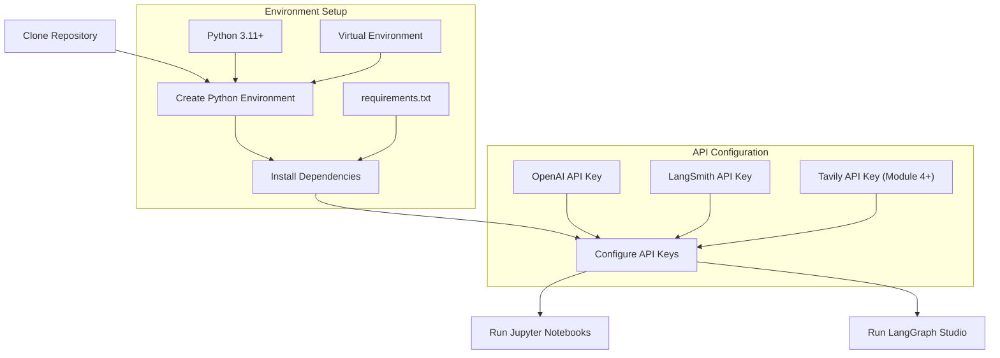
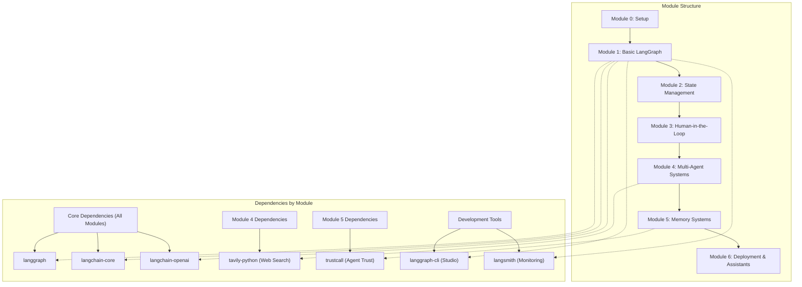
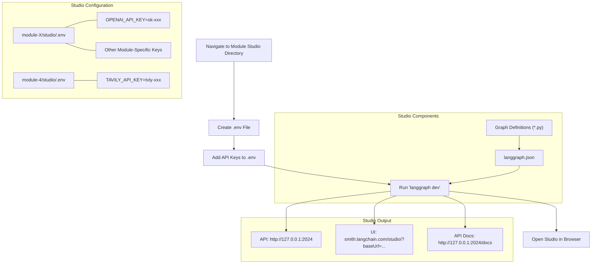

<!-- source: DeepWiki mcp.deepwiki.com · repo langchain-ai/langchain-academy · page 2 Getting Started · fetched 2026-10-26 -->

# Getting Started

<details>
<summary>Relevant source files</summary>

The following files were used as context for generating this wiki page:

- [README.md](README.md)
- [module-0/basics.ipynb](module-0/basics.ipynb)
- [module-4/studio/parallelization.py](module-4/studio/parallelization.py)
- [module-4/studio/research_assistant.py](module-4/studio/research_assistant.py)
- [requirements.txt](requirements.txt)

</details>


This guide walks you through setting up your environment to run the LangChain Academy examples and explore the LangGraph framework. You'll learn how to configure your development environment, set up necessary API keys, and run both the example notebooks and LangGraph Studio.

For an introduction to LangChain Academy and its purpose, see [Introduction to LangChain Academy](#1).

## System Requirements

### Python Version

LangChain Academy requires **Python 3.11 or later** for optimal compatibility with LangGraph. You can check your Python version with:

```bash
python3 --version
```

### Dependencies

The repository relies on several key packages:

| Package | Purpose |
|---------|---------|
| langgraph | Core library for graph-based LLM applications |
| langgraph-prebuilt | Prebuilt components for LangGraph |
| langgraph-sdk | SDK for working with LangGraph |
| langgraph-checkpoint-sqlite | SQLite-based checkpoint system |
| langsmith | Debugging, testing and monitoring LLM applications |
| langchain-community | Community components for LangChain |
| langchain-core | Core LangChain functionality |
| langchain-openai | OpenAI integrations for LangChain |
| tavily-python | Python client for Tavily search API |
| trustcall | Framework for building trustworthy agents |
| langgraph-cli | Command-line interface for LangGraph |

Sources:
- [requirements.txt:1-13]()

## Setup Process

### LangChain Academy Setup Workflow



Sources:
- [README.md:12-69]()

### Cloning the Repository

First, clone the LangChain Academy repository:

```bash
git clone https://github.com/langchain-ai/langchain-academy.git
cd langchain-academy
```

Sources:
- [README.md:23-27]()

### Creating a Virtual Environment

Create a Python virtual environment to isolate the dependencies:

#### Mac/Linux/WSL
```bash
python3 -m venv lc-academy-env
source lc-academy-env/bin/activate
```

#### Windows PowerShell
```bash
python3 -m venv lc-academy-env
Set-ExecutionPolicy -ExecutionPolicy RemoteSigned -Scope Process
lc-academy-env\scripts\activate
```

Sources:
- [README.md:29-42]()

### Installing Dependencies

Install all required packages:

```bash
pip install -r requirements.txt
```

Sources:
- [README.md:34-35]()
- [README.md:41-42]()

## API Keys Configuration

The examples in LangChain Academy require several API keys to function properly. You can set these as environment variables or use a `.env` file with the `python-dotenv` library.

### OpenAI API Key

Required for accessing OpenAI models:

```bash
# Mac/Linux/WSL
export OPENAI_API_KEY="your-openai-api-key"

# Windows PowerShell
$env:OPENAI_API_KEY = "your-openai-api-key"
```

If you don't have an OpenAI API key, you can sign up at OpenAI's website.

Sources:
- [README.md:62-64]()

### LangSmith API Key

LangSmith is used for debugging, testing, and monitoring:

```bash
# Mac/Linux/WSL
export LANGCHAIN_API_KEY="your-langchain-api-key"
export LANGCHAIN_TRACING_V2=true

# Windows PowerShell
$env:LANGCHAIN_API_KEY = "your-langchain-api-key"
$env:LANGCHAIN_TRACING_V2 = "true"
```

Sign up for LangSmith at smith.langchain.com.

Sources:
- [README.md:66-69]()

### Tavily API Key (for Web Search)

Required for modules that use web search capabilities (primarily Module 4):

```bash
# Mac/Linux/WSL
export TAVILY_API_KEY="your-tavily-api-key"

# Windows PowerShell
$env:TAVILY_API_KEY = "your-tavily-api-key"
```

Sign up for a Tavily API key at tavily.com.

Sources:
- [README.md:71-78]()

## Running the Notebooks

To run the tutorial notebooks, you'll need Jupyter:

```bash
jupyter notebook
```

This will open a browser window where you can navigate to the module notebooks.

Sources:
- [README.md:44-48]()

## Module Structure and Dependencies

### LangChain Academy Module Organization



Sources:
- [requirements.txt:1-13]()
- [module-1/studio/requirements.txt:1-6]()
- [module-3/studio/requirements.txt:1-5]()
- [README.md:3-10]()

## Setting Up LangGraph Studio

LangGraph Studio is a custom IDE for viewing and testing agents. Each module includes a `studio` directory with graphs you can explore.

### LangGraph Studio Configuration



Sources:
- [README.md:80-109]()
- [module-1/studio/.env.example:1]()
- [module-1/studio/langgraph.json:1-13]()

### Starting the Development Server

Navigate to a module's studio directory and run:

```bash
cd module-X/studio
langgraph dev
```

You should see output like:
```
- 🚀 API: http://127.0.0.1:2024
- 🎨 Studio UI: https://smith.langchain.com/studio/?baseUrl=http://127.0.0.1:2024
- 📚 API Docs: http://127.0.0.1:2024/docs
```

Open your browser and navigate to the Studio UI URL.

Sources:
- [README.md:88-97]()

### Configuring Environment for Studio

Each module's studio directory requires its own environment configuration. Create a `.env` file in each module's studio directory with your API keys:

```bash
for i in {1..6}; do
  cp module-$i/studio/.env.example module-$i/studio/.env
  echo "OPENAI_API_KEY=\"$OPENAI_API_KEY\"" > module-$i/studio/.env
done
echo "TAVILY_API_KEY=\"$TAVILY_API_KEY\"" >> module-4/studio/.env
```

Sources:
- [README.md:101-109]()

## Next Steps

Now that your environment is set up, you're ready to begin exploring the modules. Start with Module 0 for basic concepts, then progress through the modules in order for a comprehensive understanding of LangGraph.

For more information on core concepts in LangGraph, see [LangGraph Core Concepts](#3).

---

