<!-- source: DeepWiki mcp.deepwiki.com · repo langchain-ai/langchain-academy · page 3 LangGraph Core Concepts · fetched 2026-10-26 -->

# LangGraph Core Concepts

<details>
<summary>Relevant source files</summary>

The following files were used as context for generating this wiki page:

- [module-0/basics.ipynb](module-0/basics.ipynb)
- [module-1/chain.ipynb](module-1/chain.ipynb)
- [module-1/simple-graph.ipynb](module-1/simple-graph.ipynb)
- [module-4/studio/parallelization.py](module-4/studio/parallelization.py)
- [module-4/studio/research_assistant.py](module-4/studio/research_assistant.py)
- [requirements.txt](requirements.txt)

</details>


LangGraph is a framework for building language model applications using a directed graph-based approach. This page explains the fundamental building blocks of LangGraph and how they work together to create complex applications.

For detailed information about specific implementations like agents, router patterns, or human-in-the-loop features, refer to the dedicated pages on [Building Agents with LangGraph](#4), [State Management](#5), and [Human-in-the-Loop Features](#6).

## Overview of LangGraph Architecture

LangGraph follows a directed graph architecture where nodes represent processing steps and edges determine the flow of execution. The framework is designed around several core components imported from the `langgraph` package:

### Core Components Map

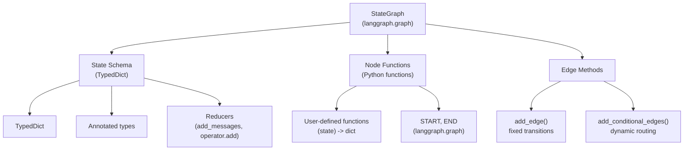

**Key Imports:**
- `StateGraph` from `langgraph.graph`
- `START`, `END` from `langgraph.graph`
- `MessagesState` from `langgraph.graph`
- `add_messages` from `langgraph.graph.message`

Sources: [module-1/simple-graph.ipynb:146-164](), [module-1/chain.ipynb:393-426]()
</thinking>

The LangGraph execution model progresses through these phases:

| Phase | Component | Code Entity |
|-------|-----------|-------------|
| 1. Define | State schema | `TypedDict` class |
| 2. Initialize | Graph builder | `StateGraph(State)` |
| 3. Populate | Add nodes | `builder.add_node(name, func)` |
| 4. Connect | Add edges | `builder.add_edge()` / `builder.add_conditional_edges()` |
| 5. Prepare | Compile | `builder.compile()` |
| 6. Execute | Invoke | `graph.invoke(input)` |

Sources: [module-1/simple-graph.ipynb:187-200](), [module-1/chain.ipynb:497-512]()

## StateGraph

The `StateGraph` class from `langgraph.graph` is the primary interface for building LangGraph applications. It orchestrates the execution flow between nodes based on the defined edges.

### StateGraph Construction Pattern

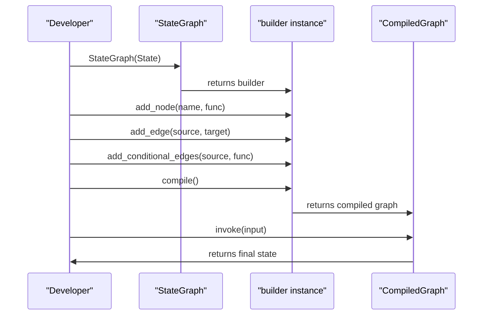

Sources: [module-1/simple-graph.ipynb:187-200](), [module-1/chain.ipynb:497-512]()

### StateGraph API Methods

| Method | Parameters | Purpose | Example |
|--------|-----------|---------|---------|
| `__init__` | `state_schema` | Initialize with state type | `StateGraph(State)` |
| `add_node` | `name: str`, `func: callable` | Register a processing node | `builder.add_node("node_1", node_1)` |
| `add_edge` | `source: str`, `target: str` | Connect nodes with fixed transition | `builder.add_edge(START, "node_1")` |
| `add_conditional_edges` | `source: str`, `path: callable` | Connect nodes with dynamic routing | `builder.add_conditional_edges("node_1", decide_mood)` |
| `compile` | `checkpointer=None`, `interrupt_before=[]` | Finalize graph for execution | `builder.compile()` |

Sources: [module-1/simple-graph.ipynb:187-203](), [module-1/chain.ipynb:497-512]()

### Construction Example

The following code demonstrates the complete construction pattern:

```python
from langgraph.graph import StateGraph, START, END

# 1. Initialize with state schema
builder = StateGraph(State)

# 2. Register nodes
builder.add_node("node_1", node_1)
builder.add_node("node_2", node_2)

# 3. Define flow with edges
builder.add_edge(START, "node_1")
builder.add_edge("node_1", "node_2")
builder.add_edge("node_2", END)

# 4. Compile for execution
graph = builder.compile()
```

Sources: [module-1/simple-graph.ipynb:187-200]()

## State Schema Definition

State in LangGraph represents the data that flows through the graph. The state schema defines the structure and types of data available to nodes during execution.

### TypedDict-Based State

The simplest state definition uses `TypedDict` from the `typing_extensions` module:

```python
from typing_extensions import TypedDict

class State(TypedDict):
    graph_state: str
```

This defines a state with a single key `graph_state` of type `str`. Each node can access this value using dictionary-style access: `state['graph_state']`.

Sources: [module-1/simple-graph.ipynb:55-59]()

### State Update Behavior

By default, when a node returns a dictionary, the values **override** the existing state:

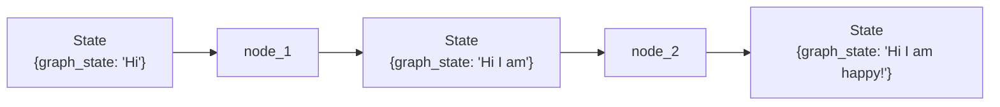

Each node's return value replaces the corresponding state keys, not merges with them.

Sources: [module-1/simple-graph.ipynb:77-97]()

### Annotated State with Reducers

To customize how state updates are applied (e.g., appending instead of replacing), use `Annotated` types with reducer functions:

```python
from typing import Annotated
from langgraph.graph.message import add_messages
from langchain_core.messages import AnyMessage

class MessagesState(TypedDict):
    messages: Annotated[list[AnyMessage], add_messages]
```

The `add_messages` reducer appends new messages to the list instead of replacing it entirely.

Sources: [module-1/chain.ipynb:387-396]()

### State as Node Input/Output Contract

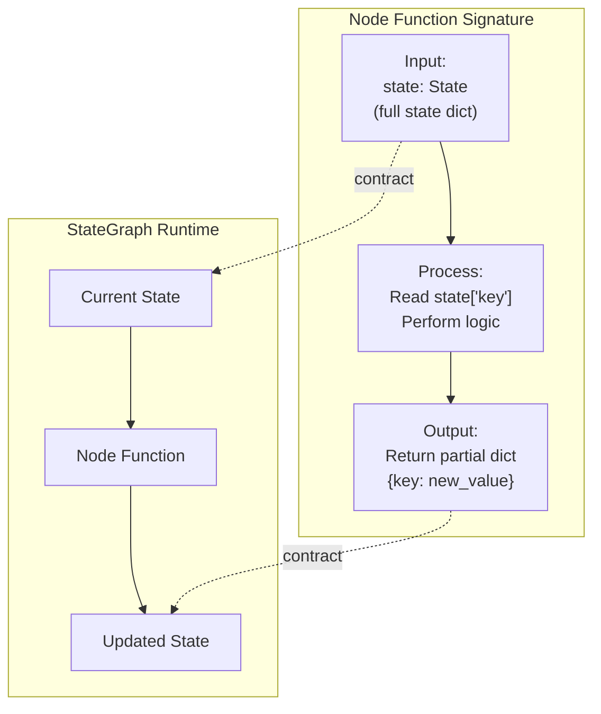

Sources: [module-1/simple-graph.ipynb:72-97]()

### State Execution Flow

```mermaid
sequenceDiagram
    participant User as "User Input"
    participant Start as "START"
    participant Node1 as "Node 1"
    participant Node2 as "Node 2"
    participant End as "END"
    participant Output as "Final State"
    
    User->>Start: Initial State
    Start->>Node1: Pass State
    Node1->>Node1: Process State
    Node1->>Node2: Updated State
    Node2->>Node2: Process State
    Node2->>End: Updated State
    End->>Output: Return Final State
```

Sources: [module-1/simple-graph.ipynb:218-229]()

## Node Functions

Nodes are Python functions that process state. Each node function has a standardized signature and return contract.

### Node Function Signature

```python
def node_name(state: StateType) -> dict:
    """
    Args:
        state: The full current state (TypedDict)
    
    Returns:
        A dict with keys to update in state
    """
    # Read from state
    value = state['some_key']
    
    # Perform processing
    new_value = process(value)
    
    # Return partial state update
    return {"some_key": new_value}
```

**Key Points:**
- First parameter must accept the state (can be typed with the state schema)
- Return value must be a dictionary containing state keys to update
- Only returned keys are updated; other state keys remain unchanged
- Side effects (printing, logging, API calls) are allowed

Sources: [module-1/simple-graph.ipynb:86-97]()

### Node Examples from Codebase

| Node Function | Purpose | State Keys Read | State Keys Written |
|---------------|---------|-----------------|-------------------|
| `node_1` (simple-graph) | Append text | `graph_state` | `graph_state` |
| `tool_calling_llm` (chain) | Invoke LLM | `messages` | `messages` |
| `search_web` (parallelization) | Search web | `question` | `context` |
| `generate_answer` (parallelization) | Generate answer | `question`, `context` | `answer` |

Sources: [module-1/simple-graph.ipynb:86-97](), [module-1/chain.ipynb:500-502](), [module-4/studio/parallelization.py:22-76]()

### Special Nodes: START and END

LangGraph provides two built-in sentinel nodes:

- **`START`**: Entry point for the graph; user input is passed to the first node connected from `START`
- **`END`**: Exit point; when reached, execution stops and the final state is returned

These are imported from `langgraph.graph`:

```python
from langgraph.graph import START, END

builder.add_edge(START, "first_node")
builder.add_edge("last_node", END)
```

Neither `START` nor `END` needs to be added with `add_node()` — they exist automatically.

Sources: [module-1/simple-graph.ipynb:185-197]()

## Edges: Controlling Execution Flow

Edges define the transitions between nodes. LangGraph provides two types of edges: normal (static) and conditional (dynamic).

### Normal Edges

Normal edges created with `add_edge()` establish fixed transitions between nodes:

```python
builder.add_edge(source="node_1", target="node_2")
```

When `node_1` completes, execution **always** proceeds to `node_2`.

**Common patterns:**

| Pattern | Code | Purpose |
|---------|------|---------|
| Entry point | `builder.add_edge(START, "first_node")` | Connect graph input to first node |
| Sequential flow | `builder.add_edge("node_1", "node_2")` | Chain nodes in sequence |
| Exit point | `builder.add_edge("last_node", END)` | Terminate execution |
| Parallel fan-out | Multiple edges from one source | Execute multiple nodes (advanced) |

Sources: [module-1/simple-graph.ipynb:193-197]()

### Conditional Edges

Conditional edges use `add_conditional_edges()` with a routing function to enable dynamic branching:

```python
def decide_mood(state) -> Literal["node_2", "node_3"]:
    """
    Routing function signature:
    - Takes state as input
    - Returns the name of the next node (as string)
    - Return type can be annotated with Literal for type safety
    """
    user_input = state['graph_state']
    
    if random.random() < 0.5:
        return "node_2"
    return "node_3"

builder.add_conditional_edges(source="node_1", path=decide_mood)
```

The routing function is invoked after the source node completes. Based on the returned string, execution routes to the corresponding node.

Sources: [module-1/simple-graph.ipynb:123-138]()

### Edge Execution Flow Diagram

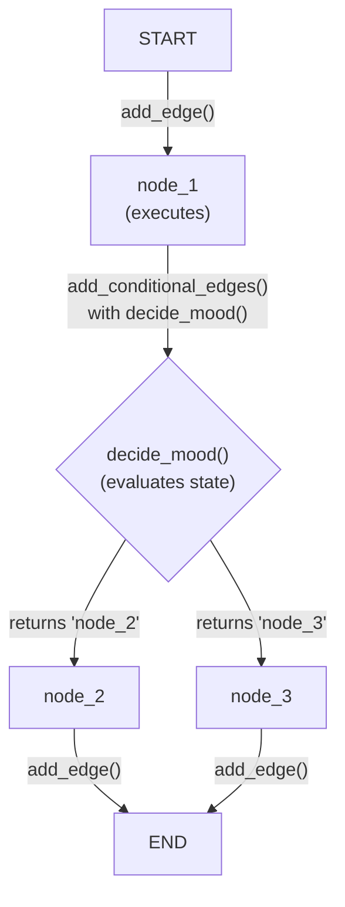

Sources: [module-1/simple-graph.ipynb:186-203]()

### Conditional Edge Return Type Annotation

Using `Literal` from `typing` provides type safety:

```python
from typing import Literal

def route_func(state) -> Literal["path_a", "path_b", "path_c"]:
    # Type checker knows only these strings are valid
    return "path_a"
```

This helps catch errors where the routing function returns a node name that doesn't exist.

Sources: [module-1/simple-graph.ipynb:124-138]()

## Example Graph Structure

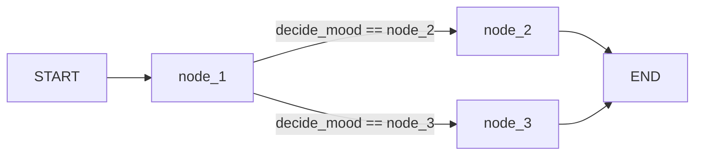

Sources: [module-1/simple-graph.ipynb:186-203]()

## MessagesState and Message Types

LangGraph applications frequently model conversations as sequences of messages. Each message has a role indicating who sent it (user, AI, system, or tool).

### Message Types from langchain_core.messages

| Class | Purpose | Typical Content |
|-------|---------|----------------|
| `HumanMessage` | User input | Questions, commands, natural language requests |
| `AIMessage` | Model responses | Answers, tool calls, generated text |
| `SystemMessage` | Model instructions | System prompts, behavior guidelines |
| `ToolMessage` | Tool results | Return values from executed tools |

Sources: [module-1/chain.ipynb:51-65](), [module-0/basics.ipynb:110-138]()

### Message Structure

Each message instance contains:

```python
from langchain_core.messages import HumanMessage

msg = HumanMessage(
    content="Hello world",  # The actual message text
    name="Lance"            # Optional: sender name
)

# Messages have these key attributes:
# - content: str (the message text)
# - name: str | None (optional identifier)
# - response_metadata: dict (for AI messages, contains token usage, etc.)
# - id: str (unique identifier, auto-generated)
```

Sources: [module-1/chain.ipynb:60-107]()

### Using MessagesState

The pre-built `MessagesState` from `langgraph.graph` combines message lists with the `add_messages` reducer:

```python
from langgraph.graph import MessagesState

class State(MessagesState):
    # Already includes: messages: Annotated[list[AnyMessage], add_messages]
    pass  # Or add additional keys if needed
```

This state type automatically:
- Appends new messages to the conversation history
- Allows message-by-message updates (by ID)
- Maintains conversation order

Sources: [module-1/chain.ipynb:404-426]()

### Message Flow in Conversational Graphs

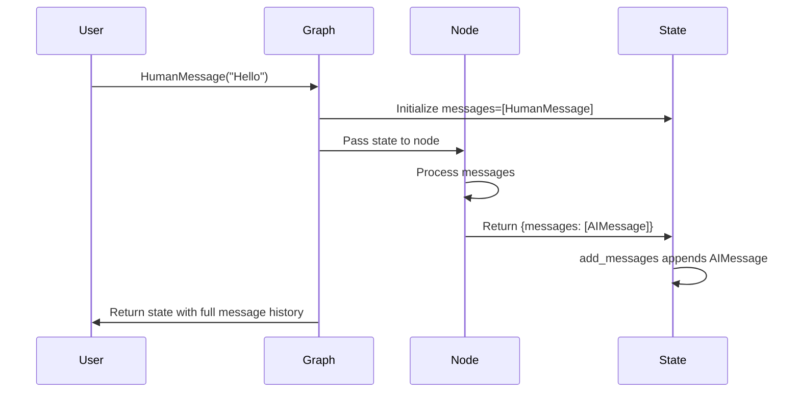

Sources: [module-1/chain.ipynb:337-355]()

## Reducers: Custom State Update Logic

Reducers control how state updates are applied when a node returns a value for a state key. Without a reducer, the default behavior is to replace the existing value.

### Default Behavior: Override

```python
class State(TypedDict):
    value: str

# Without reducer:
# If state = {"value": "old"} and node returns {"value": "new"}
# Result: state = {"value": "new"}  (replaced)
```

### Reducer Annotation

Use `Annotated` to specify a reducer function:

```python
from typing import Annotated

class State(TypedDict):
    values: Annotated[list, operator.add]

# With operator.add reducer:
# If state = {"values": [1, 2]} and node returns {"values": [3, 4]}
# Result: state = {"values": [1, 2, 3, 4]}  (appended)
```

Sources: [module-1/chain.ipynb:387-396]()

### Built-in Reducers

| Reducer | Import | Behavior | Common Use |
|---------|--------|----------|------------|
| `add_messages` | `langgraph.graph.message` | Appends messages to list, handles ID-based updates | Message history in conversations |
| `operator.add` | `operator` module | Concatenates lists, sums numbers | Aggregating parallel results |

### add_messages Reducer

The `add_messages` reducer is specialized for message lists:

```python
from typing import Annotated
from langgraph.graph.message import add_messages
from langchain_core.messages import AnyMessage

class MessagesState(TypedDict):
    messages: Annotated[list[AnyMessage], add_messages]
```

**Features:**
- Appends new messages to the end of the list
- If a message with the same ID exists, it replaces that message (for updates)
- Preserves message order

Example behavior:

```python
# Initial state
initial_messages = [
    AIMessage(content="Hello!", name="Model"),
    HumanMessage(content="Hi there.", name="User")
]

# New message
new_message = AIMessage(content="How can I help?", name="Model")

# Result with add_messages
# [AIMessage("Hello!"), HumanMessage("Hi there."), AIMessage("How can I help?")]
```

Sources: [module-1/chain.ipynb:387-396](), [module-1/chain.ipynb:456-467]()

### Pre-built MessagesState

For convenience, LangGraph provides a pre-configured `MessagesState`:

```python
from langgraph.graph import MessagesState

# Use directly or extend:
class MyState(MessagesState):
    # Inherits: messages: Annotated[list[AnyMessage], add_messages]
    custom_key: str  # Add additional keys as needed
```

This eliminates the need to manually annotate the `messages` field.

Sources: [module-1/chain.ipynb:404-426]()

### operator.add Reducer

For general list concatenation or numeric addition:

```python
import operator
from typing import Annotated

class State(TypedDict):
    context: Annotated[list, operator.add]
    counter: Annotated[int, operator.add]
```

**Behavior:**
- Lists: `[1, 2] + [3, 4] = [1, 2, 3, 4]`
- Numbers: `5 + 3 = 8`
- Strings: `"hello" + "world" = "helloworld"`

This is commonly used in parallel execution patterns to aggregate results from multiple nodes.

Sources: [module-4/studio/parallelization.py:17-20](), [module-4/studio/research_assistant.py:50-53]()

## Tools and Tool Calling

Tools allow language models to interact with external systems (APIs, databases, calculators) through well-defined Python functions.

### Tool Definition

A tool is a Python function with:
- Type-annotated parameters
- A docstring describing the function's purpose
- A return value

```python
def multiply(a: int, b: int) -> int:
    """Multiply a and b.
    
    Args:
        a: first int
        b: second int
    """
    return a * b
```

The LLM uses the function signature and docstring to determine when and how to call the tool.

Sources: [module-1/chain.ipynb:263-276]()

### Binding Tools to Models

Use the `bind_tools()` method to attach tools to a chat model:

```python
from langchain_openai import ChatOpenAI

llm = ChatOpenAI(model="gpt-4o", temperature=0)
llm_with_tools = llm.bind_tools([multiply])
```

The model now has access to the `multiply` tool and can decide when to use it based on user input.

Sources: [module-1/chain.ipynb:269-278]()

### Tool Call Structure

When the model decides to use a tool, it returns an `AIMessage` with `tool_calls`:

```python
# User input: "What is 2 multiplied by 3"

result = llm_with_tools.invoke([HumanMessage(content="What is 2 multiplied by 3")])

# result.tool_calls contains:
[{
    'name': 'multiply',
    'args': {'a': 2, 'b': 3},
    'id': 'call_lBBBNo5oYpHGRqwxNaNRbsiT',
    'type': 'tool_call'
}]
```

The `args` dictionary contains the parsed parameters based on the function signature.

Sources: [module-1/chain.ipynb:302-327]()

### Tool Calling Flow

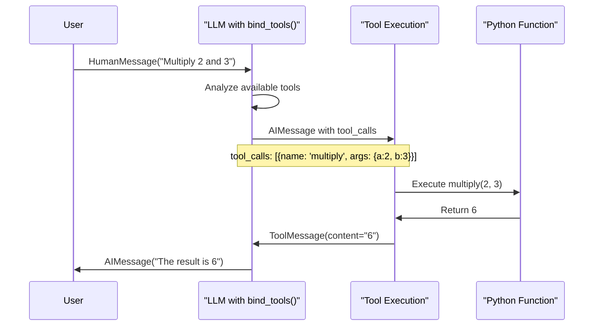

Sources: [module-1/chain.ipynb:233-249]()

### Tool Selection Logic

The model decides whether to call a tool based on:
1. The user's natural language input
2. The tool's name and docstring
3. The parameter types and descriptions

**Example:**
- Input: `"Hello!"` → No tool call, just responds with text
- Input: `"Multiply 2 and 3"` → Calls `multiply` tool with `args={'a': 2, 'b': 3}`

Sources: [module-1/chain.ipynb:520-583]()

## Graph Compilation and Invocation

After defining the graph structure, you must compile it before execution.

### The compile() Method

```python
graph = builder.compile()
```

Compilation performs several tasks:
- Validates the graph structure (checks for disconnected nodes, missing edges)
- Prepares the execution runtime
- Returns a `CompiledGraph` object that implements the Runnable protocol

Sources: [module-1/simple-graph.ipynb:197-200]()

### The invoke() Method

The compiled graph can be executed with `invoke()`:

```python
initial_state = {"graph_state": "Hi, this is Lance."}
final_state = graph.invoke(initial_state)
```

**Execution behavior:**
- Takes an initial state dictionary as input
- Executes nodes following the edge definitions
- Returns the final state after reaching `END`
- Runs synchronously (waits for each node to complete)

Sources: [module-1/simple-graph.ipynb:257-258]()

### Complete Example: Tool-Calling Chain

```python
from langgraph.graph import StateGraph, MessagesState, START, END
from langchain_openai import ChatOpenAI
from langchain_core.messages import HumanMessage

# 1. Define tool
def multiply(a: int, b: int) -> int:
    """Multiply a and b."""
    return a * b

# 2. Create LLM with tools
llm = ChatOpenAI(model="gpt-4o")
llm_with_tools = llm.bind_tools([multiply])

# 3. Define node function
def tool_calling_llm(state: MessagesState):
    return {"messages": [llm_with_tools.invoke(state["messages"])]}

# 4. Build graph
builder = StateGraph(MessagesState)
builder.add_node("tool_calling_llm", tool_calling_llm)
builder.add_edge(START, "tool_calling_llm")
builder.add_edge("tool_calling_llm", END)

# 5. Compile
graph = builder.compile()

# 6. Invoke
result = graph.invoke({"messages": [HumanMessage(content="Multiply 2 and 3")]})
```

Sources: [module-1/chain.ipynb:497-583]()

### Runnable Protocol

The compiled graph implements LangChain's Runnable interface, providing standardized methods:

| Method | Purpose | Behavior |
|--------|---------|----------|
| `invoke(input)` | Synchronous execution | Waits for completion, returns final state |
| `stream(input)` | Streaming execution | Yields state updates as they occur |
| `batch(inputs)` | Batch execution | Processes multiple inputs in parallel |

Sources: [module-1/simple-graph.ipynb:212-217]()

## Concept-to-Code Mapping

### Natural Language Concepts → Code Entities

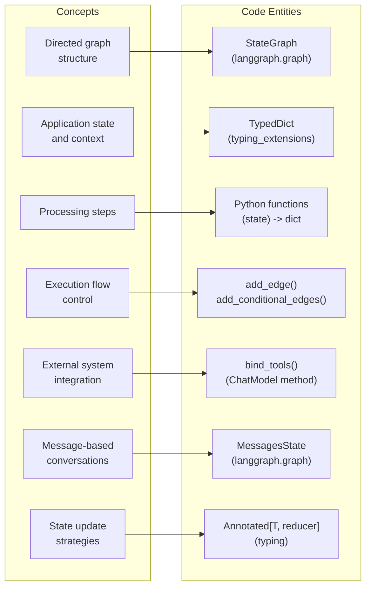

Sources: [module-1/simple-graph.ipynb:40-47](), [module-1/chain.ipynb:24-32]()

### Code Import Reference

| Concept | Import Statement | Module |
|---------|-----------------|---------|
| Graph builder | `from langgraph.graph import StateGraph` | `langgraph.graph` |
| Graph nodes | `from langgraph.graph import START, END` | `langgraph.graph` |
| Message state | `from langgraph.graph import MessagesState` | `langgraph.graph` |
| Message reducer | `from langgraph.graph.message import add_messages` | `langgraph.graph.message` |
| Message types | `from langchain_core.messages import HumanMessage, AIMessage` | `langchain_core.messages` |
| Chat models | `from langchain_openai import ChatOpenAI` | `langchain_openai` |
| State typing | `from typing_extensions import TypedDict` | `typing_extensions` |
| Reducer annotation | `from typing import Annotated` | `typing` |

Sources: [module-1/simple-graph.ipynb:185](), [module-1/chain.ipynb:98-100, 393, 422](), [requirements.txt]()

## Practical Application Patterns

### Simple Sequential Chain

This pattern demonstrates the basic execution flow without conditional routing:

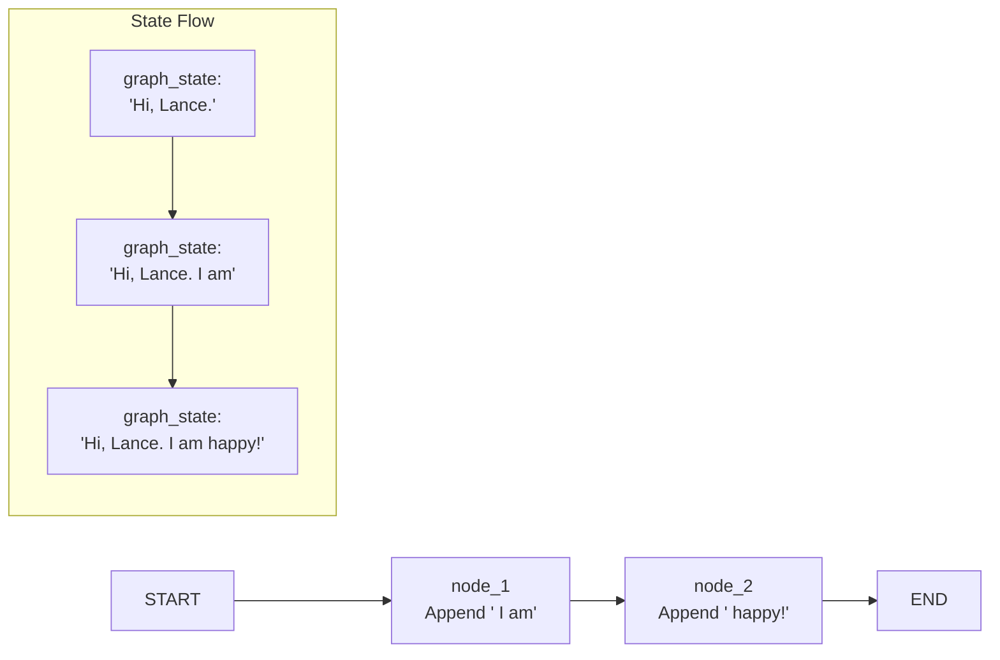

Sources: [module-1/simple-graph.ipynb:16-21]()

### Conditional Routing Pattern

This pattern shows dynamic branching based on state:

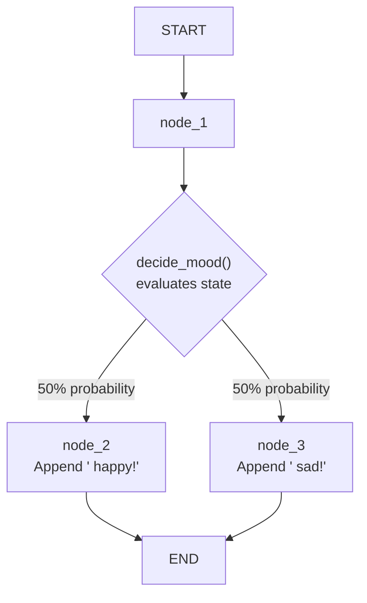

Sources: [module-1/simple-graph.ipynb:16-21]()

### Message-Based Conversational Pattern

This pattern uses `MessagesState` for conversation management:

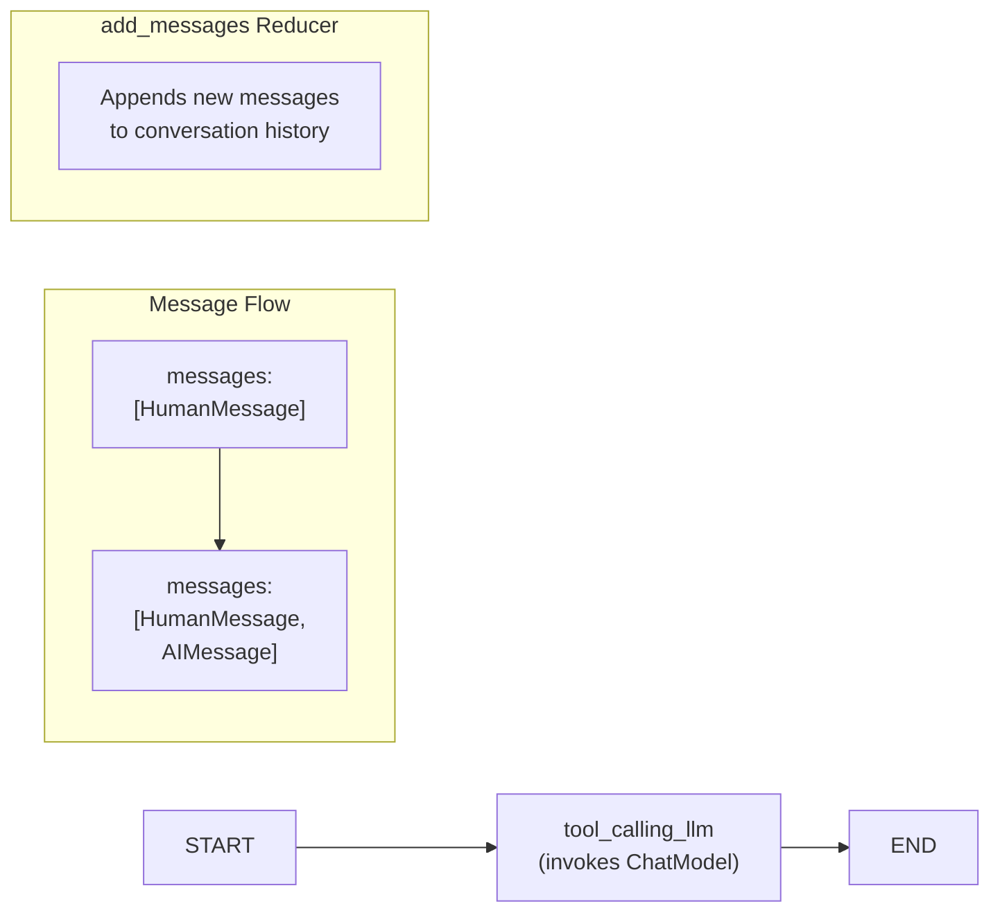

Sources: [module-1/chain.ipynb:474-512]()

## Summary

LangGraph provides a powerful framework for structuring language model applications as directed graphs. By understanding the core concepts of:

- StateGraph for defining the overall structure
- State management for tracking application context
- Nodes for processing state
- Edges for controlling flow
- Messages for handling conversations
- Reducers for customizing state updates
- Tools for extending functionality

Developers can build complex, modular, and maintainable applications that leverage language models effectively.

---

