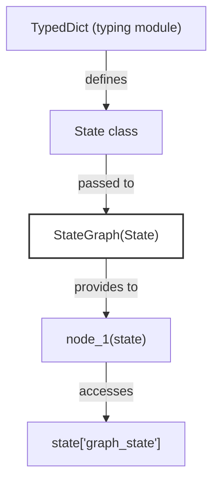
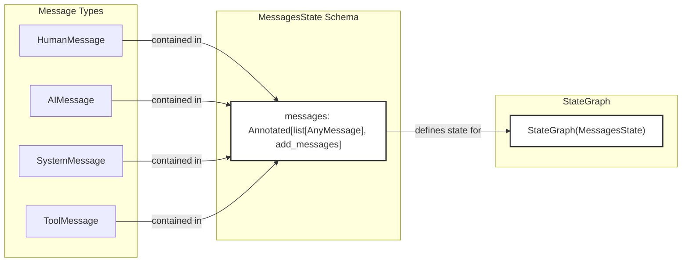
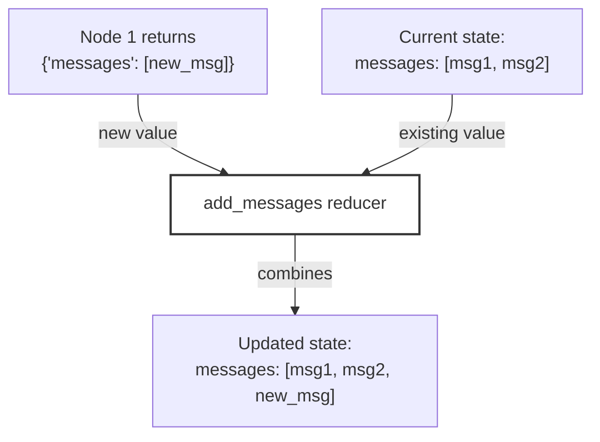
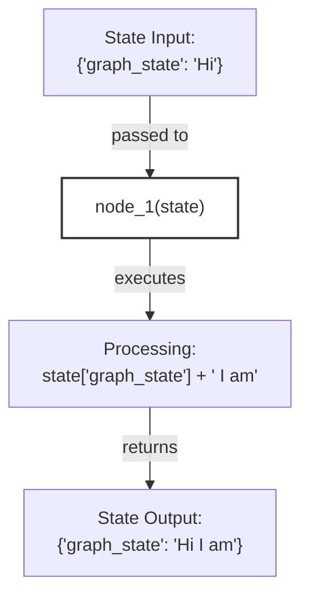
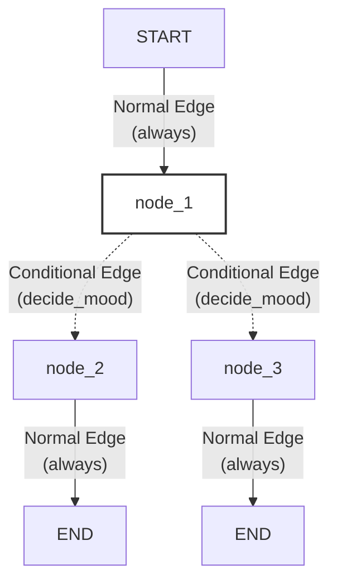
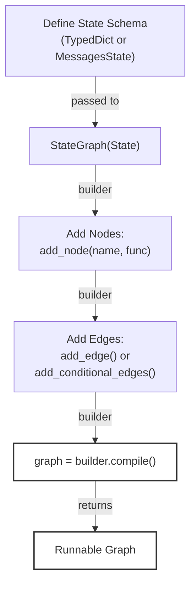
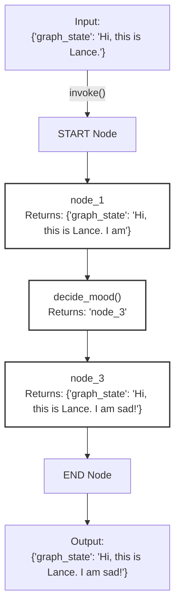

<!-- source: DeepWiki mcp.deepwiki.com · repo langchain-ai/langchain-academy · page 3.1 StateGraph and MessagesState · fetched 2026-10-26 -->

# StateGraph and MessagesState

<details>
<summary>Relevant source files</summary>

The following files were used as context for generating this wiki page:

- [module-1/chain.ipynb](module-1/chain.ipynb)
- [module-1/simple-graph.ipynb](module-1/simple-graph.ipynb)

</details>


## Purpose and Scope

This document explains the fundamental components of LangGraph: the `StateGraph` class for defining workflow orchestration and the `MessagesState` schema for managing conversation history. It covers state schema design using `TypedDict`, the reducer pattern for state updates, node functions as computational units, edge types for controlling execution flow, and the basic graph construction and invocation model.

For information about tools and tool calling patterns, see [Tools and Tool Calling](#3.2). For complete agent implementations using these primitives, see [Basic Agent Architecture](#4.1).

---

## StateGraph: The Core Orchestrator

The `StateGraph` class is the primary workflow orchestrator in LangGraph. It manages state transitions through a directed graph of nodes connected by edges.

### Class Initialization

`StateGraph` is initialized with a state schema that defines the structure of data flowing through the graph:

```python
from langgraph.graph import StateGraph

builder = StateGraph(State)
```

The state schema serves as the input schema for all nodes and edges in the graph [module-1/simple-graph.ipynb:42-46]().

### Key Methods

| Method | Purpose |
|--------|---------|
| `add_node(name, function)` | Registers a node function with a given name |
| `add_edge(from_node, to_node)` | Creates a fixed transition between nodes |
| `add_conditional_edges(from_node, router_function)` | Creates dynamic routing based on function output |
| `compile()` | Validates and prepares the graph for execution |

**Sources:** [module-1/simple-graph.ipynb:148-163](), [module-1/chain.ipynb:497-512]()

---

## State Schemas: TypedDict Basics

State schemas define the structure of data in the graph. The simplest approach uses Python's `TypedDict` from the `typing` module:

```python
from typing_extensions import TypedDict

class State(TypedDict):
    graph_state: str
```

This schema provides type hints for state keys. Each node can access `state['graph_state']` and return a dictionary with updated values [module-1/simple-graph.ipynb:50-60]().

### State Update Behavior

By default, when a node returns a new value for a state key, it **overrides** the previous value. This means:

```python
def node_1(state):
    return {"graph_state": state['graph_state'] + " I am"}
```

The string returned completely replaces the prior `graph_state` value [module-1/simple-graph.ipynb:78-98]().

### State Schema to Code Entity Mapping



**Sources:** [module-1/simple-graph.ipynb:38-78]()

---

## MessagesState: Pre-Built Conversation Schema

`MessagesState` is a pre-built state schema optimized for conversational applications. It eliminates boilerplate by providing a standard structure for message handling.

### Definition

```python
from langgraph.graph import MessagesState

class MessagesState(MessagesState):
    # Add any keys needed beyond messages, which is pre-built
    pass
```

`MessagesState` is defined with:
- A single `messages` key (a list of `AnyMessage` objects)
- The `add_messages` reducer automatically applied

[module-1/chain.ipynb:416-427]()

### Message Types

LangGraph supports multiple message types for different conversation roles:

| Message Type | Purpose |
|--------------|---------|
| `HumanMessage` | Messages from the user |
| `AIMessage` | Messages from the chat model |
| `SystemMessage` | Instructions for the chat model behavior |
| `ToolMessage` | Results from tool execution |

Each message can contain:
- `content`: The message text
- `name`: Optional author identifier
- `response_metadata`: Optional metadata dictionary (often populated by LLM providers)

[module-1/chain.ipynb:51-108]()

### MessagesState Component Diagram



**Sources:** [module-1/chain.ipynb:51-66](), [module-1/chain.ipynb:404-427]()

---

## Reducers: Controlling State Updates

Reducers specify how state updates are performed. Without a reducer, state updates override previous values. Reducers enable alternative behaviors like appending, merging, or custom logic.

### The `add_messages` Reducer

The `add_messages` reducer appends new messages to the existing list instead of replacing it:

```python
from typing import Annotated
from langgraph.graph.message import add_messages
from langchain_core.messages import AnyMessage

class MessagesState(TypedDict):
    messages: Annotated[list[AnyMessage], add_messages]
```

The `Annotated` type attaches the `add_messages` function as metadata to the `messages` key [module-1/chain.ipynb:386-397]().

### Reducer Behavior Example

```python
# Initial state
initial_messages = [
    AIMessage(content="Hello! How can I assist you?", name="Model"),
    HumanMessage(content="I'm looking for information on marine biology.", name="Lance")
]

# New message
new_message = AIMessage(content="Sure, I can help with that.", name="Model")

# Result: all three messages preserved
add_messages(initial_messages, new_message)
# Returns: [initial_messages[0], initial_messages[1], new_message]
```

[module-1/chain.ipynb:438-467]()

### Reducer Execution Flow



**Sources:** [module-1/chain.ipynb:359-397](), [module-1/chain.ipynb:434-467]()

---

## Node Functions: Computational Units

Nodes are Python functions that perform computation and return state updates. They form the operational building blocks of the graph.

### Node Function Signature

```python
def node_1(state):
    print("---Node 1---")
    return {"graph_state": state['graph_state'] + " I am"}
```

- **Input**: The current state (matches the StateGraph schema)
- **Output**: Dictionary with updated state keys
- **Access**: Nodes access state keys using dictionary syntax: `state['key_name']`

[module-1/simple-graph.ipynb:81-98]()

### Node Function with MessagesState

When using `MessagesState`, node functions typically invoke LLMs and return message lists:

```python
def tool_calling_llm(state: MessagesState):
    return {"messages": [llm_with_tools.invoke(state["messages"])]}
```

The returned message is appended to the existing message list due to the `add_messages` reducer [module-1/chain.ipynb:500-502]().

### Node Registration

Nodes are registered with the `StateGraph` builder:

```python
builder.add_node("node_1", node_1)
builder.add_node("tool_calling_llm", tool_calling_llm)
```

The first argument is the node name (used in edge definitions), and the second is the function reference [module-1/simple-graph.ipynb:188-191](), [module-1/chain.ipynb:505-506]().

### Node Execution Model



**Sources:** [module-1/simple-graph.ipynb:68-98](), [module-1/chain.ipynb:497-513]()

---

## Edge Types: Controlling Execution Flow

Edges define transitions between nodes. LangGraph supports two edge types: normal edges for fixed transitions and conditional edges for dynamic routing.

### Normal Edges

Normal edges create **fixed, unconditional** transitions:

```python
builder.add_edge(START, "node_1")
builder.add_edge("node_2", END)
```

The graph always follows these edges when the source node completes [module-1/simple-graph.ipynb:194-197]().

### Special Nodes

| Node | Purpose |
|------|---------|
| `START` | Entry point for user input; begins graph execution |
| `END` | Terminal node; marks workflow completion |

[module-1/simple-graph.ipynb:157-160]()

### Conditional Edges

Conditional edges enable **dynamic routing** based on logic:

```python
def decide_mood(state) -> Literal["node_2", "node_3"]:
    user_input = state['graph_state']
    if random.random() < 0.5:
        return "node_2"
    return "node_3"

builder.add_conditional_edges("node_1", decide_mood)
```

The router function:
- Receives the current state
- Returns the name of the next node to execute
- Uses type hints (`Literal["node_2", "node_3"]`) to specify valid destinations

[module-1/simple-graph.ipynb:117-139](), [module-1/simple-graph.ipynb:195]()

### Edge Types Comparison



**Sources:** [module-1/simple-graph.ipynb:105-139](), [module-1/simple-graph.ipynb:186-198]()

---

## Graph Construction and Compilation

### Building a Graph

Graph construction follows a consistent pattern:

1. **Initialize StateGraph** with a state schema
2. **Add nodes** with `add_node(name, function)`
3. **Add edges** with `add_edge()` or `add_conditional_edges()`
4. **Compile** with `compile()` to validate and prepare for execution

Example with basic state:

```python
from langgraph.graph import StateGraph, START, END

builder = StateGraph(State)
builder.add_node("node_1", node_1)
builder.add_node("node_2", node_2)
builder.add_node("node_3", node_3)

builder.add_edge(START, "node_1")
builder.add_conditional_edges("node_1", decide_mood)
builder.add_edge("node_2", END)
builder.add_edge("node_3", END)

graph = builder.compile()
```

[module-1/simple-graph.ipynb:167-203]()

### Compilation Purpose

The `compile()` method:
- Validates graph structure (e.g., all referenced nodes exist)
- Performs basic sanity checks
- Returns a compiled graph implementing the `Runnable` protocol

[module-1/simple-graph.ipynb:161]()

### Graph Construction Flow



**Sources:** [module-1/simple-graph.ipynb:142-203](), [module-1/chain.ipynb:497-513]()

---

## Graph Invocation: The Execution Model

### The Runnable Protocol

Compiled graphs implement the `Runnable` protocol, providing a standard interface for executing LangChain components. The primary method is `invoke()` [module-1/simple-graph.ipynb:212-217]().

### Invoking a Graph

```python
result = graph.invoke({"graph_state": "Hi, this is Lance."})
```

When `invoke()` is called:

1. **Initialization**: The input dictionary sets the initial state
2. **Execution Start**: Graph begins at the `START` node
3. **Node Traversal**: Progresses through nodes following edges
4. **State Updates**: Each node returns updated state values
5. **Conditional Routing**: Router functions determine dynamic paths
6. **Completion**: Execution ends at the `END` node
7. **Return**: Final state dictionary is returned

[module-1/simple-graph.ipynb:218-230](), [module-1/simple-graph.ipynb:233-259]()

### Synchronous Execution

`invoke()` runs the entire graph **synchronously**:
- Waits for each step to complete before proceeding
- Returns only after reaching `END`
- Returns the final state as a dictionary

Example output:
```python
{'graph_state': 'Hi, this is Lance. I am sad!'}
```

[module-1/simple-graph.ipynb:266-277]()

### Graph Invocation Flow



**Sources:** [module-1/simple-graph.ipynb:207-277]()

---

## Complete Examples

### Simple Graph with TypedDict

This example demonstrates basic `StateGraph` usage with a custom state schema:

- **State Schema**: Single string key `graph_state`
- **Nodes**: Three functions that append text
- **Edges**: Fixed edge to `node_1`, conditional routing to `node_2` or `node_3`
- **Execution**: Random 50/50 split in routing logic

File: [module-1/simple-graph.ipynb:1-309]()

### Message-Based Graph with MessagesState

This example demonstrates `MessagesState` for conversational workflows:

- **State Schema**: `MessagesState` with `add_messages` reducer
- **Nodes**: LLM invocation with tool binding
- **Tools**: `multiply` function bound to chat model
- **Execution**: Single node that processes messages and returns LLM response

File: [module-1/chain.ipynb:1-615]()

### Key Differences

| Aspect | Simple Graph | Message Graph |
|--------|--------------|---------------|
| State Schema | Custom `TypedDict` | Pre-built `MessagesState` |
| State Updates | Override (default) | Append (via `add_messages`) |
| Node Purpose | String manipulation | LLM invocation |
| Complexity | Minimal (3 nodes) | Conversational (tools, messages) |

---

## Summary

The `StateGraph` and `MessagesState` components provide the foundation for building LangGraph workflows:

- **`StateGraph`**: Orchestrates execution through nodes and edges
- **State Schemas**: Define data structure (TypedDict or MessagesState)
- **Reducers**: Control state update behavior (override vs. append)
- **Nodes**: Python functions performing computation
- **Edges**: Normal (fixed) or conditional (dynamic) transitions
- **Compilation**: Validates and prepares graphs for execution
- **Invocation**: Executes graphs synchronously via `invoke()`

These primitives combine to create flexible, stateful workflows ranging from simple sequential processes to complex conversational agents.

**Sources:** [module-1/simple-graph.ipynb:1-309](), [module-1/chain.ipynb:1-615]()

---

