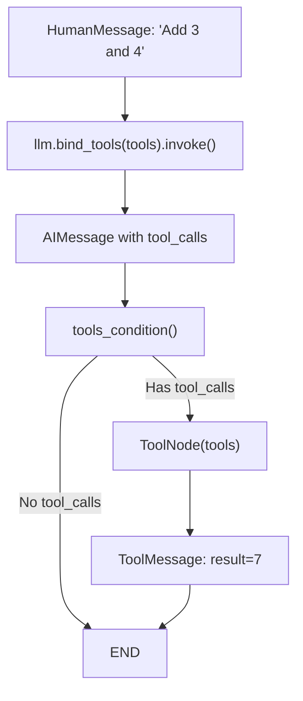
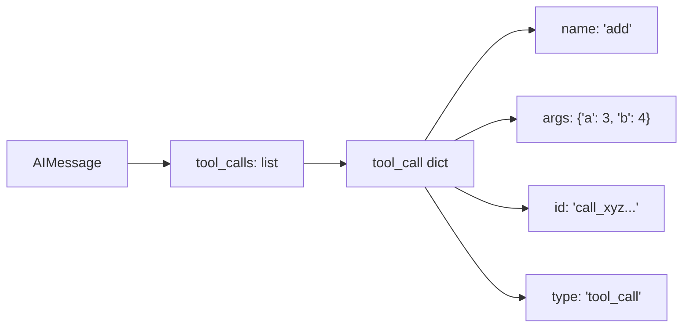
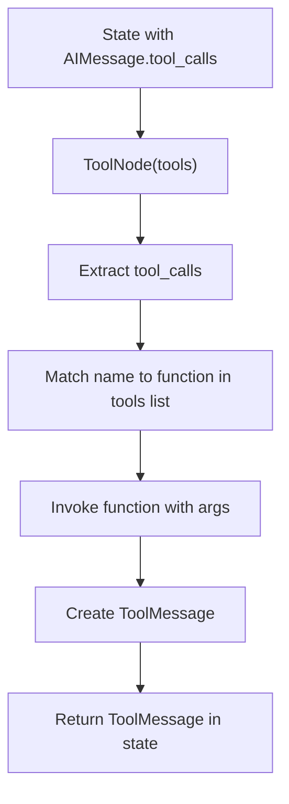
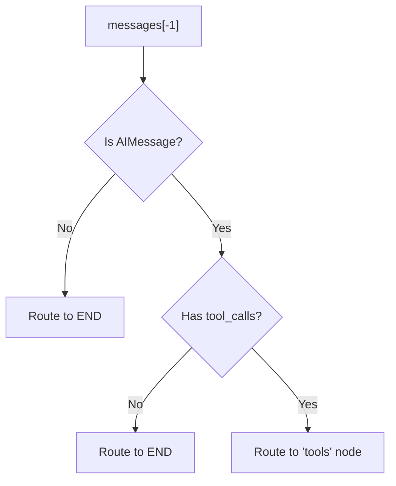
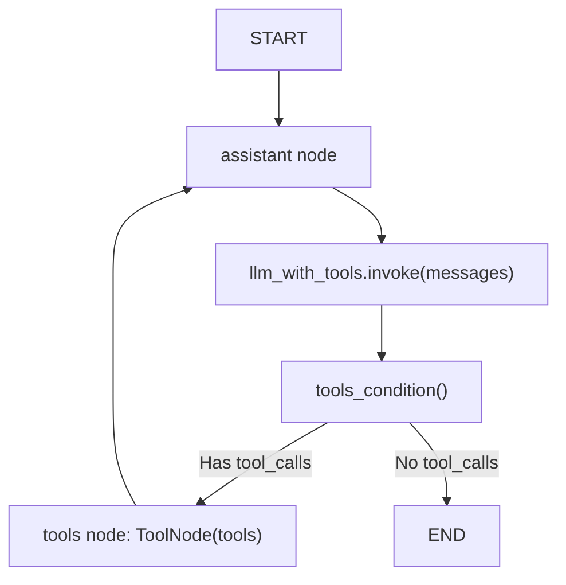
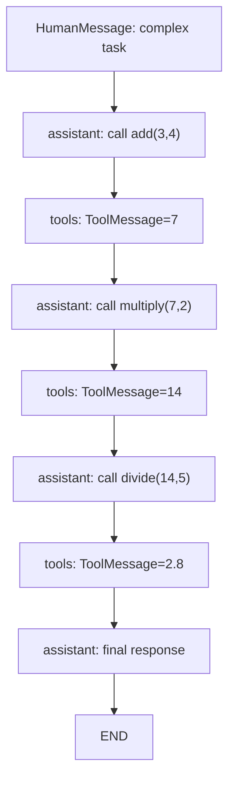

<!-- source: DeepWiki mcp.deepwiki.com · repo langchain-ai/langchain-academy · page 3.2 Tools and Tool Calling · fetched 2026-10-26 -->

# Tools and Tool Calling

<details>
<summary>Relevant source files</summary>

The following files were used as context for generating this wiki page:

- [module-0/basics.ipynb](module-0/basics.ipynb)
- [module-1/agent-memory.ipynb](module-1/agent-memory.ipynb)
- [module-1/agent.ipynb](module-1/agent.ipynb)
- [module-4/studio/parallelization.py](module-4/studio/parallelization.py)
- [module-4/studio/research_assistant.py](module-4/studio/research_assistant.py)
- [requirements.txt](requirements.txt)

</details>


This page documents the tool calling mechanism in LangGraph, which allows language models to invoke Python functions as structured tools. Tool calling enables an LLM to convert natural language requests into function calls with properly typed arguments.

## Overview

Tools are Python functions that can be invoked by an LLM. Instead of the LLM generating unstructured text that must be parsed, the model outputs a structured `AIMessage` containing `tool_calls` - explicit invocations with typed arguments matching the function signature.

**Tool Calling Flow with LangGraph Components**



Sources: [module-1/agent.ipynb:100-142](), [module-1/agent.ipynb:195-237]()

The flow consists of:
1. `HumanMessage` input provided to LLM
2. LLM with `bind_tools()` decides whether to call a tool
3. If tool call generated, `tools_condition` routes to `ToolNode`
4. `ToolNode` executes the function and returns `ToolMessage`
5. If no tool call, flow proceeds to END

## Tool Definition Pattern

Tools are standard Python functions with type annotations and docstrings. The LLM uses these signatures to generate properly formatted tool calls.

**Example Tool Definitions**

```python
def multiply(a: int, b: int) -> int:
    """Multiply a and b.

    Args:
        a: first int
        b: second int
    """
    return a * b

def add(a: int, b: int) -> int:
    """Adds a and b.

    Args:
        a: first int
        b: second int
    """
    return a + b

def divide(a: int, b: int) -> float:
    """Divide a and b.

    Args:
        a: first int
        b: second int
    """
    return a / b
```

Sources: [module-1/agent.ipynb:107-134](), [module-1/agent-memory.ipynb:98-125]()

Required elements:
- Type annotations on all parameters (e.g., `a: int`)
- Return type annotation (e.g., `-> int`)
- Docstring describing the function purpose
- `Args:` section documenting each parameter
- Function name becomes the tool name

## Binding Tools with bind_tools()

The `bind_tools()` method attaches tool schemas to the LLM, enabling it to generate tool calls.

```python
from langchain_openai import ChatOpenAI

tools = [add, multiply, divide]
llm = ChatOpenAI(model="gpt-4o")
llm_with_tools = llm.bind_tools(tools, parallel_tool_calls=False)
```

Sources: [module-1/agent.ipynb:135-141](), [module-1/agent-memory.ipynb:126-128]()

The `bind_tools()` method:
- Accepts a list of tool functions
- Converts function signatures into JSON schemas
- Sends schemas to the LLM during inference
- Returns a new LLM instance with tools attached

The `parallel_tool_calls=False` parameter forces sequential tool execution, useful for operations that must occur in order (e.g., arithmetic sequences).

Sources: [module-1/agent.ipynb:138-141]()

## Tool Call Output Structure

When an LLM decides to call a tool, it returns an `AIMessage` with a `tool_calls` attribute containing structured invocation data.

**AIMessage with Tool Calls**



Sources: [module-1/agent.ipynb:264-270]()

Each tool call dictionary contains:
- `name`: Function name to invoke (e.g., `"add"`)
- `args`: Dictionary mapping parameter names to values (e.g., `{"a": 3, "b": 4}`)
- `id`: Unique identifier for this tool call
- `type`: Always `"tool_call"`

The LLM generates these structured outputs based on the schemas provided via `bind_tools()`.

Sources: [module-1/agent.ipynb:217-223]()

## MessagesState for Tool Workflows

`MessagesState` is the standard state schema for graphs involving tool calls. It maintains a list of messages with the `add_messages` reducer.

```python
from langgraph.graph import MessagesState

class MessagesState(TypedDict):
    messages: Annotated[list[AnyMessage], add_messages]
```

Sources: [module-1/agent.ipynb:159](), [module-1/agent-memory.ipynb:138]()

Message types in the list include:
- `HumanMessage`: User input
- `AIMessage`: LLM output (may contain `tool_calls`)
- `ToolMessage`: Tool execution result
- `SystemMessage`: System instructions

The `add_messages` reducer automatically appends new messages while handling `ToolMessage` association with corresponding `AIMessage` tool calls.

Sources: [module-1/agent.ipynb:160-167]()

## ToolNode for Tool Execution

`ToolNode` is a prebuilt component that executes tools when `AIMessage.tool_calls` is present.

```python
from langgraph.prebuilt import ToolNode

tools = [add, multiply, divide]
builder.add_node("tools", ToolNode(tools))
```

Sources: [module-1/agent.ipynb:214-222](), [module-1/agent-memory.ipynb:168-176]()

`ToolNode` behavior:
1. Receives state containing `AIMessage` with `tool_calls`
2. Finds matching function from tools list by name
3. Invokes function with arguments from `args`
4. Returns `ToolMessage` with function output
5. `ToolMessage.name` set to tool name
6. `ToolMessage.tool_call_id` links to originating `AIMessage.tool_calls[i].id`

**ToolNode Execution Flow**



Sources: [module-1/agent.ipynb:214-222]()

## tools_condition for Routing

`tools_condition` is a prebuilt conditional edge function that routes based on whether the latest message contains tool calls.

```python
from langgraph.prebuilt import tools_condition

builder.add_conditional_edges(
    "assistant",
    tools_condition,
)
```

Sources: [module-1/agent.ipynb:226-231]()

Routing logic:
- If `messages[-1]` is `AIMessage` with `tool_calls` → routes to `"tools"` node
- If `messages[-1]` has no `tool_calls` → routes to `END`

This enables the LLM to dynamically decide whether to invoke tools or return a final response.

**tools_condition Routing Behavior**



Sources: [module-1/agent.ipynb:226-231]()

## Complete Agent Graph with Tools

A typical tool-enabled agent combines an assistant node with `ToolNode` and `tools_condition` routing.

**Agent Graph Structure**



Sources: [module-1/agent.ipynb:195-237]()

### Assistant Node Implementation

The assistant node invokes the LLM with bound tools:

```python
from langchain_core.messages import SystemMessage

sys_msg = SystemMessage(content="You are a helpful assistant tasked with performing arithmetic on a set of inputs.")

def assistant(state: MessagesState):
    return {"messages": [llm_with_tools.invoke([sys_msg] + state["messages"])]}
```

Sources: [module-1/agent.ipynb:162-167](), [module-1/agent-memory.ipynb:141-146]()

The assistant:
1. Prepends a `SystemMessage` to define behavior
2. Invokes `llm_with_tools` with full message history
3. Returns updated messages list containing new `AIMessage`

### Graph Construction Pattern

```python
from langgraph.graph import START, StateGraph
from langgraph.prebuilt import tools_condition, ToolNode

builder = StateGraph(MessagesState)

builder.add_node("assistant", assistant)
builder.add_node("tools", ToolNode(tools))

builder.add_edge(START, "assistant")
builder.add_conditional_edges(
    "assistant",
    tools_condition,
)
builder.add_edge("tools", "assistant")

react_graph = builder.compile()
```

Sources: [module-1/agent.ipynb:212-233](), [module-1/agent-memory.ipynb:167-187]()

Graph edges:
- `START → "assistant"`: Begin with LLM invocation
- `"assistant" → tools_condition`: Route based on tool call presence
- `"tools" → "assistant"`: Loop back after tool execution for continued reasoning

This creates a ReAct (Reasoning-Action) loop where the agent can call multiple tools in sequence.

Sources: [module-1/agent.ipynb:17-46]()

## Multi-Step Tool Execution

The ReAct loop allows the agent to execute multiple tools in sequence to answer complex queries.

**Example: Multi-Step Arithmetic**

```python
from langchain_core.messages import HumanMessage

messages = [HumanMessage(content="Add 3 and 4. Multiply the output by 2. Divide the output by 5")]
messages = react_graph.invoke({"messages": messages})
```

Sources: [module-1/agent.ipynb:246-247]()

Message sequence:
1. `HumanMessage`: "Add 3 and 4..."
2. `AIMessage`: tool_calls=[add(a=3, b=4)]
3. `ToolMessage`: 7
4. `AIMessage`: tool_calls=[multiply(a=7, b=2)]
5. `ToolMessage`: 14
6. `AIMessage`: tool_calls=[divide(a=14, b=5)]
7. `ToolMessage`: 2.8
8. `AIMessage`: "The final result is 2.8"

Sources: [module-1/agent.ipynb:256-299]()

The agent autonomously determines:
- Which tool to call at each step
- Arguments to pass to each tool
- When to stop calling tools and provide final answer

**Multi-Turn Tool Execution Flow**



Sources: [module-1/agent.ipynb:246-299]()

## Integration with LangGraph Studio

LangGraph Studio provides a visual interface for debugging and developing tool-enabled graphs. It allows you to:

- Visualize the execution flow
- See when tools are called
- Inspect state at each step
- Debug tool call issues

```
langgraph dev
```

Sources: [module-1/router.ipynb:188-206]()

## Comparison of Tool Calling Options

| Approach | Advantages | Considerations |
|----------|------------|----------------|
| Direct Tool Binding | Simple setup, direct integration with LLM | Limited to single LLM node |
| ToolNode | Pre-built solution, easy integration | Requires StateGraph |
| Custom Tool Implementation | Maximum flexibility | More complex to implement |
| Multiple Tools | Allows for diverse capabilities | Requires careful routing logic |

Sources: [module-1/router.ipynb:19-43](), [module-1/chain.ipynb:233-249]()

## Extending Tool Functionality

Tools can be extended beyond simple functions to include:

1. API integrations
2. Database queries
3. File operations
4. Custom calculations
5. External service calls

The same patterns apply regardless of tool complexity - define a function with clear input/output schemas and bind it to the LLM.

---

