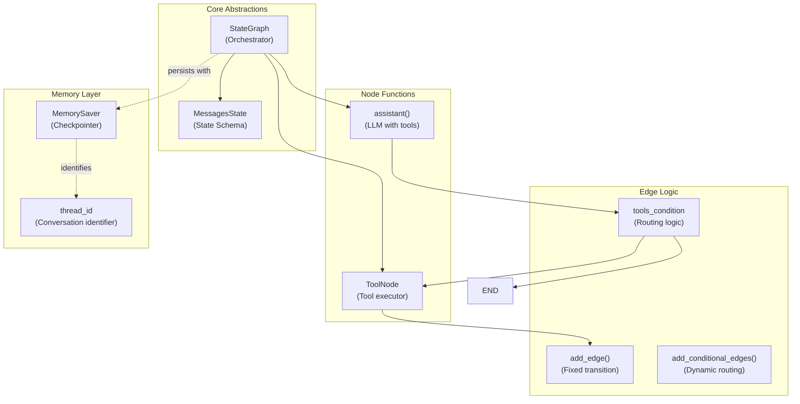
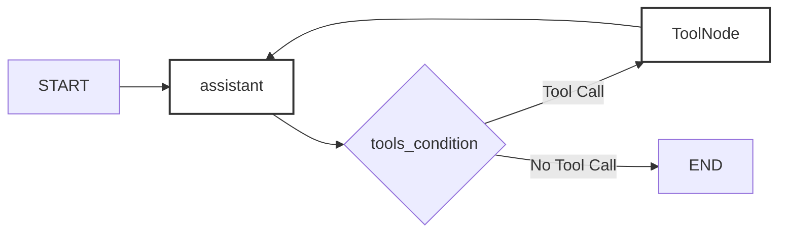
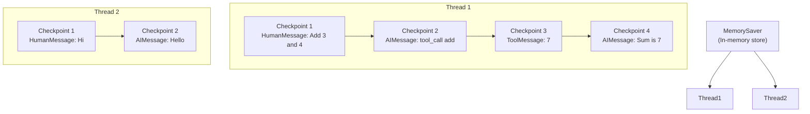
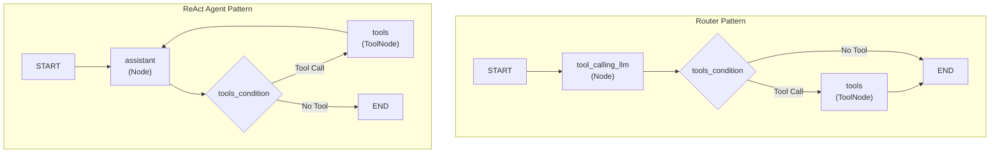

<!-- source: DeepWiki mcp.deepwiki.com · repo langchain-ai/langchain-academy · page 4 Building Agents with LangGraph · fetched 2026-10-26 -->

# Building Agents with LangGraph

<details>
<summary>Relevant source files</summary>

The following files were used as context for generating this wiki page:

- [module-1/agent-memory.ipynb](module-1/agent-memory.ipynb)
- [module-1/agent.ipynb](module-1/agent.ipynb)
- [module-1/router.ipynb](module-1/router.ipynb)

</details>


## Purpose and Scope

This page demonstrates how to construct functional agents using LangGraph patterns, including ReAct (Reasoning-Action-Observation) loops, conversational memory through checkpointers, and basic routing patterns. Agents are systems where an LLM directs control flow by deciding whether to call tools, respond directly, or continue reasoning.

For foundational LangGraph concepts like `StateGraph`, nodes, and edges, see [LangGraph Core Concepts](#3). For advanced patterns like parallelization and multi-agent systems, see [Advanced Agent Patterns](#7). For sophisticated memory architectures beyond basic checkpointing, see [Memory Systems](#8).

## Agent Architecture Overview

LangGraph agents are state machines where the LLM acts as the control mechanism. The core pattern involves:

1. **Assistant Node**: LLM with bound tools that decides next action
2. **Tools Node**: Executes tool calls and returns results
3. **Conditional Edges**: Route execution based on LLM output (tool call vs. direct response)
4. **State**: Maintains conversation history using `MessagesState`

The following table summarizes the three agent patterns covered in this module:

| Pattern | Loop Structure | Memory | Use Case |
|---------|---------------|---------|----------|
| **ReAct Agent** | Tools → Assistant | Optional | Multi-step reasoning with tool access |
| **Router** | Tools → END | None | Single decision routing |
| **Stateful Agent** | Tools → Assistant | MemorySaver + thread_id | Multi-turn conversations |

**Key LangGraph Components**



Sources: [module-1/agent.ipynb:159-168](), [module-1/agent-memory.ipynb:138-147](), [module-1/router.ipynb:80-93]()

## Basic Agent Architecture

### ReAct Agent Pattern

The ReAct (Reasoning-Action-Observation) pattern creates a loop where the LLM can:
- **Reason**: Analyze the current state and decide what to do
- **Act**: Call tools to gather information or perform actions
- **Observe**: Receive tool outputs and incorporate them into reasoning

**ReAct Loop Execution Flow**



### Implementation Components

**Assistant Node Function**

The assistant node invokes the LLM with tools bound and prepends a system message:

```python
# Node definition from agent.ipynb
def assistant(state: MessagesState):
   return {"messages": [llm_with_tools.invoke([sys_msg] + state["messages"])]}
```

Key elements:
- **Input**: `MessagesState` containing conversation history
- **Processing**: LLM with tools via `bind_tools()` 
- **Output**: Either `AIMessage` with tool calls or direct text response

Sources: [module-1/agent.ipynb:166-167]()

**Tool Configuration**

Tools are Python functions with docstrings that become tool schemas:

```python
# Tool definitions
def multiply(a: int, b: int) -> int:
    """Multiply a and b.
    Args:
        a: first int
        b: second int
    """
    return a * b

def add(a: int, b: int) -> int:
    """Adds a and b.
    Args:
        a: first int
        b: second int
    """
    return a + b
```

The LLM accesses these via `llm.bind_tools(tools)`, which exposes their schemas for function calling.

Sources: [module-1/agent.ipynb:107-124]()

**Tools Node**

LangGraph provides `ToolNode` from `langgraph.prebuilt` to execute tool calls:

```python
from langgraph.prebuilt import ToolNode

builder.add_node("tools", ToolNode(tools))
```

`ToolNode` automatically:
1. Extracts tool call information from `AIMessage`
2. Executes the corresponding Python function
3. Returns `ToolMessage` with results

Sources: [module-1/agent.ipynb:222]()

### Graph Construction

The complete ReAct agent graph assembly:

```python
from langgraph.graph import START, StateGraph
from langgraph.prebuilt import tools_condition, ToolNode

# Initialize graph with MessagesState
builder = StateGraph(MessagesState)

# Add nodes
builder.add_node("assistant", assistant)
builder.add_node("tools", ToolNode(tools))

# Add edges
builder.add_edge(START, "assistant")
builder.add_conditional_edges(
    "assistant",
    tools_condition,  # Routes to tools or END
)
builder.add_edge("tools", "assistant")  # Loop back

react_graph = builder.compile()
```

**Execution sequence**:
1. `START` → `assistant`: Initial LLM invocation
2. `assistant` → `tools_condition`: Check if tool call present
3. If tool call: `tools_condition` → `tools` → `assistant` (loop)
4. If no tool call: `tools_condition` → `END`

Sources: [module-1/agent.ipynb:212-236]()

### tools_condition Logic

The `tools_condition` function from `langgraph.prebuilt` inspects the last message:

- If `AIMessage` contains `tool_calls` → route to `"tools"` node
- Otherwise → route to `END`

This creates dynamic routing where the LLM controls flow by deciding whether to call tools.

**Example Execution Trace**

Given input: `"Add 3 and 4. Multiply the output by 2. Divide the output by 5"`

| Step | Node | Action | Output |
|------|------|--------|--------|
| 1 | assistant | LLM decides to call `add(3, 4)` | AIMessage with tool_calls |
| 2 | tools | Executes add function | ToolMessage: "7" |
| 3 | assistant | LLM decides to call `multiply(7, 2)` | AIMessage with tool_calls |
| 4 | tools | Executes multiply function | ToolMessage: "14" |
| 5 | assistant | LLM decides to call `divide(14, 5)` | AIMessage with tool_calls |
| 6 | tools | Executes divide function | ToolMessage: "2.8" |
| 7 | assistant | LLM responds with final answer | AIMessage: "The final result... is 2.8" |
| 8 | - | No tool call, route to END | Graph terminates |

The loop continues until the LLM decides no more tools are needed.

Sources: [module-1/agent.ipynb:246-305]()

**Parallel Tool Calling Configuration**

By default, OpenAI models enable parallel tool calling for efficiency. For sequential operations like arithmetic, this can be disabled:

```python
llm_with_tools = llm.bind_tools(tools, parallel_tool_calls=False)
```

This forces sequential tool execution, ensuring proper order of operations.

Sources: [module-1/agent.ipynb:141]()

## Agent Memory with Checkpointers

### Transient State Problem

Without persistence, graph state only exists during a single invocation. This prevents multi-turn conversations:

```python
# First invocation
messages = [HumanMessage(content="Add 3 and 4.")]
result = react_graph.invoke({"messages": messages})
# Result: "The sum of 3 and 4 is 7."

# Second invocation - NO MEMORY
messages = [HumanMessage(content="Multiply that by 2.")]
result = react_graph.invoke({"messages": messages})
# Result: "The result of multiplying 2 by 2 is 4."
# (LLM doesn't remember "that" = 7)
```

The second invocation has no access to the first conversation's state.

Sources: [module-1/agent-memory.ipynb:234-283]()

### MemorySaver Checkpointer

LangGraph's persistence layer uses checkpointers to save state after each step. `MemorySaver` is an in-memory key-value store:

```python
from langgraph.checkpoint.memory import MemorySaver

memory = MemorySaver()
react_graph_memory = builder.compile(checkpointer=memory)
```

**Checkpoint Storage Model**



Each node execution creates a checkpoint containing the full `MessagesState`.

Sources: [module-1/agent-memory.ipynb:314-316]()

### thread_id Configuration

To use persistence, specify a `thread_id` in the configuration:

```python
config = {"configurable": {"thread_id": "1"}}

# First message
messages = [HumanMessage(content="Add 3 and 4.")]
result = react_graph_memory.invoke({"messages": messages}, config)

# Second message - SAME thread_id
messages = [HumanMessage(content="Multiply that by 2.")]
result = react_graph_memory.invoke({"messages": messages}, config)
# Result: "The result of multiplying 7 by 2 is 14."
# (LLM remembers "that" = 7)
```

**Key behaviors**:
- Same `thread_id` → Continues existing conversation
- Different `thread_id` → Starts new conversation
- No `thread_id` → Error (required with checkpointer)

Sources: [module-1/agent-memory.ipynb:369-447]()

### State Accumulation

When invoking with an existing `thread_id`, the input messages are **appended** to the checkpoint:

**Thread State Evolution**

| Invocation | Input | State After Execution |
|------------|-------|----------------------|
| 1 | `[HumanMessage("Add 3 and 4")]` | `[HumanMessage, AIMessage(tool_call), ToolMessage, AIMessage("7")]` |
| 2 | `[HumanMessage("Multiply that by 2")]` | `[Previous 4 messages, HumanMessage, AIMessage(tool_call), ToolMessage, AIMessage("14")]` |

The LLM sees the full history, enabling contextual understanding of "that" and other references.

Sources: [module-1/agent-memory.ipynb:390-392]()

### Checkpoint Writing

The checkpointer writes state after **every node execution**, not just at graph completion:

1. `START` → `assistant` → **Checkpoint 1**
2. `assistant` → `tools` → **Checkpoint 2**
3. `tools` → `assistant` → **Checkpoint 3**
4. `assistant` → `END` → **Checkpoint 4**

This granular persistence enables features like time travel debugging (see [Time Travel Debugging](#6.4)) and interruptions (see [Breakpoints and Interruptions](#6.1)).

Sources: [module-1/agent-memory.ipynb:325-336]()

## Router Pattern

### Simplified Routing

The router pattern is a simplified agent that makes a **single routing decision** without looping:

**Router vs. ReAct Agent**



Key difference: Router's `tools` node connects to `END`, not back to `assistant`.

Sources: [module-1/router.ipynb:17-43]()

### Use Cases

Routers are appropriate when:
- Single tool call is sufficient (no multi-step reasoning)
- Need to choose between tool execution and direct response
- Simplicity is preferred over flexibility

**Example**: Question answering where the LLM either:
- Calls a search tool if information is needed
- Responds directly if it knows the answer

### Implementation

**Router Graph Construction**

```python
from langgraph.graph import StateGraph, START, END
from langgraph.graph import MessagesState
from langgraph.prebuilt import ToolNode, tools_condition

def tool_calling_llm(state: MessagesState):
    return {"messages": [llm_with_tools.invoke(state["messages"])]}

builder = StateGraph(MessagesState)
builder.add_node("tool_calling_llm", tool_calling_llm)
builder.add_node("tools", ToolNode([multiply]))
builder.add_edge(START, "tool_calling_llm")
builder.add_conditional_edges(
    "tool_calling_llm",
    tools_condition,  # Routes to tools or END
)
builder.add_edge("tools", END)  # No loop - terminates after tool

graph = builder.compile()
```

The `tools` node has a direct edge to `END`, preventing further LLM invocations.

Sources: [module-1/router.ipynb:122-148]()

### Execution Example

Given input: `"What is 2 multiplied by 2?"`

1. `START` → `tool_calling_llm`: LLM decides to call `multiply(2, 2)`
2. `tool_calling_llm` → `tools_condition` → `tools`: Execute multiply
3. `tools` → `END`: Return `ToolMessage("4")` and terminate

The LLM never sees the tool result - the graph just returns the raw `ToolMessage`. This is suitable for scenarios where downstream processing handles the tool output.

Sources: [module-1/router.ipynb:152-177]()

### Router vs. Agent Decision Matrix

| Requirement | Use Router | Use ReAct Agent |
|-------------|-----------|----------------|
| Multi-step reasoning | ❌ | ✅ |
| Tool chaining | ❌ | ✅ |
| Natural language response to tool output | ❌ | ✅ |
| Simple tool/no-tool decision | ✅ | ✅ |
| Minimal execution steps | ✅ | ❌ |

For production applications requiring multi-step reasoning, the ReAct agent pattern is typically more appropriate.

Sources: [module-1/router.ipynb:1-251]()

## LangGraph Studio Integration

Both agent patterns can be tested in LangGraph Studio, a local development server with a cloud-hosted UI. Studio provides:
- Visual graph representation
- State inspection at each checkpoint
- Interactive execution with inputs
- Debugging capabilities

To run Studio for Module 1:

```bash
cd module-1/studio/
langgraph dev
```

This starts a local server at `http://127.0.0.1:2024` with UI at `https://smith.langchain.com/studio/?baseUrl=http://127.0.0.1:2024`.

The studio directory contains production-ready implementations:
- `module-1/studio/router.py`: Router pattern from [module-1/router.ipynb]()
- Configuration in `module-1/studio/langgraph.json`

For detailed Studio usage, see [LangGraph Studio](#9).

Sources: [module-1/router.ipynb:179-207](), [module-1/agent-memory.ipynb:454-463]()

## Summary

Building agents with LangGraph involves three core patterns:

1. **ReAct Agent**: Cyclical reasoning-action-observation loop for multi-step problem solving
2. **Stateful Agent**: ReAct + `MemorySaver` + `thread_id` for multi-turn conversations
3. **Router**: Simplified single-decision routing without loops

All patterns use:
- `MessagesState` for conversation state management
- `tools_condition` for dynamic routing logic
- `ToolNode` for tool execution
- LLM with `bind_tools()` for function calling

The ReAct pattern with memory provides the foundation for more complex agent systems covered in later modules, including parallelization ([Advanced Agent Patterns](#7)) and sophisticated memory architectures ([Memory Systems](#8)).

Sources: [module-1/agent.ipynb](), [module-1/agent-memory.ipynb](), [module-1/router.ipynb]()

---

