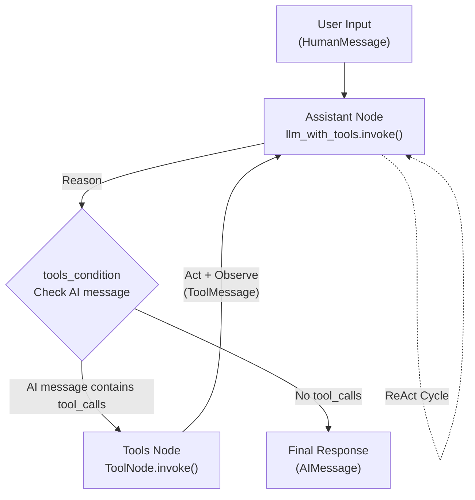
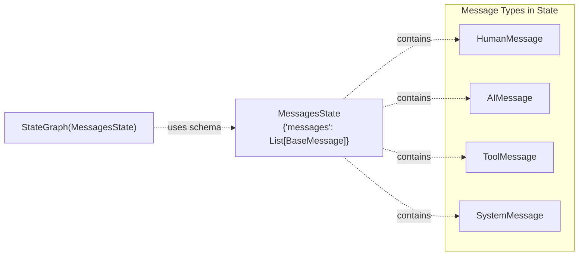
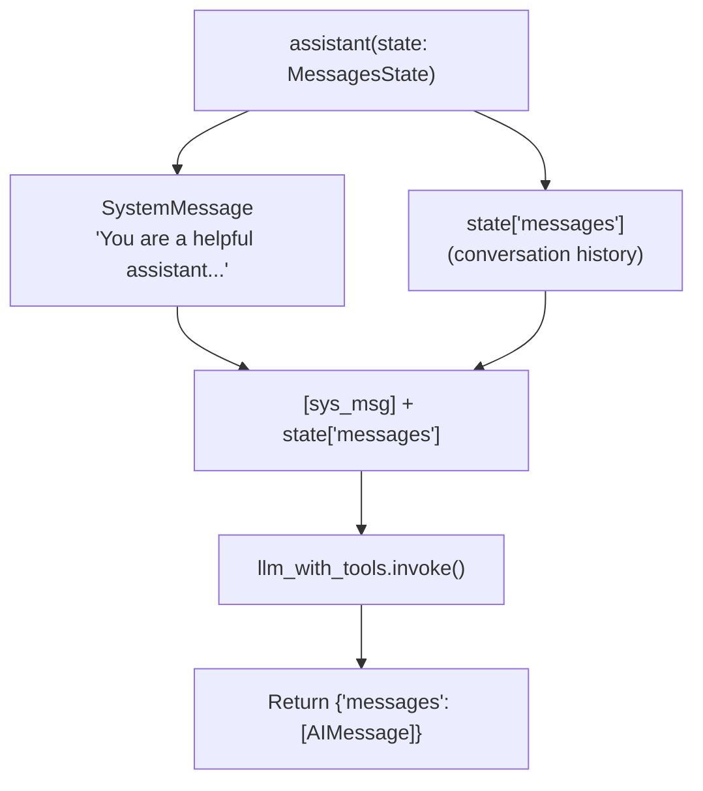
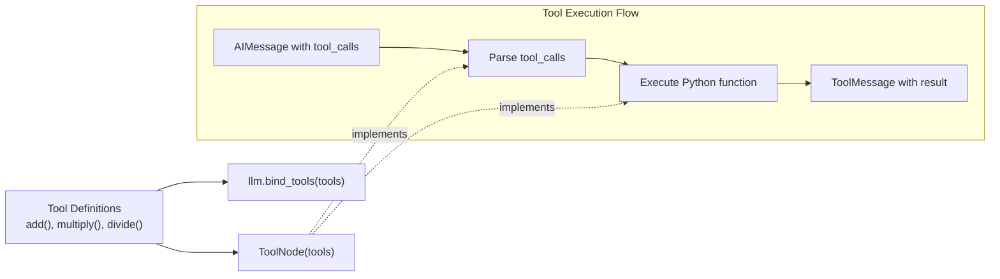
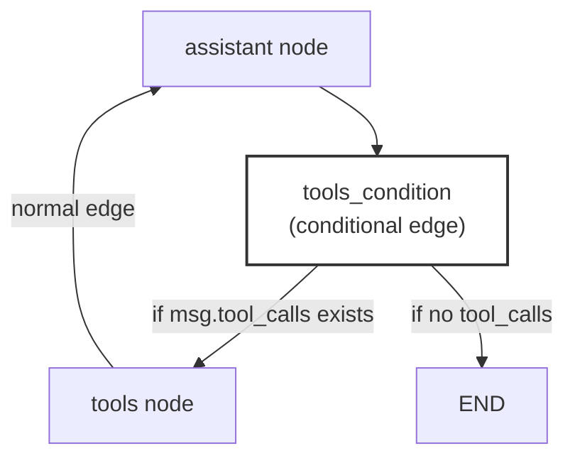
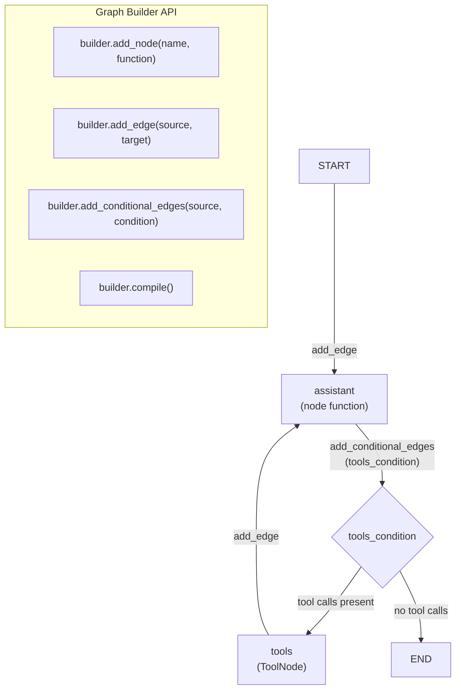
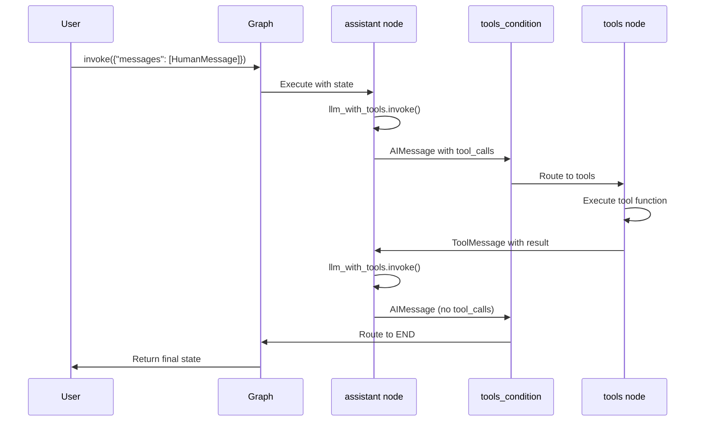
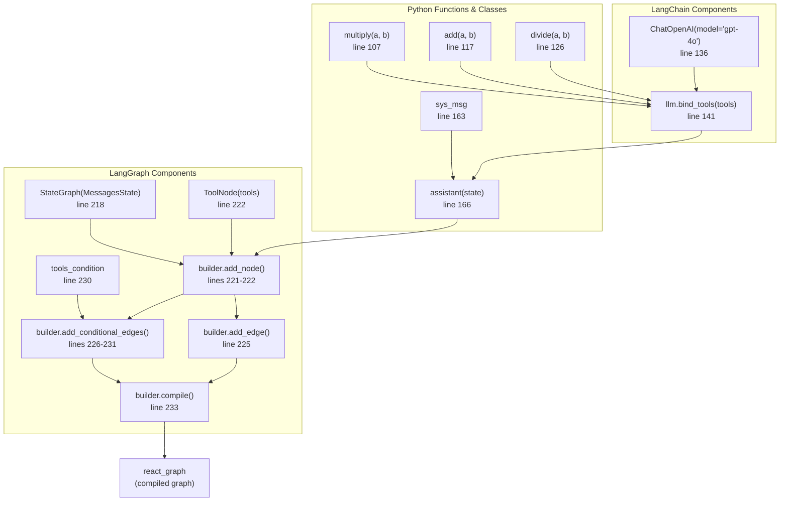

<!-- source: DeepWiki mcp.deepwiki.com · repo langchain-ai/langchain-academy · page 4.1 Basic Agent Architecture · fetched 2026-10-26 -->

# Basic Agent Architecture

<details>
<summary>Relevant source files</summary>

The following files were used as context for generating this wiki page:

- [module-1/agent-memory.ipynb](module-1/agent-memory.ipynb)
- [module-1/agent.ipynb](module-1/agent.ipynb)

</details>


## Purpose and Scope

This document details the fundamental ReAct agent architecture pattern as implemented in Module 1 of LangChain Academy. It covers the core components required to build a functional agent: the assistant node (LLM with tool-calling capability), the tools node (tool execution), conditional routing via `tools_condition`, and the control flow that creates the reasoning-action-observation cycle.

For information about adding conversational memory to agents using checkpointers, see [Agent Memory with Checkpointers](#4.2). For routing patterns without tool execution loops, see [Router Pattern](#4.3).

**Sources:** [module-1/agent.ipynb:17-46]()

---

## The ReAct Pattern

The ReAct (Reasoning and Acting) architecture is a general-purpose agent pattern that alternates between three phases:

| Phase | Description | Responsible Component |
|-------|-------------|----------------------|
| **Reason** | The LLM analyzes the current state and decides whether to call a tool or respond directly | Assistant node |
| **Act** | If the LLM decides to call a tool, the tool is executed with the specified parameters | Tools node |
| **Observe** | The tool output is passed back to the LLM, which can then reason about it and decide the next action | Assistant node (next iteration) |

This cycle continues until the LLM determines no further tool calls are needed and provides a final response.



**Sources:** [module-1/agent.ipynb:17-46](), [module-1/agent.ipynb:171-192]()

---

## Core Components

### StateGraph and MessagesState

The agent is built using `StateGraph` from LangGraph, which orchestrates the execution flow between nodes. The state schema is `MessagesState`, a pre-built schema that maintains a list of messages in the conversation.



The `MessagesState` schema provides automatic message list management with the `add_messages` reducer, which appends new messages to the existing list rather than replacing it.

**Sources:** [module-1/agent.ipynb:159-168](), [module-1/agent-memory.ipynb:138-147]()

---

### Assistant Node

The assistant node is a Python function that takes the current `MessagesState` and returns an updated state containing the LLM's response. The LLM is configured with tools bound via `bind_tools()`.

**Key Implementation Details:**



The assistant node implementation pattern:
1. Retrieves the message history from `state["messages"]`
2. Prepends a system message defining the agent's behavior
3. Invokes the LLM with tools bound: `llm.bind_tools(tools, parallel_tool_calls=False)`
4. Returns the LLM's response (either an AIMessage with tool calls or a final answer)

**Sources:** [module-1/agent.ipynb:104-142](), [module-1/agent.ipynb:159-168]()

---

### Tools Node

The tools node executes tool calls requested by the LLM. It is created using the `ToolNode` prebuilt component, which automatically:
- Parses tool call arguments from the AIMessage
- Executes the corresponding Python functions
- Returns ToolMessage objects containing the results



Tool functions are standard Python functions with type hints and docstrings. The docstrings are used to generate tool schemas that the LLM uses to understand how to call the tools.

**Sources:** [module-1/agent.ipynb:104-142](), [module-1/agent.ipynb:214-222]()

---

### Conditional Routing with tools_condition

The `tools_condition` function is a prebuilt conditional edge that inspects the last message in the state and routes execution accordingly:

| Condition | Route Target |
|-----------|-------------|
| Last message is `AIMessage` with `tool_calls` | `"tools"` node |
| Last message is `AIMessage` without `tool_calls` | `END` |

This routing logic creates the loop: if the LLM calls a tool, execution routes to the tools node, which returns control to the assistant node for the next iteration.



**Sources:** [module-1/agent.ipynb:171-192](), [module-1/agent.ipynb:226-231]()

---

## Graph Construction

The complete agent graph is constructed using the following steps:

1. **Initialize StateGraph** with `MessagesState` schema
2. **Add nodes**: `assistant` and `tools`
3. **Add edges**:
   - Entry edge: `START` → `assistant`
   - Conditional edge: `assistant` → `tools_condition` (routes to `tools` or `END`)
   - Loop edge: `tools` → `assistant`
4. **Compile** the graph into an executable runnable



The compiled graph is a runnable that can be invoked with an initial state containing messages.

**Sources:** [module-1/agent.ipynb:195-237](), [module-1/agent-memory.ipynb:150-191]()

---

## Execution Flow

### Single-Turn Execution

When the graph is invoked, execution proceeds as follows:

1. **START** → **assistant node**
   - Receives user input as `HumanMessage`
   - LLM reasons about the input and decides to call tools or respond

2. **assistant** → **tools_condition**
   - Checks if the AIMessage contains `tool_calls`

3. **Routing decision:**
   - If `tool_calls` exist: → **tools node**
   - If no `tool_calls`: → **END**

4. **tools node** (if called)
   - Executes the requested tool(s)
   - Returns `ToolMessage` with results
   - Routes back to **assistant node**

5. **Loop continues** until LLM provides final response without tool calls



### Multi-Step Tool Calling

The architecture supports sequential tool calling for complex queries. For example, with the query "Add 3 and 4. Multiply the output by 2. Divide the output by 5":

1. **Iteration 1:** LLM calls `add(3, 4)` → returns `7`
2. **Iteration 2:** LLM observes result, calls `multiply(7, 2)` → returns `14`
3. **Iteration 3:** LLM observes result, calls `divide(14, 5)` → returns `2.8`
4. **Iteration 4:** LLM observes result, provides final answer without tool calls

Note that `parallel_tool_calls=False` is set in the implementation to ensure sequential execution for mathematical operations where order matters.

**Sources:** [module-1/agent.ipynb:240-305](), [module-1/agent.ipynb:138-141]()

---

## Code Implementation Map

The following diagram maps the conceptual architecture to specific code constructs in the implementation:



**Sources:** [module-1/agent.ipynb:104-142](), [module-1/agent.ipynb:159-168](), [module-1/agent.ipynb:195-237]()

---

## Invocation Pattern

The compiled graph is invoked with an input dictionary containing the initial messages:

```python
messages = [HumanMessage(content="Add 3 and 4.")]
result = react_graph.invoke({"messages": messages})
```

The graph returns the complete state, including all messages (human, AI, and tool messages) accumulated during execution. The conversation history can be accessed via `result['messages']`.

**State Lifecycle:**
- **Transient by default:** State exists only for the duration of a single `invoke()` call
- **No cross-invocation memory:** Each invocation starts with the provided input state
- **Message accumulation:** Within a single invocation, messages accumulate as the agent loops through tool calls

For persistent memory across multiple invocations, see [Agent Memory with Checkpointers](#4.2).

**Sources:** [module-1/agent.ipynb:240-305](), [module-1/agent-memory.ipynb:286-293]()

---

## Message Flow Architecture

The following table summarizes the message types and their roles in the agent architecture:

| Message Type | Created By | Contains | Purpose |
|-------------|------------|----------|---------|
| `HumanMessage` | User input | User query text | Initiates agent reasoning |
| `SystemMessage` | Assistant node | Agent instructions | Defines agent behavior |
| `AIMessage` (with tool_calls) | LLM | Tool name, arguments | Requests tool execution |
| `ToolMessage` | Tools node | Tool execution result | Provides observation to LLM |
| `AIMessage` (no tool_calls) | LLM | Final answer text | Terminates execution |

The assistant node always receives the full message history, allowing the LLM to maintain context across multiple tool calls within a single invocation.

**Sources:** [module-1/agent.ipynb:159-168](), [module-1/agent.ipynb:240-305]()

---

## Summary

The basic agent architecture consists of:

- **StateGraph with MessagesState:** Orchestrates execution and maintains conversation history
- **Assistant node:** LLM with bound tools that reasons and decides actions
- **Tools node:** Executes tool calls and returns results
- **tools_condition:** Routes based on whether tool calls are present
- **Loop edge:** Connects tools back to assistant for iterative reasoning

This architecture implements the ReAct pattern, enabling agents to reason about problems, take actions via tools, observe results, and iterate until providing a final answer. The pattern is extensible to any set of tools and can handle complex multi-step reasoning tasks.

**Sources:** [module-1/agent.ipynb:17-46](), [module-1/agent.ipynb:171-237]()

---

