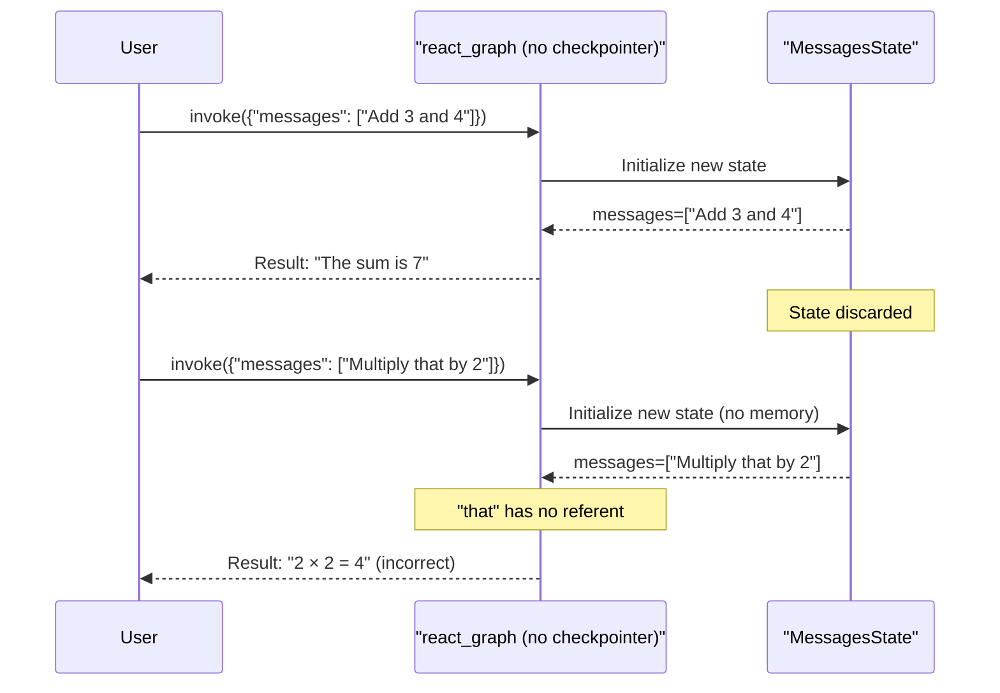
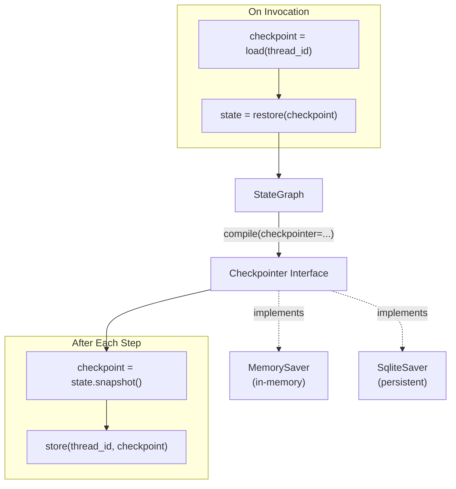
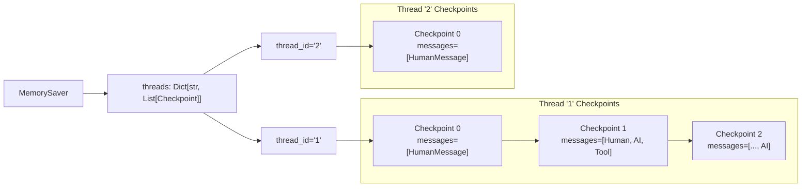
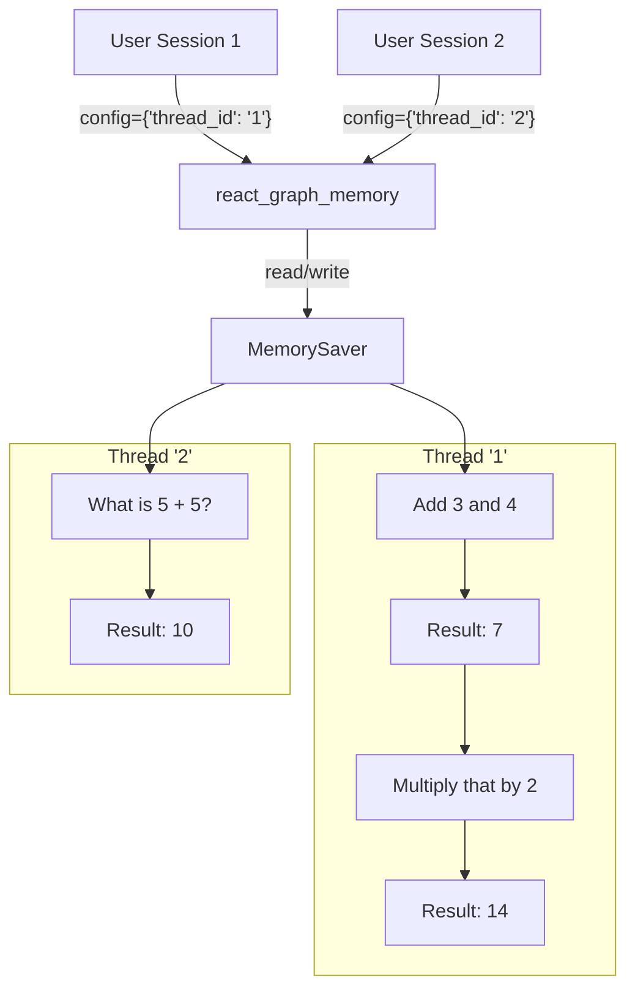
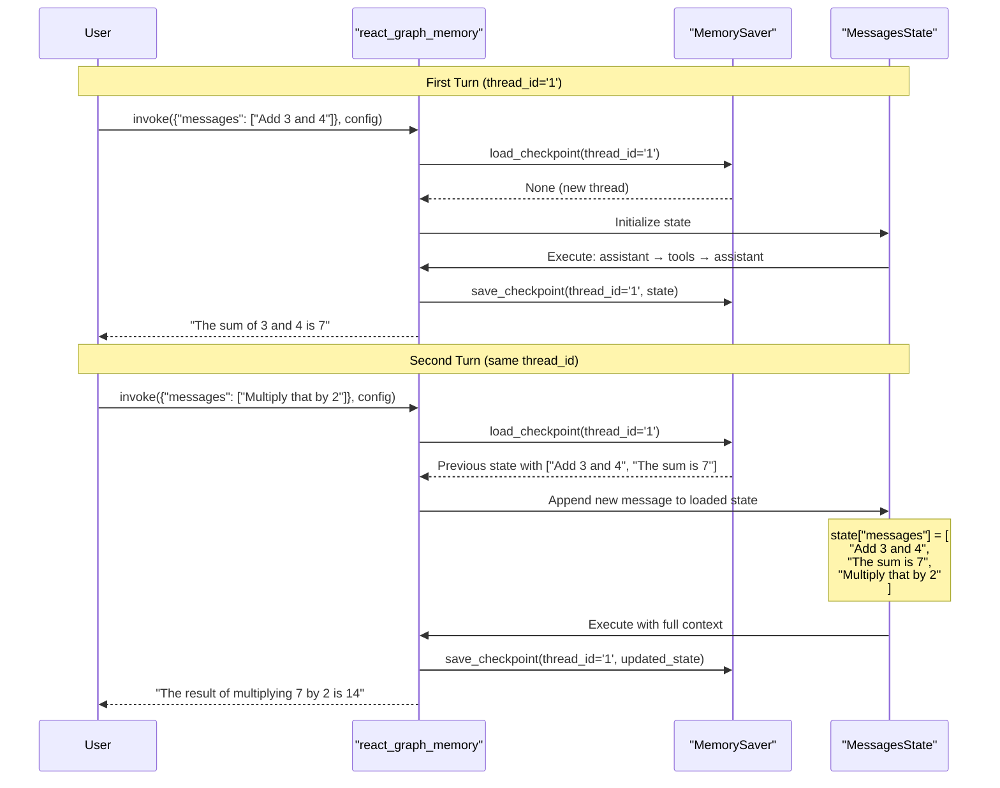
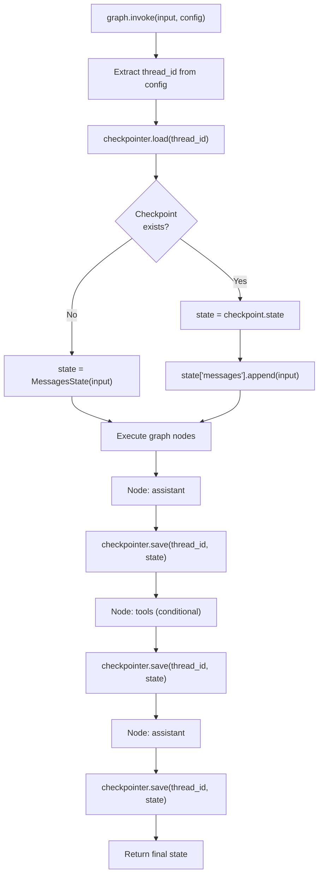

<!-- source: DeepWiki mcp.deepwiki.com · repo langchain-ai/langchain-academy · page 4.2 Agent Memory with Checkpointers · fetched 2026-10-26 -->

# Agent Memory with Checkpointers

<details>
<summary>Relevant source files</summary>

The following files were used as context for generating this wiki page:

- [module-1/agent-memory.ipynb](module-1/agent-memory.ipynb)
- [module-1/agent.ipynb](module-1/agent.ipynb)

</details>


## Purpose and Scope

This document explains how to add conversational memory to LangGraph agents using checkpointers. It demonstrates the `MemorySaver` class for in-memory state persistence, `thread_id` configuration for conversation threading, and enabling multi-turn interactions where agents can reference prior conversation context.

This page builds on the basic agent architecture covered in [Basic Agent Architecture](#4.1). For persistent storage beyond in-memory solutions, see [External Memory with SqliteSaver](#5.3). For advanced multi-schema memory systems, see [Long-Term Memory Architecture](#8.1).

---

## The State Persistence Problem

Agents built with the basic ReAct pattern from Module 1 have a critical limitation: **state is transient to a single graph execution**. Each time the graph is invoked, it starts with a clean state containing only the new input message, with no memory of previous interactions.

### Stateless Agent Behavior



The second invocation demonstrates the problem: the agent cannot resolve the pronoun "that" because it has no memory of the value 7 from the first interaction. The model incorrectly interprets "that" as 2.

**Sources:** [module-1/agent-memory.ipynb:279-283](), [module-1/agent-memory.ipynb:286-305]()

---

## Checkpointers Overview

LangGraph solves the state persistence problem through **checkpointers**: objects that automatically save the graph state after each execution step. This built-in persistence layer provides memory, allowing subsequent graph invocations to pick up from the last saved checkpoint.

### Checkpointer Architecture



The checkpointer interface defines two operations:
- **Save**: After each node executes, the checkpointer serializes and stores the current state
- **Load**: Before graph execution begins, the checkpointer retrieves the most recent state for the given thread

**Sources:** [module-1/agent-memory.ipynb:296-305]()

---

## MemorySaver Implementation

The `MemorySaver` class is an in-memory key-value store for graph state, suitable for development and testing. It stores checkpoints in RAM and does not persist across process restarts.

### Basic Usage Pattern

To add memory to an agent graph, compile it with a `MemorySaver` instance:

```python
from langgraph.checkpoint.memory import MemorySaver

# Create checkpointer
memory = MemorySaver()

# Compile graph with checkpointer
react_graph_memory = builder.compile(checkpointer=memory)
```

This single change transforms a stateless graph into a stateful one. The graph now automatically saves state after each step and can resume from saved checkpoints.

### MemorySaver Data Structure



Each thread maintains an ordered list of checkpoints, allowing the graph to resume from the latest state or even replay from earlier checkpoints (time travel).

**Sources:** [module-1/agent-memory.ipynb:308-317]()

---

## Thread ID Configuration

When using a checkpointer, each graph invocation must specify a **`thread_id`** to identify which conversation thread to use. The `thread_id` is passed in a configuration dictionary:

```python
config = {"configurable": {"thread_id": "1"}}

messages = react_graph_memory.invoke(
    {"messages": [HumanMessage(content="Add 3 and 4.")]},
    config
)
```

### Thread Isolation



Different `thread_id` values create isolated conversation contexts. Thread "1" and Thread "2" have completely separate state and message histories. This enables multi-user scenarios where each user has their own conversation thread.

### Thread ID Requirements

The `thread_id` can be any string value:
- **Session IDs**: `thread_id = session.user_id`
- **Conversation IDs**: `thread_id = conversation.uuid`
- **Sequential numbers**: `thread_id = "1"`, `"2"`, `"3"`, etc.

The only requirement is consistency: use the same `thread_id` to continue the same conversation.

**Sources:** [module-1/agent-memory.ipynb:320-337](), [module-1/agent-memory.ipynb:369-379]()

---

## Multi-turn Conversations

With checkpointing enabled, agents can maintain context across multiple invocations, enabling natural multi-turn conversations with pronoun resolution and context carryover.

### Stateful Multi-turn Flow



The key difference from stateless execution:
1. **First invocation**: `load_checkpoint` returns `None`, so the graph starts fresh
2. **Second invocation**: `load_checkpoint` retrieves the full conversation history
3. **Message appending**: The new `HumanMessage` is appended to the existing messages list
4. **Context resolution**: The model sees the full conversation and correctly resolves "that" to 7

### Complete Conversation Example

| Turn | User Input | Messages State After Turn | Model Reasoning |
|------|-----------|---------------------------|-----------------|
| 1 | "Add 3 and 4." | `[Human("Add 3 and 4."), AI(tool_call: add(3,4)), Tool("7"), AI("The sum is 7.")]` | Direct tool call |
| 2 | "Multiply that by 2." | `[...previous..., Human("Multiply that by 2."), AI(tool_call: multiply(7,2)), Tool("14"), AI("...7 by 2 is 14.")]` | Resolves "that"→7 from turn 1 |

The conversation state grows monotonically, maintaining complete context for pronoun resolution, multi-step tasks, and conversational coherence.

**Sources:** [module-1/agent-memory.ipynb:382-448]()

---

## How Checkpointing Works

### Step-by-step Checkpoint Lifecycle



The checkpointer saves state **after every node execution**, not just at the end of the graph. This granular checkpointing enables:
- **Interruption recovery**: If execution fails mid-graph, state is preserved up to the last completed node
- **Time travel debugging**: Inspect or replay from any intermediate checkpoint
- **Breakpoint patterns**: Pause execution for human input (covered in [Breakpoints and Interruptions](#6.1))

### MessagesState Reducer Behavior

The `MessagesState` schema uses the `add_messages` reducer for the `messages` field, which has special behavior during checkpoint restoration:

```python
# From MessagesState definition
class MessagesState(TypedDict):
    messages: Annotated[list[AnyMessage], add_messages]
```

When new input is provided to a checkpointed graph:
1. **Load**: Previous messages are loaded from checkpoint
2. **Append**: New messages from input are appended (not replaced)
3. **Execute**: Graph runs with combined message list

This append-only behavior is critical for conversation continuity. Without it, each invocation would overwrite the message history.

**Sources:** [module-1/agent-memory.ipynb:296-305](), [module-1/agent-memory.ipynb:320-337]()

---

## Code Implementation

The complete implementation showing the transition from stateless to stateful agent:

### Graph Definition (Shared)
[module-1/agent-memory.ipynb:90-147]()

Defines the `assistant` node and tools, identical to the stateless version.

### Stateless Compilation
[module-1/agent-memory.ipynb:150-191]()
```python
react_graph = builder.compile()  # No checkpointer
```

### Stateful Compilation
[module-1/agent-memory.ipynb:308-317]()
```python
from langgraph.checkpoint.memory import MemorySaver
memory = MemorySaver()
react_graph_memory = builder.compile(checkpointer=memory)
```

### Invocation with Thread ID
[module-1/agent-memory.ipynb:369-379]()
```python
config = {"configurable": {"thread_id": "1"}}
messages = react_graph_memory.invoke({"messages": messages}, config)
```

The only changes required:
1. Import `MemorySaver`
2. Create a `MemorySaver` instance
3. Pass it to `compile(checkpointer=...)`
4. Include `config` with `thread_id` in all `invoke()` calls

---

## Limitations of MemorySaver

`MemorySaver` has important limitations:

| Limitation | Description | Alternative |
|------------|-------------|-------------|
| **Volatility** | State lost on process restart | Use `SqliteSaver` ([External Memory](#5.3)) |
| **Memory usage** | Full state history kept in RAM | Implement message trimming ([Message Handling](#5.2)) |
| **Single process** | Cannot share state across processes/machines | Use persistent checkpointers |
| **No expiration** | Threads never automatically cleaned up | Implement manual cleanup logic |

For production deployments, use `SqliteSaver` or other persistent checkpointers. `MemorySaver` is best suited for:
- Local development
- Testing
- Jupyter notebooks
- Short-lived processes

**Sources:** [module-1/agent-memory.ipynb:308-317](), documentation context from Diagram 2 and Diagram 3

---

## Summary

Key concepts for agent memory with checkpointers:

1. **Checkpointers** provide automatic state persistence after each graph step
2. **`MemorySaver`** is an in-memory checkpointer for development use
3. **`thread_id`** identifies conversation threads in the configuration
4. **Message appending** preserves conversation context across invocations
5. **Multi-turn conversations** work naturally with pronoun resolution and context carryover

The pattern is simple: compile with a checkpointer and pass a `thread_id` in the config. LangGraph handles the rest.

**Sources:** [module-1/agent-memory.ipynb:1-497]()

---

