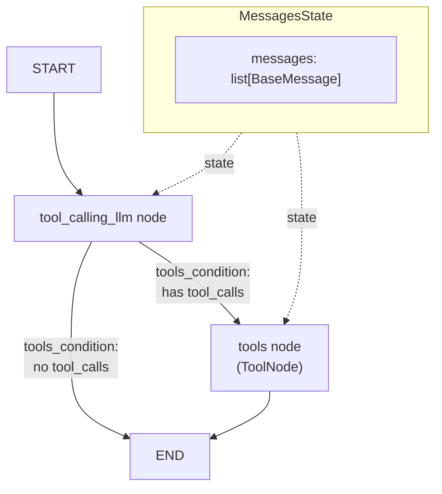
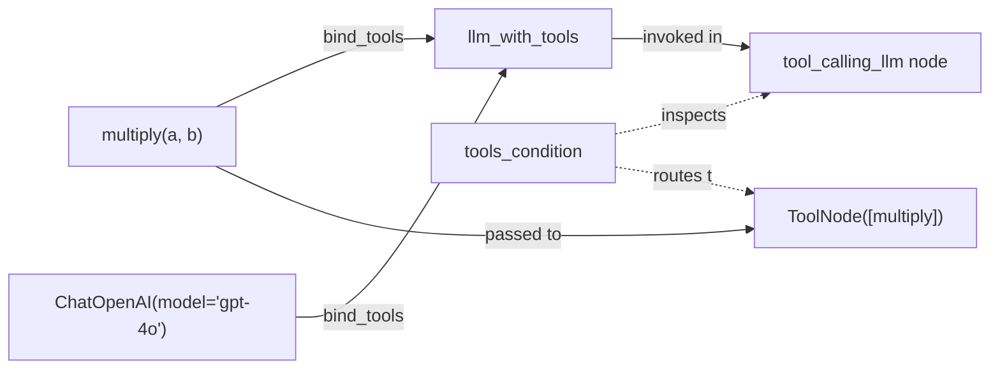
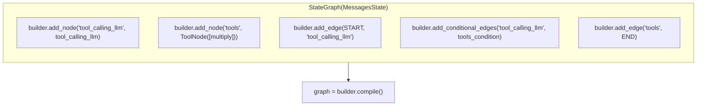
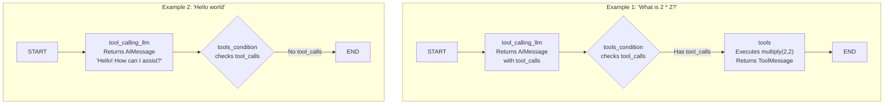

<!-- source: DeepWiki mcp.deepwiki.com · repo langchain-ai/langchain-academy · page 4.3 Router Pattern · fetched 2026-10-26 -->

# Router Pattern

<details>
<summary>Relevant source files</summary>

The following files were used as context for generating this wiki page:

- [module-1/router.ipynb](module-1/router.ipynb)

</details>


## Overview

The Router Pattern demonstrates how a language model can dynamically control execution flow by routing between direct responses and tool calls. This pattern uses `tools_condition` to inspect LLM output and determine whether to execute a tool or terminate the conversation turn. The router serves as a foundational building block for more complex agent architectures described in [Building Agents with LangGraph](#4).

This page covers the Router Pattern implementation, focusing on the `tools_condition` conditional edge, `ToolNode` execution, and graph construction patterns.

## Routing Mechanism

The router enables the LLM to choose between two execution paths:

1. **Direct Response**: Return a natural language message and route to `END`
2. **Tool Call**: Return a tool call message and route to `tools` node

The `tools_condition` function from `langgraph.prebuilt` inspects the most recent message in the state. If it contains tool calls, routing proceeds to the `ToolNode`. Otherwise, execution ends.

### Router Pattern Graph Structure



Sources: [module-1/router.ipynb:16-44](), [module-1/router.ipynb:134-145]()

## Key Components

| Component | Code Entity | Purpose |
|-----------|-------------|---------|
| **State Schema** | `MessagesState` | Contains `messages` list for conversation history |
| **LLM with Tools** | `llm_with_tools = llm.bind_tools([multiply])` | LLM configured to potentially call tools |
| **LLM Node** | `tool_calling_llm(state: MessagesState)` | Node function that invokes LLM and returns response |
| **Tool Execution** | `ToolNode([multiply])` | Prebuilt node that executes tool calls from messages |
| **Conditional Edge** | `tools_condition` | Function that routes based on presence of tool calls |

### Code Entity Relationships



Sources: [module-1/router.ipynb:80-93](), [module-1/router.ipynb:123-136]()

## Graph Construction

The router graph is built using `StateGraph` with `MessagesState` and combines normal edges with conditional edges:



The `add_conditional_edges` call with `tools_condition` creates the routing logic. When `tool_calling_llm` returns:
- Message with `tool_calls`: routes to `"tools"`
- Message without `tool_calls`: routes to `END`

Sources: [module-1/router.ipynb:134-145]()

## Implementation Pattern

### Step 1: Define Tool and Create LLM with Tools

```python
# Tool definition with docstring for LLM
def multiply(a: int, b: int) -> int:
    """Multiply a and b.
    
    Args:
        a: first int
        b: second int
    """
    return a * b

# Bind tool to LLM
llm = ChatOpenAI(model="gpt-4o")
llm_with_tools = llm.bind_tools([multiply])
```

Sources: [module-1/router.ipynb:82-92]()

### Step 2: Define Node Function

The node function invokes the LLM and returns the updated messages:

```python
def tool_calling_llm(state: MessagesState):
    return {"messages": [llm_with_tools.invoke(state["messages"])]}
```

This function:
- Takes `MessagesState` containing conversation history
- Invokes `llm_with_tools` with the message list
- Returns a state update with the LLM's response (which may contain tool calls)

Sources: [module-1/router.ipynb:130-131]()

### Step 3: Build Graph with Conditional Edges

```python
from langgraph.graph import StateGraph, START, END
from langgraph.prebuilt import ToolNode, tools_condition

builder = StateGraph(MessagesState)
builder.add_node("tool_calling_llm", tool_calling_llm)
builder.add_node("tools", ToolNode([multiply]))
builder.add_edge(START, "tool_calling_llm")
builder.add_conditional_edges(
    "tool_calling_llm",
    tools_condition,  # Routes to "tools" or END based on tool_calls
)
builder.add_edge("tools", END)
graph = builder.compile()
```

Sources: [module-1/router.ipynb:123-145]()

## tools_condition Routing Logic

The `tools_condition` function from `langgraph.prebuilt` implements the conditional edge logic. It inspects the last message in the state:

### Routing Behavior

| Condition | Message Type | Route Destination |
|-----------|--------------|-------------------|
| Message has `tool_calls` attribute with calls | `AIMessage` with tool calls | `"tools"` node |
| Message has no tool calls | `AIMessage` without tool calls | `END` |

### Message Flow Example

```mermaid
sequenceDiagram
    participant User
    participant tool_calling_llm
    participant tools_condition
    participant tools
    participant END

    User->>tool_calling_llm: "What is 3 * 4?"
    tool_calling_llm->>tools_condition: AIMessage(tool_calls=[multiply(3, 4)])
    tools_condition->>tools: Route to tools
    tools->>END: ToolMessage(result=12)
    
    User->>tool_calling_llm: "Hello"
    tool_calling_llm->>tools_condition: AIMessage("Hello! How can I help?")
    tools_condition->>END: Route to END
```

The `tools_condition` function checks for the presence of `tool_calls` in the `AIMessage` returned by the LLM. When tool calls exist, the message is routed to the `ToolNode` for execution. The `ToolNode` then executes the tool and appends a `ToolMessage` to the state.

Sources: [module-1/router.ipynb:138-143](), [module-1/router.ipynb:100-103]()

## Execution Example

The compiled graph can be invoked with a message to see the routing in action:

```python
from langchain_core.messages import HumanMessage

# Example 1: Tool call required
messages = [HumanMessage(content="What is 2 multiplied by 2?")]
result = graph.invoke({"messages": messages})
# Result contains: HumanMessage -> AIMessage(tool_calls) -> ToolMessage(result=4)

# Example 2: Direct response
messages = [HumanMessage(content="Hello world.")]
result = graph.invoke({"messages": messages})
# Result contains: HumanMessage -> AIMessage("Hello! How can I assist you today?")
```

### Execution Flow Visualization



Sources: [module-1/router.ipynb:171-176]()

## LangGraph Studio Integration

The router implementation can be visualized and tested in LangGraph Studio. The studio provides graph visualization and execution tracing.

### Setup

1. Navigate to `module-1/studio/` directory
2. Run `langgraph dev` to start local server at `http://127.0.0.1:2024`
3. Open Studio UI at `https://smith.langchain.com/studio/?baseUrl=http://127.0.0.1:2024`
4. Load the `router` graph defined in `module-1/studio/router.py`

The `langgraph.json` configuration file specifies the graph location:
```json
{
  "dependencies": [...],
  "graphs": {
    "router": "./router.py:graph"
  }
}
```

Studio allows interactive testing of the router by sending messages and observing whether the graph routes to the `tools` node or terminates at `END`.

Sources: [module-1/router.ipynb:188-206]()

## Use Cases

The Router Pattern is ideal for:

1. **Simple question-answering systems** that occasionally need to call tools
2. **Calculator-like applications** where mathematical operations may be required
3. **Foundational components** in more complex agent architectures
4. **Prototyping agent behaviors** before building more sophisticated systems

## Related Patterns

The Router Pattern can be used as a building block for more complex patterns:

- **ReAct Pattern**: Extends the router with reasoning and action steps
- **Map-Reduce Pattern**: Uses multiple routers to process and aggregate information
- **Agent Supervision**: Adds human oversight to the routing decisions

For more information on these advanced patterns, see [Advanced Agent Patterns](#7).

Sources: [module-1/router.ipynb:17-37]()

---

