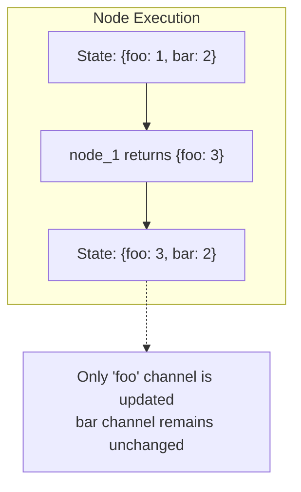
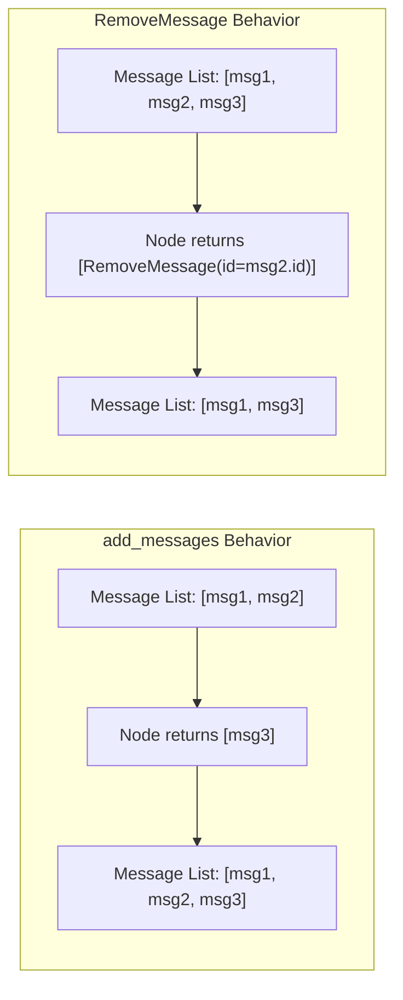
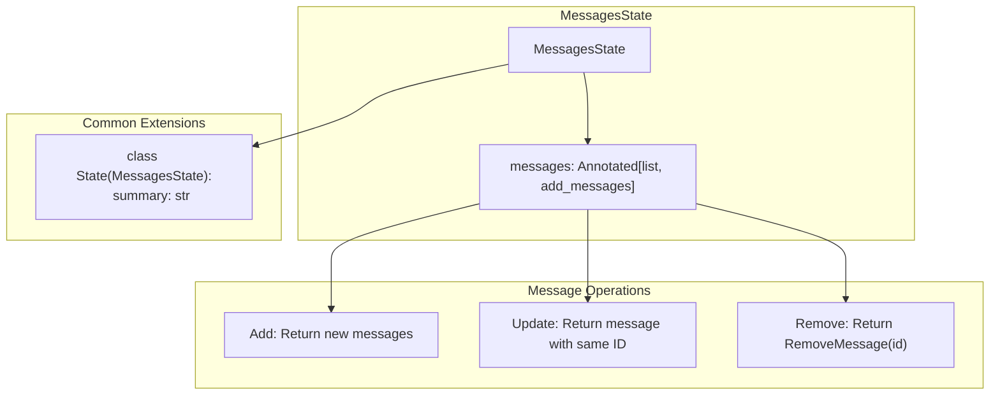
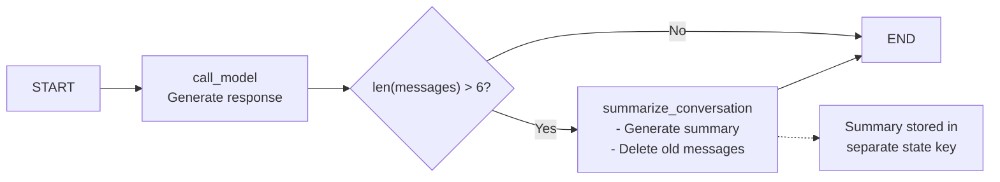
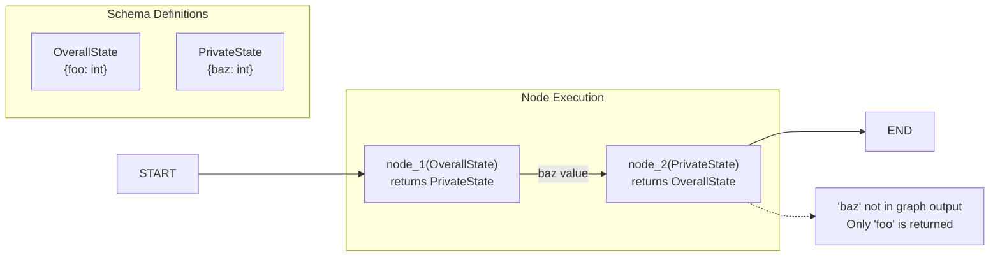
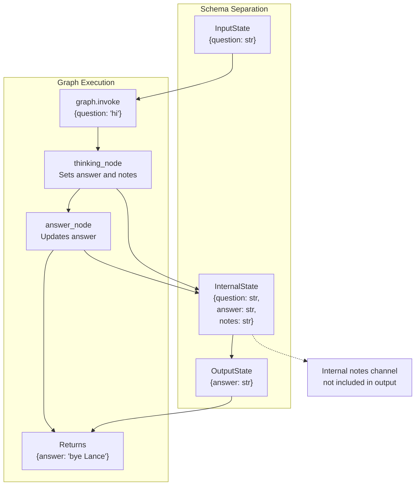
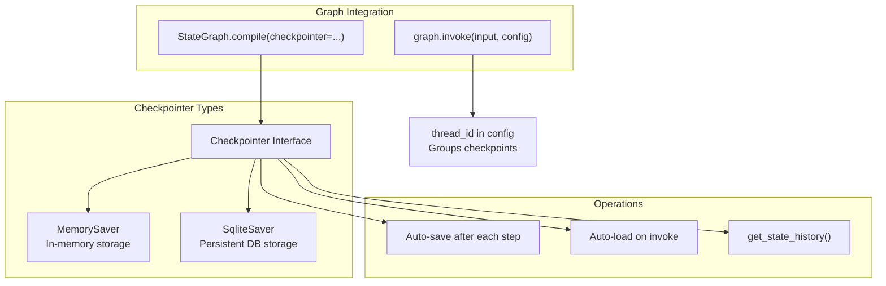
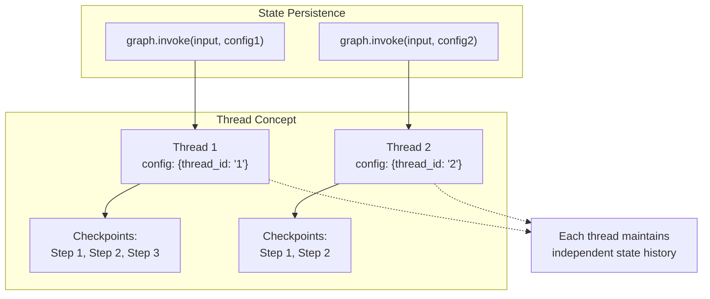

<!-- source: DeepWiki mcp.deepwiki.com · repo langchain-ai/langchain-academy · page 5 State Management · fetched 2026-10-26 -->

# State Management

<details>
<summary>Relevant source files</summary>

The following files were used as context for generating this wiki page:

- [module-2/chatbot-summarization.ipynb](module-2/chatbot-summarization.ipynb)
- [module-2/multiple-schemas.ipynb](module-2/multiple-schemas.ipynb)
- [module-2/state-reducers.ipynb](module-2/state-reducers.ipynb)
- [module-2/state-schema.ipynb](module-2/state-schema.ipynb)
- [module-2/trim-filter-messages.ipynb](module-2/trim-filter-messages.ipynb)

</details>


## Purpose and Scope

This document covers advanced state management techniques in LangGraph, including state schema design, reducer patterns, and persistence strategies. State management is fundamental to building LangGraph applications, as it defines how data flows through the graph, how concurrent updates are merged, and how conversation history is maintained across invocations.

For basic graph construction and agent patterns, see [Building Agents with LangGraph](#4). For human-in-the-loop features that interact with state, see [Human-in-the-Loop Features](#6). For advanced memory systems that build on these state management concepts, see [Memory Systems](#8).

## State Schema Fundamentals

In LangGraph, a state schema defines the structure and types of data that flows through a graph. All nodes communicate through this shared schema, reading from and writing to specific state channels (keys).

### Schema Definition Approaches

LangGraph supports three primary approaches for defining state schemas:

**TypedDict**: The most lightweight approach using Python's `typing` module. Type hints are used for static type checking but are not enforced at runtime.

```python
from typing_extensions import TypedDict

class TypedDictState(TypedDict):
    foo: str
    bar: str
```

**Literal Types**: For constraining values to specific options:

```python
from typing import Literal

class TypedDictState(TypedDict):
    name: str
    mood: Literal["happy", "sad"]
```

**Pydantic**: Provides runtime validation and more sophisticated type constraints:

```python
from pydantic import BaseModel, field_validator

class PydanticState(BaseModel):
    name: str
    
    @field_validator('name')
    @classmethod
    def validate_name(cls, value: str) -> str:
        if value.strip() == "":
            raise ValueError("Name cannot be empty")
        return value
```

Sources: [module-2/state-schema.ipynb:38-111]()

### State as Channels

Each key in the state schema represents a "channel" - a data pathway that nodes can read from and write to. When a node returns a dictionary, it overwrites the values for those specific channels, leaving other channels unchanged.

**State Channel Write Behavior**



Sources: [module-2/state-schema.ipynb:119-187]()

## Reducer Patterns

Reducers define how state updates are merged when multiple writes occur to the same channel. Without a reducer, the default behavior is to overwrite the previous value.

### Built-in Reducers

**add_messages Reducer**: Specialized reducer for managing conversation messages. Handles message addition, updating, and deletion.



The `add_messages` reducer is used with `MessagesState`:

```python
from langgraph.graph import MessagesState

class State(MessagesState):
    # MessagesState includes:
    # messages: Annotated[list, add_messages]
    pass
```

**operator.add Reducer**: For numeric or list concatenation:

```python
from typing import Annotated
import operator

class State(TypedDict):
    count: Annotated[int, operator.add]  # Adds to previous value
    items: Annotated[list, operator.add]  # Concatenates lists
```

Sources: [module-2/state-reducers.ipynb]() (referenced in TOC), [module-2/trim-filter-messages.ipynb:264-276]()

### Custom Reducers

Reducers are functions that take the current value and new value, returning the merged result:

```python
def custom_reducer(current: list, new: list) -> list:
    # Custom merge logic
    return current + new
```

Sources: [module-2/state-reducers.ipynb]() (referenced in TOC)

## Message State Management

`MessagesState` is a specialized state schema for conversational agents, with built-in support for message history management.

### MessagesState Architecture

**MessagesState Components**



Sources: [module-2/chatbot-summarization.ipynb:105-115](), [module-2/trim-filter-messages.ipynb:156-199]()

### Message Filtering and Trimming

Long conversations lead to high token usage and latency. LangGraph provides several strategies for managing message history:

**RemoveMessage Pattern**: Explicitly remove messages by ID after processing:

```python
from langchain_core.messages import RemoveMessage

def summarize_conversation(state: State):
    # Generate summary from messages
    summary = model.invoke(state["messages"])
    
    # Remove all but last 2 messages
    delete_messages = [RemoveMessage(id=m.id) for m in state["messages"][:-2]]
    
    return {
        "summary": summary.content,
        "messages": delete_messages
    }
```

**Trim by Count**: Use `trim_messages` utility (referenced but not shown in detail in provided files).

**Conditional Trimming**: Trigger summarization based on message count:

```python
def should_continue(state: State) -> Literal["summarize_conversation", END]:
    messages = state["messages"]
    
    # If more than 6 messages, summarize
    if len(messages) > 6:
        return "summarize_conversation"
    
    return END
```

Sources: [module-2/chatbot-summarization.ipynb:167-229](), [module-2/trim-filter-messages.ipynb:263-315]()

### Summarization Strategy

**Summarization Graph Pattern**



The summarization node combines summary generation with message removal:

```python
def summarize_conversation(state: State):
    summary = state.get("summary", "")
    
    if summary:
        summary_message = (
            f"This is summary of the conversation to date: {summary}\n\n"
            "Extend the summary by taking into account the new messages above:"
        )
    else:
        summary_message = "Create a summary of the conversation above:"
    
    messages = state["messages"] + [HumanMessage(content=summary_message)]
    response = model.invoke(messages)
    
    # Delete all but 2 most recent messages
    delete_messages = [RemoveMessage(id=m.id) for m in state["messages"][:-2]]
    
    return {"summary": response.content, "messages": delete_messages}
```

Sources: [module-2/chatbot-summarization.ipynb:167-196]()

## Multiple Schema Patterns

LangGraph supports using multiple schemas within a single graph for advanced use cases.

### Private State

Private state allows nodes to pass internal data that isn't exposed in the graph's input/output:

**Private State Pattern**



Type hints specify which schema each node uses:

```python
def node_1(state: OverallState) -> PrivateState:
    return {"baz": state['foo'] + 1}

def node_2(state: PrivateState) -> OverallState:
    return {"foo": state['baz'] + 1}
```

Sources: [module-2/multiple-schemas.ipynb:64-145]()

### Input/Output Schemas

Graphs can define explicit input and output schemas that differ from the internal schema:

**Input/Output Schema Flow**



Input/output schemas perform filtering on what channels are permitted:

```python
class InputState(TypedDict):
    question: str

class InternalState(TypedDict):
    question: str
    answer: str
    notes: str  # Not exposed in output

class OutputState(TypedDict):
    answer: str

# Build with schema separation
graph = StateGraph(InternalState, input=InputState, output=OutputState)
```

Sources: [module-2/multiple-schemas.ipynb:148-245]()

## Persistence and Memory

Persistence allows graphs to maintain state across invocations, enabling long-running conversations and stateful applications.

### Checkpointer Interface

The checkpointer interface provides a pluggable mechanism for state persistence:

**Checkpointer Architecture**



Sources: [module-2/chatbot-summarization.ipynb:236-289](), [module-2/chatbot-external-memory.ipynb]() (referenced in TOC)

### MemorySaver

`MemorySaver` provides in-memory checkpointing for development and testing:

```python
from langgraph.checkpoint.memory import MemorySaver
from langgraph.graph import StateGraph

# Create graph with memory
memory = MemorySaver()
graph = workflow.compile(checkpointer=memory)

# Use with thread_id for conversation grouping
config = {"configurable": {"thread_id": "1"}}
output = graph.invoke({"messages": [input_message]}, config)
```

Sources: [module-2/chatbot-summarization.ipynb:255-289]()

### Thread-Based Conversations

Threads group checkpoints into logical conversation units, analogous to Slack channels:

**Thread Management**



Configuration structure:

```python
# Create thread
config = {"configurable": {"thread_id": "1"}}

# First invocation
output = graph.invoke({"messages": [msg1]}, config)

# Continues from previous state
output = graph.invoke({"messages": [msg2]}, config)

# Access current state
current_state = graph.get_state(config)
summary = current_state.values.get("summary", "")
```

Sources: [module-2/chatbot-summarization.ipynb:297-444]()

### SqliteSaver

`SqliteSaver` provides persistent storage using SQLite, enabling cross-session continuity:

```python
from langgraph.checkpoint.sqlite import SqliteSaver

# Create persistent checkpointer
memory = SqliteSaver.from_conn_string("checkpoints.db")
graph = workflow.compile(checkpointer=memory)

# State persists across Python sessions
config = {"configurable": {"thread_id": "1"}}
output = graph.invoke({"messages": [msg]}, config)
```

The database stores serialized checkpoints with thread isolation, allowing the application to resume conversations after restart.

Sources: [module-2/chatbot-external-memory.ipynb]() (referenced in TOC and Module 2 description)

## State Access and Manipulation

Graphs provide methods to access and modify state outside of normal execution flow.

### State Inspection

```python
# Get current state
state = graph.get_state(config)
print(state.values)  # Access state values
print(state.next)    # Next node(s) to execute

# Get state history
for state in graph.get_state_history(config):
    print(state.values)
```

### State Updates

```python
# Update state programmatically
graph.update_state(
    config,
    {"messages": [new_message]},
    as_node="node_name"  # Optional: attribute update to specific node
)
```

These operations are explored in detail in [Time Travel Debugging](#6.4).

Sources: [module-2/chatbot-summarization.ipynb:390-444](), [module-3/time-travel.ipynb]() (referenced in Module 3)

## Code Entity Reference

| Concept | Primary Code Entity | Location |
|---------|-------------------|----------|
| State Schema | `StateGraph(schema)` | `langgraph.graph.StateGraph` |
| Message State | `MessagesState` | `langgraph.graph.MessagesState` |
| Message Reducer | `add_messages` | `langgraph.graph.add_messages` |
| Message Removal | `RemoveMessage` | `langchain_core.messages.RemoveMessage` |
| Numeric Reducer | `operator.add` | `operator.add` |
| In-Memory Persistence | `MemorySaver` | `langgraph.checkpoint.memory.MemorySaver` |
| SQLite Persistence | `SqliteSaver` | `langgraph.checkpoint.sqlite.SqliteSaver` |
| Thread Configuration | `config["configurable"]["thread_id"]` | Dictionary key path |
| State Access | `graph.get_state(config)` | Method on compiled graph |
| State History | `graph.get_state_history(config)` | Method on compiled graph |
| State Update | `graph.update_state(config, values)` | Method on compiled graph |

Sources: [module-2/chatbot-summarization.ipynb:89-289](), [module-2/multiple-schemas.ipynb:82-115](), [module-2/trim-filter-messages.ipynb:156-315]()

---

