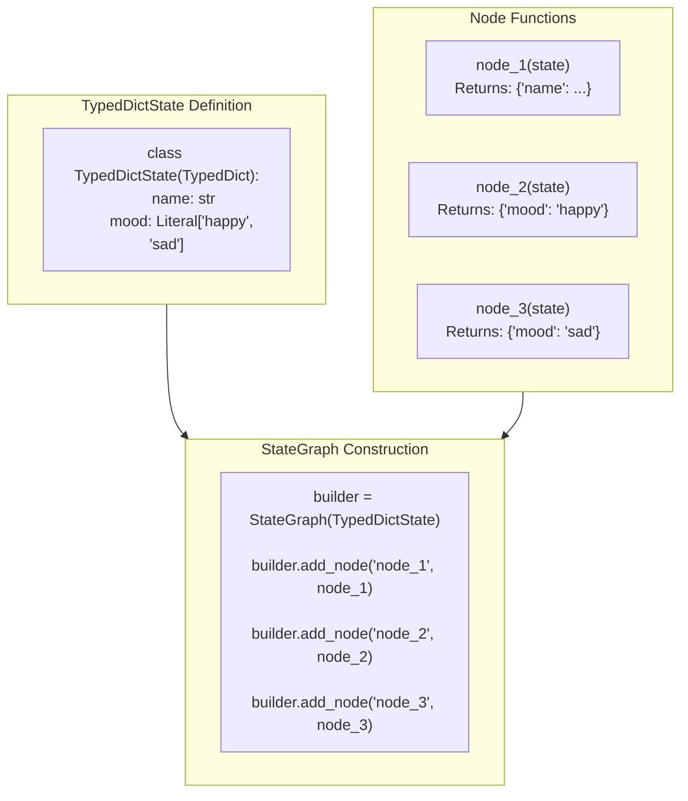
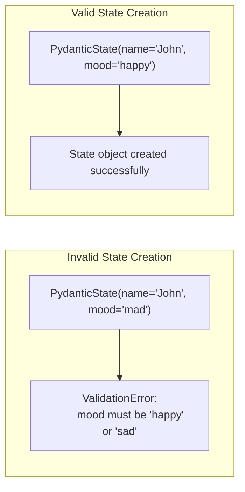
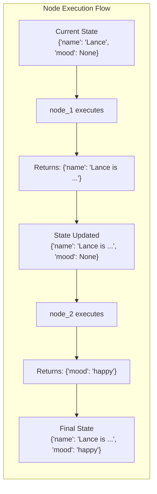
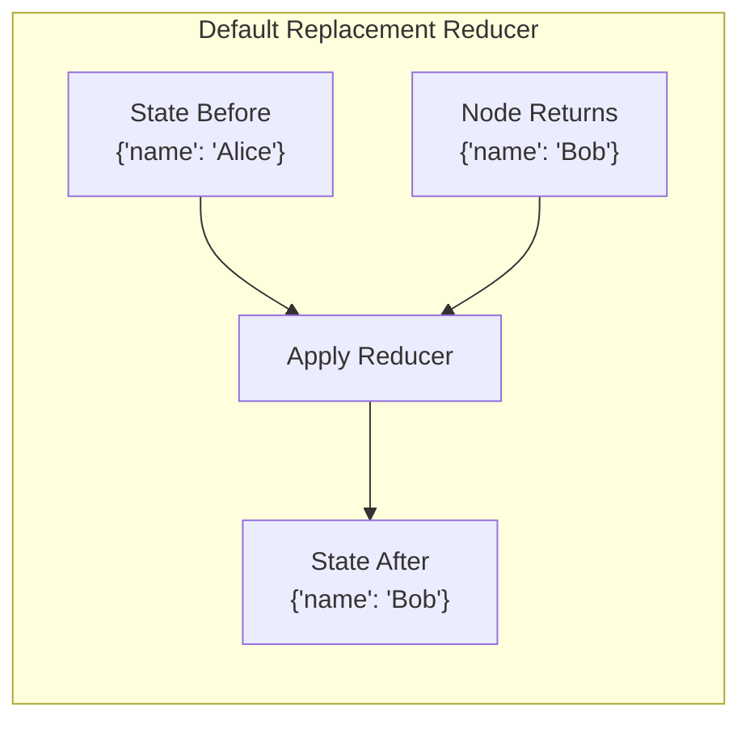
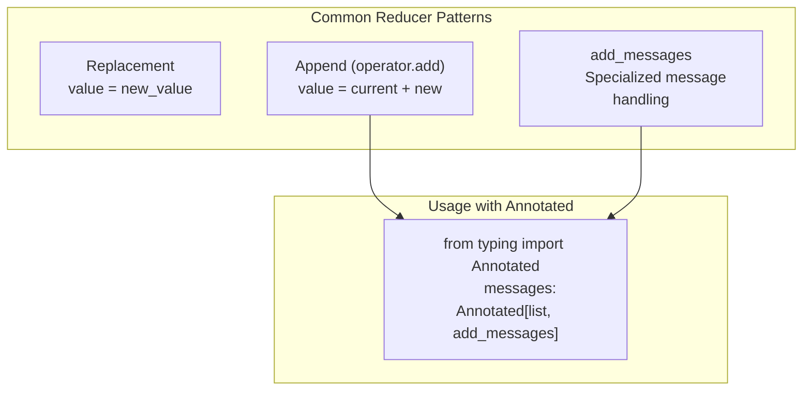
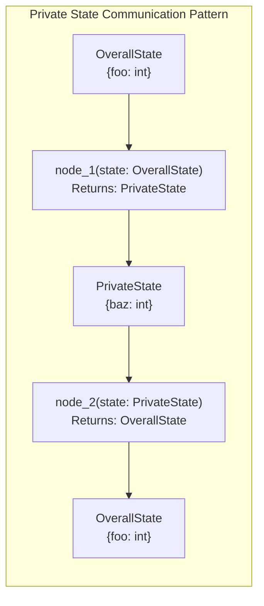
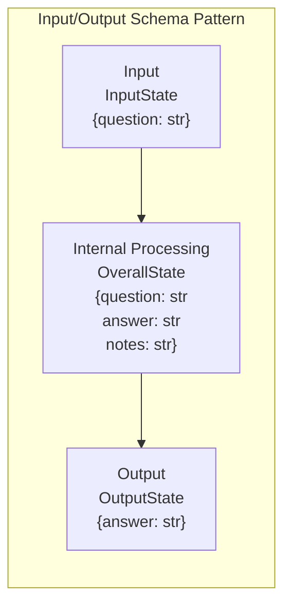
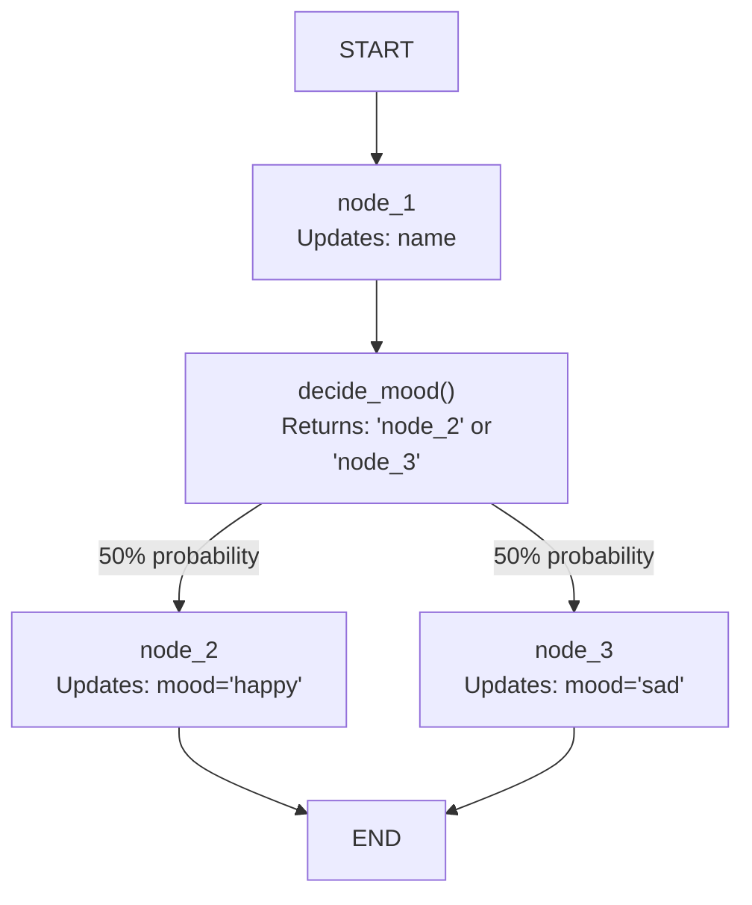

<!-- source: DeepWiki mcp.deepwiki.com · repo langchain-ai/langchain-academy · page 5.1 State Schemas and Reducers · fetched 2026-10-26 -->

# State Schemas and Reducers

<details>
<summary>Relevant source files</summary>

The following files were used as context for generating this wiki page:

- [module-2/multiple-schemas.ipynb](module-2/multiple-schemas.ipynb)
- [module-2/state-reducers.ipynb](module-2/state-reducers.ipynb)
- [module-2/state-schema.ipynb](module-2/state-schema.ipynb)

</details>


## Purpose and Scope

This page explains state schemas and reducers in LangGraph - two fundamental concepts that control how data flows through a graph. You'll learn how to define state schemas, customize state reducers, and apply these concepts to create more sophisticated graph applications. For information about message processing techniques like filtering and summarization, see [Message Handling Techniques](#5.2).

## State Schemas

A state schema defines the structure and types of data that nodes in a graph communicate through. When constructing a `StateGraph`, you provide a schema that all nodes use for reading and updating state.

### Schema Definition Patterns

LangGraph supports three primary patterns for defining state schemas, each with different characteristics:

**Comparison of State Schema Types**

| Schema Type | Runtime Validation | Access Pattern | Use Case |
|-------------|-------------------|----------------|----------|
| `TypedDict` | No | `state["key"]` | Simple dictionary-like state |
| `dataclass` | No | `state.key` | Object-oriented access patterns |
| `BaseModel` (Pydantic) | Yes | `state.key` | Complex validation requirements |

Sources: [module-2/state-schema.ipynb:64-111](), [module-2/state-schema.ipynb:234-251](), [module-2/state-schema.ipynb:385-421]()

### TypedDict Schemas

`TypedDict` from Python's `typing` module provides type hints without runtime enforcement:



Each key in the `TypedDict` defines a "channel" in the graph. Nodes read from state using dictionary access (`state["name"]`) and return dictionaries with keys to update.

Sources: [module-2/state-schema.ipynb:76-187]()

The `Literal` type provides specific value constraints:

```python
from typing import Literal

class TypedDictState(TypedDict):
    name: str
    mood: Literal["happy","sad"]  # Only these two values allowed
```

Sources: [module-2/state-schema.ipynb:99-111]()

### Dataclass Schemas

Python dataclasses provide an alternative schema definition with object-oriented access:

```python
from dataclasses import dataclass

@dataclass
class DataclassState:
    name: str
    mood: Literal["happy","sad"]
```

**Key Differences from TypedDict:**

State Access Pattern:
- TypedDict: `state["name"]`
- Dataclass: `state.name`

State Update Pattern (both):
- Return dictionaries: `{"name": "value"}`

Despite different access patterns, nodes still return dictionaries for updates in both cases. This is because LangGraph stores each key separately and only needs matching attribute names in the returned object.

Sources: [module-2/state-schema.ipynb:232-310]()

### Pydantic Schemas

`BaseModel` from Pydantic provides runtime validation, making it suitable when you need to enforce data constraints:



Example with field validation:

```python
from pydantic import BaseModel, field_validator

class PydanticState(BaseModel):
    name: str
    mood: str
    
    @field_validator('mood')
    @classmethod
    def validate_mood(cls, value):
        if value not in ["happy", "sad"]:
            raise ValueError("mood must be 'happy' or 'sad'")
        return value
```

Unlike `TypedDict` and `dataclass`, Pydantic enforces type constraints at runtime. Attempting to create `PydanticState(name="John", mood="mad")` raises a `ValidationError`.

Sources: [module-2/state-schema.ipynb:385-466]()

### Node Update Pattern

All schema types follow the same update pattern in LangGraph:



Node functions follow this pattern:
1. Receive current state as input
2. Process data using schema-appropriate access pattern
3. Return dictionary with keys to update
4. LangGraph merges returned values into state

The returned dictionary needs only the keys the node wants to modify - unchanged keys are preserved.

Sources: [module-2/state-schema.ipynb:142-224]()

## State Reducers

Reducers control how node outputs combine with existing state. When a node returns a value for a state key, the reducer determines the merge strategy.

### Default Reducer: Replacement

By default, LangGraph uses a replacement strategy - new values overwrite existing values:



This works for scalar values (strings, numbers, booleans) where replacement is the desired behavior.

Sources: Implicit default behavior in [module-2/state-schema.ipynb:76-224]()

### Custom Reducers with Annotated

For complex types like lists, you can specify custom reducers using `Annotated` from the `typing` module:



Example with `operator.add` for list concatenation:

```python
from typing import Annotated
import operator

class State(TypedDict):
    items: Annotated[list, operator.add]  # Appends instead of replaces
```

When a node returns `{"items": [4, 5]}` and the current state has `{"items": [1, 2, 3]}`, the reducer produces `{"items": [1, 2, 3, 4, 5]}`.

The `add_messages` reducer provides specialized behavior for message lists, including support for message deletion and updates by ID.

Sources: Usage demonstrated in [module-2/chatbot-summarization.ipynb:103-115](), message filtering in [module-2/trim-filter-messages.ipynb:254-305]()

### Using RemoveMessage for Message Filtering

When working with message state, LangGraph provides a special `RemoveMessage` type that allows you to filter messages by ID instead of just appending:

```python
def filter_messages(state: MessagesState):
    # Delete all but the 2 most recent messages
    delete_messages = [RemoveMessage(id=m.id) for m in state["messages"][:-2]]
    return {"messages": delete_messages}
```

This is a powerful pattern for managing conversation history in chatbots.

Sources: [module-2/trim-filter-messages.ipynb:282-304]()

## Working with Multiple Schemas

### Private State Pattern

Private state enables nodes to exchange information that isn't part of the graph's public interface:



Implementation example:

```python
class OverallState(TypedDict):
    foo: int

class PrivateState(TypedDict):
    baz: int

def node_1(state: OverallState) -> PrivateState:
    return {"baz": state['foo'] + 1}

def node_2(state: PrivateState) -> OverallState:
    return {"foo": state['baz'] + 1}
```

The type hints indicate which schema each node reads from and writes to. `node_1` reads `OverallState` but returns `PrivateState`, allowing `node_2` to access `baz` without exposing it in the graph's final output.

Sources: [module-2/multiple-schemas.ipynb:63-156]()

### Input/Output Schema Filtering

`StateGraph` supports separate input and output schemas to control the graph's external interface:



Example implementation:

```python
class OverallState(TypedDict):
    question: str
    answer: str
    notes: str

class InputState(TypedDict):
    question: str

class OutputState(TypedDict):
    answer: str

builder = StateGraph(
    OverallState,
    input_schema=InputState,
    output_schema=OutputState
)
```

This pattern enables:
- **Internal state richness**: `OverallState` contains all keys nodes need for processing
- **Input restriction**: Users can only provide `question` 
- **Output filtering**: Graph returns only `answer`, hiding internal `notes`

When invoked, the graph accepts `{"question": "hi"}` and returns `{"answer": "bye Lance"}`, even though internal nodes used `notes` during processing.

Sources: [module-2/multiple-schemas.ipynb:163-329]()

## Building Advanced State Patterns

### Custom State Types

You can extend existing state types to create customized state objects. For example, you can extend the `MessagesState` to include additional fields:

```python
from langgraph.graph import MessagesState

class State(MessagesState):
    summary: str
```

This creates a state that has both the standard `messages` functionality and a custom `summary` field.

Sources: [module-2/chatbot-summarization.ipynb:103-115]()

### State with Memory

State is normally transient within a single graph execution. For conversational applications that need to maintain state between runs, you can use LangGraph's checkpointing functionality:

```python
from langgraph.checkpoint import MemorySaver

# Build graph with memory persistence
memory = MemorySaver()
graph = builder.compile(checkpointer=memory)
```

This allows the graph to:
1. Save the state after each execution
2. Retrieve and resume from the previous state on the next call
3. Support long-running conversations with interruptions

Sources: [module-2/chatbot-summarization.ipynb:235-252]()

## Practical Implementation Examples

### Basic State Schema with Conditional Routing

This example demonstrates `TypedDict` schema with conditional edge routing:



Implementation with type hints and conditional logic:

```python
class TypedDictState(TypedDict):
    name: str
    mood: Literal["happy","sad"]

def node_1(state):
    return {"name": state['name'] + " is ... "}

def node_2(state):
    return {"mood": "happy"}

def node_3(state):
    return {"mood": "sad"}

def decide_mood(state) -> Literal["node_2", "node_3"]:
    return "node_2" if random.random() < 0.5 else "node_3"

builder = StateGraph(TypedDictState)
builder.add_node("node_1", node_1)
builder.add_node("node_2", node_2)
builder.add_node("node_3", node_3)
builder.add_edge(START, "node_1")
builder.add_conditional_edges("node_1", decide_mood)
builder.add_edge("node_2", END)
builder.add_edge("node_3", END)
graph = builder.compile()

result = graph.invoke({"name":"Lance"})
# Returns: {'name': 'Lance is ... ', 'mood': 'happy'} or 
#          {'name': 'Lance is ... ', 'mood': 'sad'}
```

Sources: [module-2/state-schema.ipynb:142-224]()

### Conversation Summarization with Custom State

```python
# Define custom state with summary
class State(MessagesState):
    summary: str

# Define summarizer node
def summarize_conversation(state: State):
    summary = state.get("summary", "")
    # [Summarization logic]
    delete_messages = [RemoveMessage(id=m.id) for m in state["messages"][:-2]]
    return {"summary": response.content, "messages": delete_messages}

# Define conditional logic
def should_continue(state: State):
    if len(state["messages"]) > 6:
        return "summarize_conversation"
    return END
```

This example shows how to create a chatbot that summarizes the conversation history when it gets too long, allowing for efficient long-running conversations without increasing token usage.

Sources: [module-2/chatbot-summarization.ipynb:168-227]()

## Best Practices

1. **Choose the right schema type** for your application:
   - `TypedDict` for simple dictionary-like state
   - `dataclass` for more object-oriented access patterns
   - `MessagesState` for conversation-based applications

2. **Use custom reducers** for complex data types like lists or specialized objects where the default replacement behavior isn't appropriate.

3. **Consider multiple schemas** when you need to:
   - Pass private information between specific nodes
   - Restrict inputs or outputs of your graph
   - Handle different data structures in different parts of your graph

4. **Add persistence** with checkpointers when building applications that need to maintain state across multiple calls.

5. **Use schema type hints** to improve code readability and enable better IDE support, even though they aren't enforced at runtime.

---

