<!-- source: DeepWiki mcp.deepwiki.com · repo langchain-ai/langchain-academy · page 5.2 Message Handling and Summarization · fetched 2026-10-26 -->

# Message Handling and Summarization

<details>
<summary>Relevant source files</summary>

The following files were used as context for generating this wiki page:

- [module-2/chatbot-summarization.ipynb](module-2/chatbot-summarization.ipynb)
- [module-2/trim-filter-messages.ipynb](module-2/trim-filter-messages.ipynb)

</details>


This page documents techniques for managing conversation length in LangGraph applications. Long-running conversations can result in high token usage and increased latency. This page covers three primary approaches: message filtering, message trimming, and LLM-based summarization. For more information about state schemas and reducers, see [State Schemas and Reducers](#5.1).

## The Challenge: Managing Conversation Length

In conversational AI applications, each interaction with the LLM typically includes the full message history to maintain context. However, as conversations grow longer:

- **Token costs increase**: More tokens are consumed with each LLM call
- **Latency increases**: Processing time grows with conversation length
- **Context window limits**: LLMs have maximum token limits
- **Relevance decreases**: Older messages may become less relevant

LangGraph provides three complementary techniques to address these challenges:

| Technique | Modifies State | Retains Context | Best For |
|-----------|----------------|-----------------|----------|
| **Filtering** | No | Partial | Simple use cases with limited history needs |
| **Trimming** | No | Partial | Token-based limits with recent context |
| **Summarization** | Yes | Full | Long conversations requiring complete context |

## MessagesState Foundation

All message handling techniques work with `MessagesState`, which provides the standard schema for storing conversation messages. It contains a `messages` key that holds the list of messages with the `add_messages` reducer.

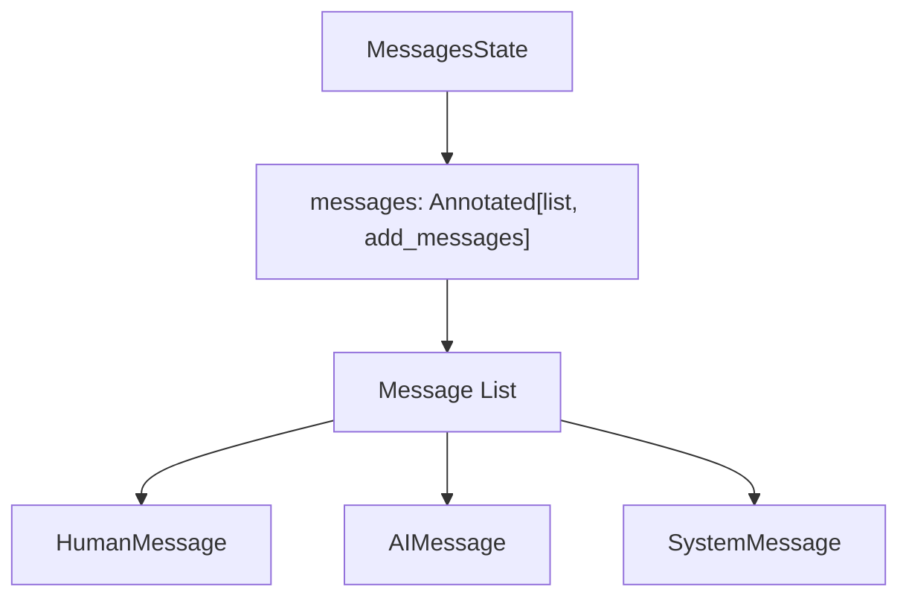

Sources: [module-2/trim-filter-messages.ipynb:89-123](), [module-2/chatbot-summarization.ipynb:112-115]()

## Approach 1: Message Filtering

Message filtering allows selective control over which messages are passed to the LLM or retained in state.

### Using RemoveMessage for State Modification

The `RemoveMessage` class enables targeted removal of messages from graph state. The `filter_messages` node uses `RemoveMessage` to delete all but the most recent messages.

**Graph Structure with RemoveMessage**

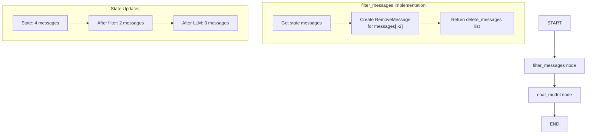

Sources: [module-2/trim-filter-messages.ipynb:266-304]()

**Implementation Details**

The `filter_messages` node creates `RemoveMessage` instances for each message to be deleted, identified by message `id`:

```python
def filter_messages(state: MessagesState):
    # Delete all but the 2 most recent messages
    delete_messages = [RemoveMessage(id=m.id) for m in state["messages"][:-2]]
    return {"messages": delete_messages}
```

This modifies the graph state directly, reducing both storage and processing overhead.

Sources: [module-2/trim-filter-messages.ipynb:286-289]()

### Direct Filtering Without State Modification

An alternative approach filters messages only during the LLM invocation, keeping full history in state.

**Direct Filtering Flow**

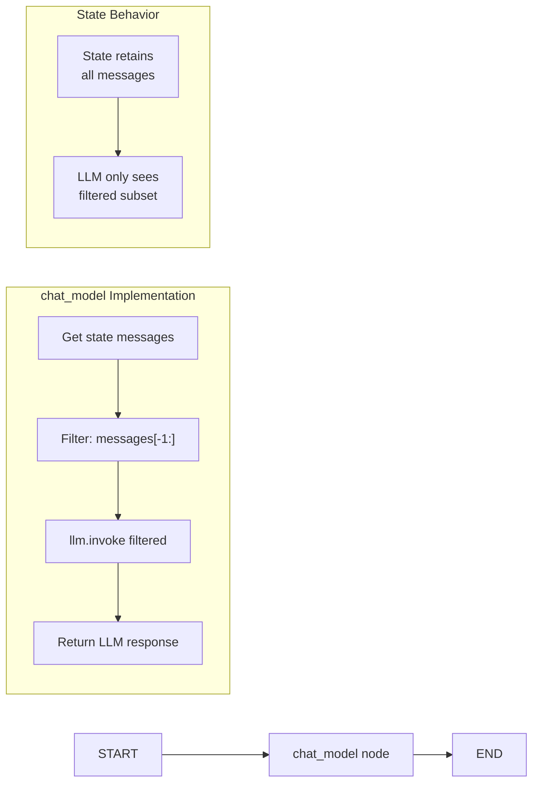

Sources: [module-2/trim-filter-messages.ipynb:373-403]()

**Implementation Details**

The `chat_model` node filters messages before invoking the LLM:

```python
def chat_model_node(state: MessagesState):
    return {"messages": [llm.invoke(state["messages"][-1:])]}
```

This approach is useful when you want to maintain a complete audit trail in state while limiting what the LLM processes.

Sources: [module-2/trim-filter-messages.ipynb:391-392]()

**Comparison: State Modification vs. Direct Filtering**

| Aspect | RemoveMessage (State Modification) | Direct Filtering |
|--------|-----------------------------------|------------------|
| State Size | Reduced | Full history maintained |
| Implementation | Separate filter node | In chat_model node |
| Use Case | Long-term conversations | Audit trails, debugging |
| Complexity | Higher (two nodes) | Lower (one node) |

Sources: [module-2/trim-filter-messages.ipynb:266-584]()

## Approach 2: Message Trimming

Message trimming uses token counting to limit conversation length, providing more precise control than simple message filtering.

### Token-Based Trimming with trim_messages

The `trim_messages` function from `langchain_core.messages` limits messages based on token count rather than message count.

**Trimming Configuration**

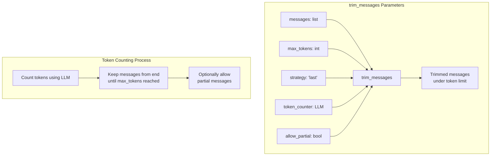

Sources: [module-2/trim-filter-messages.ipynb:615-654]()

**Implementation in Graph**

The `chat_model_node` applies trimming before invoking the LLM:

```python
def chat_model_node(state: MessagesState):
    messages = trim_messages(
        state["messages"],
        max_tokens=100,
        strategy="last",
        token_counter=ChatOpenAI(model="gpt-4o"),
        allow_partial=False,
    )
    return {"messages": [llm.invoke(messages)]}
```

Sources: [module-2/trim-filter-messages.ipynb:635-643]()

**Trimming Example**

Given a conversation with 7 messages totaling 500 tokens, with `max_tokens=100`:

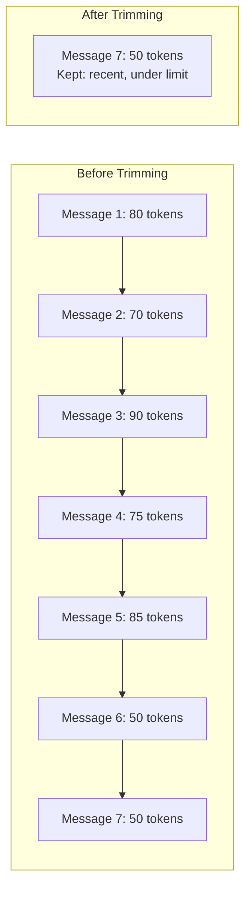

Only the most recent message that fits within the token limit is retained.

Sources: [module-2/trim-filter-messages.ipynb:669-692]()

**Key Parameters**

| Parameter | Purpose | Example Values |
|-----------|---------|----------------|
| `max_tokens` | Maximum token count | 100, 1000, 4000 |
| `strategy` | Which messages to keep | "last" (most recent) |
| `token_counter` | LLM for counting tokens | `ChatOpenAI(model="gpt-4o")` |
| `allow_partial` | Allow incomplete messages | `True`, `False` |

Setting `allow_partial=False` ensures only complete messages are included, preventing mid-message truncation.

Sources: [module-2/trim-filter-messages.ipynb:603-650]()

## Approach 3: LLM-Based Summarization

LLM-based summarization compresses conversation history while retaining semantic context, making it ideal for long conversations where earlier context remains relevant.

### Summary-Enhanced State Schema

To support summarization, extend `MessagesState` with a `summary` field:

**Custom State Schema**

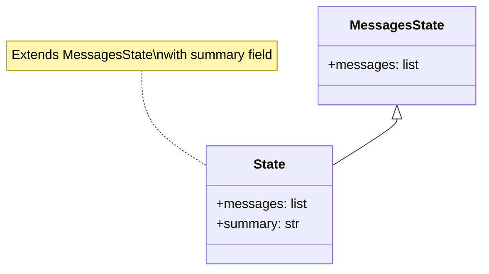

Sources: [module-2/chatbot-summarization.ipynb:112-115]()

**Implementation**

```python
from langgraph.graph import MessagesState

class State(MessagesState):
    summary: str
```

The `summary` field stores the compressed conversation history as a string.

Sources: [module-2/chatbot-summarization.ipynb:113-114]()

### Summarization Process

The `summarize_conversation` node generates a summary and removes old messages:

**Summarization Node Flow**

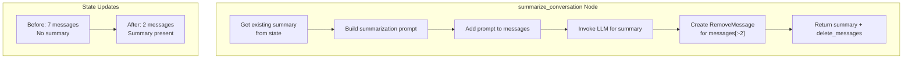

Sources: [module-2/chatbot-summarization.ipynb:173-196]()

**Implementation Details**

```python
def summarize_conversation(state: State):
    # Get any existing summary
    summary = state.get("summary", "")
    
    # Create summarization prompt
    if summary:
        summary_message = (
            f"This is summary of the conversation to date: {summary}\n\n"
            "Extend the summary by taking into account the new messages above:"
        )
    else:
        summary_message = "Create a summary of the conversation above:"
    
    # Generate new summary
    messages = state["messages"] + [HumanMessage(content=summary_message)]
    response = model.invoke(messages)
    
    # Delete all but the 2 most recent messages
    delete_messages = [RemoveMessage(id=m.id) for m in state["messages"][:-2]]
    return {"summary": response.content, "messages": delete_messages}
```

Key aspects:
- Extends existing summary if present
- Uses LLM to compress conversation history
- Removes old messages to prevent state growth
- Maintains 2 most recent messages for immediate context

Sources: [module-2/chatbot-summarization.ipynb:173-196]()

### Using Summary in Conversation

The `call_model` node incorporates the summary when present:

**Model Invocation with Summary**

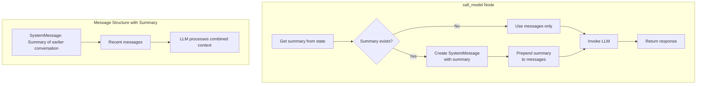

Sources: [module-2/chatbot-summarization.ipynb:132-153]()

**Implementation**

```python
def call_model(state: State):
    # Get summary if it exists
    summary = state.get("summary", "")
    
    # If there is summary, add it
    if summary:
        system_message = f"Summary of conversation earlier: {summary}"
        messages = [SystemMessage(content=system_message)] + state["messages"]
    else:
        messages = state["messages"]
    
    response = model.invoke(messages)
    return {"messages": response}
```

This approach provides full conversation context to the LLM while keeping token usage manageable.

Sources: [module-2/chatbot-summarization.ipynb:132-153]()

### Conditional Summarization Trigger

Use conditional edges to trigger summarization based on conversation length:

**Graph with Conditional Summarization**

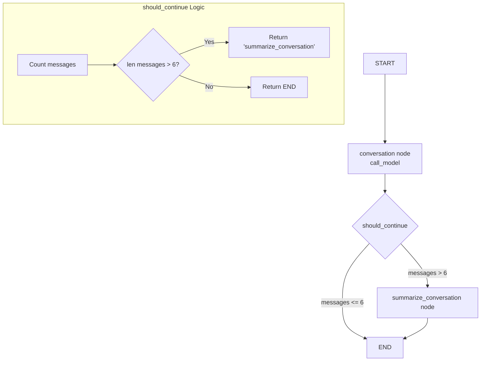

Sources: [module-2/chatbot-summarization.ipynb:208-229]()

**Implementation**

```python
def should_continue(state: State) -> Literal["summarize_conversation", END]:
    """Return the next node to execute."""
    messages = state["messages"]
    
    # If there are more than six messages, then we summarize the conversation
    if len(messages) > 6:
        return "summarize_conversation"
    
    # Otherwise we can just end
    return END
```

This automatically manages conversation length without manual intervention.

Sources: [module-2/chatbot-summarization.ipynb:217-228]()

## Memory Integration with MemorySaver

All message handling techniques work with LangGraph's checkpointing system for persistent conversations.

### Compiling with MemorySaver

The `MemorySaver` checkpointer enables conversations to persist across multiple invocations:

**Graph Compilation with Memory**

```mermaid
flowchart TD
    subgraph "Graph Setup"
        gs1["Build StateGraph"] --> gs2["Add nodes"]
        gs2 --> gs3["Add edges"]
        gs3 --> gs4["Compile with\nMemorySaver"]
    end
    
    subgraph "Runtime Behavior"
        rb1["First Invocation"] --> rb2["Save state checkpoint"]
        rb2 --> rb3["Second Invocation\n(same thread_id)"]
        rb3 --> rb4["Load previous checkpoint"]
        rb4 --> rb5["Continue conversation"]
    end
    
    subgraph "MemorySaver Implementation"
        mi1["MemorySaver"] --> mi2["In-memory storage"]
        mi2 --> mi3["Key-value store\nby thread_id"]
    end
```

Sources: [module-2/chatbot-summarization.ipynb:254-288]()

**Implementation**

```python
from langgraph.checkpoint.memory import MemorySaver
from langgraph.graph import StateGraph, START

# Define graph
workflow = StateGraph(State)
workflow.add_node("conversation", call_model)
workflow.add_node(summarize_conversation)
workflow.add_edge(START, "conversation")
workflow.add_conditional_edges("conversation", should_continue)
workflow.add_edge("summarize_conversation", END)

# Compile with checkpointer
memory = MemorySaver()
graph = workflow.compile(checkpointer=memory)
```

The `checkpointer=memory` parameter enables automatic state persistence.

Sources: [module-2/chatbot-summarization.ipynb:271-287]()

### Thread-Based Conversation Management

Conversations are organized into threads using `thread_id` in the configuration:

**Thread Configuration Usage**

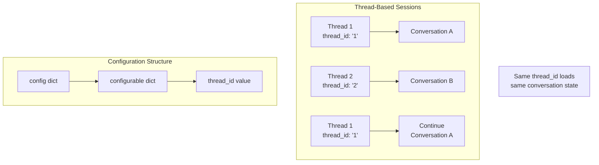

Sources: [module-2/chatbot-summarization.ipynb:297-310]()

**Implementation**

```python
# Create a thread
config = {"configurable": {"thread_id": "1"}}

# First interaction
input_message = HumanMessage(content="hi! I'm Lance")
output = graph.invoke({"messages": [input_message]}, config)

# Continue same conversation
input_message = HumanMessage(content="what's my name?")
output = graph.invoke({"messages": [input_message]}, config)
```

The same `thread_id` ensures the conversation context is maintained across invocations.

Sources: [module-2/chatbot-summarization.ipynb:336-347]()

### Accessing State History

Use `get_state` to inspect the current conversation state:

**State Inspection**

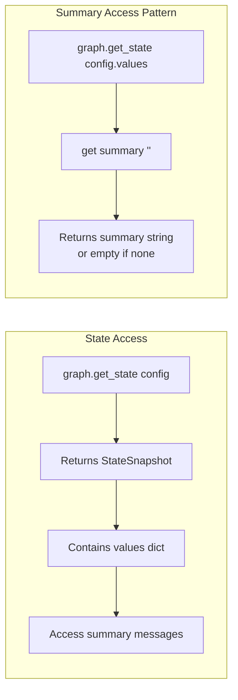

Sources: [module-2/chatbot-summarization.ipynb:390-391](), [module-2/chatbot-summarization.ipynb:442-443]()

**Implementation**

```python
# Check summary in state
summary = graph.get_state(config).values.get("summary", "")
```

This allows inspection of the summarized conversation history at any point.

Sources: [module-2/chatbot-summarization.ipynb:391]()

## Complete Summarization System

The following diagram shows a complete chatbot implementation with summarization and memory:

**Full Chatbot Architecture with Summarization**

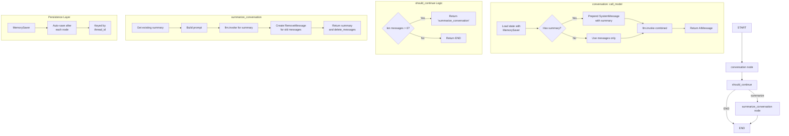

Sources: [module-2/chatbot-summarization.ipynb:254-288]()

**Key Components**

| Component | Implementation | Purpose |
|-----------|----------------|---------|
| `State` class | Extends `MessagesState` + `summary: str` | Stores summary and messages |
| `call_model` node | Prepends summary to messages if present | Provides full context to LLM |
| `summarize_conversation` node | Uses LLM to create summary, removes old messages | Compresses history |
| `should_continue` edge | Checks `len(messages) > 6` | Triggers summarization |
| `MemorySaver` checkpointer | Saves state after each step | Enables persistence |
| `thread_id` config | Identifies conversation thread | Organizes sessions |

Sources: [module-2/chatbot-summarization.ipynb:1-455]()

## Summary

Message handling techniques in LangGraph provide powerful ways to manage conversation flows, control token usage, and optimize performance. By using techniques like filtering, trimming, summarization, and memory integration, you can build efficient conversational applications that maintain context while minimizing computational overhead.

The table below summarizes the key message handling techniques:

| Technique | Purpose | When to Use |
|-----------|---------|------------|
| RemoveMessage | Remove specific messages from state | When you want to selectively trim history |
| Direct Filtering | Filter messages during LLM call | When you want to keep full history in state |
| Private State | Pass data between nodes without exposing it | For intermediate processing |
| Input/Output Schema | Control graph inputs and outputs | For cleaner APIs |
| Summarization | Compress conversation history | For long conversations requiring context |
| Checkpointing | Add memory to conversations | For stateful interactions that can be interrupted |

By combining these techniques, you can create sophisticated conversation flows that balance context retention with computational efficiency.

---

