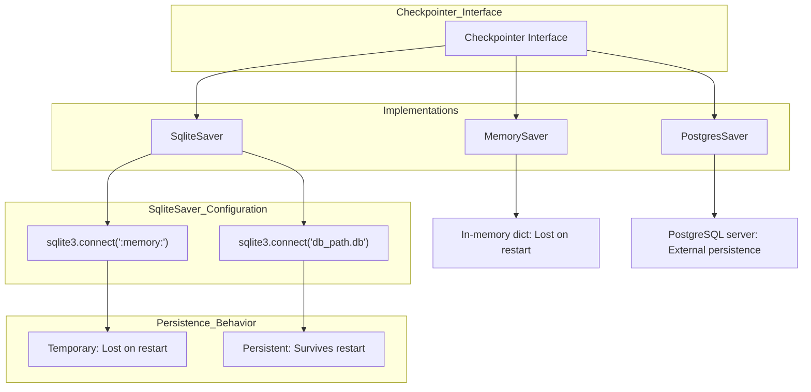
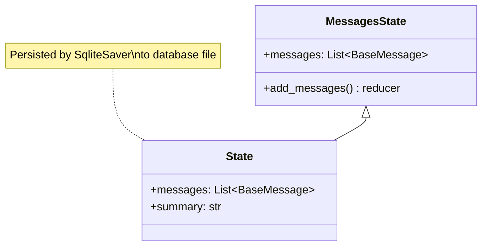
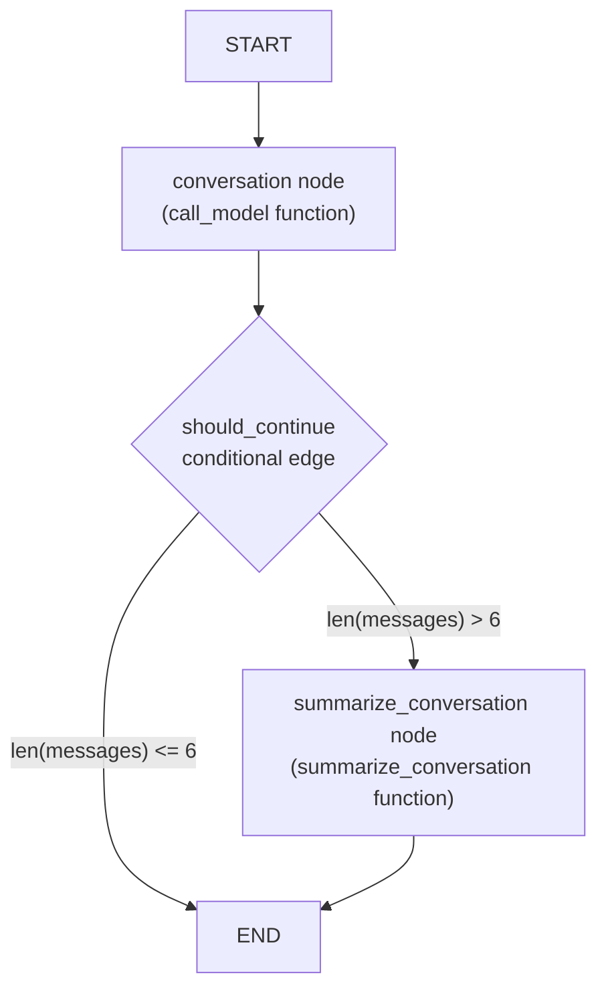
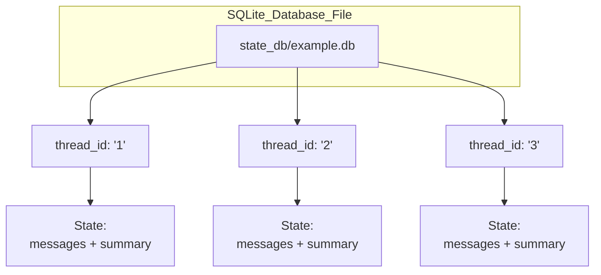
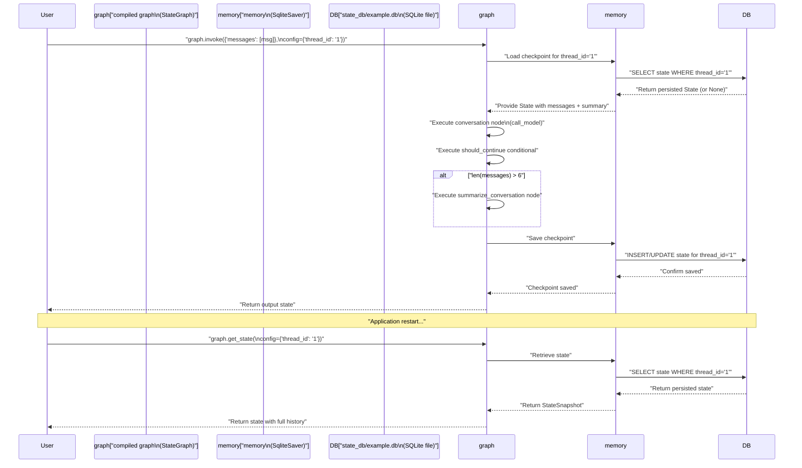

<!-- source: DeepWiki mcp.deepwiki.com · repo langchain-ai/langchain-academy · page 5.3 External Memory with SqliteSaver · fetched 2026-10-26 -->

# External Memory with SqliteSaver

<details>
<summary>Relevant source files</summary>

The following files were used as context for generating this wiki page:

- [module-2/chatbot-external-memory.ipynb](module-2/chatbot-external-memory.ipynb)

</details>


## Overview and Purpose

This document explains how to implement persistent state storage in LangGraph applications using `SqliteSaver`. While `MemorySaver` (covered in page 4.2) stores state only in memory and is lost on application restart, `SqliteSaver` persists conversation state across sessions using SQLite database files.

This builds on concepts from page 5.1 (State Schemas and Reducers) and page 5.2 (Message Handling and Summarization) by adding persistent storage to the state management stack.

Sources: [module-2/chatbot-external-memory.ipynb:15-32]()

## Dependencies

The implementation requires the following packages:

| Package | Purpose |
|---------|---------|
| `langgraph-checkpoint-sqlite` | Provides `SqliteSaver` class |
| `langchain_core` | Core message types (`HumanMessage`, `SystemMessage`, `RemoveMessage`) |
| `langgraph` | `StateGraph`, `MessagesState`, checkpointer interface |
| `langchain_openai` | `ChatOpenAI` LLM integration |

Sources: [module-2/chatbot-external-memory.ipynb:36-44]()

## SqliteSaver Checkpointer

`SqliteSaver` is a checkpointer implementation in LangGraph that persists graph state to SQLite databases. It implements the checkpointer interface that enables:

1. State persistence across application restarts
2. Historical state retrieval via `get_state()` and `get_state_history()`
3. Thread-based conversation management
4. Multi-user conversation isolation

SQLite is an embedded SQL database engine that requires no separate server process, making it suitable for local development and single-machine deployments.



**Diagram: Checkpointer implementations and SqliteSaver connection modes**

Sources: [module-2/chatbot-external-memory.ipynb:67-73](), [module-2/chatbot-external-memory.ipynb:115-120]()

## Setting Up SqliteSaver

`SqliteSaver` requires a `sqlite3.Connection` object for database access. The connection mode determines persistence behavior.

### Connection Modes

| Mode | Connection String | Persistence | Use Case |
|------|------------------|-------------|----------|
| In-memory | `":memory:"` | Lost on restart | Testing, temporary sessions |
| File-based | `"path/to/db.db"` | Survives restart | Production, long-term memory |

### In-Memory Database

Suitable for testing or temporary storage:

```python
import sqlite3
conn = sqlite3.connect(":memory:", check_same_thread=False)
```

The `check_same_thread=False` parameter allows the connection to be used across multiple threads, which is necessary for LangGraph's execution model.

Sources: [module-2/chatbot-external-memory.ipynb:77-85]()

### File-Based Database

For persistent storage that survives application restarts:

```python
import sqlite3
db_path = "state_db/example.db"
conn = sqlite3.connect(db_path, check_same_thread=False)
```

The example notebook downloads a pre-populated database file from the repository for demonstration purposes.

Sources: [module-2/chatbot-external-memory.ipynb:97-107]()

### Creating SqliteSaver Instance

Once the connection is established, instantiate the checkpointer:

```python
from langgraph.checkpoint.sqlite import SqliteSaver
memory = SqliteSaver(conn)
```

This `memory` object implements the checkpointer interface and can be passed to `StateGraph.compile()`.

Sources: [module-2/chatbot-external-memory.ipynb:115-120]()

## Chatbot Implementation with SqliteSaver

The example chatbot demonstrates persistent memory with conversation summarization, building on the patterns from page 5.2.

### State Schema Definition

The `State` class extends `MessagesState` to include a `summary` field for storing conversation summaries:



**Diagram: State schema with summary field for persistent storage**

The `State` class definition:

```python
from langgraph.graph import MessagesState

class State(MessagesState):
    summary: str
```

All fields in `State` (both `messages` and `summary`) are persisted to the SQLite database on each checkpoint.

Sources: [module-2/chatbot-external-memory.ipynb:147-149]()

### Node Functions

The graph consists of three node functions that handle conversation flow and summarization:

#### 1. call_model Node

The `call_model` function invokes the LLM with conversation context, prepending the summary if it exists:

- Retrieves `state.get("summary", "")` to check for existing summary
- If summary exists, prepends `SystemMessage` with summary content
- Invokes `ChatOpenAI` model with message history
- Returns `{"messages": response}` to update state

Sources: [module-2/chatbot-external-memory.ipynb:151-169]()

#### 2. summarize_conversation Node

The `summarize_conversation` function creates or extends the conversation summary:

- Checks for existing summary in `state.get("summary", "")`
- Prompts LLM to create/extend summary based on message history
- Uses `RemoveMessage` to delete all but last 2 messages: `[RemoveMessage(id=m.id) for m in state["messages"][:-2]]`
- Returns `{"summary": response.content, "messages": delete_messages}`

This prevents unbounded message list growth while maintaining conversation context via summary.

Sources: [module-2/chatbot-external-memory.ipynb:171-194]()

#### 3. should_continue Conditional Function

The `should_continue` function routes execution based on message count:

```python
def should_continue(state: State) -> Literal["summarize_conversation", END]:
    messages = state["messages"]
    if len(messages) > 6:
        return "summarize_conversation"
    return END
```

When message count exceeds 6, triggers summarization to condense conversation history.

Sources: [module-2/chatbot-external-memory.ipynb:196-208]()

### Graph Construction and Compilation

The graph is built using `StateGraph` with three nodes and conditional routing:



**Diagram: Graph structure with conversation and summarization nodes**

Sources: [module-2/chatbot-external-memory.ipynb:229-237]()

#### Compilation with SqliteSaver

The critical step is passing the `SqliteSaver` instance to `workflow.compile()`:

```python
from langgraph.graph import StateGraph, START

workflow = StateGraph(State)
workflow.add_node("conversation", call_model)
workflow.add_node(summarize_conversation)
workflow.add_edge(START, "conversation")
workflow.add_conditional_edges("conversation", should_continue)
workflow.add_edge("summarize_conversation", END)

graph = workflow.compile(checkpointer=memory)
```

The `checkpointer=memory` argument connects the compiled graph to the `SqliteSaver` instance, enabling automatic state persistence after each node execution.

Sources: [module-2/chatbot-external-memory.ipynb:229-241]()

## Working with Persisted State

### Thread-Based Conversation Management

LangGraph uses thread IDs to isolate different conversations in the same database. Each thread maintains independent state:



**Diagram: Thread-based state isolation in SqliteSaver**

#### Invoking with Thread Configuration

The `config` dictionary specifies which thread to use:

```python
config = {"configurable": {"thread_id": "1"}}
input_message = HumanMessage(content="hi! I'm Lance")
output = graph.invoke({"messages": [input_message]}, config)
```

Each invocation with the same `thread_id` accesses and updates the same persisted state.

Sources: [module-2/chatbot-external-memory.ipynb:259-276]()

### Retrieving State

The `graph.get_state()` method retrieves the current state snapshot for a thread:

```python
config = {"configurable": {"thread_id": "1"}}
graph_state = graph.get_state(config)
```

Returns a `StateSnapshot` object containing:

| Field | Type | Description |
|-------|------|-------------|
| `values` | `dict` | Current state including `messages` and `summary` |
| `next` | `tuple` | Next nodes to execute (empty if at END) |
| `config` | `dict` | Thread configuration including `thread_id` |
| `metadata` | `dict` | Checkpoint metadata (step count, source, etc.) |
| `parent_config` | `dict` | Previous checkpoint configuration |

Sources: [module-2/chatbot-external-memory.ipynb:288-296]()

### Persistence Across Sessions

File-based SqliteSaver persists state across application restarts. The notebook demonstrates this by noting that state can be retrieved even after restarting the kernel:

```python
# After restarting notebook kernel
config = {"configurable": {"thread_id": "1"}}
graph_state = graph.get_state(config)
# Returns previously saved state from database file
```

This enables:
- Long-term conversation memory
- Crash recovery
- Multi-session user experiences
- Development iteration without losing test data

Sources: [module-2/chatbot-external-memory.ipynb:304-322]()

## Execution Flow with Persistent State

The following sequence shows how SqliteSaver interacts with the graph during execution:



**Diagram: Sequence of SqliteSaver operations during graph execution**

Sources: [module-2/chatbot-external-memory.ipynb:259-322]()

## Checkpointer Comparison

Different checkpointer implementations suit different deployment scenarios:

| Checkpointer | Persistence | Multi-Process | Use Case |
|--------------|-------------|---------------|----------|
| `MemorySaver` | No (lost on restart) | No (single process) | Development, testing |
| `SqliteSaver` | Yes (file-based) | Limited (file locking) | Single-machine production |
| `PostgresSaver` | Yes (database server) | Yes (client-server) | Distributed systems, high scale |

### When to Use SqliteSaver

**Suitable for:**
- Local development with persistent state
- Single-machine deployments
- Applications with moderate concurrency
- Prototypes transitioning to production

**Not suitable for:**
- Distributed systems with multiple application servers
- High-concurrency scenarios requiring connection pooling
- Applications requiring advanced database features

For distributed deployments, migrate to `PostgresSaver` as referenced in the notebook.

Sources: [module-2/chatbot-external-memory.ipynb:30-32]()

## LangGraph Studio Integration

The notebook mentions LangGraph Studio for visual debugging and interaction. Studio can connect to applications using SqliteSaver for state inspection.

To run Studio with the chatbot implementation:

```bash
cd module-2/studio
langgraph dev
```

This starts a local API server that Studio UI can connect to, enabling:
- Graph visualization
- State inspection for specific thread IDs
- Interactive testing with persistent state
- Checkpoint history exploration

See page 9 for detailed Studio usage.

Sources: [module-2/chatbot-external-memory.ipynb:329-347]()

## Summary

SqliteSaver provides a straightforward way to add persistent memory to LangGraph applications. By connecting to a SQLite database, it enables conversation state to persist across sessions, allowing for the creation of chatbots and other applications that can remember previous interactions even after being restarted.

The implementation involves:
1. Setting up a SQLite connection
2. Creating a SqliteSaver instance
3. Compiling a graph with the SqliteSaver as the checkpointer
4. Using thread IDs to manage different conversations

This approach is particularly useful for developing applications that require state persistence without the complexity of setting up external database services.

---

