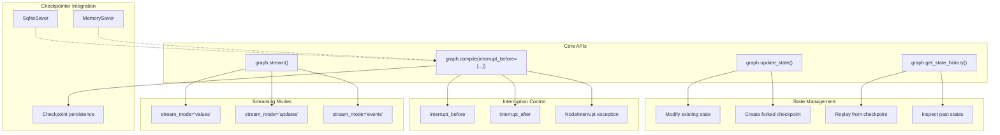
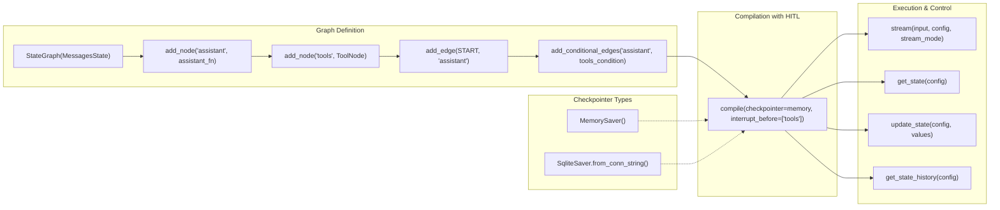
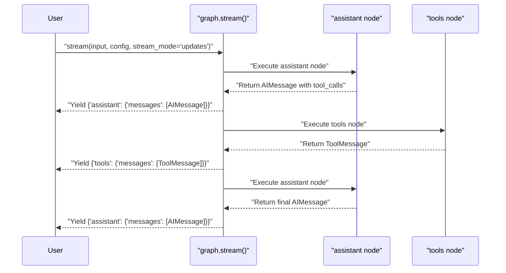

<!-- source: DeepWiki mcp.deepwiki.com · repo langchain-ai/langchain-academy · page 6 Human-in-the-Loop Features · fetched 2026-10-26 -->

# Human-in-the-Loop Features

<details>
<summary>Relevant source files</summary>

The following files were used as context for generating this wiki page:

- [module-3/breakpoints.ipynb](module-3/breakpoints.ipynb)
- [module-3/streaming-interruption.ipynb](module-3/streaming-interruption.ipynb)
- [module-3/time-travel.ipynb](module-3/time-travel.ipynb)

</details>


Human-in-the-Loop (HITL) features in LangGraph enable developers to integrate human interaction, supervision, and feedback into automated agent workflows. Module 3 introduces these capabilities through four key notebooks that demonstrate debugging, monitoring, and intervention patterns.

## Overview of Human-in-the-Loop Capabilities

LangGraph provides several mechanisms for human intervention in agent workflows:

1. **Streaming** ([page 6.3](#6.3)) - Real-time monitoring with `stream()` method using `values`, `updates`, or `events` modes
2. **Breakpoints** ([page 6.1](#6.1)) - Pause execution at specific nodes using `interrupt_before` or `interrupt_after` parameters
3. **State Editing** ([page 6.2](#6.2)) - Modify state during execution with `update_state()` method
4. **Time Travel** ([page 6.4](#6.4)) - View, replay, and fork execution using `get_state_history()` method

**Architectural Overview**



Sources: [module-3/streaming-interruption.ipynb:16-29](), [module-3/breakpoints.ipynb:16-28](), [module-3/edit-state-human-feedback.ipynb:16-29](), [module-3/time-travel.ipynb:16-36]()

## Motivations for Human Intervention

Human-in-the-loop capabilities serve three primary purposes in agent systems:

1. **Approval** - Interrupt agent execution, surface state to a human user, and allow approval or rejection of tool calls or actions before they execute
2. **Debugging** - Rewind and replay graph execution to reproduce or avoid issues, inspect intermediate states, and understand execution flow
3. **Editing** - Modify agent state to correct errors, provide guidance, or explore alternative execution paths

**Use Case Mapping**

| Capability | Primary Use Case | Key Method | Module 3 Notebook |
|------------|------------------|------------|-------------------|
| Streaming | Real-time monitoring of agent behavior | `graph.stream()` | [streaming-interruption.ipynb]() |
| Breakpoints | Tool call approval before execution | `interrupt_before` | [breakpoints.ipynb]() |
| State Editing | Correcting agent mistakes or providing feedback | `graph.update_state()` | [edit-state-human-feedback.ipynb]() |
| Time Travel | Debugging and replaying execution from past states | `graph.get_state_history()` | [time-travel.ipynb]() |

Sources: [module-3/time-travel.ipynb:16-37](), [module-3/breakpoints.ipynb:16-28](), [module-3/edit-state-human-feedback.ipynb:16-29]()

## Component Architecture

**StateGraph with Checkpointer**



Sources: [module-3/streaming-interruption.ipynb:79-188](), [module-3/breakpoints.ipynb:76-134](), [module-3/time-travel.ipynb:76-172]()

## Streaming for Real-Time Monitoring

Streaming provides real-time visibility into graph execution. LangGraph supports three streaming modes via the `stream_mode` parameter:

| Stream Mode | Returns | Use Case |
|-------------|---------|----------|
| `values` | Full state after each node | Displaying complete conversation history |
| `updates` | Only state changes from each node | Efficient monitoring of deltas |
| `events` | Low-level events including token streaming | Token-by-token LLM output for chat UIs |

**Streaming Execution Pattern**



For token-by-token streaming from LLM calls within nodes, use `stream_mode="events"` with `.astream_events()` method and filter for `on_chat_model_stream` events. See [page 6.3](#6.3) for detailed streaming patterns.

Sources: [module-3/streaming-interruption.ipynb:47-314](), [module-3/streaming-interruption.ipynb:318-775]()

## Breakpoints for Human Approval

Breakpoints pause execution at specific nodes, allowing human review before proceeding. Configure breakpoints using the `interrupt_before` or `interrupt_after` parameters in `compile()`:

```python
# Interrupt before tools node executes
graph = builder.compile(
    checkpointer=memory,
    interrupt_before=["tools"]
)
```

When a breakpoint is hit:
1. `graph.stream()` returns control without executing the interrupted node
2. Call `graph.get_state(config)` to inspect current state and `next` node(s)
3. Optionally call `graph.update_state(config, values)` to modify state
4. Resume execution by calling `graph.stream(None, config)` again

Nodes can also dynamically interrupt themselves by raising `NodeInterrupt` exception. See [page 6.1](#6.1) for detailed breakpoint patterns including the `human_feedback` node pattern.

Sources: [module-3/breakpoints.ipynb:16-28](), [module-3/edit-state-human-feedback.ipynb:16-29]()

## State Editing During Execution

The `graph.update_state()` method modifies state at any checkpoint, enabling human feedback and corrections:

```python
# Modify state at current checkpoint
new_config = graph.update_state(
    config,
    {"messages": [HumanMessage(content="Modified input")]}
)
```

Key behaviors:
- Returns new `RunnableConfig` with updated `checkpoint_id`
- Creates a new checkpoint preserving the old one (time travel enabled)
- Can modify message history using message IDs to overwrite specific messages
- When resuming with `stream(None, new_config)`, graph executes from modified state

See [page 6.2](#6.2) for detailed state editing patterns including the `human_feedback` node pattern and message ID-based overwrites.

Sources: [module-3/edit-state-human-feedback.ipynb:16-29](), [module-3/time-travel.ipynb:605-628]()

## Time Travel Debugging

Time travel enables viewing, replaying, and forking execution from past checkpoints:

```python
# Get all past states
states = [s for s in graph.get_state_history(config)]

# Replay from a past state
for event in graph.stream(None, past_state.config, stream_mode="values"):
    # Graph re-executes from that checkpoint
    pass

# Fork from a past state with modified input
fork_config = graph.update_state(
    past_state.config,
    {"messages": [HumanMessage(content="Different input", id=original_msg_id)]}
)
for event in graph.stream(None, fork_config):
    # Graph executes new path from fork point
    pass
```

Each `StateSnapshot` from `get_state_history()` contains:
- `values`: Complete state at that checkpoint
- `config`: Contains `thread_id` and `checkpoint_id` for replay/fork
- `next`: Node(s) scheduled for next execution
- `metadata`: Step number, writes made, etc.

See [page 6.4](#6.4) for detailed time travel patterns.

Sources: [module-3/time-travel.ipynb:232-782]()

## Thread and Checkpoint Configuration

All HITL features operate through the `RunnableConfig` object containing thread and checkpoint identifiers:

```python
# Configuration structure
config = {
    "configurable": {
        "thread_id": "1",              # Isolates conversations
        "checkpoint_id": "abc123..."   # Specific checkpoint for replay/fork
    }
}
```

**Thread Isolation**: Different `thread_id` values create independent execution contexts. Each thread maintains its own checkpoint history.

**Checkpoint Identifiers**: The `checkpoint_id` is automatically assigned by the checkpointer after each node execution. Use it to replay or fork from specific execution points.

Sources: [module-3/streaming-interruption.ipynb:231-237](), [module-3/time-travel.ipynb:213-222]()

## LangGraph Studio Integration

LangGraph Studio provides a visual interface for HITL features via the `langgraph_sdk` client. Studio runs locally with `langgraph dev` and connects to `http://127.0.0.1:2024`:

```python
from langgraph_sdk import get_client

client = get_client(url="http://127.0.0.1:2024")

# Create thread
thread = await client.threads.create()

# Stream execution
async for chunk in client.runs.stream(
    thread["thread_id"],
    assistant_id="agent",
    input=initial_input,
    stream_mode="updates"
):
    # Process streamed updates
    pass

# Access state history
states = await client.threads.get_history(thread["thread_id"])

# Replay from checkpoint
async for chunk in client.runs.stream(
    thread["thread_id"],
    assistant_id="agent",
    input=None,
    checkpoint_id=past_state["checkpoint_id"]
):
    pass
```

Studio UI provides graph visualization, state inspection, and interactive debugging at `https://smith.langchain.com/studio/?baseUrl=http://127.0.0.1:2024`.

Sources: [module-3/time-travel.ipynb:783-811](), [module-3/time-travel.ipynb:822-1342]()

## Best Practices

When implementing human-in-the-loop features:

1. **Checkpoint Management**: Use appropriate checkpoint handlers for your needs (MemorySaver for development, SqliteSaver for persistence)

2. **Thread Isolation**: Use thread IDs to isolate different conversations and execution paths

3. **Selective Interruption**: Only interrupt at critical decision points to avoid overwhelming human operators

4. **Meaningful State Display**: Format state information for easy human comprehension

5. **Efficient Streaming**: Choose the appropriate stream mode based on UI needs

6. **Idempotent Node Design**: Design nodes that can be replayed predictably

7. **User Experience**: Provide clear context and options for human decision-making

Sources: [module-3/time-travel.ipynb:16-37]()

## Conclusion

Human-in-the-loop features in LangGraph provide powerful mechanisms for integrating human judgment, supervision, and feedback into agent workflows. These capabilities are essential for building reliable, safe, and effective agent systems, especially in contexts where high-stakes decisions are being made or where agent behavior needs to be closely monitored and guided.

Through time travel, breakpoints, state editing, and streaming, developers can create agent systems that combine the efficiency of automation with the judgment and oversight of human operators.

For more detailed information on specific features, see the following related pages:
- [Time Travel Debugging](#6.1)
- [Breakpoints and Interruptions](#6.2)
- [Streaming and State Editing](#6.3)

---

