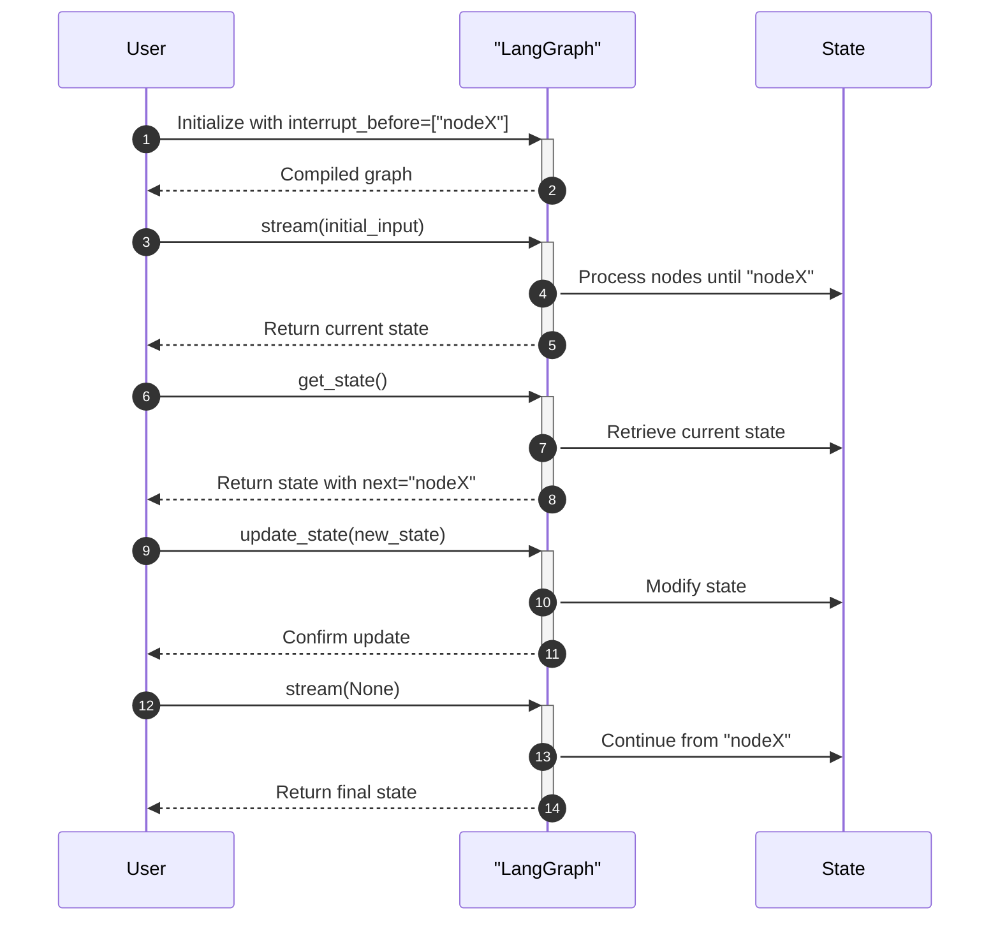
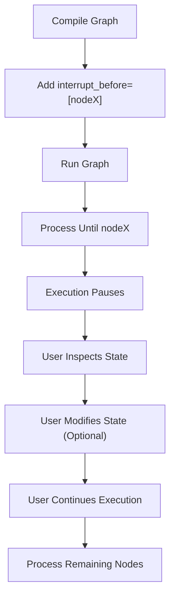
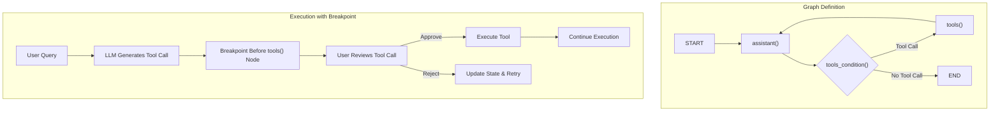
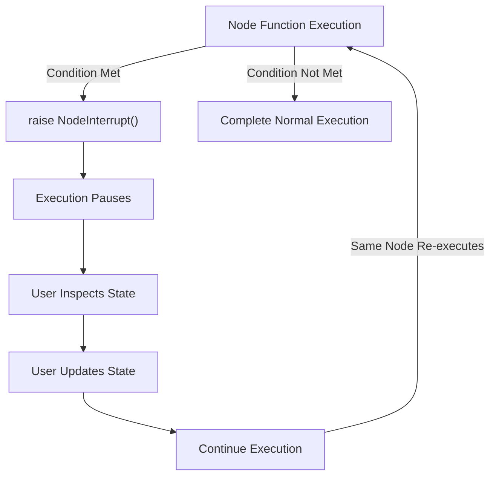
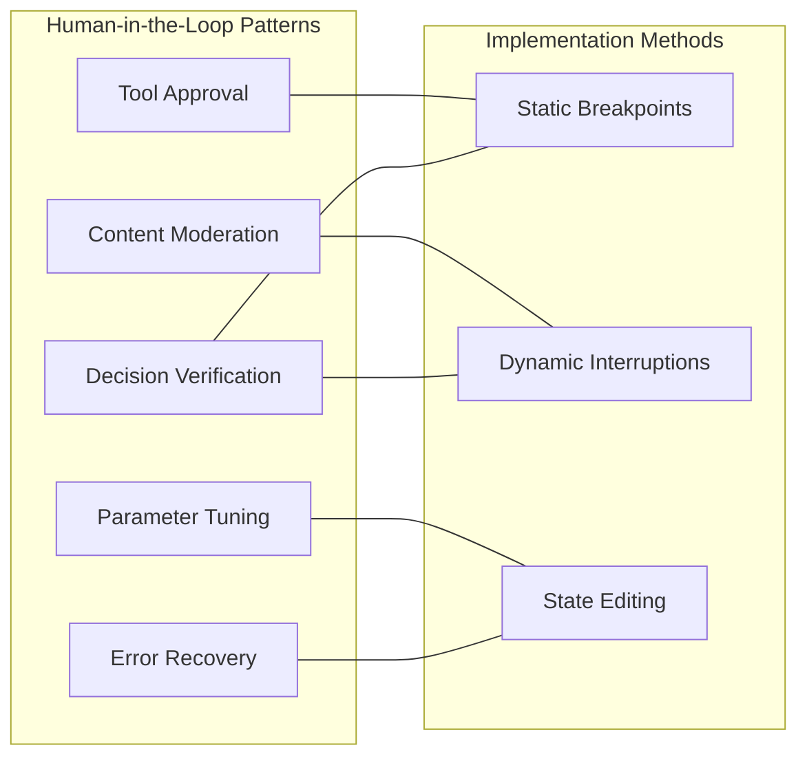

<!-- source: DeepWiki mcp.deepwiki.com · repo langchain-ai/langchain-academy · page 6.1 Breakpoints and Interruptions · fetched 2026-10-26 -->

# Breakpoints and Interruptions

<details>
<summary>Relevant source files</summary>

The following files were used as context for generating this wiki page:

- [module-3/breakpoints.ipynb](module-3/breakpoints.ipynb)

</details>


## Purpose and Overview

This document describes the breakpoint and interruption mechanisms in LangGraph that enable human-in-the-loop workflows. LangGraph provides two main methods for pausing graph execution:

1. **Static Breakpoints**: Pre-defined points where execution will pause before specific nodes
2. **Dynamic Interruptions**: Runtime-determined pauses raised by conditional logic within nodes

These features support three key use cases:
- **Approval**: Allowing users to review and approve actions (like tool calls) before execution
- **Debugging**: Examining state during execution to identify and fix issues 
- **Editing**: Modifying state during pauses to influence subsequent execution

For information about streaming and state editing, see [Streaming and State Editing](#6.3).

## Graph Execution Flow with Breakpoints



Sources: [module-3/breakpoints.ipynb:72-90]()

## Static Breakpoints

Static breakpoints are defined during graph compilation using the `interrupt_before` parameter, which takes a list of node names where execution should pause.

### Implementation



Sources: [module-3/breakpoints.ipynb:178-178]()

### Example: Tool Call Approval

A common use case is to add a breakpoint before a tool execution node, allowing a user to approve or reject the tool call:



In this pattern:
1. The user submits a query
2. The LLM generates a tool call
3. Execution pauses before the tool node runs
4. The user reviews the proposed tool call
5. If approved, execution continues; if not, the state can be modified

Sources: [module-3/breakpoints.ipynb:90-123](), [module-3/breakpoints.ipynb:144-178]()

### Basic Usage

Here's how breakpoints work in practice:

1. **Add breakpoint during compilation**:
   ```python
   graph = builder.compile(interrupt_before=["tools"], checkpointer=memory)
   ```

2. **Run until the breakpoint**:
   ```python
   for event in graph.stream(initial_input, thread, stream_mode="values"):
       # Process events until breakpoint is reached
   ```

3. **Check state and next node**:
   ```python
   state = graph.get_state(thread)
   next_node = state.next  # Returns node name where execution paused
   ```

4. **Continue execution**:
   ```python
   for event in graph.stream(None, thread, stream_mode="values"):
       # Continue execution from breakpoint
   ```

Sources: [module-3/breakpoints.ipynb:178-182](), [module-3/breakpoints.ipynb:246-249](), [module-3/breakpoints.ipynb:297-300]()

## Dynamic Interruptions

While static breakpoints are defined at compile time, dynamic interruptions allow for conditional pausing based on runtime logic within node functions.

### The NodeInterrupt Mechanism



Dynamic interruptions use the `NodeInterrupt` exception class, which can be raised anywhere within a node function to pause execution.

Sources: [module-3/dynamic-breakpoints.ipynb:91-102]()

### Implementation Example

```python
def some_node(state):
    if condition_requiring_human_input(state):
        raise NodeInterrupt("Reason for interruption")
    # Normal processing continues if condition not met
```

This is particularly useful for:
- Conditional approvals based on dynamic content
- Handling edge cases that require human judgment
- Providing explanatory messages about why execution paused

Sources: [module-3/dynamic-breakpoints.ipynb:92-97]()

### State Handling with NodeInterrupt

When a `NodeInterrupt` is raised:

1. Execution stops and the current state is saved
2. The node that raised the interrupt remains as the next node to execute
3. The interrupt reason is stored in the state's tasks
4. When execution resumes, the same node will run again unless state is modified

This is important to understand: without modifying the state, the same `NodeInterrupt` will be raised repeatedly when execution resumes. This design ensures that the condition causing the interruption is addressed.

Sources: [module-3/dynamic-breakpoints.ipynb:201-207](), [module-3/dynamic-breakpoints.ipynb:222-226]()

## Human-in-the-Loop Implementation Patterns

Breakpoints and interruptions enable several human-in-the-loop patterns:



### Tool Call Approval Pattern

The most common pattern is tool call approval:

1. Configure a breakpoint before the tools node
2. When the LLM generates a tool call, execution pauses
3. The user reviews the proposed action
4. If approved, continue execution without changes
5. If rejected, modify the state to prevent the tool call

Sources: [module-3/breakpoints.ipynb:359-369]()

### Dynamic Validation Pattern

For conditional checks:

1. Implement logic in a node to evaluate content
2. Raise `NodeInterrupt` when human review is needed
3. Include explanatory message in the interrupt
4. User reviews and modifies state if needed
5. Continue execution with modified state

Sources: [module-3/dynamic-breakpoints.ipynb:91-102]()

## Integration with LangGraph SDK

Both breakpoint types are supported in the LangGraph SDK:

### Static Breakpoints via SDK

```python
async for chunk in client.runs.stream(
    thread_id,
    assistant_id="agent",
    input=initial_input,
    stream_mode="values",
    interrupt_before=["tools"],  # Specify breakpoints here
):
    # Process stream events
```

Sources: [module-3/breakpoints.ipynb:457-469]()

### Dynamic Breakpoints via SDK

When a `NodeInterrupt` is raised in a graph running in LangGraph Studio:

1. The run is paused
2. The exception message is available in the state
3. You can use the SDK to modify the state
4. Resume execution with `input=None`

Sources: [module-3/dynamic-breakpoints.ipynb:367-375](), [module-3/dynamic-breakpoints.ipynb:404-419]()

## Practical Implementation

### State Inspection and Modification

During a breakpoint, you can:

1. **Get the current state**:
   ```python
   state = graph.get_state(thread)
   ```

2. **Check the next node to run**:
   ```python
   next_node = state.next  # Returns tuple of node names
   ```

3. **Check for interrupts**:
   ```python
   tasks = state.tasks  # Contains interrupt information
   ```

4. **Modify state**:
   ```python
   graph.update_state(thread, new_state)
   ```

5. **Continue execution**:
   ```python
   for event in graph.stream(None, thread, stream_mode="values"):
       # Execution continues
   ```

Sources: [module-3/breakpoints.ipynb:246-249](), [module-3/dynamic-breakpoints.ipynb:179-181](), [module-3/dynamic-breakpoints.ipynb:206-207]()

### User Approval Implementation

Here's a basic pattern for implementing user approval:

```python
# Run until breakpoint
for event in graph.stream(initial_input, thread, stream_mode="values"):
    # Display state to user
    print(event)

# Get user feedback
user_approval = input("Do you want to continue? (yes/no): ")

if user_approval.lower() == "yes":
    # Continue execution
    for event in graph.stream(None, thread, stream_mode="values"):
        print(event)
else:
    # Modify state or cancel operation
    print("Operation cancelled by user.")
```

Sources: [module-3/breakpoints.ipynb:358-369]()

## Best Practices

1. **Choose the right interruption type**:
   - Use static breakpoints for predictable approval points
   - Use dynamic interruptions for conditional checks

2. **Provide context in interruptions**:
   - Include clear messages in `NodeInterrupt` exceptions
   - Display relevant state information to users

3. **Always check the next node**:
   - Verify `state.next` to confirm where execution paused
   - Check `state.tasks` for interrupt details

4. **Handle resumption properly**:
   - For dynamic interrupts, ensure state changes address the interrupt condition
   - Pass `None` as input when resuming execution

5. **Use checkpointing**:
   - Always include a checkpointer (like `MemorySaver`) when using breakpoints
   - This ensures state is preserved between interruptions

Sources: [module-3/breakpoints.ipynb:177-178](), [module-3/dynamic-breakpoints.ipynb:114-117]()

## Summary

Breakpoints and interruptions are powerful mechanisms for implementing human-in-the-loop workflows in LangGraph. They allow for:

- Pre-defined pause points using `interrupt_before`
- Dynamic, conditional pauses using `NodeInterrupt`
- State inspection and modification during pauses
- Seamless continuation of execution

These features enable important use cases like approval workflows, content moderation, and interactive debugging that make AI systems more controllable and transparent.

---

